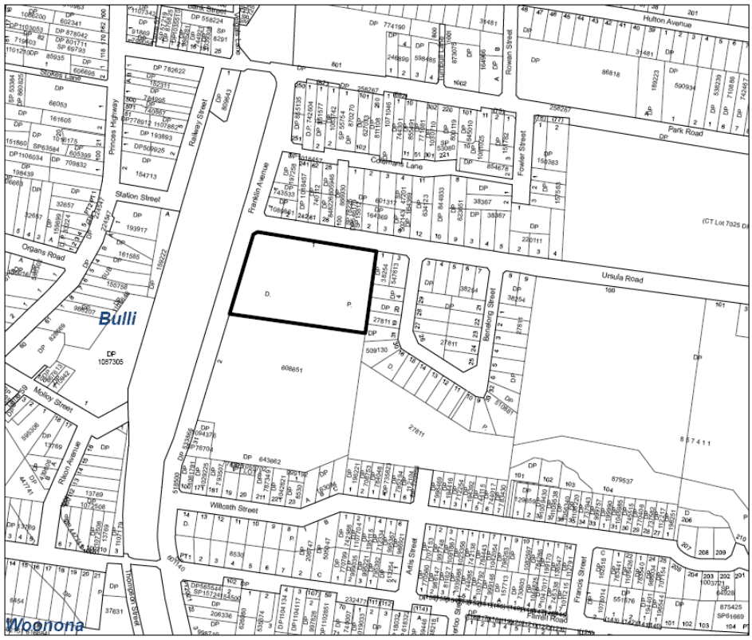

## 2 LAND TO WHICH THIS PLAN APPLIES

1\. This precinct plan applies to Lot 1, DP 608651 located on the south-eastern corner of the intersection of Franklin Avenue and Ursula Road, Bulli, as shown in Figure 1 below.

> [Picture on page 3: a picture, saved as a picture (images/chapter-d4-bulli-franklin-avenue-page-3-13.gif, 150 dpi).]

#### Figure 1: Land to which this plan applies
