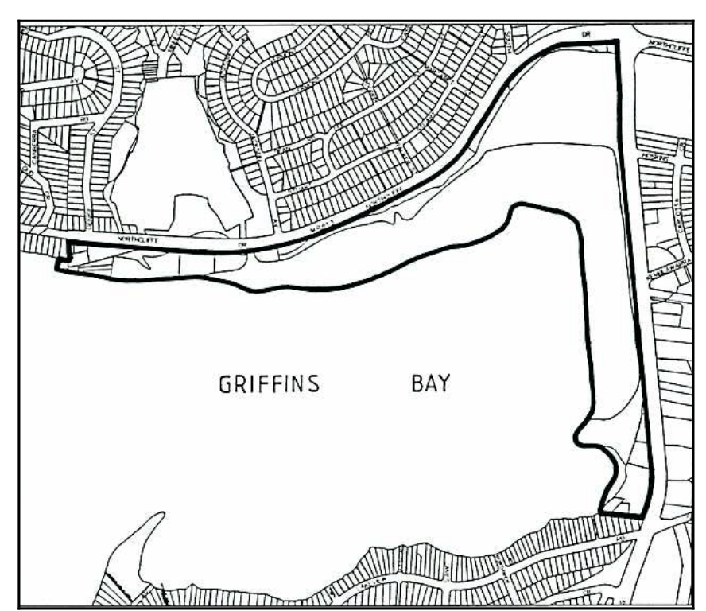

## 2 LAND TO WHICH THIS DCP APPLIES

1\. This precinct plan applies to the foreshores of Lake Illawarra, south of Northcliffe Drive and west of King Street, Warrawong. This area is known as Griffins Bay and is shown in Figure 1 below.

> [Picture on page 3: a picture, saved as a picture (images/chapter-d5-griffins-bay-page-3-16.gif, 150 dpi).]

#### Figure 1: Land to which this DCP applies
