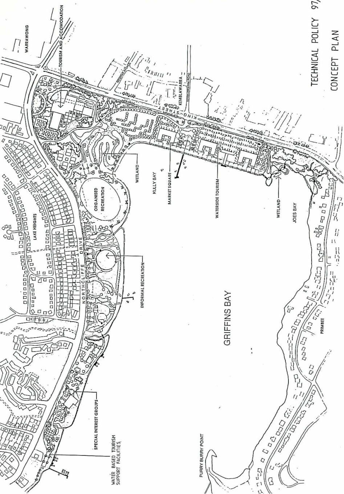

## 4 APPROVAL PROCESS

### 4.1 Developer obtains LIA consent to lodge development

1\. The potential lessee must become familiar with the requirements of the guidelines, preparing sufficient information for the LIA to form an opinion on the general nature, character and scale of the development, prior to giving its consent (as owner of the land vested in the Authority) to lodge a development application to Council.

2\. Submissions: At this stage, the LIA’s consent is limited to its role only as a landowner not as a consent authority for works. It should be noted that the relevant owners consent will also be required to lodge a development application relating to land not vested in the LIA.

### 4.2 Developer lodges Development Application and subsequent

### Construction Certificate Application

1\. This involves preparing a development application in accordance with Wollongong City Council’s requirements and obtaining its consent to the proposed development. If Council ultimately grants development consent to the proposed development, the applicant / developer would need to obtain a Construction Certificate application from a Principal Certifying Authority or Wollongong City Council.

### 4.3 Developer obtains LIA to carry out work

1\. Once all other approvals are obtained the developer then seeks the consent of the LIA to carry out work on land under its statutory jurisdiction in accordance with the requirements of Clause 14 of the LIA Act 1987. Information required to be submitted by the developer with the application required for consent will include a copy of the approved development and building applications and any associated conditions. Once consent is given by the LIA (which may be conditions) the developer can proceed with construction.

2\. This process is independent of any negotiation the LIA and the developer may have relating to the leasing of the land the subject of development approval and consents.

> [Picture on page 5: a picture, saved as a picture (images/chapter-d5-griffins-bay-page-5-1.gif, 150 dpi).]

Figure 2: Concept plan
