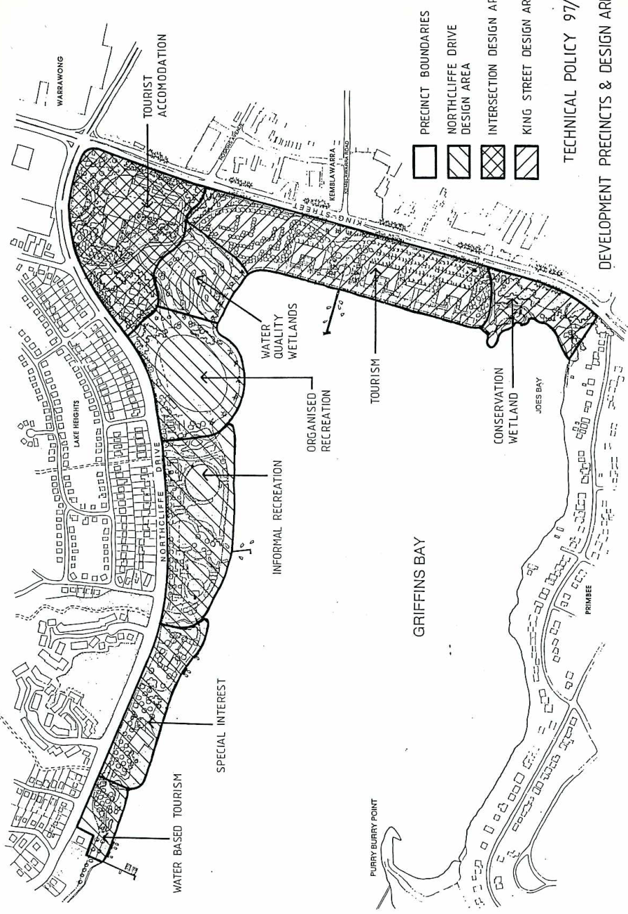

## 5 DEVELOPMENT PRECINCTS AND DESIGN AREAS

1\. The Griffins Bay area has been divided into eight development precincts according to proposed land use. The subject precincts are grouped into 3 areas for urban design and landscape purposes and are shown in Figure 3.

| DESIGN AREA | DEVELOPMENT PRECINCT | PREFERRED LAND USES | INDICATIVE DEVELOPMENT |
|---|---|---|---|
| Northcliffe Drive Area | Water based Tourism Support Facilities Precincts Special interest Group Precinct Informal Recreation Precinct Organised Recreation Precinct Wetland (Water Quality) Precinct | Boating uses support facilities Club houses and associated amenities Passive and informal recreation Formal Recreation Wetland established | Wetland and dry boat repair, mooring for charter recreation, vessels and house boats, servicing and victual supply and refuelling facilities, access roads and parking Club houses, access road, parking areas, outside amenity areas directly associated with club facilities, public access maintained to foreshore areas. Parks, landscaping, walking/cycle paths. Playing fileds for organised sport, associated facilities (amenities block, parking…). Water pollution control point and associated stormwater quality improvement facilities, boardwalks, nature oriented recreation/ education access road. |
| Intersection Area | Tourism Accommodation Precinct | Accommodation | Motels, restaurants, related commercial entertainment, tavern, retain and recreation, access road and parking. |
| King Street Area | Waterside Tourism Precinct Wetland (Conservation) Precinct | Waterside tourism and related commercial development Wetland Conservation Improvements | Restaurants, cafes, milk cars, outdoor eating facilities, fishing and boating supplies, boat hire, public wharf, tavern, recreation facilities, ancillary commercial and retail uses, access roads and parking. Wetland/ sedge land restoration, interpretive/ education centre, boardwalks, nature orientated and associated facilities. |

> [Picture on page 7: a picture, saved as a picture (images/chapter-d5-griffins-bay-page-7-1.gif, 150 dpi).]

#### Figure 3: Development Precincts and Design Areas
