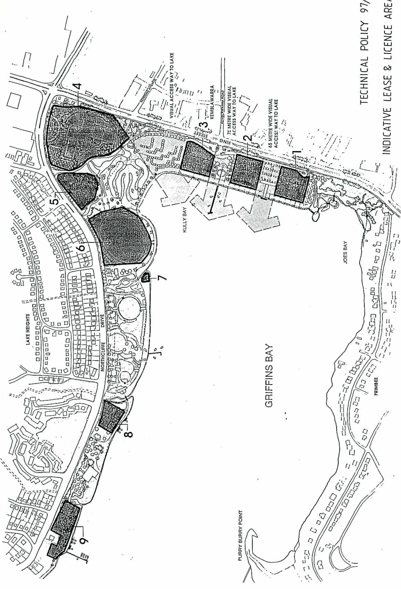
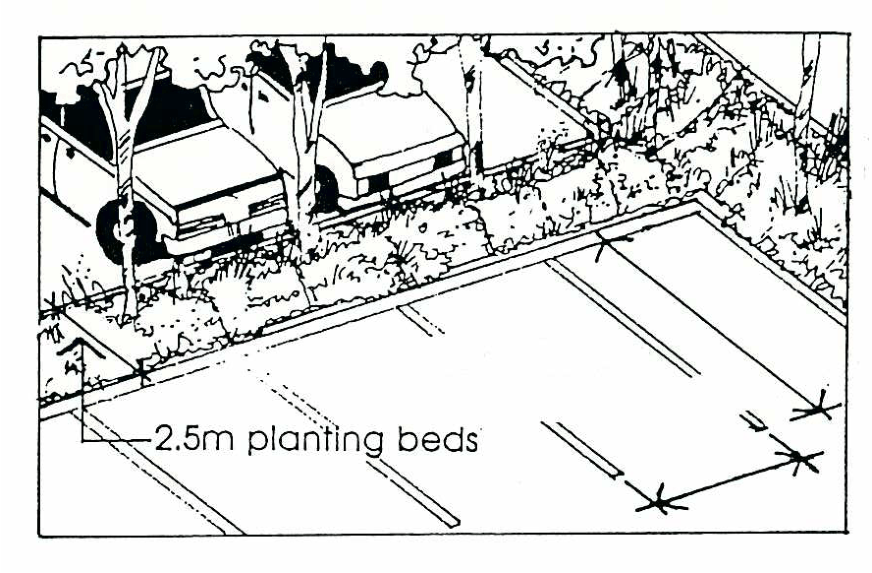
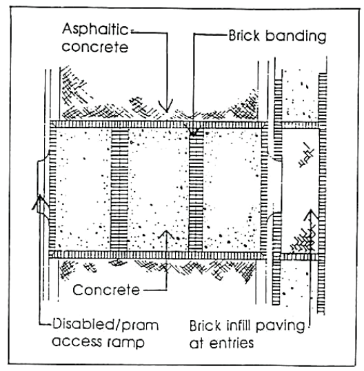
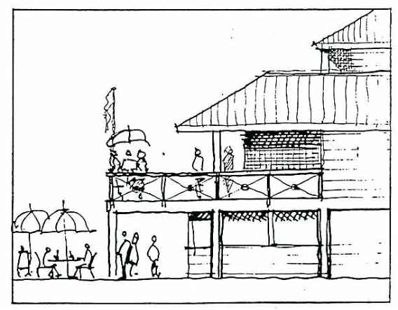
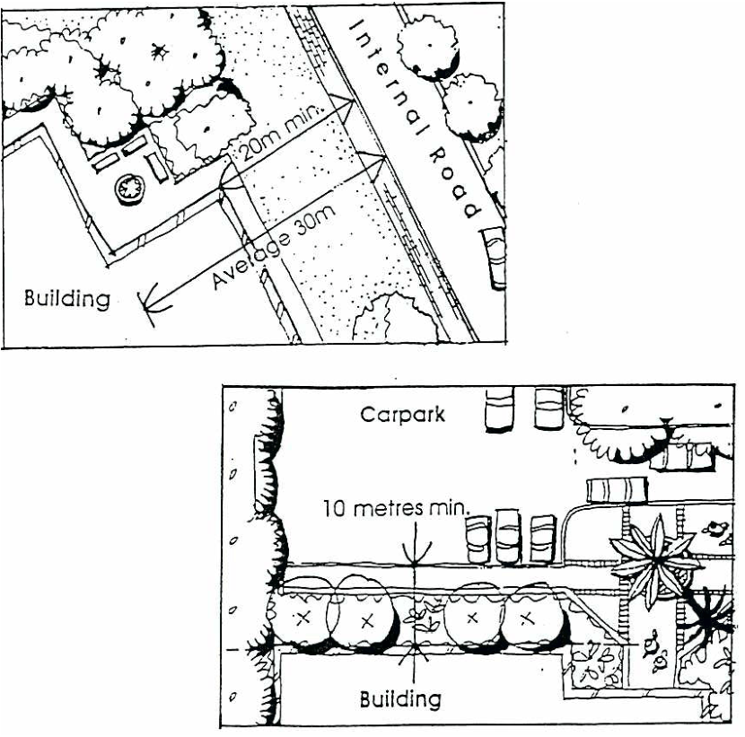

## 7 DESIIGN GUIDELINES AND DEVELOPMENT STANDARDS

1\. General standards which affect the whole Griffins Bay area are described first, followed by their specific design and landscape guidelines for each area.

### 7.1 Access and parking

1\. The primary internal road has been located to improve access to the site as well as providing optional traffic flow to and from King Street and Northcliffe Drive. While details of the alignment have yet to be resolved and will be determined in response to negotiation with the Roads and Traffic Authority (RTA) and Wollongong City Council (WCC), a 10m minimum setback to the road from King Street is important to ensure a quality setting for the scheme is developed along King Street. The road will be approximately 1km long, two traffic lands wide without kerbside parking. The setback from King Street will be planted with trees to form an avenue.

2\. The intersection between King Street and the primary internal road must be controlled by traffic signals, and will ideally be located at Kemblawarra Road. A full traffic study will be required, which takes this into account.

3\. A number of secondary roads will be required for car park access, servicing, patron drop off etc. These will be designed and developed in association with the particular development parcel. The design of all roads will be consistent with RTA and WCC engineering design requirements.

> [Picture on page 10: a picture, saved as a picture (images/chapter-d5-griffins-bay-page-10-1.gif, 150 dpi).]

#### Figure 4: Indicative lease and licence areas

4\. The traffic impact assessment commissioned by the LIA predicted car parking requirements of some 630-740 spaces for the ultimate development scenario, depending on the amount of car parking overlap between uses. Developers of individual sites should provide traffic assessments to substantiate proposals for overlap as part of a development application, to minimise the area of the site occupied by sealed parking areas.

5\. Refer to Car Parking, Access, Servicing/ Loading Facilities and Traffic Management chapter in Part E of this DCP for WCC requirements.

6\. The development concept makes provisions for car parking throughout the site for general community and lessee use. A car park is located adjacent to all major facilities. The size and location are indicative and require refinement through discussion between the LIA and potential developers.

> [Picture on page 11: a picture, saved as a picture (images/chapter-d5-griffins-bay-page-11-12.gif, 150 dpi).]

Figure 5: Car park stalls shall be separated by slightly mounted planting beds for shade and wind protection.

### 7.2 Pedestrian and Cyclist facilities

1\. Unrestricted public access to the foreshore of Griffins Bay is the key objective of the LIA. To this end, pedestrian and cycle paths have been located around the foreshore and street frontage with connections between them at regular intervals.

2\. To ensure pedestrian safety, a barrier along King Street will be required which directs pedestrians towards traffic signals where crossing is safe.

3\. The majority of the main paths in the Informal Recreation Precinct have been constructed. Construction is proceeding on the pedestrian promenade adjacent to the seawall on the eastern side of the bay. A link between the promenade and the developed areas fronting Northcliffe Drive will be to integrate their development and uses with the pedestrian/bicycle trail network to ensure safe and convenient access throughout the site.

> [Picture on page 12: a picture, saved as a picture (images/chapter-d5-griffins-bay-page-12-1.gif, 150 dpi).]

Figure 6: Pedestrian and cyclist path intersections with roads should be denoted with a change of pavement.

### 7.3 Building design

1\. Buildings should be of similar style, character and materials to other buildings in the development. They should be well proportioned in respect to massing, roofscape, windows and balconies etc. Visual diversity should be achieved within a unity of the whole development.

2\. The overall character of a building is affected by the design of the individual elements and therefore architectural detailing should be used to emphasise building quality and to reinforce the overall aesthetic character of the area. Buildings should be designed for maximum interaction with public spaces.

> [Picture on page 12: a picture, saved as a picture (images/chapter-d5-griffins-bay-page-12-11.gif, 150 dpi).]

Figure 7: Roof pitch – Roofs shall be between 15˚ and 35˚ pitch. No flat roofs will be permitted

### 7.4 Window openings

1\. All facades should be designed to accommodate well proportioned windows which relate to each other and to adjacent buildings. Openings should be maximised on the foreshore facing elevations to reinforce openness and interactions with the promenade and public areas.

2\. Openings should be designed to reinforce elevated balance and a unified appearance throughout the development. Windows to toilets, stores and service areas must not be positioned facing the promenade or onto public open space.

### 7.5 Orientation

1\. All development should address both the waterside promenade and the adjacent public spaces. Overshadowing of these areas should be minimised.

### 7.6 Setbacks

1\. A minimum setback of 20m with an average of 30m for each building is required adjacent to the primary internal road. A setback of 10m is required between car parks and buildings.

> [Picture on page 13: a picture, saved as a picture (images/chapter-d5-griffins-bay-page-13-14.gif, 150 dpi).]

#### Figure 8: Setbacks

### 7.7 Materials

1\. External materials should be sympathetic in colour, texture and range to achieve a harmonious composition in the context of a lake side environment. A limited variety of materials and colours is desirable to avoid monotony.

2\. Materials should generally be durable and low maintenance and suitable to the location. Timber shall be utilised as far as possible, relating to the waterfront location.

3\. Glass clad buildings are to be avoided and all glazing must have a reflectivity index of less than 10%, to avoid glare for pedestrians and motorists.

### 7.8 Energy efficient design

1\. Consideration should be given to energy efficient design. Solar water heating would be desirable if integrated sensitively into the building roof forms.

2\. Windows can be positioned to avoid over heating in summer, and the addition of balconies and awnings would protect windows and the buildings fabric from direct sunlight. Cross ventilation and ceiling fans would be preferable to air conditioners.

### 7.9 Public courtyards

1\. Covered seating and temporary vendors/ displays etc are desirable and applications to the LIA and WCC should be made for this use. Lessees may apply to use public areas adjacent to the waters edge on a similar basis. Approval for such use will be by licence.

2\. External spaces around the buildings should be suitably proportional to building height and human scale.

### 7.10 Floor levels

1\. Nominal habitable floor levels of RL 2.5 AHD were adopted during concept planning of Griffins Bay to ensure flood protection and access for the disables fro adjacent areas in consideration of aesthetic requirements. Before lodging a development application, developers should ascertain from WCC the level of inundation under 1% AEP conditions and freeboard requirements for the particular area of land under consideration. Basements (non habitable) may be permitted within buildings subject to measures being implements for flood protection and to overcome geotechnical constraints which the particular site under consideration may present.

### 7.11 Disabled Access

1\. Access for the disabled to all buildings and facilities is a requirement of both the LIA and WCC. The requirements of Australian Standards AS1438: Design for Access and Mobility should be ascertained prior to preparing detail designs for buildings and their approaches.

### 7.12 Signs

1\. Signage is permitted only when affixed to the buildings to which it relates. All proposals must be submitted to the LIA for final approval. No freestanding advertising/ signage will be permitted above the building eaves levels, or if deemed by the LIA to conflict with the aesthetic nature of the development.

2\. Advertising signage will only be permitted if it is directly related to services and use of the building.

### 7.13 Landscaping

1\. The quality of the landscape development and urban design detailing will be importance to the overall success of the Griffins Bay scheme. These elements will establish the setting for the building and the new character for the area. It is important that the design treatment and materials used within external areas are co-ordinated to ensure a consistent and recognisable theme.

2\. The overriding landscape objective is to provide a naturalistic setting reflective of the indigenous landscape character. The formality of the settings will vary from relatively loosely structured areas designed to cater for informal recreation along Northcliffe Drive to more formal landscape treatments for development fronting King Street.

3\. Landscape and urban design works consist of the following:

(a) Pavements and the treatment of the ground plan in general;

(b) Site furniture including benches, seats, barriers and fences, litter bins and signs etc;

(c) Planting including street trees and formal planting, general tree groups, shrubs and groundcover planting.

4\. The development shall maintain a consistent co-ordinated landscape theme which will be perceived to dominate the architectural elements. The landscape will provide a setting for the buildings and be an important adjunct in raising the visual quality of the area. It is important to establish a landscape ‘palette’ consisting of paving, furniture elements, structures and planting. A site furniture patette for King Street and Northcliffe Drive areas has been developed using off-the-shelf items and paving materials.

5\. The desired landscaping and urban design theme is one in which buildings and open space areas are elements within strong groups or separating vegetation.

6\. Within this structural treatment, specific precincts could be identified through detail differentiation while maintaining the overall naturalistic landscape character of the development.
