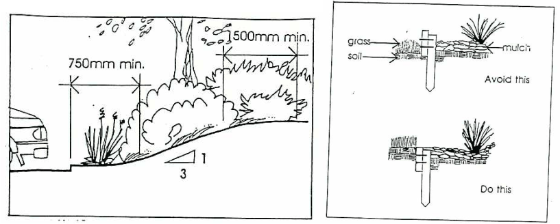
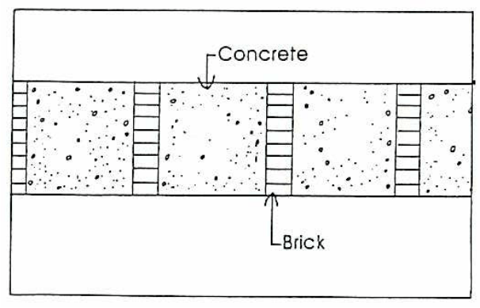

## 9 NORTHCLIFFE DRIVE DESIGN AREA

### 9.1 Building design

1\. Buildings designed for this zone should be harmonious with the predominantly naturalistic setting consistent with the waterside recreational use of the area. The buildings and associated structures will have relatively small footprints and be subservient in scale to the landscape setting. No specific building setback requirements apply to buildings in this area as they will have considerable interaction with water related activities. However, public access must be maintained to and along the waters edge and the building scale should not be visually dominate the foreshore.

2\. Buildings such as kiosks, toilets, stores etc may have little functional need for elevated penetration etc. In these cases, consideration should be given to the articulation of facades facing public spaces I.e. integration of seating, or large overhangs to provide shelter. Patterned brickwork or timber detailing can also provide visual interest.

3\. New buildings in this area are to be restricted to two habitable storeys. The building design should be as low as possible, so as to not obscure views of the lake from Northcliffe Drive. Pitch roofs should be incorporated at a pitch between 15˚ and 35˚.

### 9.2 Landscape design

1\. The landscape and urban design objective for this area is to create a parklike setting suitable for activities designated for the area. The ultimate view to the area should be one which presents a near continuous tree cover punctuated by small scale structure and grassed open spaces. Filtered views to the lake from Northcliffe Drive through the trees should be maintained through appropriate planting arrangements and management.

2\. Views to the foreshore from the south and east will be characterised by a well vegetated parkland waterfront with the trees providing a screen to much of the Lake Heights residential development on the rising land to the north of the foreshore.

### 9.3 Planting and Landscaping

1\. Planting is to be characterised by informal groups of trees and shrubs in broad planting beds elevated above the generally flat topography on gentle mounds to provide enclosure and protection. More formal feature or specimen tree planting is to be located along major paths, along Northcliffe Drive (avenue planning) and around buildings and structures. Particular emphasis should be placed on creating extensive shaded areas for sun protection which enclose open grassed areas.

2\. Plant species considered appropriate to the lake side environment which will achieve the desired character are listed below in table 2. They should form the basis of planting design.

#### Tree Planting Generally

Casurina glauca (Swamp Oak)

Eucalyptus robusta (Swamp Mahogany)

Eucalyptus botryoides (Bangalay)

#### Feature Trees

Acacia longifolia var. sophorae

Dodonea viscosa

Melaleuca armillaris

Melaleuca ericifolia

Myoporum acuminatum

Rhagodia candolleana

Westringia fruticosa

#### Shrubs - Small

Correa alba

Crinum pedunculatum

Dianella caerulea

Myoporum boninense subsp. Australe

Neolema squamulosum subsp. argenteum

#### Groundcover

Hibbertia scandens

Lomandra longifolia

Lomandra multiflora  subsp. multiflora

3\. In addition to the above species, wetland plants will be used in the sites designed as wetland water quality and conservation areas. Species to be used should be researched to identify those suitable for the specific function. Phragmities and Typha species should be avoided due to their rampant habitat and the need to create planting variety to obtain a diversity of wetland habitats.

4\. Level changes required to provide use areas or building platforms should be formed by gently sloping mulched beds (maximum grade 1V:3H) or grassed banks (maximum grade 1V:4H). Retaining walls should be voided. Edges to planting beds should be either ’spade edges’ or hardwood timber edges rather than brick edging.

> [Picture on page 19: a picture, saved as a picture (images/chapter-d5-griffins-bay-page-19-1.gif, 150 dpi).]

### 9.4 Pavements

1\. Vehicular pavements in areas along the Northcliffe Drive frontage should be asphaltic concrete with concrete kerbs in accordance with WCC requirements. A pedestrian/ cycle trail is proposed around the perimeter of the site to provide the main means of linking the various activity areas along the foreshore of the bay. This is to provide access to facilities within the foreshore park. Brick inserts may be used within the paths as they approach activity areas to provide greater interest. Brick paving may also be used at specified activity nodes (e.g. heads of jetties/ under picnic furniture etc).

> [Picture on page 19: a picture, saved as a picture (images/chapter-d5-griffins-bay-page-19-10.gif, 150 dpi).]

### 9.5 Site furniture and small structure

1\. Site furniture elements within this precinct should be utilitarian and low key with an emphasis on the use of timber components in keeping with the overall naturalistic character of the area. Hardwood timber elements combined with concrete marine standard metal fixings should be

used. The use of hardwood timber should be carried through items such as scats, tables, jetties, shelters, bridges etc. Concrete litter bins are preferred over wheelie bin clusters in the lower use intensity areas and at site entries. Light standards, bubblers etc should be metal construction.

2\. External lighting should be restricted to the major paths, car parks, building surrounds and picnic structures. Lights should be pole mounted fixing or fixings attached to structures.
