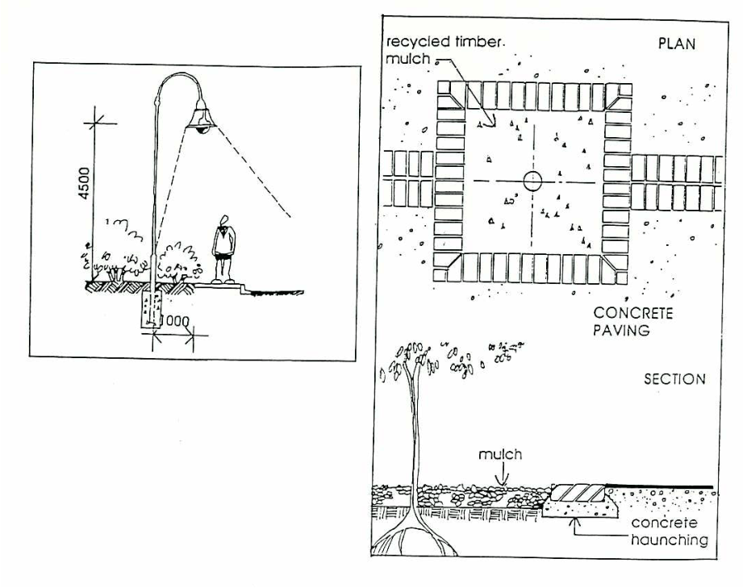

## 10 INTERECTION AREA

### 10.1 Building design

1\. Uses in this area will be oriented towards providing accommodation and associated tourist facilities. In response to this, it is envisaged that the built form will be a major focal point, being situated on the most visible point of the development corner of Northcliffe Drive and King Street. The building should act a ‘gateway’ to the rest of Griffins Bay development. While the built form will be a dominant feature in views from King Street, it should be articulated by having a stepped building form with smaller floor areas at higher levels.

2\. The ground floor levels of the building should encourage public interaction with the introduction of cafes etc. External spaces at ground level should interact with internal activities as much as possible.

3\. Architectural consideration should be given to the waterside and parkland setting with appropriate detailing of balconies, awnings etc.

4\. The building form should address both lake and the street intersection and corner location. There should be a minimum obstruction of views from the surrounding residential areas to the lake and a minimum overshadowing of the adjacent parks.

5\. Car parking within the building envelope should be adopted as far as possible. All external areas should contain tree and shrub planting for shade, screening and shelter and to reduce the visual scale of the development for uses of the site at ground level.

6\. A maximum of 6 habitable storeys (including above ground parking levels) is envisaged. This may be increased subject to WCC’s approval. A stepped building mass reducing a height to 3 storeys towards the lake is required.

7\. Pitched roofs are required. Balconies and terrace levels are appropriate to the location.

### 10.2 Landscape design

1\. The landscape and urban design for this area is to create an urban landscape setting for the most intensively developed part of the scheme. The landscape treatment shall reinforce the civic and urban character of King Street/ Northcliffe Drive address and be formal in character. Less formality and more natural character is required on the Griffins Bay side of the lease area in keeping with the lakeside orientation and the settings needed to cater for ancillary tourist related uses.

2\. There will be considerable interaction between internal building areas and external spaces within this lease area which will be subject to detailed design resolution by the developer.

### 10.3 Planting and landscaping

1\. Planting is to be characterised by formal planting of individual feature trees/ avenue trees and formal planting beds. This formality should be lessened on the lake frontage. Emphasis should be placed on the use of semi-mature and mature tall growing trees along the street frontage to provide scale transition between the building and street level. Forest/ woodland planting should be used on the lakeside side of the development to provide some screening for the privacy of guests at the complex and reduce the scale of the buildings in views from the lake. Preference should be given to the use of shade trees in activity areas to protect uses and obtain energy benefits.

2\. Plants species considered appropriate to the area, which will achieve the desired character and should form the basis of planting design, are listed below. This list should be varied to suit the particular use and design theme applying to the site within the objectivities mentioned above.

3\. Effort should be made to incorporate some of the indigenous Illawarra region rainforest species in more protected areas of the site. This could include the use of ferns and tree planting of Coachwood and Sassafras. Blueberry Ash, Lillipillis etc immediately adjacent to the building particularly on east and south aspects.

#### Tree Planting Generally

Casurina glauca (Swamp Oak)

Eucalyptus robsta Swamp Mahogany)

Eucalyptus botryoides (Bangalay)

Tristaniopsis laurina (Water Gum)

#### Feature Trees

Ficus rubignosa

Livistona australis

#### Shrubs - Small

Agapanthus orientaslis

Callistemon ‘Kings Park Special’

Clivea minata

Grevillia sp.

Epacris longifolia

Rhagodia sp.

#### Shrubs - Medium

Acacia longifolia var. Sophorae

Melaleuca armillaris

Melaleuca nodosa

Westringia fruiticosa

Pittosporium revulution

#### Shrubs – Feature

Abelia grandiflora

Camelia sasanqua sp.

Correa alba

Eriostenon buxifolious

Escalloria macrantha

Kunzea ambigua

Photinia glabra ‘Rubra:’

#### Groundcover

Grevilla ‘Royal Mantle’

Hibbertia scandens

Kennedia prostrate

Lomandra longifolia

Myoporum parvifolium

4\. Level changes required to provide use areas or building platforms should be formed by low retaining walls (up to 900mm high). Brick edging to the planting beds within the more formal areas is preferred over timber edging which should be confined to the lake shore side of the developments.

### 10.4 Pavements

1\. Vehicular pavement treatment should vary in quality depending on the location relative to main areas of use. For public areas comprising the primary internal road and associated parking areas the surface treatment should be asphaltic concrete. Brick edged concrete should delineate pedestrian crossings. Brick paving should be used on major entries, thresholds and set down areas immediately adjacent to the accommodation complex. All roads and car parks should be kerbed and guttered in accordance with WCC requirements.

2\. Pedestrian pavement materials within the predominantly private areas of the precinct will be determined in response to the desired design theme and function of the areas and is a matter for detailed design. Paving in transition areas from the accommodation complex to roadways and the foreshore should be a combination of brick and concrete. It is envisaged that brick will be used as banding in the concrete paths and at activity nodes and intersection paths. Concrete paving would be used for the main pedestrian/ cycle path with brick banding o denote proximity areas.

> [Picture on page 23: a picture, saved as a picture (images/chapter-d5-griffins-bay-page-23-1.gif, 150 dpi).]

### 10.5 Site Furniture and small structures

1\. Site furniture elements within this precinct should be of high quality and ‘civic’ in character. The emphasis will be on the use of metal and timber components to a high standard of finish in keeping within the desired character of the area.

2\. Materials, finishes and fixings capable of with standing the salt spray and salt soils of the area must be used. Green coloured preserved timber products shall not be used.

3\. External lighting should be located along all major paths, throughout car parks and around buildings for safety and security. A combination of pole mounted and bollard lighting should be

used. Bollard lighting is most appropriate to the immediate surrounds of the building.
