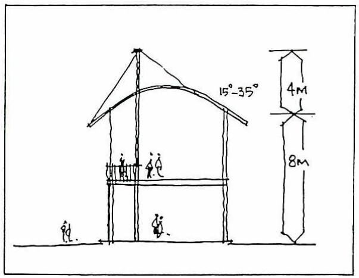
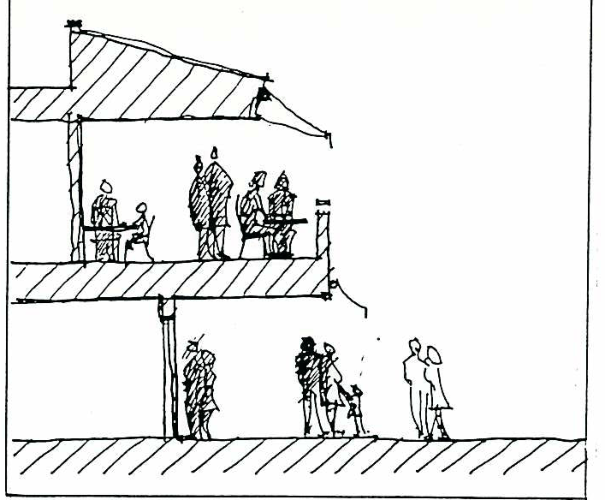
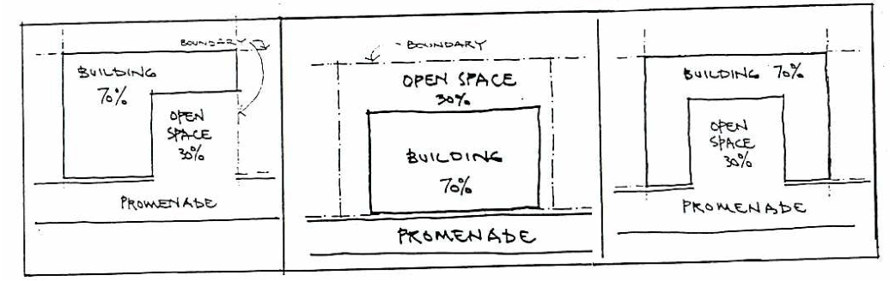
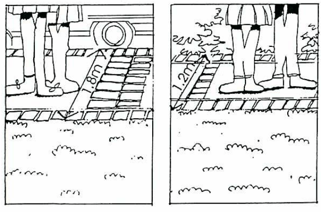
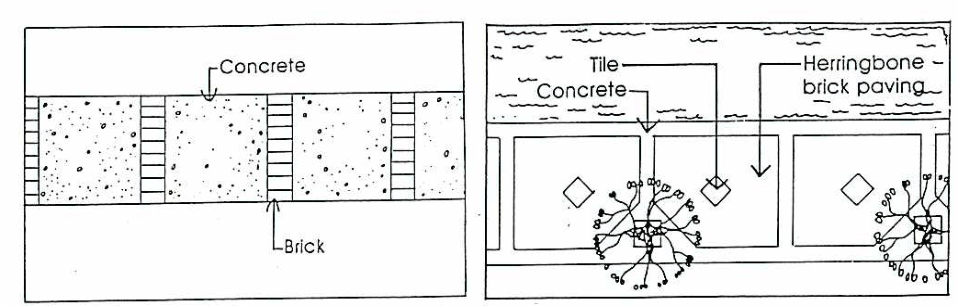

## 11 KING STREET AREA

### 11.1 Building design

1\. Buildings within the precincts along King Street will cater for waterside tourism and commercial uses including restaurants, retail and associated tourism facilities.

2\. The architectural quality of buildings along the highly visible King Street frontage will play an important part in the overall success of the development. The building character must be unique to Griffins Bay, yet be in keeping with the informal and recreational aspects of the development.

3\. It is essential to create a lively and attractive environment emphasising the interaction with the water and to promote associated uses. The architecture must create an atmosphere of lakeside activity by utilising maritime detailing and references, to produce a waterfront village theme.

4\. All new buildings shall have an internal height of no more than 8m (measured at the ceiling level on the external wall, to the natural ground level of finishes level whichever is lower).

5\. An additional height of 4m will be permitted for the vertical articulation of the building envelop and roofscape. This is in order to encourage the consideration of waterfront architectural influences on the building design, and to add interest to the building form when viewed from the surrounding higher areas.

6\. Awnings and balconies should be considered on all frontages to protect pedestrians from weather, and to re-enforce a street appearance along the lakeside promenade. As far as possible the architecture should encourage maximum interaction with the promenade and plaza areas, street trading and external eating areas associated with cafes and restaurants will be encouraged.

> [Picture on page 24: a picture, saved as a picture (images/chapter-d5-griffins-bay-page-24-15.gif, 150 dpi).]

7\. Balconies at first floor should be considered to encourage pedestrian use and to enliven the upper level.

8\. A set back from the waters edge of 30m is required for buildings between King Street and Griffins Bay and a 3.0m zone around the building envelope for the articulation of balconies, awnings and external non-fixed elements, such as temporary external displays and street trading.

9\. The lease areas shown in figure 3: Indicative Lease and Licence Areas defined the nominal extend of the lease area. However only 70% of this site area can be built upon (buildings and car parks), the remaining 30% must be utilised as external public space for market style trading, seating, street theatre, planting etc. This external space must address and integrate with the promenade.

> [Picture on page 25: a picture, saved as a picture (images/chapter-d5-griffins-bay-page-25-1.gif, 150 dpi).]

> [Picture on page 25: a picture, saved as a picture (images/chapter-d5-griffins-bay-page-25-2.gif, 150 dpi).]

### 11.2 Landscape design

1\. The landscape and urban design objective for this area is to create a waterfront character within a semi-naturalistic landscape setting. Buildings and waterfront activity areas will be set within a framework of woodland tree planting to separate the built elements and provide external spaces for public use. Construction of timber jetty, boat skid, sea wall, waterfront promenade and associated car parking areas has been commenced by the LIA.

2\. Of particular importance in this area will be the maintaince of filtered views from King Street to the lake through visual access corridors between the main building groups.

### 11.3 Planting and Land forming

1\. Planting within this area will be characterised by semiformal and formal tree planting related to directionality of the access ways and building configurations. Formal planting beds will be used within car parks, adjacent to buildings and around activity areas to provide enclosure, shade and assist in protection from the westerly winds.

2\. The following list of plants should be used as the basis of design selections

#### Trees to car parks/ perimeter areas

Casurina glauca (Swamp Oak)

Eucalyptus robsta Swamp Mahogany)

Eucalyptus botryoides (Bangalay)

Melaleuca quinquinervia (Broadleaved Paperbark)

#### Feature trees to promenade and urban spaces

Ficus rubignosa (Port Jackson Fig)

#### Shrubs – Medium

Acecia longifolia

Eriostemon myoporoides

Melaleuca armillaris

Rhagodia baccata

Westringia fruiticosa

Melaleuca ericofolia

Callistemon sp.

Grevilla sp

Leptrospermum laevigatum

#### Shrubs  - Small\

Callistemon ‘Captian Cook’

Correa alba

Correa reflexa

Epacris longifolia

Eriostemon buxifolius

Isopagon dubius

#### Groundcovers

Grevilla “Royal Mantle”

Lomandra longifolia

Myoporum parvifolium

Seliera readicans

3\. Level changes required to provide use areas or building platforms should be formed by gently sloping mulched planting beds (maximum grade 1V:3V) or grassed banks (maximum grade 1V:4V) where possible. Where this is possible, due to space constraints, low brick retaining walls should be used. Edges to planting beds should be brick near buildings and timber in grassed areas.

### 11.4 Pavements

1\. Vehicular pavements throughout the area will primarily by asphaltic concrete> Brick edged concrete crossings should be provided at intersections of pedestrians/ cycle path and the roads. Road and car parks should be edged with concrete kerbs and gutters and constructed in accordance with WCC requirements.

2\. A pedestrian trail is proposed around the perimeter of the site to provide the main means of linking the various activity areas along the foreshore. Much of the path installed. This is constructed in concrete to a width of 2.5m in accordance with WCC requirements. Narrower paths 1.2m to 1.8m are to be used to provide access to facilities within the foreshore park. Bricks inserts should be used within the paths as they approach activity areas to provide greater interest. The width of paths should be determined by their importance and safety requirements. Paths adjacent to roadways should be at least 1.8m wide.

> [Picture on page 27: a picture, saved as a picture (images/chapter-d5-griffins-bay-page-27-18.gif, 150 dpi).]

3\. A concrete edge/brick infill pavement has been partially constructed along the seawall fronting Griffins Bay. This promenade treatment will be extended along the quayside in layer development packages.

4\. The central “Markey square” opposite the main timber jetty will be paved with brick with concrete banding similar to that used along the quayside promenade. The dimensions of the banding will be in the order to 4.8m to 5.6m squares depending on the grid adopted for adjacent buildings.

> [Picture on page 28: a picture, saved as a picture (images/chapter-d5-griffins-bay-page-28-1.gif, 150 dpi).]

### 11.5 Site Furniture and Site Elements

1\. Site furniture used in these areas will adopt elements from both the Northcliffe Drive and King Street intersection areas. “Civic” standard information will be used in the building lease sites and areas immediately adjacent to them (e.g. ‘marekt square’). The waterfront and public spaces between the buildings will have a higher timber component than the components used in the ‘civic’ furniture.

2\. External lighting should be located along all major paths, along the waterfront promenade, throughout the car parks and around the buildings for safety and ssecurity. A combination of pole mounted and bollard lighting should be used. Bollard lighting is most appropriate to the immediate surrounds of the buildings. Lighting mounted under awnings of buildings will be required to augment area lighting.
