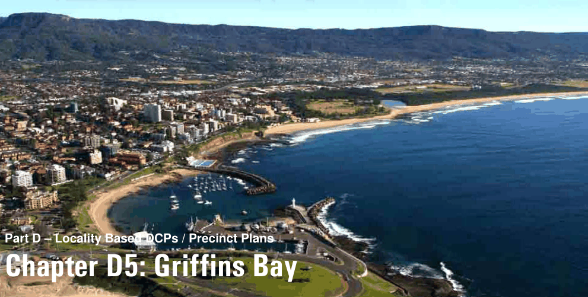

# Wollongong Development Control Plan 2009 - Chapter D5 Griffins Bay

> This chapter is split into 11 section file(s), one per numbered heading, in the order they appear in the PDF.

Source PDF: [Wollongong-DCP-2009-Chapter-D05-Griffins-Bay.pdf](https://planfortomorrow.sharepoint.com/sites/Planfortomorrow/Shared%20Documents/00%20NSW-Planning-Resources/dcp/wollongong-development-control-plan-2009/chapter-d5-griffins-bay/Wollongong-DCP-2009-Chapter-D05-Griffins-Bay.pdf)

> [Picture on page 1: a picture, saved as a picture (images/chapter-d5-griffins-bay-page-1-1.gif, 150 dpi).]

#### Part D – Locality Based DCPs / Precinct Plans

### Chapter D5: Griffins Bay

> The PDF's contents list (page numbers of the printed document) is not repeated here - see Sections below.

i

| 11.4 | Pavements | 25 |  |
|---|---|---|---|
| 11.5 | Site Furniture and Site Elements | 26 | Figures Figure 1: Land to which this DCP applies .......................... 1 Figure 2: Concept plan................................................. 3 Figure 3: Development Precincts and Design Areas .............. 5 Figure 4: Indicative lease and licence areas........................ 8 Figure 5: Car park stalls shall be separated by slightly mounted planting beds for shade and wind protection....................... 9 Figure 6: Pedestrian and cyclist path intersections with roads shoulf be denoted with a change of pavement. ................. 10 Figure 7: Roof pitch – Roofs shall be between 15˚ and 35˚ pitch. No flat roofs will be permitted ............................. 10 Figure 8: Setbacks ................................................... 11 |

ii

<!-- sections -->
## Sections

1. [1 INTRODUCTIION](01-introductiion.md)
2. [2 LAND TO WHICH THIS DCP APPLIES](02-land-to-which-this-dcp-applies.md)
3. [3 OBJECTIVIES](03-objectivies.md)
4. [4 APPROVAL PROCESS](04-approval-process.md)
5. [5 DEVELOPMENT PRECINCTS AND DESIGN AREAS](05-development-precincts-and-design-areas.md)
6. [6 LEASE AND LICENCE AREAS](06-lease-and-licence-areas.md)
7. [7 DESIIGN GUIDELINES AND DEVELOPMENT STANDARDS](07-desiign-guidelines-and-development.md)
8. [8 SERVICES AND GEOTECHNICAL CONDITIONS](08-services-and-geotechnical-conditions.md)
9. [9 NORTHCLIFFE DRIVE DESIGN AREA](09-northcliffe-drive-design-area.md)
10. [10 INTERECTION AREA](10-interection-area.md)
11. [11 KING STREET AREA](11-king-street-area.md)
