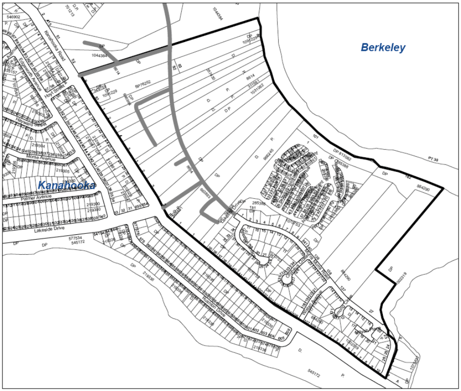

## 2 LAND TO WHICH THIS PLAN APPLIES

1\. This precinct plan applies to certain lands on the northern side of Kanahooka Road, Kanahooka as shown in Figure 1 below.

> [Picture on page 3: a picture, saved as a picture (images/chapter-d6-kanahooka-northern-side-of-kanahooka-road-page-3-13.gif, 150 dpi).]

#### Figure 1: Land to which this Precinct Plan applies
