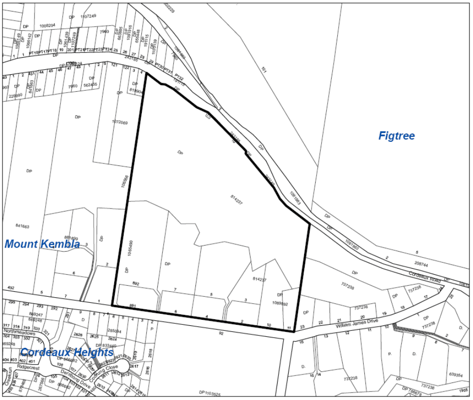

## 2 LAND TO WHICH THE PLAN APPLIES

1\. This precinct plan applies to Lots 891 and 892, DP 1065490, Lots 2 – 7, DP 814237, Lot 10, DP 814237 and Lots 10 and 11, DP 1089892, (ie previously known as Part Lots 55, 56 and 57 DP 7960), Cordeaux Road, Mount Kembla as shown in Figure 1 below.

> [Picture on page 3: a picture, saved as a picture (images/chapter-d7-mount-kembla-cordeaux-road-page-3-15.gif, 150 dpi).]

#### Figure 1: Land to which this Precinct Plan applies
