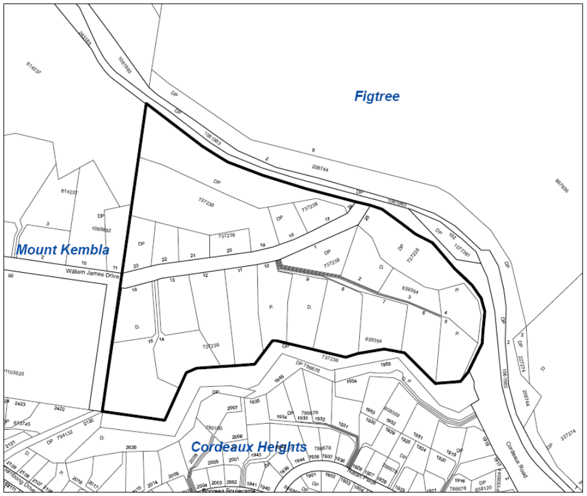

## 2 LAND TO WHICH PLAN APPLIES

1\. This precinct plan applies to Lots 1 and 2, DP 737238, Lots 4 – 25, DP 737238 and Lot 3, DP 639354 (DP 737238), William James Drive, Mount Kembla.

> [Picture on page 3: a picture, saved as a picture (images/chapter-d8-mount-kembla-william-james-drive-page-3-16.gif, 150 dpi).]

#### Figure 1: Land to which this DCP applies

Part D – Locality Based DCPs / Precinct Plans Chapter D8: Mount Kembla (William James Drive)
