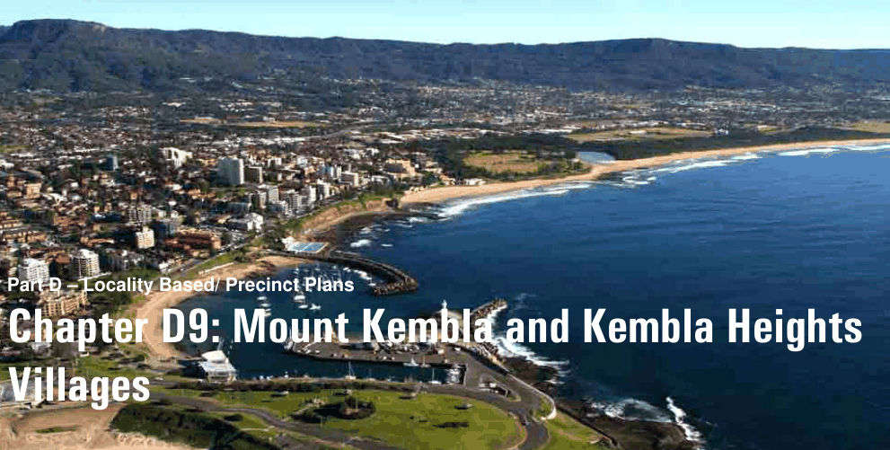

# Wollongong Development Control Plan 2009 - Chapter D9 Mount Kembla and Kembla Heights Villages

> This chapter is split into 6 section file(s), one per numbered heading, in the order they appear in the PDF.

Source PDF: [Wollongong-DCP-2009-Chapter-D09-Mount-Kembla-and-Kembla-Heights-Villages.pdf](https://planfortomorrow.sharepoint.com/sites/Planfortomorrow/Shared%20Documents/00%20NSW-Planning-Resources/dcp/wollongong-development-control-plan-2009/chapter-d9-mount-kembla-and-kembla-heights-villages/Wollongong-DCP-2009-Chapter-D09-Mount-Kembla-and-Kembla-Heights-Villages.pdf)

> [Picture on page 1: a picture, saved as a picture (images/chapter-d9-mount-kembla-and-kembla-heights-villages-page-1-1.gif, 150 dpi).]

#### Part D – Locality Based/ Precinct Plans

### Chapter D9: Mount Kembla and Kembla Heights Villages

### Contents

<!-- sections -->
## Sections

1. [2 LAND TO WHICH THIS PLAN APPLIES](01-2-land-to-which-this-plan-applies.md)
2. [4 DEVELOPMENT CONTROLS](02-4-development-controls.md)
3. [1 INTRODUCTION](03-1-introduction.md)
4. [2 LAND TO WHICH THIS PLAN APPLIES](04-2-land-to-which-this-plan-applies.md)
5. [3 AIMS AND OBJECTIVES](05-3-aims-and-objectives.md)
6. [4 DEVELOPMENT](06-4-development.md)
