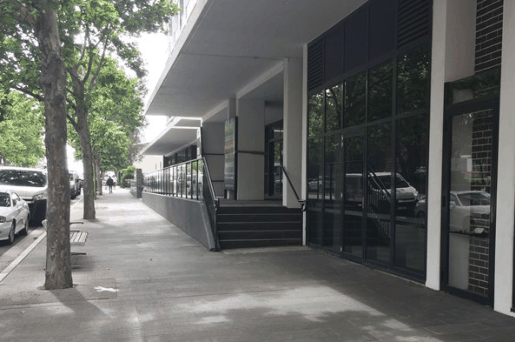
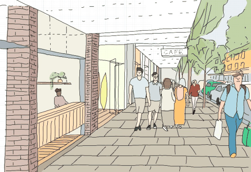

### 5.3 Interfacing with the Public Domain

#### 5.3.1 Objectives

(a) Provide a public domain that interfaces with development that promotes accessibility, without

the need for steps or level changes

(b) Ensure public spaces are not perceived to be alienated through encroachments into the public

domain, which provides access to private development.

#### 5.3.2 Controls

1\. Development should be constructed to meet the existing public domain without the need for

steps or ramps. Where finished floor levels are required to be elevated from the public domain,

the transition should occur within the internal footprint of the building.

2\. Development should not include the use of raised walkways in the public domain that terminate

in stairs.

3\. Extended horizontal lengths of stairs, regardless of the number of risers, is not to occur in the

public domain.

4\. Access to and within developments that account for levels changes is to comply with the

applicable legislation, construction codes and standards.

Figure 1 Illustrates built form outcomes that challenge manoeuvrability and limit equitable

access to public space. Figure 2 demonstrates a desirable interface between new development

and the public domain featuring level transitions allowing for equal access.

> [Picture on page 12: a picture, saved as a picture (images/chapter-e1-access-for-people-with-disability-page-12-20.gif, 150 dpi).]

1 Unnecessarily raised access to

storefronts and residential

apartments foyer enclosed by

fencing located within the public

realm, which requires the use of

stairs to navigate transition

changes.

#### Figure 1: Complicated interface with the public domain

2 Ground floor commercial and

shared public entrances at street

level, featuring thresholds that are

unhindered by steps that promote

accessibility.

> [Picture on page 13: a picture, saved as a picture (images/chapter-e1-access-for-people-with-disability-page-13-6.gif, 150 dpi).]

#### Figure 2: Level interface with the public domain

2\. In some exceptional cases, it may be appropriate to allow for development to encroach upon

or alter the public domain so that equitable access can be provided to a building. In proposing

that access be provided via a ramp or other mechanical device on the public domain or

alteration of the public domain, the applicant must demonstrate the following:

(a) Access by other means will result in a substantial loss of original fabric of a heritage

item, thereby impacting on the significance of the place, and that the provision of

equitable access is highly desirable, with no alternative access options available.

(b) The proposal involves a significant public building where equitable access is highly

desirable and there are no alternative access options available; and

(c) The safety, accessibility, legibility and consistency of public domain is not adversely

affected.

3\. Should an applicant propose the use of the public domain to provide equitable access to a

building, Council's consent as owner of the land must be obtained prior to lodgement of a

development application. To obtain Council's consent the applicant must fully document all

access options that have been pursued.

4\. To assist in the assessment of Development Applications where equitable access is required,

Council recommends the provisions for access be prioritised during the design phase.

Note: Access can be discussed as part of a pre-lodgement meeting and is recommended by

Council.
