## 6 FURTHER RESOURCES

The following resources have been provided to further guide developers in how to provide access in a

range of development types. It should be noted the list below is not exhaustive and that developers are

recommended to explore other contemporary resources.

The Access Institute published an easy to understand guide that explains the rationale behind the

mandatory Australian Standards for Access and Mobility, in the publication, “The ‘Why’s’ of Access”

(2019). The guide is a simple to understand resource that is intended to support people interpreting and

applying the Australian Standards for Access. The ‘Why’s’ of Access can be downloaded from:

https://accessinstitute.com.au/product/free-download-the-whys-of-access-handbook/

Landcom has published a set of guidelines for stakeholders and industry which encourages a universal

design approach and provides examples for new single and double storey housing. The universal

housing design guidelines are available from:

https://www.landcom.com.au/assets/Publications/Statement-of-Corporate-

Intent/b999e51367/Universal-Housing-Design-Guidelines-July-2008.pdf

Lendlease published the Design for Dignity Guidelines (2015) that was developed by Westpac Group

in collaboration with The Australian Network on Disability. The guidelines provide principles for ‘beyond

compliance’ accessibility in urban regeneration. The guidelines also provide more contemporary

examples of how to provide access over the 2008, The Good, the Bad and the Ugly – Design and

Construction for Access publication by the Australian Human Rights Commission. The Design for

Dignity Guidelines is available from:

https://designfordignity.com.au/wp-

content/uploads/2016/08/Design_for_Dignity_Guidelines_Aug_2016.pdf

Livable Housing Australia have published the Livable Housing Design Guidelines. The guidelines

provide advice and examples on how to achieve each level of liveable housing. The Livable Housing

Design Guidelines are available from:

https://livablehousingaustralia.org.au/wp-

content/uploads/2021/02/SLLHA_GuidelinesJuly2017FINAL4.pdf

The National Disability Insurance Scheme (NDIS) Specialist Disability Accommodation Design

Standard (2019) is a publication that sets out the detailed design requirements to be incorporated into

newly built Specialist Disability Accommodation under NDIS. Note: this document will be use in the

enrolment and certification of Specialist Disability Accommodation and is available from:

https://www.ndis.gov.au/providers/housing-and-living-supports-and-services/specialist-disability-

accommodation/sda-design-standard

### APPENDIX 1 – DESIGN EXAMPLES

All of these examples have been taken from The Good, the Bad and the Ugly – Design and Construction

for Access publication, produced by Australian Human Rights Commission (April 2008), to assist

developers in providing accessibility solutions. It is recommended developers seek the services of an

access consultant when designing publicly accessible spaces, as the examples hereafter may have

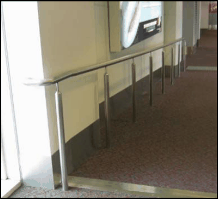

> [Picture on page 22: a picture, saved as a picture (images/chapter-e1-access-for-people-with-disability-page-22-6.gif, 150 dpi).]

been updated since publication.

#### HANDRAILS

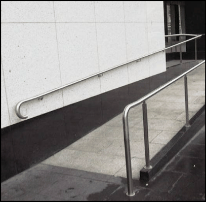

> [Picture on page 22: a picture, saved as a picture (images/chapter-e1-access-for-people-with-disability-page-22-9.gif, 150 dpi).]

Figure 3: (Top left) Correct application of returning the handrail down and back onto itself to form 180°

return onto a post. The handrails also provide clearances on the top 270° arc of the handrail and the

15mm directly under the handrail to allow for uninterrupted transition along the full length of the

handrail for fingers and thumbs.

Figure 4: (Top right) Correct application of returning the handrail down and back onto itself to form

180° return onto a post. The handrails also provide clearances on the top 270° arc of the handrail and

the 15mm directly under the handrail to allow for uninterrupted transition along the full length of the

handrail for fingers and thumbs.

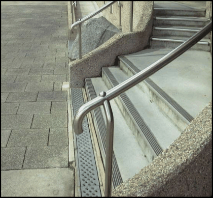

> [Picture on page 23: a picture, saved as a picture (images/chapter-e1-access-for-people-with-disability-page-23-1.gif, 150 dpi).]

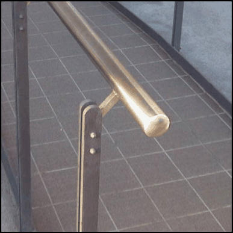

> [Picture on page 23: a picture, saved as a picture (images/chapter-e1-access-for-people-with-disability-page-23-2.gif, 150 dpi).]

Figure 5: (Top left) Handrails which do not comply with the specifications of AS1428.1 for handrails on

stairs suitable for people with disability since the handrails fail to return to a side wall or downwards and

back on themselves at 180°.

Figure 6: (Top right) Handrails which do not comply with the specifications of AS1428.1 for handrails

on stairs suitable for people with disability since the handrails fail to return to a side wall or downwards

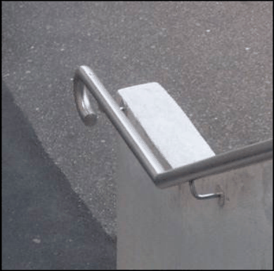

> [Picture on page 23: a picture, saved as a picture (images/chapter-e1-access-for-people-with-disability-page-23-8.gif, 150 dpi).]

and back on themselves at 180°.

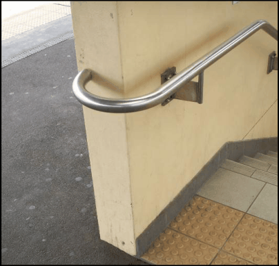

> [Picture on page 23: a picture, saved as a picture (images/chapter-e1-access-for-people-with-disability-page-23-10.gif, 150 dpi).]

Figure 7: (Top left) Correct return of the handrail to a side wall and the required 270° top arc clearance.

Figure 8: (Top right) Correct return of a handrail downwards and back on itself at 180°.

#### STAIRWAY NOSINGS

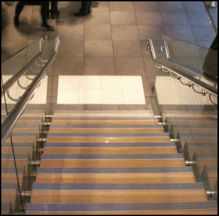

> [Picture on page 24: a picture, saved as a picture (images/chapter-e1-access-for-people-with-disability-page-24-2.gif, 150 dpi).]

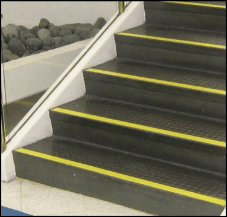

> [Picture on page 24: a picture, saved as a picture (images/chapter-e1-access-for-people-with-disability-page-24-3.gif, 150 dpi).]

Figure 9: (Top left) The correct minimum luminance contrast and depth of treatment on the nosings of

the treads / goings.

Figure 10: (Top right) The correct minimum luminance contrast and depth of treatment on the nosings

of the treads / goings.

#### OPEN RISERS AND OVERHANGING TREADS ON STAIRWAYS

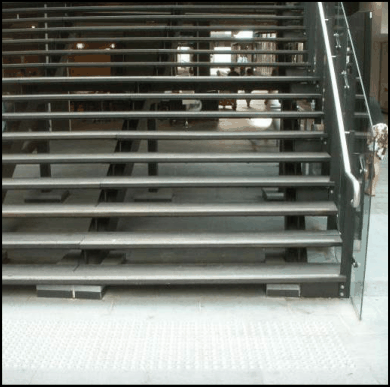

> [Picture on page 24: a picture, saved as a picture (images/chapter-e1-access-for-people-with-disability-page-24-9.gif, 150 dpi).]

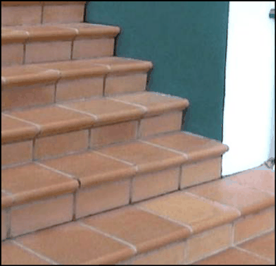

> [Picture on page 24: a picture, saved as a picture (images/chapter-e1-access-for-people-with-disability-page-24-10.gif, 150 dpi).]

Figure 11: (Top left) Open risers and light sources coming from behind the stairway impact upon

contrast and present a space for mobility aids to become unintentionally lodged.

Figure 12: (Top right) An enclosed stairway but has protruding lips which may cause problems for

people by restricting leg movements and may also cause trip hazards.

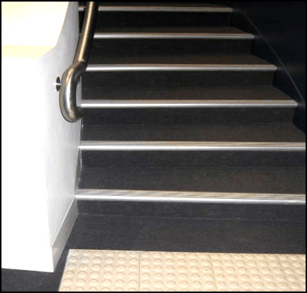

> [Picture on page 25: a picture, saved as a picture (images/chapter-e1-access-for-people-with-disability-page-25-1.gif, 150 dpi).]

Figure 13: Correct enclosed opaque risers with no overhangs which meet the requirements of stairways

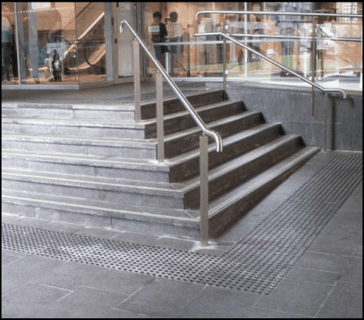

> [Picture on page 25: a picture, saved as a picture (images/chapter-e1-access-for-people-with-disability-page-25-3.gif, 150 dpi).]

suitable for people with disabilities, under AS1428.1.

#### LUMINANCE CONTRAST

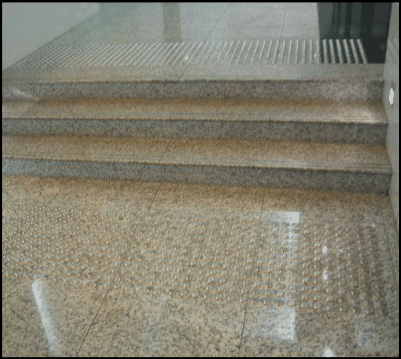

> [Picture on page 25: a picture, saved as a picture (images/chapter-e1-access-for-people-with-disability-page-25-6.gif, 150 dpi).]

Figure 14: (Top left) TGSIs which fail to comply with the specifications of AS 1428.4 since they fail to

provide the required luminance contrast. Under AS1428.4, a minimum of 30% luminance contrast is

required for TGSIs, compared to the surrounding floor/ground surface. These photographs also show

other non-compliant features such as the handrails and the lack of colour contrasting nosings.

Figure 15: (Top right) TGSIs which fail to comply with the specifications of AS 1428.4 since they fail to

provide the required luminance contrast. Under AS1428.4, a minimum of 30% luminance contrast is

required for TGSIs, compared to the surrounding floor/ground surface. These photographs also show

other non-compliant features such as the handrails and the lack of colour contrasting nosings.

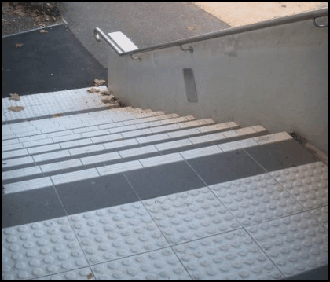

> [Picture on page 26: a picture, saved as a picture (images/chapter-e1-access-for-people-with-disability-page-26-1.gif, 150 dpi).]

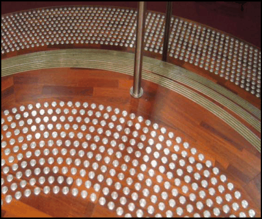

> [Picture on page 26: a picture, saved as a picture (images/chapter-e1-access-for-people-with-disability-page-26-2.gif, 150 dpi).]

Figure 16: (Top left) TGSIs which have a high luminance contrast, as required by AS 1428.4. The

photographs also show the correct setback from the top nosings of 300 +/- 10mm and the minimum

depth of 600mm.

Figure 17: (Top right) TGSIs which have a high luminance contrast, as required by AS 1428.4. The

photographs also show the correct setback from the top nosings of 300 +/- 10mm and the minimum

depth of 600mm.

#### TACTILE GROUND SURFACE INDICATORS

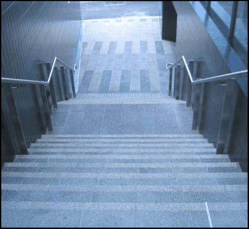

> [Picture on page 26: a picture, saved as a picture (images/chapter-e1-access-for-people-with-disability-page-26-10.gif, 150 dpi).]

Figure 18: The correct interpretation of the requirements for TGSIs on an intermediate landing with no

handrail break: there are no TGSIs on the landing.

#### DOOR THRESHOLDS

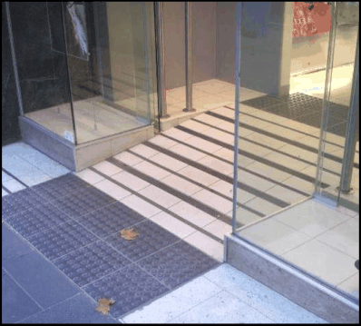

> [Picture on page 27: a picture, saved as a picture (images/chapter-e1-access-for-people-with-disability-page-27-2.gif, 150 dpi).]

Figure 19: A threshold ramp with an automatic door into a retail premises which complies with the BCA

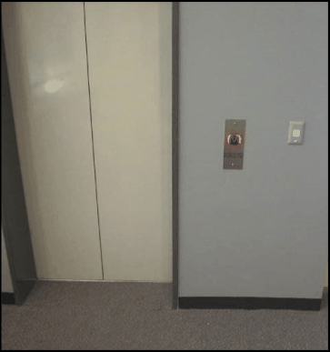

> [Picture on page 27: a picture, saved as a picture (images/chapter-e1-access-for-people-with-disability-page-27-4.gif, 150 dpi).]

and AS1428.1 (without the need for a landing area).

#### LIFTS

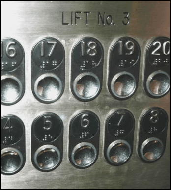

> [Picture on page 27: a picture, saved as a picture (images/chapter-e1-access-for-people-with-disability-page-27-7.gif, 150 dpi).]

Figure 20: (Top left) Show call buttons which comply with the requirements of AS1735.12 in terms of

their placement, luminance contrast application and raised tactile and Braille which are consistently

placed adjacent to each button.

Figure 21: (Top right) Show call buttons which comply with the requirements of AS1735.12 in terms of

their placement, luminance contrast application and raised tactile and Braille which are consistently

placed adjacent to each button.

#### FLOOR SURFACES

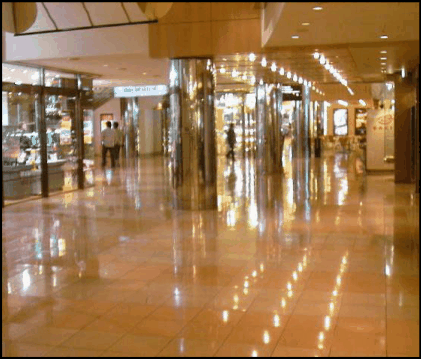

> [Picture on page 28: a picture, saved as a picture (images/chapter-e1-access-for-people-with-disability-page-28-2.gif, 150 dpi).]

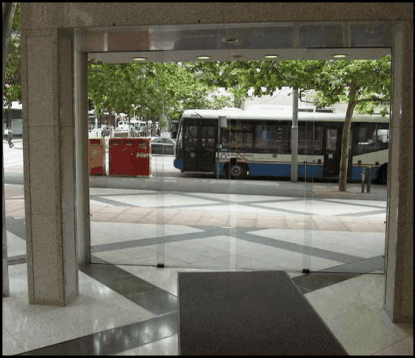

> [Picture on page 28: a picture, saved as a picture (images/chapter-e1-access-for-people-with-disability-page-28-3.gif, 150 dpi).]

Figure 22: (Top left) Very shiny and slippery floor surfaces which fail to meet the “R” rating, as required

by AS4586 and HB197.

Figure 23: (Top right) Very shiny and slippery floor surfaces which fail to meet the “R” rating, as required

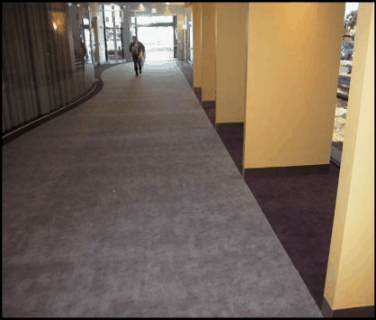

> [Picture on page 28: a picture, saved as a picture (images/chapter-e1-access-for-people-with-disability-page-28-7.gif, 150 dpi).]

by AS4586 and HB197.

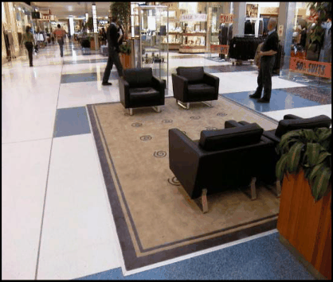

> [Picture on page 28: a picture, saved as a picture (images/chapter-e1-access-for-people-with-disability-page-28-9.gif, 150 dpi).]

Figure 24: (Top left) Show floor surfaces which meet the “R” rating under AS4586 and HB197.

Figure 25: (Top right) Show floor surfaces which meet the “R” rating under AS4586 and HB197.

#### HEIGHT AND DESIGN OF RECEPTION DESKS AND COUNTERS

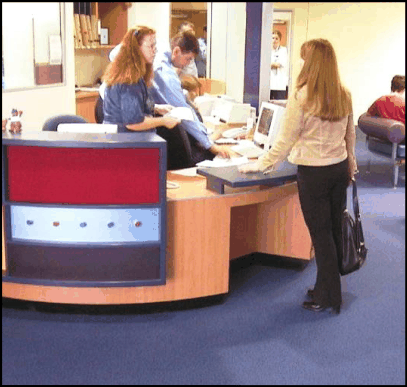

> [Picture on page 29: a picture, saved as a picture (images/chapter-e1-access-for-people-with-disability-page-29-2.gif, 150 dpi).]

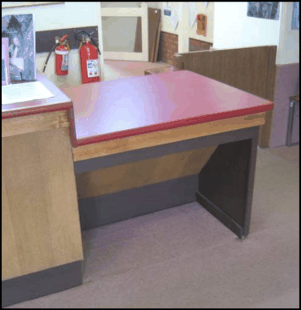

> [Picture on page 29: a picture, saved as a picture (images/chapter-e1-access-for-people-with-disability-page-29-3.gif, 150 dpi).]

Figure 26: (Top left) Reception counters which allow for a frontal approach with an adequate toe plate

and knee space for a person using a wheelchair.

Figure 27: (Top right) Reception counters which allow for a frontal approach with an adequate toe plate

and knee space for a person using a wheelchair.

#### ACCESSIBLE TOILET / WC FACILITIES

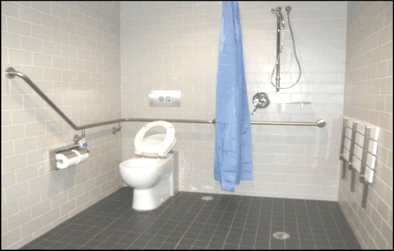

> [Picture on page 29: a picture, saved as a picture (images/chapter-e1-access-for-people-with-disability-page-29-9.gif, 150 dpi).]

Figure 28: Correct placement of toilet and shower fittings as per the requirements of AS1428.1. Note:

The toilet roll holders are placed below the grab rail, to ensure a person using a wheelchair is able to

rise off the pan and transfer back onto their wheelchair unencumbered.

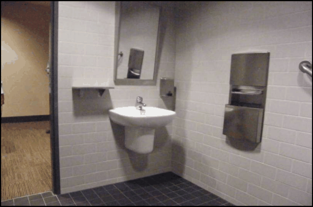

> [Picture on page 30: a picture, saved as a picture (images/chapter-e1-access-for-people-with-disability-page-30-1.gif, 150 dpi).]

Figure 29: The correct installation of a washbasin and other fittings, including a shelf as required by

Table F2.4 of the BCA.

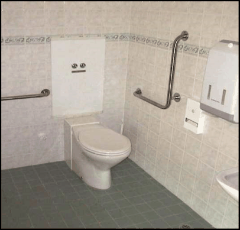

> [Picture on page 30: a picture, saved as a picture (images/chapter-e1-access-for-people-with-disability-page-30-4.gif, 150 dpi).]

Figure 30: The incorrect placement of the toilet paper holder too far forward of the WC pan, which forces

patrons to lean excessively forward to get to the paper. This can result in patrons falling off the pan in

attempting to reach the toilet holder.
