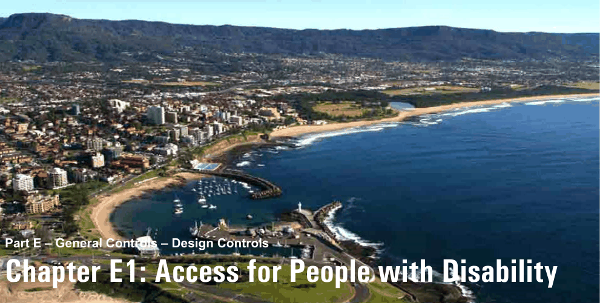

# Wollongong Development Control Plan 2009 - Chapter E1 Access for People with Disability

> This chapter is split into 20 section file(s), one per numbered heading, in the order they appear in the PDF.

Source PDF: [Wollongong-DCP-2009-Chapter-E1-Access-for-People-with-Disability.pdf](https://planfortomorrow.sharepoint.com/sites/Planfortomorrow/Shared%20Documents/00%20NSW-Planning-Resources/dcp/wollongong-development-control-plan-2009/chapter-e1-access-for-people-with-disability/Wollongong-DCP-2009-Chapter-E1-Access-for-People-with-Disability.pdf)

> [Picture on page 1: a picture, saved as a picture (images/chapter-e1-access-for-people-with-disability-page-1-1.gif, 150 dpi).]

#### Part E – General Controls – Design Controls

### Chapter E1: Access for People with Disability

> The PDF's contents list (page numbers of the printed document) is not repeated here - see Sections below.

i

#### Document Control

|  |  | Document ID: Wollongong DCP 2009 – E1 Access for People with a Disability |  |
|---|---|---|---|
| Rev No | Adoption Date | In force date | Revision Details |
| 1 | 15/12/2009 | 3/3/2010 | Adopted |
| 2 | 15/3/21 | n.d. | Draft for exhibition |
| 3 | 2/5/2022 | 23/5/2022 | Revised Draft for exhibition – Substantial revision. Renamed Access for People with Disability |

<!-- sections -->
## Sections

1. [1 INTRODUCTION](01-introduction.md)
2. [2 LAND TO WHICH THIS PART APPLIES](02-land-to-which-this-part-applies.md)
3. [3 PURPOSE](03-purpose.md)
4. [4 STATUTORY FRAMEWORK](04-statutory-framework.md)
5. [4.1 Commonwealth Disability Discrimination Act 1992](05-4-1-commonwealth-disability-discrimination.md)
6. [4.2 The Disability (Access to Premises – Buildings) Standards](06-4-2-the-disability-access-to-premises.md)
7. [4.3 Building Code of Australia and Australian Standard AS 1428](07-4-3-building-code-of-australia-and.md)
8. [5 CONTROLS FOR PROVIDING ACCESS](08-5-controls-for-providing-access.md)
9. [5.2 Universal Design](09-5-2-universal-design.md)
10. [5.3 Interfacing with the Public Domain](10-5-3-interfacing-with-the-public-domain.md)
11. [5.4 Public Spaces and Links to Private Properties](11-5-4-public-spaces-and-links-to-private.md)
12. [5.5 Continuous Accessible Path of Travel](12-5-5-continuous-accessible-path-of-travel.md)
13. [5.6 Walkways, Ramps and Landings](13-5-6-walkways-ramps-and-landings.md)
14. [5.7 Outdoor Areas – Including Parks](14-5-7-outdoor-areas-including-parks.md)
15. [5.8 Adaptable Housing](15-5-8-adaptable-housing.md)
16. [5.9 Livable Housing (Silver level)](16-5-9-livable-housing-silver-level.md)
17. [5.10 Access to Heritage buildings](17-5-10-access-to-heritage-buildings.md)
18. [5.11 Access to Temporary Structures and During Temporary Events](18-5-11-access-to-temporary-structures-and.md)
19. [5.12 Accessible Adult Change Facilities in Public Buildings](19-5-12-accessible-adult-change-facilities-in.md)
20. [6 FURTHER RESOURCES](20-6-further-resources.md)
