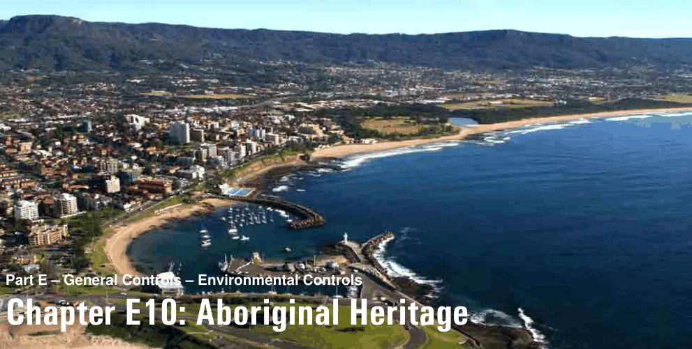

# Wollongong Development Control Plan 2009 - Chapter E10 Aboriginal Heritage

> This chapter is split into 10 section file(s), one per numbered heading, in the order they appear in the PDF.

Source PDF: [Wollongong-DCP-2009-Chapter-E10-Aboriginal-Heritage.pdf](https://planfortomorrow.sharepoint.com/sites/Planfortomorrow/Shared%20Documents/00%20NSW-Planning-Resources/dcp/wollongong-development-control-plan-2009/chapter-e10-aboriginal-heritage/Wollongong-DCP-2009-Chapter-E10-Aboriginal-Heritage.pdf)

> [Picture on page 1: a picture, saved as a picture (images/chapter-e10-aboriginal-heritage-page-1-1.gif, 150 dpi).]

#### Part E – General Controls – Environmental Controls

### Chapter E10: Aboriginal Heritage

### Contents

<!-- sections -->
## Sections

1. [3 PRELIMINARY INVESTIGATION SURVEY OF ANY](01-3-preliminary-investigation-survey-of-any.md)
2. [4 KEY PROCEDURES TOWARDS THE PREPARATION OF](02-4-key-procedures-towards-the-preparation.md)
3. [7 ASSESSMENT AND DETERMINATION OF](03-7-assessment-and-determination-of.md)
4. [1 INTRODUCTION](04-1-introduction.md)
5. [2 AREAS OF POTENTIAL ABORIGINAL ARCHAEOLOGICAL](05-2-areas-of-potential-aboriginal.md)
6. [3 PRELIMINARY INVESTIGATION SURVEY](06-3-preliminary-investigation-survey.md)
7. [4 KEY PROCEDURES TOWARDS THE PREPARATION OF AN](07-4-key-procedures-towards-the-preparation.md)
8. [5 APPLICATION LODGEMENT REQUIREMENTS](08-5-application-lodgement-requirements.md)
9. [6 PUBLIC EXHIBITION PROCESS](09-6-public-exhibition-process.md)
10. [7 ASSESSMENT AND DETERMINATION OF DEVELOPMENT](10-7-assessment-and-determination-of.md)
