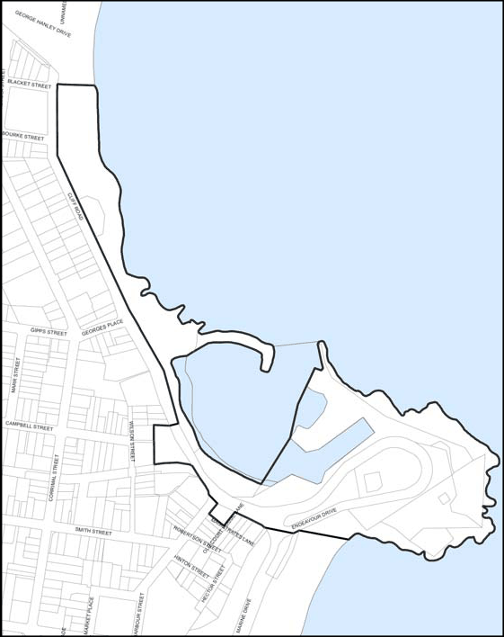

## 20 HERITAGE CONSERVATION AREAS

1\. The City of Wollongong Local Government Area contains nine (9) Heritage Conservation Areas as listed in the Table below:

#### Table 1: Heritage Conservation areas in Wollongong Local Government area

#### Heritage Conservation Areas

#### Level of Significance

| North Beach precinct and Belmore Basin - Wollongong | State |
|---|---|
| Kembla Heights Mining Village – Harry Graham Drive and Soldiers Road | Local |
| Austinmer – Moore Street and The Grove | Local |
| Old Bulli – Princess Highway | Local |
| Bulli – commercial centre and railway, Princes Highway, Railway Street, Station Street, Park Road, Stikes Lane, Quilkey Place | Local |
| Market Street – Wollongong, Market Street | Local |
| Brownsville – Hore Street, Prince Edward Drive and Brownsville Avenue | Local |
| Garrawarra Hospital – Helensburgh, Princes Highway | Local |
| Illawarra Escarpment Landscape Area |  |

This section of the DCP provides specific information and development standards for each of the nine (9) Heritage Conservation Areas.

### 20.1 Buildings within Heritage Conservation Areas

1\. Buildings within a heritage conservation area fall within one of the following categories:

a) Contributory A buildings – These buildings provide good evidence of the main development period of the specific conservation area and also make a positive contribution to the character and /or heritage significance of the conservation area (ie contribute to the historic or aesthetic significance of the area, or both); OR

b) Contributory B buildings – These buildings contribute to the character and significance of the conservation area for its historic or aesthetic values of significance to the area with significant work. However, these buildings are likely to have significant infill areas which are not easily reversible. These buildings are not individually significant but add to the cohesive and representative quality of the conservation area; OR

c) Neutral buildings – These buildings do not contribute to the significance of the conservation area but also do not detract from the overall character of the area. This may include early to new buildings. For example, a modern single storey dwelling which is consistent with the prevailing setbacks, form and building materials of neighbouring contributory buildings may be considered a neutral building; OR

d) Intrusive buildings – These buildings display qualities which do not add to the character of the heritage area. Such buildings do not set a precedent for any new buildings within the specific conservation area. Non-contributory buildings may be demolished and replaced with a new building sympathetic to contributory buildings within the specific heritage conservation area.

2\. Council’s Strategic Project (Heritage) Officer can provide prospective applicants with advice as to whether their building is a contributory or non-contributory building within the specific heritage conservation area.

### 20.2 General Principles for the Heritage Conservation Areas

1\. The following general principles apply to each of the Heritage Conservation Areas within the city:

a) Retain the existing street patterns that reflect the successive original subdivision patterns.

b) Amalgamation of allotments should only be allowed where the new or replacement development is in the form and layout pattern of those existing dwellings on separate allotments.

c) ‘Contributory A’ and ‘Contributory B’ buildings should not be demolished and their contributions to the areas are to be maintained or enhanced. It is an aim to improve the streetscape qualities of buildings through the removal or reversal of unsympathetic elements, where applicable.

d) Neutral buildings may only be demolished if they are to be replaced by a building that will contribute to the character of the relevant Heritage Conservation Area. In this respect new contemporary dwellings are allowable in conservation areas, but must respect the significance and character of the area and ultimately contribute to the respective Heritage Conservation Area.  New contemporary dwellings must strive to enhance the significance of the area by contributing to the quality of the built environment.

e) Intrusive buildings may be demolished but must be replaced by a building that will contribute to the character of the respective area.

f) Any proposed alteration and addition to an existing dwelling or a new infill dwelling will be assessed on its merits taking into account the relationship of the proposed development with the form, scale, building materials and streetscape character of existing dwellings in the conservation area.

g) The removal of original detailing or the enclosure of verandahs on the front façade of a dwelling will generally not be permitted.

h) Any first floor alteration or addition to a dwelling shall not impact upon the contribution of a building to the streetscape character of the area.

i) First floor alterations or additions to a dwelling should be restricted to the rear of a dwelling and should minimise impact upon the original roof form when viewed from the public domain. Any first floor addition which interrupts the front roof plane of a heritage item or contributory building will not be permitted.

j) Any alterations or additions to a dwelling should be recessive and not dominate the original form and character of the dwelling.

### 20.3 North Beach Precinct and Belmore Basin Heritage Conservation

### Area

#### 20.3.1 What is the area’s significance?

1\. This heritage conservation area runs between North Beach and Flagstaff Hill.

2\. The North Beach Precinct includes the North Beach Kiosk and Residence, the North Beach Bather’s Pavilion building, tramway cutting and archaeological site of Puckey’s Salt Works. This precinct is listed on the NSW State Heritage Register.

3\. The North Beach Bather’s Pavilion is a single storey face brick Inter-War Functionalise style building which was constructed in 1938. The Bather’s pavilion includes changing and toilet facilities for both

> [Picture on page 20: a picture, saved as a picture (images/chapter-e11-heritage-conservation-page-20-15.gif, 150 dpi).]

men and women.

4\. The North Beach Kiosk and Caretaker’s Residence is a single –storey face brick Inter-War Functionalise style building which was constructed in 1938 and replaced an earlier timber kiosk nearby. The North Beach Kiosk and Caretaker’s Residence was designed and built in the same style and building materials

5\. The Smiths Hill Fort (Battery Park) was constructed between 1887 – 1888 and involved a concealed emplacement with underground storage and shelter for the gunners. The fort contained two (2) x 5 ton, 80 pound rifled muzzled loader guns and a 1.5 inch caliber Nordenfelt quick firing breach loader gun.

6\. The precinct also contains a Gentlemen’s Bath at ‘Clarkes’ rock pool and the Continental Baths, to the north of Wollongong Harbour.

7\. The Gentlemen’s Baths were constructed in circa 1890’s. This involved the blasting of rock by a contractor to enlarge ‘Clarkes’ rock pool which made it 4 feet deep at low tide and 5 – 6 feet deep at medium tide.

Figure 1: North Beach Precinct and Belmore Basin Heritage Conservation Area

8\. The Continental Baths were officially opened on 24 March 1928 and included open air dressing sheds with separate areas for gentlemen and ladies, single and double dressing benches, facilities included showers and toilets. In the 1980’s the original dressing shed was demolished due to a

structural engineers report which indicated that the building was unsafe. This building was replaced by the current dressing shed which was officially opened on 13 December 1986.

9\. Belmore Basin is the name of the small  sheltered area at the centre of  Wollongong Harbour, which was completed with convict labour in the 1840s. Belmore Basin is a large precinct that includes Flagstaff Hill, Wollongong Harbour / Belmore Basin and Brighton Beach.

10\. This precinct was the original civic and commercial centre of Wollongong and the Heritage Conservation Area contains a wealth of evidence of its early development.
