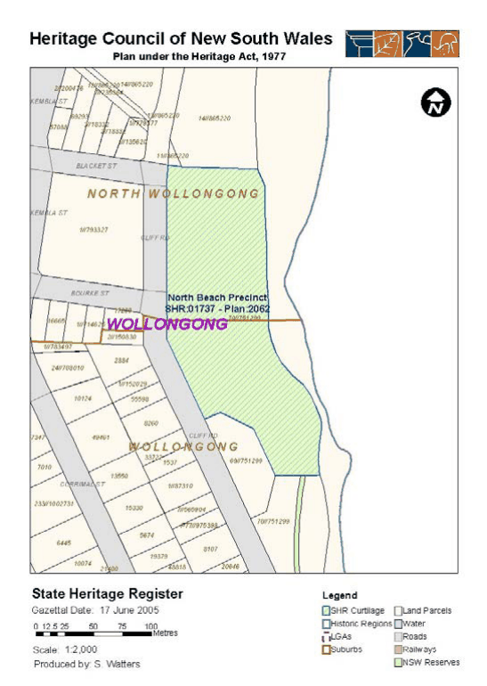
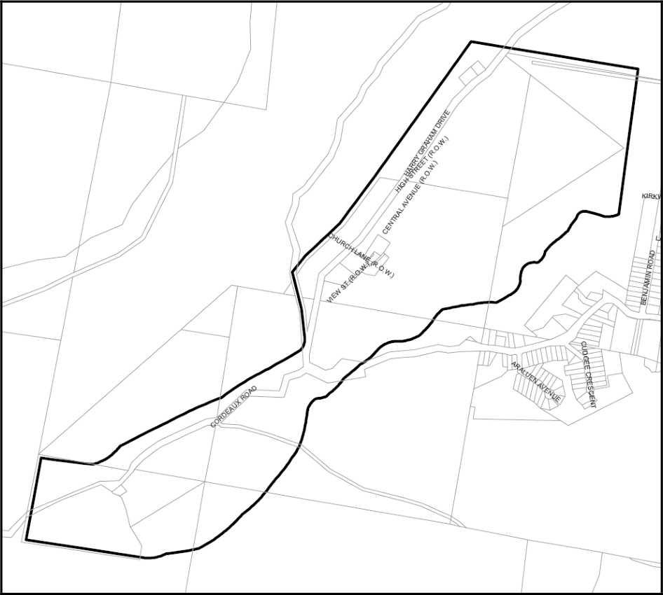
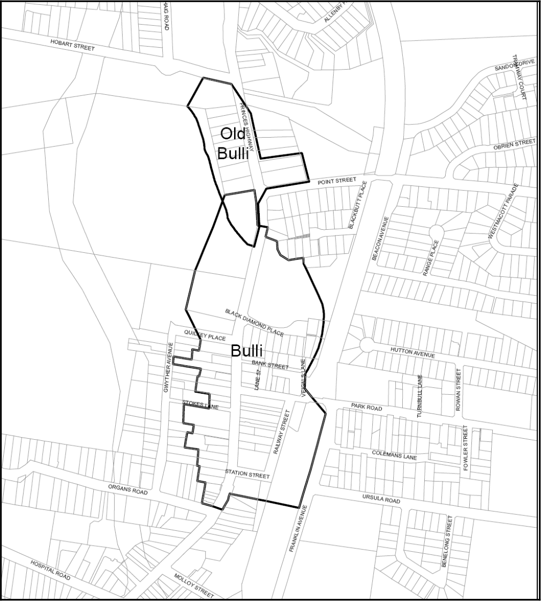
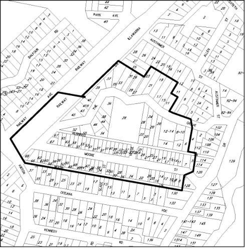

## 11. WHAT ARE THE SIGNIFICANT CHARACTERISTICS OF THE AREA?

a) The North Wollongong Bather’s Pavilion and the Kiosk and residence are a group of buildings of the Inter-War Functionalise style period and use located at the back of North Wollongong Surf Beach.

b) The North Beach Bathers Pavilion is located close to an embankment that runs behind North Beach. Between this embankment and the Bathers Pavilion is a pedestrian / bicycle shareway that marks the alignment of the former Mount Pleasant Colliery railway line.

c) The former Mount Pleasant Colliery railway line is associated with the early days of the Southern Coalfield in NSW and played a significant role in the transportation of coal from the Mount Pleasant mine to Belmore Basin for the coastal shipping trade.

d) The North Beach Bathers Pavilion is significant as a rare survivor of an early Twentieth Century building constructed for the purposes of a beach pavilion. The Bathers Pavilion is a good representative example of the Inter-War Functionalise style of architecture. It has representative value of part of the group of beach pavilion buildings constructed prior to the Second World War and has rarity value as a surviving group of buildings within a single precinct.

e) The North Beach kiosk and caretakers residence is a good representative example of the Inter-War Functionalise style of architecture and is a rare surviving example of a group of contemporaneous beach pavilion buildings.

f) The Smiths Hill Fort is historically significant as it represents the evolution of Wollongong by the 1880’s as a significant port requiring defence. The fort is significant as one of the strategically located forts to defend the eastern coast of NSW against a feared Russian invasion. Fort Scratchly and Smiths Hill Fort were the only coastal fortifications built by the government outside Sydney. The two (2) x 5 ton, 80 pound rifled muzzled loader guns are owned by the Royal Australian Artillery Association and must remain part of the fort structure.

g) The Gentlemen’s Baths are acknowledged as a swimming site since the mid 1850’s. The site is associated with the development of swimming skills for the Volunteer lifesavers and the community as a whole. The first swimming carnival was held at the bath’s in May 1896, the same year as the swimming club was formed.

h) Remnant items of the original Continental Bath dressing shed and tidal pool remain including the perimeter wall foundation, building platform, north-western corner double stair into the pool and the entry path from Cliff Road.

i) Wollongong Harbour represents the establishment of Wollongong and the evolution of the town’s early commercial development.

j) Wollongong Harbour was the gateway for people and commodities entering Wollongong and the main

export point for the district’s produce to the Sydney Market and is a fine example of a 19th century harbour.

k) Belmore Basin is a rare survivor of major convict harbour construction and a rare survivor of the

numerous 19th century coastal shipping facilities in the Illawarra.

l) Wollongong Harbour was built by convict labourers and extended by contract workers as the project was too large for the government of the day to undertake. The harbour demonstrates the importance of

shipping in the 19th century and the process of rapid industrial development to being the third largest port in the state.

m) Brighton Beach and Lawn was the first harbour point used in the arrival of settlers, military and commodities to the region, prior to the construction of a jetty and Belmore Basin in Wollongong Harbour.

n) The first Norfolk Island pine trees were planted in circa 1880 on Brighton Lawn and have significant

landmark qualities which help to relate and identify the site as part of the late 19th century beach landscape.

o) The Breakwall Lighthouse on Flagstaff Hill was the first lighthouse in the Illawarra Region and is one of only two cast wrought iron lighthouses built in NSW. The lighthouse retains evidence of the evolution of lighthouse technology.

p) During the Crimean War, 1850’s two 64 pounder muzzle loader cannons of Waterloo vintage were installed on Flagstaff Hill, due to fears of Russian attack. In 1879, three 68 smooth bore muzzle loader cannons with timber carriages were later placed on Flagstaff Hill to reinforce the military defences on Flagstaff Hill, due to renewed fears of Russian attack. The three 68 pounder cannons were removed but later rediscovered and reinstated on Flagstaff Hill in April 1982.

q) The underground fort on Flagstaff Hill was originally built between 1890 – 1891 and housed a 6 HP BL gun (6 inch hydro pneumatic breech loading disappearing swivel gun) which fired common shells and Palliser projectiles with a range of 10,000 yards. The fort walls throughout are brick and concrete and the ceiling is 3 feet thick with porous concrete and reinforced with steel rails. The fort is buried beneath 5 feet of earth. The southern and western walls of the fort were partially demolished during the earthworks to form the current carpark, in front of the fort.

r) The Wollongong Head Lighthouse on Flagstaff Hill was established in 1937 and provided an improved navigational aid to coastal shipping not just vessels destined to Wollongong Harbour. This lighthouse represents the increased importance of Port Kembla harbour and the Commonwealth Lighthouse Service program to use the latest engineering techniques to build lighthouses to improve the safety of Australian coastal waters.

s) The sites of the two Pilots cottages, military barracks, dam, stables, Flagstaff Hill fort and small

> [Picture on page 22: a picture, saved as a picture (images/chapter-e11-heritage-conservation-page-22-28.gif, 150 dpi).]

outbuildings are of potential archaeological value.

t) The Old Court House is situated in the former Government Reserve which was established in 1833. The Old Court House was completed in 1858 and served as a district court house until 1885 when the Market Street Court House was opened. The Old Court House is of state significance since it is the oldest civic building in Wollongong and the only extant evidence of the original administrative, legal and military hub of Wollongong. In its original form, the Old Court House is an architectural example of the Australian Colonial Court House of the early Victorian period.

#### 20.3.2 Development Controls for the

#### Area

1\. North Beach Precinct and Belmore Basin Heritage Conservation Area is subject to the findings and recommendations contained in the 1997 Conservation Study, prepared by Meredith Hutton on behalf of Council.

2\. Any proposal affecting any heritage item or building or structure within the area identified as ‘North Beach Precinct’ on the State Heritage Register will require the lodgement of an Integrated Development Application under Section 91 of the Environmental Planning and Assessment Act 1979 since the concurrence approval is required from the NSW Heritage Council pursuant to Section 60 of the Heritage Act 1977. Alternatively, a separate approval application may be made to the NSW Heritage Office of the Department of Planning under Section 60 of the Heritage Act 1979, prior to the lodgement of a Development Application with Council. Any such application must be supported by a Conservation Management Plan which takes into account the findings and recommendations of the 1997 Conservation Study.

3\. Any proposal affecting any heritage item or building / structure within the remainder of the heritage conservation area will require the lodgement of a Development Application and should be supported by a Conservation Management Plan which takes into account the findings and recommendations of the 1997 Conservation Study.

4\. It is recommended that any prospective applicant should liaise with Council’s Strategic Project Officer (Heritage) at an early stage to discuss Council’s requirements in respect to a proposal within the North Beach Precinct and Belmore Basin Heritage Conservation Area and the relationship with the 1997 Conservation Study.

### 20.4 Kembla Heights Heritage Conservation Area (HCA)

#### 20.4.1 What is the area’s significance?

1\. The Kembla Heights Heritage Conservation Area (HCA) is bounded by Harry Graham Drive and Soldiers Road, Mount Kembla. Kembla Heights Heritage Conservation Area was developed for the purposes of serving the local mining industry. The area was the location of the first kerosene mine in Australia (est.1865). Kembla Heights was also the hometown of Harry Graham, the first mayor of the amalgamated Central Illawarra Council (1945).

2\. Kembla Heights is the most intact mining village in the Wollongong Local Government Area with its simple, consistent late Victorian and early Federation period cottages characterised by simple “home renovations”. The area is located on the Illawarra Escarpment and has views back to Port Kembla and Wollongong which provide important links between the inland and the coast and the old and new industries of the Illawarra – coal and steel.

3\. Windy Gully is also located within Kembla Heights Heritage Conservation Area, southwest of Kembla Heights village. This area was initially used for agricultural and dairy farming purposes by early settlers. With the discovery of oil-bearing shale and coal, Windy Gully became an outpost for miners with the establishment of a number of cottages and the miners’ clubroom in the late 1890s. Remnants of these structures still remain today.

4\. The pattern of development of the town reflects the type and size of the local mining industry, particularly in terms of its rapid expansion during the 1880s and 1890s following the establishment of the first large coal mine (Kembla Colliery, 1883). Mining relics and remnant buildings have the potential to provide archaeological evidence in and around the settlements of Kembla Heights. The provision of housing by the Mount Kembla Mine to encourage workers to the site demonstrates the early recognition by industries in isolated areas of the need to provide accommodation where transport was limited or non-existent.

5\. The subsequent development of recreational and service facilities such as clubs, halls and the post office, and the development of a close knit community demonstrate the way in which isolation bonds inhabitants and encourages them to develop and fight for services in their community. This is further demonstrated by the pain felt by the local community in response to the Mount Kembla mining disaster (1902) in which many local men and boys were killed. The disaster involved the largest loss of life in mainland Australia in a work place disaster and gives the locality importance in the history of mining and catastrophic events in Australia.

> [Picture on page 24: a picture, saved as a picture (images/chapter-e11-heritage-conservation-page-24-1.gif, 150 dpi).]

#### Figure 2: Kembla Heights Heritage Conservation Area

#### 20.4.2 What are the significant characteristics of the area?

1\. The following characteristics contribute to the significance of the Kembla Heights Heritage Conservation Area:

a) The large rural setting with strong rural atmosphere and character.

b) The varied setback of the buildings and the sense of informality and casualness this creates.

c) The consistent size and common architectural features of the housing. Dwellings are mostly single storey miner’s cottages built in the Victorian (1840-1890) or Federation (c.1890-1915) period with a weatherboard and hipped iron roof construction on brick, timber or stone piers.

d) The consistent extensions and infill. Many have skillion roofed, lean-to style extensions at the rear. Veranda extensions are common and range from shade cloth through to full or partial cladding to create extra rooms. Generally, they do not distract from the character of the place resulting in a largely intact village setting.

e) Fencing is relatively informal, comprising of mainly low scale fencing. This includes timber pickets and palings, chain mesh, corrugated iron sheeting turned on its side and star picket threaded with heavy duty wire.

f) There are no footpaths in the locality representing a typical rural setting. Pedestrians are required to use road surfaces and grassed areas.

g) The grouping of the recreational facilities into one area.

h) Discreet garages and sheds, which are detached from the main buildings and set to the rear.

i) The mainly informal gardens and spacious yards with concrete paths leading from gates to the veranda steps.

j) The setting against the backdrop of the Illawarra escarpment and the views east to Port Kembla and Wollongong.

k) Views between different parts of the conservation area created by existing open spaces.

l) The limited road access.

m) The home handyman approach to repair. This is evidenced in the type of fencing, infill, driveways, sheds, and alterations and additions to the dwellings themselves utilising readily accessible, often recycled materials.

n) Significant archaeology is present within the Kembla Heights Heritage Conservation Area, particularly around the former mine site.

#### 20.4.3 Development Controls for the Area

#### A. Built form (existing streetscape)

i. Single storey development only in original streets.

ii. Build only on previous house sites in existing streetscape.

iii. Discourage decorative balustrading and lace work on verandas except where previous evidence of this can be demonstrated.

iv. Reinstate original features where appropriate.

v. Retain symmetry and proportion of existing cottages.

#### B. Built form (extended future streetscape)

i. Single storey buffer required between original streetscape and two storey development.

ii. Development generally should be sympathetic and respect the form and character of the conservation area. It should not mimic historic building stock.

iii. No primarily brick development.

iv. New development should not obstruct views between Kembla Heights and the coast.

#### C. Setback (existing streetscape)

i. Maintain varied setbacks and the sense of informality.

ii. Avoid large tracts of similarly setback buildings to be in existing streetscape. Small groups with similar setbacks acceptable.

#### D. Fences

i. No solid walls (especially brick walls).

ii. No colourbond or new sheet metal fencing.

iii. Encourage paling, mesh/wire or timber post and rail fencing materials.

iv. Maintain low front fence heights (max. 1.2 metre height).

v. Rear and side fence heights should be minimised where possible.

#### E. Driveways

i. No solid concrete driveways. Gravel, asphalt, strip driveways, sleepers or other sympathetic forms acceptable.

#### F. Views

i. Clearance of poor quality undergrowth acceptable on a merits basis where appropriate and desirable.

ii. Controlled opening up of views east (to the Coast) through the appropriate removal of new growth bush land acceptable where appropriate.

#### G. Infill

i. Avoid new complete veranda infill to create new rooms.

ii. Partial sympathetic solid infill acceptable on merit where extension elsewhere cannot be achieved.

iii. Encourage reversal or improvement of intrusive veranda infill.

iv. Veranda infill acceptable where mesh, shade cloth or other appropriate materials are used to create an outdoor style room.

v. Any new dwelling proposed on previous house sites in the existing streetscape must apply similar form, scale, materials and detailing as the existing historic building stock in a sympathetic manner but be readily identifiable as new work.

#### H. Extensions

i. Allow skillion roofed, single storey extensions to rear.

ii. Where rear extension is not possible, consider skillion or flat roofed extensions to the side with the new area set back from the original façade.

iii. No upper storey extensions.

iv. Gabled extensions only to be considered on a merits basis on Edwardian / Federation styled housing.

#### I. Street furniture

i. Limit street furniture to discreet items suitable to rural setting in necessary locations.

#### J. Signage

i. Retain and maintain existing style of street signage.

ii. No new illuminated, neon style signage.

#### K. Footpaths and road surfaces

i. Limit footpaths in existing areas, no footpaths at all preferred.

ii. Roads should be kept informal, without kerb and guttering.

iii. Paths from gates to individual houses acceptable in concrete but no wider than existing traditional steps and entry way.

#### L. Garages and sheds

i. Garages to be detached and set back behind dwellings. Open car port structure preferred.

ii. Brick and colour bond unacceptable except where not visible from surrounding areas.

iii. Single storey only.

#### M. Allotment size and subdivision

i. Follow existing underlying pattern once determined.

ii. No subdivision of existing house sites.

#### N. Materials

i. No new brick and tile development within the existing streetscape.

ii. No new metal framed windows in existing buildings.

iii. No use of raw materials as main cladding e.g. oiled timbers or vinyl cladding in existing streetscape.

iv. Encourage use of painted timber cladding, galvanised/corrugated and iron roofing.

v. Encourage replacement of metal windows and reinstatement of traditional timber windows.

vi. Limit use of new fibre cement sheeting.

#### O. Colour

i. No painting or treatments in colours that dominate the landscape e.g. bright or dark tones beyond existing colour range.

#### P. New development

i. New development in an extended streetscape should be sympathetic and be consistent with any overall Master Plan developed. New development should reflect the existing free standing informal village atmosphere of Kembla Heights Heritage Conservation Area.

ii. No medium or high density development should take place in the Conservation Area.

iii. Two storeys may be considered in areas where single storey development acts as a buffer between original and existing development. Any two storey dwelling must be sympathetic with surrounding original cottages and respect the form and character of the conservation area. However, any new dwelling should not mimic historic building stock.

iv. New development should follow existing streetscape principles of variable setback, low key landscape and spacious yards.

#### Q. Street plantings

i. Retain existing plantings. Replace where removal becomes necessary.

#### R. Gardens

i. Encourage gardens that continue to allow views of buildings.

### 20.5 Old Bulli Heritage Conservation Area

#### 20.5.1 What is the area’s significance?

1\. Old Bulli is significant as one of the earliest areas settled in Bulli and as the centre of the original Bulli township. It demonstrates the rapid expansion of towns located next to successful mines. It also demonstrates the decline of towns when the coming of the railway causes a shift in the town centre to the station area. Set against the backdrop of the Illawarra Escarpment, Old Bulli is a small centre with a number of its earliest buildings extant (Methodist Church, Miners’ Cottage, Denmark Hotel). It is therefore able to project a sense of what the c1879 townscape on the Princes Highway might have been.

2\. Old Bulli’s location at a high point on the Princes Highway, particularly that of the Denmark Hotel and it’s lookout, suggest importance as a central point between the mines and the jetty where views from public buildings to either facility had the potential to provide advance notice of impeding arrivals and departures of ships or coal trains. The hotel is the last surviving hotel of four existing by c1879 and is a reminder of the town’s previous prosperity.

3\. The entry from the north is a potential ‘gateway’ to the locality, drawing the eye from the pedestrian overbridge to the Denmark Hotel and beyond, giving the visitor a sense of arrival. The bridge itself is an important, dominant visual reminder of the town’s association with coal, as is the Miner’s Cottage. The sandstone Methodist Church in particular is a reminder of the existence of a significant local community at the time of its construction (c1865). Refer to Figure 3.

#### 20.5.2 What are the significant characteristics of the area?

a) The landmark qualities of the Denmark Hotel, former rail overbridge and Methodist Church.

b) The close proximity of, and connectivity with Bulli.

c) The distinctive landscape leading from the railway bridge up to the Denmark Hotel, back down into the flats and onwards to Bulli.

d) The separation of the church from the rest of the conservation area by the Princes Highway.

e) The interweaving of sympathetic development between the heritage and contributory items. However, this does have the effect of eroding the overall heritage character of the Heritage Conservation Area.

f) The presence of open space on three sides (race course, Slacky Flats and former railway corridor).

g) The maintenance of a similar setback of most of the buildings on the western side of the Princes Highway.

h) The maintenance of green space by the properties neighbouring the church and the resultant sense of green space around the building.

#### 20.5.3 Development Controls for the Area

#### A. Built form

i. Single storey to street frontage, except where a second storey acts as a step down between an existing larger building and a single storey building, or except where historical evidence exists for two storey streetscape.

#### B. Setback

i. Maintain the predominant setbacks on either side of the Princes Highway.

ii. Ensure landmark settings of Methodist Church and Denmark Hotel are maintained.

#### C. Fences

i. Low fencing in traditional styles and complementary to the respective building.

ii. Avoid fencing where there is no historic evidence or demonstrated need.

iii. No high fencing or sound barriers to be installed along Princes Highway.

iv. Original fences, where they exist, should not be altered other than for the purposes of maintenance and reinstatement of missing sections.

#### D. Driveways

i. Should be in simple, non-decorative forms.

ii. No paved or stencilled patterns.

#### E. Views

i. Retain views to and from landmark buildings such as the Denmark Hotel, Methodist Church, Miner’s Cottage and former railway overbridge.

ii. Maintain ‘gateway’ qualities of the northern approach.

#### F. Infill

i. Encourage and support demolition of intrusive buildings and replacement with more sympathetic structures.

ii. Infill generally to be sympathetic in form, materials, setback, and design to the predominant character and underlying subdivision pattern of the conservation area.

#### G. Extensions

i. Extensions should generally be sympathetic in form, materials, setback and design to the character of the conservation area.

ii. Extensions should be set back behind the heritage and contributory buildings.

#### H. Street furniture

i. Any new street furniture should not dominate the area and be sympathetic to the character of the

area. Locate in places where the heritage characteristics of the area can be appreciated but do not detract.

#### I. Signage

i. Limit signs on commercial properties to locations on parapets, awning fascias and below awning styles.

ii. Permission should not be given for large above awning signs.

iii. Removal of inappropriate signage is encouraged.

iv. Utilise interpretive signage in a sympathetic manner.

#### J. Footpaths and road surfaces

i. Retain similar style to current, except where any future Streetscape Study/Main Street Plan recommends alternatives.

#### K. Garages and sheds

i. Should be free standing and setback from the main buildings.

#### L. Allotment size and subdivision

i. Retain existing allotment sizes except where new development on amalgamated blocks will retain building form representative of that on multiple individual allotments.

#### M. Materials

i. Materials should be sympathetic to the character of the area.

ii. Appropriate materials include timber weatherboard, galvanised corrugated iron, face brick or rendered painted masonry.

#### N. Colour

i. Colour should be sympathetic to the character of the area and not dominate the heritage character of the streetscape.

ii. Bright colours should be avoided and where existing, should be removed.

#### O. New development

i. Development should be sympathetic and respect the form and character of the conservation area.

#### P. Street plantings

i. Should be kept at a minimum to retain ability to interpret historic building stock..

### 20.6 Bulli Heritage Conservation Area

#### 20.6.1 What is the area’s significance?

1\. Bulli is significant as the development of a railway town that replaced a previously thriving town. Together with Old Bulli, it demonstrates the before and after of the coming of the railway and typical types of development to be found in such a locality, including the former joint stock bank and commercial strip. The Bulli Family Hotel has particular significance for its landmark qualities, its previous popularity with influential visitors and its location at the high point of a rolling landscape dominated by the snakelike curve of the Princes Highway to Old Bulli and beyond. Refer to Figure 3.

#### 20.6.2 What are the significant characteristics of the area?

a) The locality has impressive views north from the commercial centre along the Princes Highway and west to the escarpment.

b) The northern approach is dominated by the low lying open space of Slacky flats, incorporating the War Memorial, creek and stands of Blackbutt.

c) Bulli has good connectivity on regional scale with its proximity to the railway, the Princess Highway, beach, open space etc and is likely to be a reason for the new development now occurring to continue. However, on a local level, the railway, Princes Highway and creeks create a disconnected street network.

d) The heritage character has been eroded by new development along the Princess Highway and on Black Diamond Place.

e) The closure of the street frontages to many of the shops along the Princes Highway, causing a sense of abandonment of the commercial heart of Bulli while the separation of the two sides of the conservation area by the Princes Highway, the noise and the lack of a well placed pedestrian crossing allowing easy access to both sides of the street create a somewhat dysfunctional centre.

f) The main commercial strip is generally consistent architecturally with its parapeted shopfronts. Elsewhere, form and style between old and new is variable with mixed results.

g) The landmark qualities of the Bulli Family Hotel, former Joint Stock bank and the row of single storey parapeted shopfronts on the eastern side of the Princes Highway.

h) Signage is consistent and appropriate to the streetscape in the main commercial strip except where the entire shopfront is painted in corporate logos and colours and where placed above awnings.

i) Together with Old Bulli, Bulli has the potential to be one heritage precinct for continuity with three distinct precincts: Old Bulli, Creek & Parks, Bulli town centre.

#### 20.6.3 Development Controls for the Area

#### A. Built form

i. Maintain predominant historic parapeted building form and underlying subdivision pattern on the Princes Highway commercial strip.

ii. Retain or reinstate shop frontage and pedestrian access from the Princes Highway. Encourage active retail street frontages by the provision of unobstructed views of the building/shop interiors from the street .

iii. Retail frontages should be predominantly clear glazing with the exception of hampers and stall boards and vertical divisions of the historic shopfront composition.

iv. Two storey development acceptable where acting as a step-down between taller buildings and single storey buildings subject to being sympathetic with the predominant heritage character of the area.

v. Encourage continuing hotel use and restoration of the existing hotel buildings.

#### B. Setback

i. Maintain predominant historic building setbacks in the Princes Highway commercial area.

#### C. Fences

i. Retain existing average heights in traditional styles. Avoid high brick or solid walls. New fences should be designed in a complimentary manner to the respective building and be based on historical evidence where available.

ii. Maintain and preserve original fences where they exist. No alterations should be allowed other than repair and reinstatement of missing elements.

iii. No high fences or high barriers to be installed along Princess Highway.

#### D. Awnings

i. Retain and conserve existing original awnings and verandas where these still exist.

ii. Maintain awning pattern over the footpath along the commercial strip.

iii. Encourage reinstatement of awnings (suspended or post supported) where historical evidence exists.

iv. Avoid wide facia to awnings that would obscure parapet detailing of the shop façade.

#### E. Driveways

i. Should be in simple, non-decorative forms. No paved or stencilled patterns.

#### F. Views

i. Retain views to and from landmark buildings such as the Joint Stock Bank and The Bulli Family Hotel.

#### G. Infill

i. Infill buildings within the Princes Highway commercial strip should retain the existing underlying subdivision pattern and single storey, brick or rendered masonry, parapeted form.

ii. Infill generally to be sympathetic in form, materials, setback and design to the predominant character of the conservation area.

#### H. Extensions

i. Extensions to commercial buildings on the Princes Highway should not exceed the height of the existing parapets.

ii. Extensions generally be sympathetic in form, materials, setback and designed to complement the character of the conservation area.

iii. Extensions should be set back behind the heritage and contributory buildings.

#### I. Street furniture

i. Any new street furniture should not dominate, and should be sympathetic to the character of the area.

ii. Reduce street clutter by removal of inappropriate furnishing and signage.

iii. Create a unique identity by consistent paving, furnishing and lighting along the commercial precinct.

#### J. Signage

i. Limit signs on commercial properties to locations on parapets, awning fascias and below awning styles.

ii. No above awning signage should be permitted to reduce cluttering and obscuring parapet detailing.

#### K. Footpaths and road surfaces

i. Retain similar style to current, except where any future Streetscape Study/Main Street Plan recommends alternatives.

#### L. Garages and sheds

i. Where available, rear land access should be utilized.

ii. Garages and sheds should be free standing and setback from the main buildings.

iii. Allotment size and subdivision.

iv. Retain existing allotment sizes except where new development on amalgamated blocks will retain a building form representative of that on multiple individual allotments.

#### M. Materials

i. Materials should be sympathetic to the character of the area.

ii. Appropriate materials include timber, timber weatherboard, galvanised corrugated iron, face brick or rendered/ painted masonry.

iii. Face brick finishes of the Heritage and Contributory Buildings where they exist must be retained and not painted.

#### N. Colour

i. Colour should by sympathetic to the character of the area, and should be recessive and not dominate the heritage character of the streetscape.

ii. Existing inappropriate colour schemes should be removed.

iii. Colours schemes on Heritage and Contributory Buildings should be based on documentary and physical evidence.

#### O. New development

i. Extensions to the commercial strip should retain the single storey, parapeted form and provide active street frontage.

ii. Development generally should be sympathetic and respect the predominant form and character of the conservation area.

#### P. Street plantings

i. Should be kept at a minimum to retain ability to interpret historic building stock.

> [Picture on page 32: a picture, saved as a picture (images/chapter-e11-heritage-conservation-page-32-1.gif, 150 dpi).]

#### Figure 3: Old Bulli and Bulli Heritage Conservation Areas

### 20.7 Austinmer Heritage Conservation Area

#### 20.7.1 What is the area’s significance?

> [Picture on page 33: a picture, saved as a picture (images/chapter-e11-heritage-conservation-page-33-3.gif, 150 dpi).]

#### Figure 4: Austinmer Heritage Conservation Area

1\. Austinmer Conservation Area is part of Captain Westmacott’s Estate from which he initiated the earliest colonial settlement in the village in 1837 and played a vital role in the community. Moore Street was one of the first formed streets in the early twentieth century with pre-war style allotments that helped to create a new identity for Austinmer from a coal town to a seaside resort. This street connected the railway station to the main tourist attraction, the beach and it became the main street of Austinmer during the 1930s. It demonstrates the long and varying history of this area from the establishment of the first Anglican Church in the town (c1904), Post Office (c1919) and Federation style dwellings to 1930s shop fronts and later developments such as the former R.S.L Club.

2\. The Grove represents the continuing growth of Austinmer. Of particular importance is the contour of the street which was surveyed prior to the 1913 subdivision, and is based on the original track along Hicks Creek. The presence of Palm trees and the mixture of tropical and native vegetation also demonstrate the importance that this street played in establishing the new identity of Austinmer as a seaside village during the 1920s and 1930s. The Grove has particular landscape significance for its remaining parcel of remnant bushland, which is rare east of the railway line.

3\. The Austinmer Railway Station buildings are of particular significance as surviving timber structures of a similar scale constructed during the time of the duplication of the south coast line. The brick and concrete curved arch road bridge is of particular significance as very few such bridges survive, particularly in connection with a station group.

#### 20.7.2 What are the significant characteristics of the area?

a) The Austinmer Heritage Conservation Area has close proximity to public transport (railway station & bus connection) and close proximity to the beach.

b) It is divided into three distinct streets/precincts: Moore St, The Grove and Hennings Lane.
