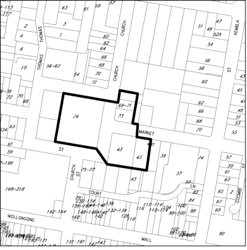
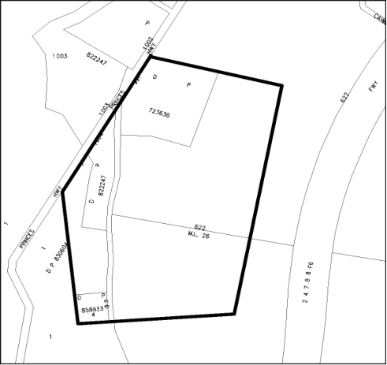

## 3. Hennings Lane

a) Hennings Lane is generally a mixture of the rear of properties facing Moore Street and The Grove and newer properties fronting the lane. The major exception being the larger dwelling ‘Rathane” located on Hennings Lane. This dwelling and its surrounds provide a significant contribution to the landscape and architectural values of the conservation area. This gives it an ambiguous character.

b) It has an impressive ocean view from the eastern end of the lane.

#### 20.7.3 Development Controls for the Area

#### A. Built form

i. Maintain predominantly single storey development on Moore Street.

ii. Retain historic building stock including Victorian, Federation and Inter-War period housing.

iii. New commercial premises should follow existing parapeted shopfront style.

iv. Maintain obscured streetscape nature of the housing along The Grove.

v. Retain original underlying subdivision pattern in the area.

#### B. Setback

i. Maintain predominant historic building alignment in Moore Street .

ii. Maintain an appropriate setback that is sympathetic to the existing alignment of the significant and contributory buildings elsewhere in the conservation area .

#### C. Fences and walls

i. Allow low impact fencing in traditional forms present in the area. E.g. brick, timber picket, post or brick pier and rail, hedging and wire mesh.

ii. Retain dry stone walls in The Grove.

iii. Retain original fencing in Moore Street, no alterations should be permitted other than maintenance and reinstatement of missing sections.

iv. Colourbond and similar fences are not considered appropriate within the conservation area.

#### D. Driveways

i. Maintain less formal driveways in The Grove. Driveways should not be long and straight. Concrete should avoided.

ii. Maintain rear lane vehicular access along Moore Street. Avoid vehicular access from the Moore Street frontages of the properties.

#### E. Views

i. Maintain leafy views to and between properties in The Grove.

ii. Maintain Ocean view corridor to the east end of Hennings Lane.

#### F. Infill

i. Infill development to be sympathetic in form, materials, setback and design to the underlying character of the respective streetscapes within the Conservation Area.

ii. No new veranda infill should be permitted to Contributory Buildings.

#### G. Extensions

i. Extensions to  be sympathetic in form, materials, setback and design to compliment the dominant character of the Conservation Area.

ii. Extensions in Moore Street should be set back behind the Heritage and Contributory items. They should not overwhelm the respective building and should maintain the single-storey streetscape character.

iii. Two story development must be setback beyond the ridge line of the roof to minimise impact on the streetscape.

#### H. Street furniture

i. Maintain use of simple bus stop shelters and low key street furniture generally.

#### I. Signage

i. Limit signs on commercial properties in Moore Street to locations on parapets, awning fascias and below awning styles.

#### J. Footpaths and road surfaces

i. Retain similar style to current, except where any future Streetscape Study/Main Street Plan recommends alternatives.

ii. The Grove should remain informal, with no kerb and guttering. Any future pedestrian treatment should be low key and not detract from the landscape setting.

#### K. Garages and sheds

i. Should be free standing and setback from the main buildings in The Grove. Garages should not dominate the landscape setting.

ii. Moore Street garages should be located at the rear with laneway access. No new main street garages should be permitted.

#### L. Allotment size and subdivision

i. No amalgamation of allotments in Moore Street. Maintain historical subdivision pattern.

ii. Retain existing allotment sizes elsewhere except where new development on amalgamated blocks will retain a building form representative of that on multiple individual allotments.

#### M. Materials

i. Materials should be sympathetic to the character of the area and should not dominate the heritage character of the streetscape.

#### N. Colour

i. Colour should by sympathetic to the seaside and heritage character of the area and not dominate the identified heritage character of the streetscape. Existing inappropriate colour schemes should be removed.

ii. New colour schemes for the Heritage and Contributory Buildings should be in line with the traditional palette based on documentary evidence, and be consistent with the style of the respective building.

#### O. New development

i. Development generally should be sympathetic and respect the form and dominant character of the respective streetscape within the conservation area.

#### P. Street plantings

i. Maintain existing Brush Box street plantings in Moore Street.

ii. Maintain the mature native and introduced vegetation species in The Grove, particularly the existing tree canopy.

iii. New development in The Grove should be screened using appropriate plantings.

#### Q. Gardens

i. Maintain the dominant landscape and topography of The Grove.

ii. Cut and fill should be minimised in The Grove.

iii. Maintain front garden setting of the residential buildings along Moore Street.

### 20.8 Market Street Heritage Conservation Area

#### 20.8.1 What is the area’s significance?

> [Picture on page 36: a picture, saved as a picture (images/chapter-e11-heritage-conservation-page-36-11.gif, 150 dpi).]

#### Figure 5: Market Street Heritage Conservation Area

1\. The centre piece of this Conservation Area is St Michaels Anglican Cathedral, built in 1858 which is a significant landmark within Wollongong city centre.  It also includes a number of associated buildings within the Church square and some significant trees.  The Conservation Area extends beyond the Church Square to include other buildings, notably the Courthouse, the older part of which was built c. 1890.

#### 20.8.2 What are the significant characteristics of the area?

a) The Courthouse buildings have significance for their contribution to streetscape as well as for their relationship to each other.

b) The earliest building was built c.1890 and was designed by Colonial architect James Barnett. It is an excellent example of the Victorian Italianate style.

c) Later additions built c.1975 have been undertaken in “brutalist modern” style while maintaining respect for earlier building.

d) St Michael’s Anglican Church of Australia has townscape significance as a landmark building on the crown of a hill and is the centrepiece of a group of related ecclesiastical buildings. It was completed in 1858 and is an excellent example of architect John Norbury Hunt’s early Australian work.

e) The Gothic styled St Michael’s Parish Hall (c.1909), Church Hall (c.1920), Rectory (c.1880) gardens, stone walls and trees are important townscape elements within the conservation area. The usage, form and scale of these buildings relate to adjacent church buildings and contribute to the low rise character of the area.

f) The former Victorian Filligree style Allowrie Terrace building (c.1880) has architectural and townscape significance however unsympathetic alterations and finishes detract from its architectural significance.

#### 20.8.3 Development Controls for the Area

a) Views of the St Michael’s Anglican Church of Australia set against the skyline looking west and east along Market Street, must be maintained. Future developments that propose to penetrate this view will not be permitted.

b) The height of new developments immediately west of St. Michael’s must not exceed the existing ridgeline of the church (R.L 43.45 AHD).

c) Development surrounding St. Michael’s Square must be designed so as not to compromise the existing views to be appreciated to and from the site in other directions.

d) Building lines for any future development within and surrounding this site (such as land to the north of St. Michael’s Square) must align with the existing zero front setback of the church and its associated buildings.

e) Four metre front setback to all new development fronting Market Street east of St. Michael’s Church.

f) New development and renovation of buildings must be designed by a suitably qualified registered architect.

g) Shopfronts must be a maximum of six metres wide to retain fine grain of built form.

h) Trees within the grounds of the church  are to be protected.

i) Limit signage and street furniture in order to reduce clutter and degradation of vistas to and from heritage items in particular St Michael’s Church.

Any proposal affecting any heritage item or building / structure within the remainder of the heritage conservation area will require the lodgement of a Development Application and must be supported by a Heritage impact Statement or Conservation Management Plan.

It is recommended that any prospective applicant should liaise with Council’s Strategic Project Officer (Heritage) at an early stage to discuss Council’s requirements in respect to a proposal within the Market Street Heritage Conservation Area.

### 20.9 Brownsville Heritage Conservation Area

#### 20.9.1 What is the significance of the area?

1\. Brownsville Heritage Conservation Area is believed to be the only remaining remnant of the first settlement at Dapto prior to the opening of the railway. Located on George Brown’s Mullet Creek Farm, his ‘Ship Inn’ (later Illawarra Lake Hotel) and Brown’s flour mill became the centre of the community and demonstrates an agricultural focus of farming and later, dairying on the South Coast. Hore Street with its late Victorian timber cottages and narrow roadway sets the context for the Hotel (c1840) and is the only remaining evidence of “Brown’s” township, demonstrating historic and social significance. Brownsville Heritage Conservation Area is significant as being probably the earliest remnant of a pre-railway township in the southwest of the Wollongong Local Government Area.

#### 20.9.2 What are the significant characteristics of the area?

a) The Heritage Conservation Area is a quiet residential precinct close to the Princes Highway with a semi rural character. Lack of formal kerb and guttering on one side of Hore Street and lack of line markings generally contribute to this character.

b) The Brownsville Heritage Conservation Area focuses on the early subdivision of land owned by the Brown family.

c) The former Illawarra Lake Hotel, currently converted to a dwelling and flats, is two storeys in height and is the predominant landmark in the conservation area.

d) Hore Street features a reasonably intact group of single storey late Victorian timber cottages on the east

side. The west side features the rear of the buildings facing Prince Edward Drive and Brownsville Avenue.

e) Hore Street has irregular small lots, of 10 -18 metres width and 30 metres in depth; It is considered that the area is under re-development pressure.

f) A few intrusive buildings are located within the Brownsville Heritage Conservation Area

#### 20.9.3 Development Controls for the Area

#### A. Built form

i. Maintain single storey development with hipped roof form on Hore Street.

ii. Maintain original cottages and rural like setting within the Heritage Conservation Area.

iii. Retain symmetry and proportion of historic building stock.

iv. Reinstate original features where appropriate.

#### B. Setback

i. Maintain predominant historic building alignment in Hore Street.

ii. Maintain an appropriate setback that is sympathetic to the existing alignment of the significant and contributory buildings elsewhere in the conservation area.

#### C. Fences

i. Allow low impact fencing at existing average heights  in traditional forms present in the area.

ii. Maintain existing fences to the rear lane behind Hore Street properties.

#### D. Driveways

i. Concrete strip or similar complimentary to the rural setting.

#### E. Views

i. Retain views of the Illawarra Hotel as a dominant landmark from places and roads within the vicinity of the Heritage Conservation Area. Where possible, views from the Princess Highway should be re-established.

#### F. Infill

i. Infill buildings should be sympathetic in form, materials, setback and design to support the underlying character of the conservation area but should not mimic historic building stock.

ii. Infill development should only replace neutral or intrusive items within the Heritage Conservation Area.

iii. Veranda infill should be reversed where possible.

#### G. Extensions

i. Extensions to  be sympathetic in form, materials, setback and design to the dominant character of the conservation area.

ii. Extensions should be set back behind the Heritage and Contributory items on Hore Street.

iii. No first floor additions to Hore Street properties.

#### H. Street furniture

i. No street furniture to be added to Hore Street.

ii. Footpaths and road surfaces.

iii. No kerb and guttering on west side of Hore Street to maintain retain rural, informal atmosphere.

#### I. Garages and sheds

i. Garages and sheds should be free standing and setback from the main buildings, preferably on the rear of site with laneway access.

ii. Allotment size and subdivision.

iii. No amalgamation of allotments in Hore Street. Retain historic subdivision pattern.

iv. Retain existing allotment sizes elsewhere except where new development on amalgamated blocks will retain a  building  form representative of that on multiple individual allotments.

#### J. Materials

i. Materials should be sympathetic to the character of the area and should not dominate the heritage character of the streetscape.

ii. No new brick buildings in Hore Street.

iii. No new metal framed windows; reinstate timber framed windows where possible.

iv. Reinstate traditional galvanised iron or appropriate corrugated metal roof sheeting at time of roof replacement.  No colour bond roofing should be permitted on contributory items.

#### K. Colour

i. Colour should by sympathetic to the character of the area and not dominate the heritage character of the streetscape.

ii. Colour schemes to the Heritage and Contributory Buildings should be based on documentary evidence and be in keeping with the traditional palette.

#### L. New development

i. New development should be sympathetic and respect the form and character of the conservation area. It should not mimic historic building stock.

#### M. Street plantings

i. No new formal street plantings.

#### N. Gardens

i. Open and simple gardens that do not  impede views of Heritage or Contributory Buildings are preferred.

### 20.10 Garrawarra Hospital Heritage Conservation Area

#### 20.10.1 What is the area’s significance?

> [Picture on page 39: a picture, saved as a picture (images/chapter-e11-heritage-conservation-page-39-25.gif, 150 dpi).]

#### Figure 6: Garrawarra Hospital Heritage Conservation Area

1\. Garrawarra Hospital was originally built in 1909 as a “Hospital for Consumptives”.  The hospital was the only government controlled institution constructed specifically for the treatment of tuberculosis in NSW. Prior to this time, public treatment of the disease had been provided at public hospitals and at government subsidised private institutions such as Thirlmere House or privately run homes such as

RT Hall Sanatorium at Hazelbrook. The hospital was finally closed in 1957 due to the success of early diagnosis, antibiotics and thoracic surgery for the treatment of tuberculosis.

2\. The Garrawarra hospital was re-opened in 1958 after extensive re-modelling as a hospital for people with chronic diseases and diseases of the ageing. Following a services review undertaken in 1991 and the development of a Master Plan for Garrawarra Hospital in 2000, the hospital was changed to the present Garrawarra Centre for Aged Care, in order to reflect the diversified role of Garrawarra as a multi-purpose aged care services centre. The Centre provides accommodation for up to 280 frail aged people and is under the Sydney and Illawarra ownership of the South-East Area Health Service.

3\. It is a landmark site which demonstrates fine site planning and architectural design from the early part of the 20th century.  It was designed by the renowned government architect Walter Liberty Vernon. The group of buildings are regionally significant as a relatively intact Edwardian hospital.

#### 20.10.2 What are the significant characteristics of the area?

1\. Garrawarra Centre for Aged Care is a place of cultural significance since it is both the only government controlled institution constructed originally for the specific treatment of tuberculosis in NSW and as a landmark site in the region which demonstrates fine site planning, building design and architectural detailing by Government Architect, WL Vernon.

2\. The full details as to the heritage significance of site are contained in the Conservation Plan, prepared by Howard Tanner and Associates and dated November 1993.

#### 20.10.3 Development Controls for the Area

1\. Garrawarra Hospital Heritage Conservation Area is subject to the findings and recommendations contained in the Conservation Plan, prepared by Howard Tanner and Associates in November 1993 on behalf of the Southern Sydney Area Health Service.

2\. Any proposal affecting any heritage item or building / structure within the heritage conservation area will require the lodgement of Development Application and supported by a Heritage Impact Statement which takes into account the findings and recommendations of the Conservation Plan Dated November 1993.

3\. It is recommended that any prospective applicant should liaise with Council’s Strategic Project Officer (Heritage) at an early stage to discuss any proposal within the Garrawarra Hospital Heritage Conservation Area and its relationship with the 1993 Conservation Plan.

### 20.11 Illawarra Escarpment Landscape Heritage Conservation Area

#### 20.11.1 What is the area’s significance?

1\. The Illawarra Escarpment is a major contributor to the distinctive character of each locality in the Wollongong LGA.

2\. The whole of the Illawarra Escarpment is shown on the Australian Heritage Database (ie maintained by the Commonwealth Department of Environment and Water Resources) as an “indicative place” on the Register of the National Estate. The indicative listing was made by staff of the Australian Heritage Council, drawing on information provided by others, including the National Trust of NSW and the NSW National Parks & Wildlife Service. The assessment of significance for the nomination was based upon the fact of “..the combined effect of a narrow coastal plain, rugged escarpment and rich forest and pasture land give a most unusual landscape of considerable grandeur which exceeds any other coastal plain and mountain landscape on the New South Wales coast.”

#### 20.11.2 What are the significant characteristics of the area?

1\. The Illawarra Escarpment Landscape Area is significant for the following reasons:

a) The Illawarra Escarpment is a major landform and landmark along the Illawarra Region, the use and exploitation of which (together with the coastal plain) was the genesis of rural (mainly dairying) and urban development of the Illawarra, especially as a major coalfield and steel-making centre in Australia.

b) The Illawarra Escarpment contains a range of relatively intact ecological communities including a number of endangered ecological communities and large remnant trees such as a giant Fig tree at Thirroul and a large Red Cedar above the Kemira mine portal.

c) The escarpment is critical for the conservation of regional biodiversity, being some of the most important in southern New South Wales for their flora and fauna, associated with tall moist forest, including rainforest.

d) The escarpment area has a high scenic quality given the combined effect of a narrow coastal plain, rugged escarpment edge, rich forest and contrasting pasture lands. The Illawarra Escarpment is also widely considered to have a high scenic environmental quality in comparison to other coastal plain and escarpment landscape areas along the New South Wales coast.

e) The Illawarra Escarpment is significant for its historical evidence and associations will all the processes of development and change that have occurred since European settlement, including old roads, mine structures and dwellings, abandoned house sites, pit pony paddocks and trace evidence of timber getting and other agricultural activities.

f) The Illawarra Escarpment contains a range of individual heritage items and traces of early settlement, remains of old / disused settlement and old access roads, including slab houses, Bulli Pass (an off-cuts of Westamacott’s Pass), Throsby’s track and aboriginal dreaming track at Bulli, mining sites and structures, Kembla Grange & Mount Kembla tank trap route, retaining wall / embankment for the old cliff-face short-cut road just north of Rixon’s Pass etc. The majority of these items are of regional significance (some of which have also been recommended for formal nomination on the State Heritage Register).

2\. Examples of significant natural items of environmental heritage within the escarpment include:

g) A stand of Illawarra Subtropical Rainforest, west of South Avondale Road;

h) Remnant Fig tree plantings in the grounds of the former “Benares” homestead;

i) Remnant Bunya Pine plantings to the east of Paynes Road;

j) Remnant Hoop Pine plantings to the east of upper Paynes Road;

k) A large Red Cedar tree atop of the portal to the closed Kemira Mine;

l) A remnant bushland and riparian corridor on the eastern footslopes of Mt Keira; and

m) Plantings of Coral trees around collieries as well as along the edges of paddocks of early farmers in the region.

3\. Examples of significant man made historic (European) items include:

a) Windy Gully hamlet;

b) 1930’s depression dam and campsite, on the mid slopes at Thirroul, adjacent to a tributary of Flanagan’s Creek;

c) Nunan’s farm “Seaview”, one of the highest properties on the escarpment at West Dapto (Huntley);

d) Marshall Mount homestead and outbuildings;

e) Hillside Farm slab and weathboard house at Dombarton and Figtree Farm slab hut at Reddalls Road, Kembla Grange;

f) Linbrook Farm, Avondale;

g) Old Miner’s cottages at Mount Keira;

h) Bankbook Hill, Wongawilli – evidence of one of the last remaining squatting settlements, including remains of house sites, planted vegetation and one occupied dwelling;

i) Bulgo shack community;

j) Carrick’s sawmill on the flat above Morrison Road, Coledale;

k) Mount Kembla and Bulli mines, particularly given their long operation, direct links social with local communities (past and present) as well as their cultural heritage significance due to mining disasters and strikes;

l) Bullock track west of Harry Graham Drive, Kembla Heights and at Stanwell Park (off Wodi Wodi trail) and a steep track at Bulgo leading to the shack community;

m) Throsby’s track and Aboriginal dreaming track;

n) Walking tracks at Austinmer to Bulli lookout and Sublime Point;

o) Bulli Pass (and cut-offs of Westmacott’s Pass);

p) Retaining wall / embankment of old cliff-face short cut road, just north of Rixon’s Pass;

q) Abandoned electricity stanchions; and

r) Tank traps between Kembla Grange to Broker’s Nose.

#### 20.11.3 Development Controls for the Area

1\. Any proposal affecting any heritage item or building / structure or involving subdivision  within the heritage conservation area will require the lodgement of Development Application and a Heritage Impact Statement or Conservation Management Plan which takes into account the findings and recommendations of the Illawarra Escarpment Heritage Assessment Study 2007 (Parts 1 -3), prepared by Mayne – Wilson & Associates and Heritage Futures in conjunction with Godden Mackay Logan on behalf of Council.

2\. It is recommended that any prospective applicant should liaise with Council’s Strategic Project Officer (Heritage) at an early stage to discuss any proposal within the Heritage Conservation Area and its relationship with the 2007 study.
