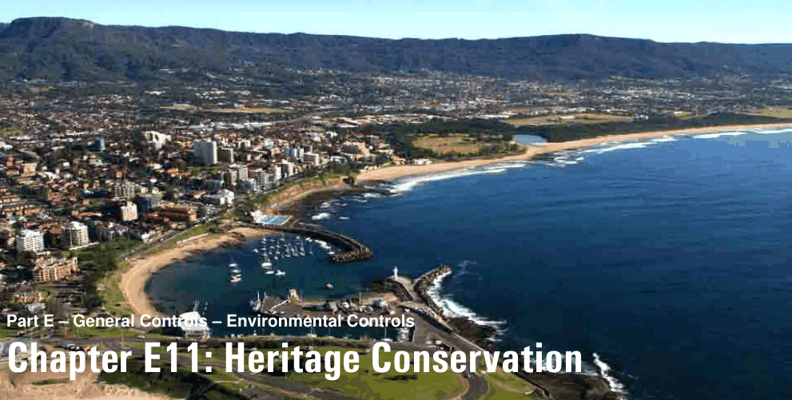

# Wollongong Development Control Plan 2009 - Chapter E11 Heritage Conservation

> This chapter is split into 42 section file(s), one per numbered heading, in the order they appear in the PDF.

Source PDF: [Wollongong-DCP-2009-Chapter-E11-Heritage-Conservation.pdf](https://planfortomorrow.sharepoint.com/sites/Planfortomorrow/Shared%20Documents/00%20NSW-Planning-Resources/dcp/wollongong-development-control-plan-2009/chapter-e11-heritage-conservation/Wollongong-DCP-2009-Chapter-E11-Heritage-Conservation.pdf)

> [Picture on page 1: a picture, saved as a picture (images/chapter-e11-heritage-conservation-page-1-1.gif, 150 dpi).]

#### Part E – General Controls – Environmental Controls

### Chapter E11: Heritage Conservation

### Contents

<!-- sections -->
## Sections

1. [12 ALTERATIONS AND ADDITIONS TO HERITAGE](01-12-alterations-and-additions-to-heritage.md)
2. [13 INFILL DEVELOPMENT](02-13-infill-development.md)
3. [5 PRINCIPLES OF HERITAGE CONSERVATION 2](03-5-principles-of-heritage-conservation-2.md)
4. [14 DEVELOPMENT IN THE VICINITY OF A HERITAGE](04-14-development-in-the-vicinity-of-a.md)
5. [7 STATUTORY FRAMEWORK](05-7-statutory-framework.md)
6. [15 ADAPTIVE RE-USE OF A HERITAGE BUILDING 13](06-15-adaptive-re-use-of-a-heritage-building.md)
7. [16 DEMOLITION OR RELOCATION OF A HERITAGE](07-16-demolition-or-relocation-of-a-heritage.md)
8. [17 GARDENS, LANDCAPING AND FENCING 14](08-17-gardens-landcaping-and-fencing-14.md)
9. [10 HERITAGE IMPACT ASSESSMENT](09-10-heritage-impact-assessment.md)
10. [18 SIGNAGE](10-18-signage.md)
11. [11 SUBDIVISION](11-subdivision.md)
12. [19 DEVELOPMENT OF HISTORICAL (POST-EUROPEAN](12-19-development-of-historical-post-european.md)
13. [20 HERITAGE CONSERVATION AREAS](13-20-heritage-conservation-areas.md)
14. [24 BIBLIOGRAPHY](14-24-bibliography.md)
15. [1 INTRODUCTION](15-1-introduction.md)
16. [2 OBJECTIVES](16-2-objectives.md)
17. [3 LAND TO WHICH THIS CHAPTER APPLIES](17-3-land-to-which-this-chapter-applies.md)
18. [4 DEFINITIONS](18-4-definitions.md)
19. [5 PRINCIPLES OF HERITAGE CONSERVATION](19-5-principles-of-heritage-conservation.md)
20. [6 PERIOD BUILDING STYLES IN WOLLONGONG](20-6-period-building-styles-in-wollongong.md)
21. [7 STATUTORY FRAMEWORK](21-7-statutory-framework.md)
22. [8 WHEN IS A DEVELOPMENT APPLICATION REQUIRED?](22-8-when-is-a-development-application.md)
23. [9 WHEN CONSENT IS NOT REQUIRED FROM COUNCIL](23-9-when-consent-is-not-required-from.md)
24. [10 HERITAGE IMPACT ASSESSMENT](24-10-heritage-impact-assessment.md)
25. [11 SUBDIVISION](25-11-subdivision.md)
26. [12 ALTERATIONS AND ADDITIONS TO HERITAGE LISTED](26-12-alterations-and-additions-to-heritage.md)
27. [13 INFILL DEVELOPMENT](27-13-infill-development.md)
28. [14 DEVELOPMENT IN THE VICINITY OF A HERITAGE SITE](28-14-development-in-the-vicinity-of-a.md)
29. [15 ADAPTIVE RE-USE OF A HERITAGE BUILDING](29-15-adaptive-re-use-of-a-heritage-building.md)
30. [16 DEMOLITION OR RELOCATION OF A HERITAGE BUILDING OR](30-16-demolition-or-relocation-of-a-heritage.md)
31. [17 GARDENS, LANDCAPING AND FENCING](31-17-gardens-landcaping-and-fencing.md)
32. [18 SIGNAGE](32-18-signage.md)
33. [19 DEVELOPMENT OF HISTORICAL (POST-EUROPEAN](33-19-development-of-historical-post-european.md)
34. [20 HERITAGE CONSERVATION AREAS](34-20-heritage-conservation-areas.md)
35. [11 WHAT ARE THE SIGNIFICANT CHARACTERISTICS OF THE AREA?](35-11-what-are-the-significant-characteristics.md)
36. [1 Moore Street](36-1-moore-street.md)
37. [2 The Grove](37-2-the-grove.md)
38. [3 Hennings Lane](38-3-hennings-lane.md)
39. [21 CONSERVATION INCENTIVES](39-21-conservation-incentives.md)
40. [22 HERITAGE INTERPRETATION](40-22-heritage-interpretation.md)
41. [23 ARCHIVAL PHOTOGRAPHIC RECORDING](41-23-archival-photographic-recording.md)
42. [24 BIBLIOGRAPHY](42-24-bibliography.md)
