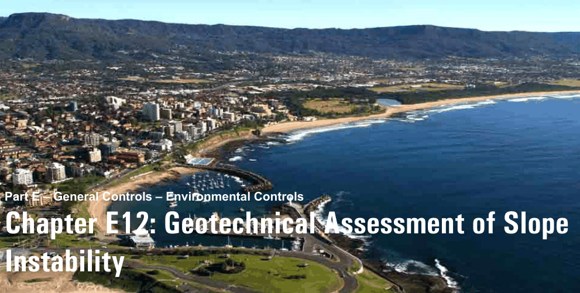

# Wollongong Development Control Plan 2009 - Chapter E12 Geotechnical Assessment of Slope Instability

> This chapter is split into 7 section file(s), one per numbered heading, in the order they appear in the PDF.

Source PDF: [Wollongong-DCP-2009-Chapter-E12-Geotechnical-Assessment-of-Slope-Instability.pdf](https://planfortomorrow.sharepoint.com/sites/Planfortomorrow/Shared%20Documents/00%20NSW-Planning-Resources/dcp/wollongong-development-control-plan-2009/chapter-e12-geotechnical-assessment-of-slope-instability/Wollongong-DCP-2009-Chapter-E12-Geotechnical-Assessment-of-Slope-Instability.pdf)

> [Picture on page 1: a picture, saved as a picture (images/chapter-e12-geotechnical-assessment-of-slope-instability-page-1-1.gif, 150 dpi).]

#### Part E – General Controls – Environmental Controls

### Chapter E12: Geotechnical Assessment of Slope Instability

### Contents

<!-- sections -->
## Sections

1. [4 CONTROLS](01-4-controls.md)
2. [5 CRITERIA FOR ASSESSMENT](02-5-criteria-for-assessment.md)
3. [1 INTRODUCTION](03-1-introduction.md)
4. [2 OBJECTIVES](04-2-objectives.md)
5. [3 DEFINITIONS](05-3-definitions.md)
6. [4 CONTROLS](06-4-controls.md)
7. [5 CRITERIA FOR ASSESSMENT](07-5-criteria-for-assessment.md)
