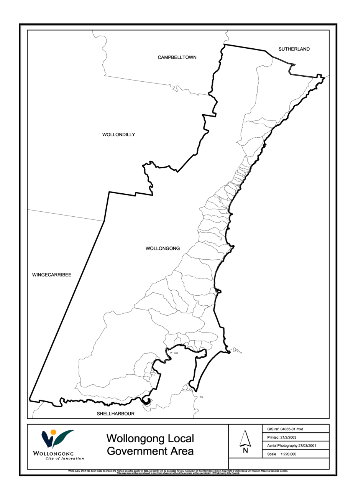

## 3 OBJECTIVES

1\. The key objectives of this chapter are to:

a) Maintain the existing flood regime and flow conveyance capacity;

b) Maintain the function of floodway and flood storage areas;

c) Reduce the impact of flooding and flood liability on individual owners and occupiers of flood prone land;

d) Reduce private and public losses from flooding;

e) Improve public safety with respect to flooding;

f) Minimise the potential impact of development and other activity upon the aesthetic, recreational and environmental value of the waterway corridors;

g) Increase public awareness of the hazard and extent of land affected by the full range of potential floods;

h) Ensure new development must, as far as practical, reduce the existing flood risk, and in no circumstances should the flood risk be worsened;

i) Ensure new development (with the exception of waterway crossings) does not encroach within areas susceptible to channel erosion, migration, bank failure and slumping; and

j) Deal equitably and consistently with all matters requiring Council approval on flood affected land, in accordance with the principles within the latest version of the NSW Floodplain Development Manual or its update.

> [Picture on page 5: a picture, saved as a picture (images/chapter-e13-floodplain-management-page-5-1.gif, 150 dpi).]

#### Figure 1 Catchments within the Wollongong Local Government Area. DEFINITIONS

For the purposes of this chapter of the DCP, the following definitions and technical terms apply:

| Annual | The chance of a flood of a given or larger size occurring in any one year, usually |  |
|---|---|---|
| exceedance probability (AEP) | expressed as a percentage. Example, if a peak flood discharge of 500 m3/s has an AEP of 1%, it means that there is a 1% chance (that is one-in-100 chance) of a 500 m3/s or larger event occurring in any one year. |  |
| Australian Height Datum (AHD) | Australian Height Datum: National reference datum for level. |  |
| Average Recurrence | the long-term average number of years between the occurrence of a flood as big as, or larger than, the selected event. For example, floods with a discharge |  |
| Interval (ARI) | as great as, or greater than, the 20-year ARI flood event will occur on once every 20 years. ARI is another way of expressing the likelihood of occurrence of a flood event. | average |
| ARR1987 | Australian Rainfall and Runoff: 1987 published by the Institute of Engineers, Australia |  |
| ARR2019 | Australian Rainfall and Runoff 2019, published by the Commonwealth of Australia (Geoscience Australia). |  |
| Basement Car Parking | Refers to a car parking area wholly or partly accommodated underground, below a building. The roof of this space, including any solid walls on the podium, must not exceed 1.2 m in height above natural ground level or finished ground level, whichever is the greatest distance. |  |
| DPIE | Department of Planning Industry and Environment |  |
| Deck | An outdoor living area attached to a dwelling, which may be covered or uncovered, and is not capable of being used or adapted for use as habitable floor area. |  |
| Enclosed car parking | Car parking that is potentially subject to rapid inundation, which consequently increases danger to human life and property damage (such as basement or bunded car parking areas). The following criteria apply for the purposes of determining what is enclosed car parking: (a) Flooding of surrounding areas may raise water levels above the perimeter which encloses the car park (normally the entrance), resulting in rapid inundation of the car park to depths greater than 0.8m, and (b) Drainage of accumulated water in the car park has an outflow discharge capacity significantly less than the potential inflow capacity |  |
| Filling | Depositing of soil, rock or other material. Filling does not include the depositing of topsoil, or feature rock imported to the lot, that is intended for use in garden landscaping, turf or garden bed establishment or topdressing of lawns. |  |
| Flood | A relatively high stream flow which overtops the natural or artificial banks in any part of a stream, river, estuary, lake or dam, and/or local overland flooding associated with major drainage as defined by the Floodplain Development Manual before entering a watercourse, and/or coastal inundation resulting from super-elevated sea levels and/or waves overtopping coastline defences excluding tsunami. |  |
| Flood awareness | An appreciation of the likely effects of flooding and a knowledge of the flood warning and evacuation procedures. | relevant |

| Flood compatible building components | A combination of measures incorporated in the design and/or construction and alteration of individual buildings or structures subject to flooding, and the use of flood compatible materials for the reduction or elimination of flood damage. |
|---|---|
| Flood compatible materials | Those materials used in building which are resistant to damage when inundated. A list of flood compatible materials is attached in Schedule |
| Flood evacuation strategy | The proposed strategy for the evacuation of areas within effective warning time during periods of flood as specified within any policy of Council, the FRMP, the relevant State Government disaster plan, by advices received from the State Emergency Services (SES) or as determined in the assessment of individual proposals. |
| Flood Planning Area | The area where flood related development controls apply. It includes land below the flood planning level (FPL) and may extend to include other areas of land where the high consequences in low probability events require additional flood related controls to reduce damages or to not alter the floodway in rarer flood events. |
| Flood planning levels (FPLs) | flood planning level In the Wollongong LGA, the FPL is the level of a 1 % AEP flood event plus 0.5 metres freeboard, unless otherwise stated in an adopted Floodplain Risk Management Study and/or Floodplain Risk Management Plan |
| Flood Prone Land | Land susceptible to flooding by the PMF event. Flood Prone Land is synonymous with flood liable land. |
| Flood Refuge Area | An onsite refuge above the PMF that provides reasonable shelter for the likely occupants of the development commensurate with the period of time that refuge is likely to be required in floods up to the PMF. Note: In general, it is not acceptable to rely on a refuge provided by or on other development sites. In all cases where an onsite refuge is provided, it is to be both intrinsically accessible to all people on the site, sheltered and an integrated part of the development (i.e. a second storey with internal stair access). The route to the refuge is to be fail safe, plainly evident and self-directing. |
| Flood Fringe Areas | The remaining areas of flood prone land after floodway and flood storage areas have been identified |
| Floodway Areas | Areas of the floodplain where a significant discharge of water occurs during floods. They are often aligned with naturally defined channels. Floodways are areas that, even if only partially blocked would cause a significant redistribution of flow or a significant increase in flood levels. Where not mapped in an adopted Flood Study or FRMS, floodway areas may be defined using DPIE Floodway Definition Guidance (in Prep 2020), or using a velocity x depth product greater than 0.4m2/s. While the DPIE Floodway Definition Guidance is finalised, floodway areas may also be defined using the guidance provided in Appendix D. |
| Flood Storage Areas | those parts of the floodplain that are important for the temporary storage of floodwaters during the passage of a flood. The extent and behaviour of flood storage areas may change with flood severity, and loss of flood storage can increase the severity of flood impacts by reducing natural flood attenuation. |

Hence, it is necessary to investigate a range of flood sizes before defining flood storage areas.

Floodplain Synonymous with flood liable and flood prone land) is the area of land that is

subject to inundation by the probable maximum flood (PMF).

Floodplain Development Manual (2005) or the latest version.

#### Floodplain Development Manual (FDM)

A plan prepared for one or more floodplains in accordance with the requirements of the FDM.

#### Floodplain Risk Management Plan (FRMP)

A study prepared for one or more floodplains in accordance with the requirements of the FDM.

#### Floodplain Risk Management Study (FRMS)

Freeboard The height above the design flood used, in consideration of local and design

factors, to provide reasonable certainty that the risk exposure selected in deciding on a particular design flood is actually provided. It is a factor of safety typically used in relation to the setting of flood levels, levee crest levels and so

on. Freeboard compensates for a range of factors including wave action, localised hydraulic behaviour and levee settlement, all of which increase water levels or reduce the level of protection provided. Freeboard should not be relied upon to provide protection for flood events larger than the relevant defined flood event of a design flood.

Freeboard is included in the design flood planning level and therefore used in the derivation of the flood planning area.

Infrastructure projects undertaken by public authorities.

#### Government Infrastructure Projects Habitable Floor Area

• In a residential situation: a living or working area, such as a lounge room, dining room, rumpus room, kitchen, bedroom or workroom;

• In an industrial or commercial situation: an area used for offices or to store valuable possessions susceptible to flood damage in the event of a flood.

#### Hazard

A source of potential harm or a situation with a potential to cause loss. In relation to this plan, the hazard is flooding which has the potential to cause harm or loss to the community.

Overland Flow Runoff from rainfall that flows over the land before entering a watercourse,

creek, river, lake or dam. Overland flow can flow down roads, driveways and through homes and buildings. It is typically shallow and fast flowing.

Merit Approach An approach, the principles of which are embodied in the Floodplain

Development Manual that weighs social, economic, ecological and cultural impacts of land use options for different flood prone areas together with flood damage, hazard and behaviour implications, and environmental protection and wellbeing of the State’s rivers and floodplains.

| Outbuilding | A building which is ancillary to a principal residential building and includes sheds, garages, car ports and similar buildings. |
|---|---|
| Practical | That which in the opinion of Council can be achieved within the design of the development, while not necessitating: (a) floor levels to be raised in a way that would unreasonably hinder access to and from existing floor levels or ground levels on the same site or adjacent public areas; and (b) the raising of a structure to a height that would result in unacceptable impacts on the amenity of adjacent residential properties; and (c) the height or presentation of a building that would be inconsistent with the existing or planned streetscape. |
| Probable maximum flood (PMF) | The largest flood that could conceivably occur at a particular location, usually estimated from probable maximum precipitation. |
| Probable maximum precipitation (PMP) | The greatest depth of precipitation for a given duration meteorologically possible over a given size storm area at a particular location at a particular time of the year, with no allowance made for long-term climatic trends (World Meteorological Organisation, 1986). It is the primary input to the estimation of the probable maximum flood. |
| Probability | A statistical measure of the expected chance of flooding (see ARI). |
| Reliable access | during a flood means the ability for people to safely evacuate an area subject to imminent flooding within effective warning time, having regard to the depth and velocity of flood waters, the suitability of the evacuation route, and without a need to travel through areas where water depths increase. |
| Risk | The chance of something happening that will have an impact. It is measured in terms of consequences and probability (likelihood). In the context of this chapter, it is the likelihood of consequences arising from the interaction of floods, communities and the environment. |
| Survey plan | is a plan prepared by a registered surveyor which shows the information required for the assessment of an application in accordance with the provisions of this Policy. |
| Suitably Qualified Civil Engineer | A civil engineer who is included in the National Professional Engineers Register, administered by the Institution of Engineers Australia or is eligible for membership of Engineers Australia. |
