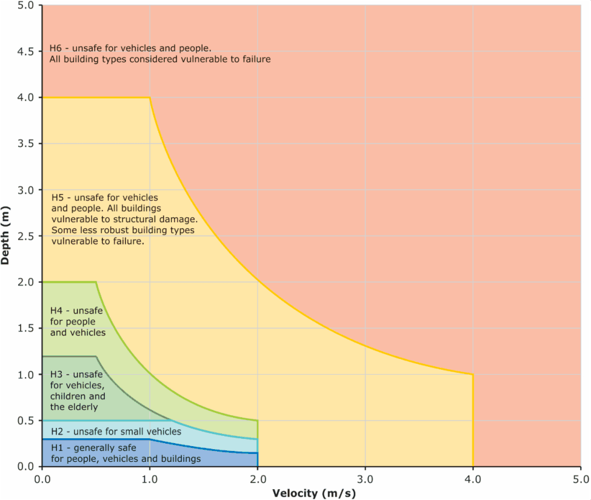

## 6 WHAT ARE THE KEY CRITERIA FOR DETERMINING

### APPLICATIONS?

### 6.1 General

1\. The criteria for determining applications for proposals potentially affected by flooding are structured in recognition that different controls are applicable to different land uses and levels of potential flood inundation and hazard.

2\. The procedure to determine what controls apply to proposed development are:

a) Identify the land use category of the development (Appendix: A);

b) Determine which floodplain and which part of that floodplain the land is located within (Section 6.3) and relevant flood risk mapping; and

c) Applying the controls outlined under Clause 6.4.

3\. Sections 6.4, 6.5 and 6.6 provide objectives, performance criteria and prescriptive controls for development, car parking and fencing within the floodplain and flood planning area.

• The objectives represent the outcomes that the Council wishes to achieve from each control.

• The performance criteria represent a means of assessing whether the desired outcomes will be achieved.

• The prescriptive controls are preferred ways of achieving the outcome. While adherence to the prescriptive controls may be important, it is paramount that the objectives and the performance criteria are clearly satisfied.

### 6.2 Land Use Categories

1\. Eight major land use categories are defined for floodplain management. The specific uses, as defined by the applicable Environmental Planning Instruments, and other specially defined uses, have been grouped within each of these 8 categories.

### 6.3 Flood Risk Precincts

1\. Each of the floodplains within the Wollongong LGA area can be classified based on different levels of potential flood risk. This classification of floodplains into flood risk precincts (FRPs) is achieved by considering the probabilities and consequences of all floods that could potentially occur. The full range of flood events are considered including frequent flooding (e.g. 20% AEP), rare flooding (e.g. the 1% AEP) and extreme flooding (E.g. the PMF).

2\. The mapping of FRPs has been undertaken for some floodplains in the Wollongong LGA and some catchments are being reviewed. Studied catchments can be viewed at https://www.wollongong.nsw.gov.au/development/maps within the planning and environment map. Note – flood information is within the Constraints and Planning DCPs layer and viewable at a scale of 1:15000.

3\. Council has adopted a three tier FRP classification as follows:

a) High Flood Risk Precinct - The High FRP is where high flood damages, potential risk to life and/or evacuation problems would be anticipated or where development would significantly or adversely alter flood behaviour. This area includes floodways. In this precinct, there would be a significant likelihood of flood damages and/or danger to life. The High FRP includes:

i) Areas greater than H3 hazard conditions during a 1% AEP flood from Figure 3;

ii) Land within 10m from the top of a watercourse bank; and

iii) Floodways.

b) Medium Flood Risk Precinct - In this precinct there would be a significant likelihood of flood damage and/or danger to life, but these damages or danger to life can be minimised by the application of appropriate development controls. The Medium FRP includes:

i) Includes land below the 1% AEP level plus 0.5 m that is not within the High FRP area inundated in a 1% AEP plus freeboard and not classified as High FRP.

c) Low Flood Risk Precinct - This precinct is where the likelihood of damages is low for most land

uses. The Low FRP.

i) All areas within the floodplain (i.e. within the extent of the PMF) but not identified within either the High FRP or the Medium FRP; and

ii) All areas within the 2100 Coastal Zone Inundation Extent not classified Medium Flood Risk or High Flood Risk Precinct.

3\. Where the FRP mapping has not been undertaken as part of the FRMS process it may be required as part of a flood study prepared for an individual development application. Such FRP mapping is to be undertaken by a suitably qualified engineer.

4\. The NSW FDM (2005) is currently being reviewed (October 2019). The Australian Institute for Disaster Resilience (ADR, 2017) recommends the use of Flood Planning Constraint Categories (FPCCs) as an alternative to Flood Risk Precincts. Should the future versions of the NSW FDM also recommend the use of FPCC, Council may review how it considers flood risk in land use planning.

> [Picture on page 19: a picture, saved as a picture (images/chapter-e13-floodplain-management-page-19-1.gif, 150 dpi).]

#### Figure 3: Combined Flood Hazard Curves (Smith et al., 2014)

### 6.4 Which controls apply to proposed developments?

1\. The development controls apply to all land within a Flood Risk Precinct. The controls are graded relative to the severity and frequency of potential floods.

2\. If no such study or plan exists, a site specific flood study may be required in accordance with Chapters E13 and E14 of this DCP.

3\. The categories applicable to each floodplain are depicted on the planning matrices contained in the following schedules at Appendix C:

Note:  Council is to insert controls for other floodplains as FRMPs are prepared and become adopted. Numbering of schedules takes into account studies yet to be completed. Schedule numbers shown relate to those which have been adopted by Council and included in Appendix C.

• Schedule 1 –Towradgi Creek Floodplain;

• Schedule 2 – Hewitts/Slacky/Woodlands/Tramway/ Thomas Gibson Creeks Floodplain;

• Schedule 3 – Minnegang Creek Floodplain;

• Schedule 4 – Allans Creek Floodplain;

• Schedule 5 – Fairy and Cabbage Tree Creeks Floodplain;

• Schedule 6 – Mullet/Brooks Creeks Floodplain;

• Schedule 7 – Wollongong City Floodplain;

• Schedule 8 - Whartons, Collins, Farrahars Creeks, Bellambi Gully and Bellambi Lake Floodplains ;

• Schedule 9 – Lake Illawarra Floodplain;

• Schedule 9a – Lake Illawarra - Windang Peninsula; and

• Schedule 10 – All other floodplains.

#### 6.4.1 Objectives

a) To ensure the proponents of development and the community in general are fully aware of the potential flood hazard and consequent risk associated with the use and development of land within the floodplain;

b) To require developments with high sensitivity to flood risk (e.g. critical public utilities) be sited and designed such that they are subject to no or minimal risk from flooding and have reliable access;

c) Allow development with a lower sensitivity to the flood hazard to be located within the floodplain, subject to appropriate design and siting controls, provided that the potential consequences that could still arise from flooding remain acceptable having regard to the State Government’s Flood Policy and the likely expectations of the community in general;

d) To prevent any intensification of the use of High Flood Risk Precinct or floodways, and wherever appropriate and possible, allow for their conversion to natural waterway corridors;

e) To ensure that design and siting controls required to address the flood hazard do not result in unreasonable impacts upon the amenity or ecology of an area; and

f) To minimise the risk to life during flooding.

#### 6.4.2 Performance Criteria

a) The proposed development should not result in any increased risk to life;

b) Development should not detrimentally increase the potential flood affectation on other development or properties either individually or in combination with the cumulative impact of development that is likely to occur in the same floodplain;

c) Development should not result in impacts upon the amenity of an area by way of unacceptable overshadowing of adjoining properties, privacy impacts (e.g. by unsympathetic house-raising) or by being incompatible with the streetscape or character of the locality;

d) The proposal must not have an adverse impact upon the ecological value of the waterway corridors, and where possible, should provide for their enhancement. Proposed development must be consistent with ESD principles; and

e) The geomorphic stability of a waterway corridor does not impose additional risk to human life or property.

#### 6.4.3 Prescriptive Controls

a) Appendix C (Schedules 1 – 10) outlines the prescriptive controls that apply to each of the floodplains to which this Plan applies;

b) Table 2 provides permissible impacts for various development types for flood events up to the 1% AEP flood;

c) Flood impacts in the PMF will be assessed on merit and will consider:

i) Impacts to evacuation routes and onsite refuge service levels;

ii) Additional flood affected allotments;

iii) Flood warning times; and

iv) Changes to above yard and above floor flooding.

#### Table 2. Permissible Flood Impacts

| Development/ Project Type | Allowable Impact (mm) |  |  |  |  |  |
|---|---|---|---|---|---|---|
|  | Critical Uses and Facilities | Sensitive Uses and Facilities | Residential | Commercial or Industrial | Tourist Related Development | Recreation or Non-urban Uses |
| Individual Property | 10 | 10 | 20 | 20 | 20 | 20 |
| Multi Lot Subdivision | 10 | 10 | 20 | 50 | 50 | 50 |
| Government Infrastructure Projects | 20 | 20 | 100 | 150 | 150 | 150 |

New development must not increase the frequency of over floor flooding for residential, commercial or industrial buildings in a 20%, 1% or PMF event. Additionally, new development must not cause additional lots to be impacted by the 1% or PMF event.

### 6.5 Car Parking – Flood Related Requirements

#### 6.5.1 Objectives

a) To minimise the damage to motor vehicles from flooding;

b) To ensure that motor vehicles do not become moving debris during floods;

c) To minimize damage to garages and their contents from flooding; and

d) To minimise the risk to human life resulting from the inundation of car parking, or driveway areas.

#### 6.5.2 Performance Criteria

a) The proposed car parking should not result in any increased risk to vehicle damage;

b) The proposed garage should not detrimentally increase the potential flood affectation on other development;

c) The parking should be designed considering the hazard curves in Figure 3;

d) The proposed parking or driveway area must not increase the risk to life from flooding; and

e) The parking should be designed to ensure that vehicles will not be transported by floodwaters.

#### 6.5.3 Prescriptive Standards

a) Open car parking – open car parking subject to inundation should be designed giving regard to vehicle stability in terms of depths and velocity during inundation by floodwaters, ensuring that each car parking space is within hydraulic hazard category H1 in Figure 3 during a 1 % AEP flood.

b) Garage addition or open car parking to an existing house – the minimum floor level should be as high as practical but shall be no lower than 300mm above adjacent finished ground levels. Refer to Schedule 1 for the maximum floor areas within the various FRPs.

c) Garage as part of new development and redevelopment;

i) Not permitted within a floodway;

d) Basement car parks – are to be protected from inundation during a 1 % AEP flood, ensuring all vehicular access, doors and ventilation points are a minimum of 0.2 metres above the 1 % AEP flood level.

### 6.6 Fencing – Flood Related Requirements

#### 6.6.1 Objectives

a) To ensure that fencing does not result in the undesirable obstruction of the free flow of floodwaters;

b) To ensure that fencing does not become unsafe during floods and potentially become moving debris which threatens the integrity of structures or the safety of people; and

c) To ensure that fencing does not obstruct connectivity and the movement of fauna along riparian corridors.

#### 6.6.2 Performance Criteria

a) Fencing is to be constructed in a manner which does not affect the flow of floods so as to detrimentally increase flood affectation on surrounding land;

b) Ability to be certified by a suitably qualified engineer, that the proposed fencing is adequately constructed so as to withstand the forces of floodwaters, or collapse in a controlled manner to prevent impediment to flood waters; and

c) Where fencing is required across riparian corridors, the fencing is to be of the type that will not harm or obstruct the movement of native fauna.

#### 6.6.3 Prescriptive Standards

a) Fencing within a floodway or High FRP will not be permissible except for security/ permeable/ open type/safety fences of a type approved by Council.

b) Council requires a Development Application for all new solid (non-porous) and continuous fences above 0.6m high, in the High and Medium FRP’s.

c) An applicant must demonstrate that the fence would not impede flow or flood water. Appropriate fences must satisfy the following:

i) An open collapsible hinged fence structure of pool fence type;

ii) Brick or other masonry type fence (which will generally not be permitted) or:

iii) A fence type and citing criteria prescribed by Council.

Council will consider other forms of fencing subject to compliance with the performance criteria.
