## 9 WHAT INFORMATION IS REQUIRED WITH AN APPLICATION TO

### ADDRESS THIS CHAPTER?

1\. Applications must include information which addresses all relevant controls listed above, and the following matters as applicable.

2\. Applications for Concessional Development (see Appendix A) to an existing dwelling on Flood Prone Land shall be accompanied by documentation from a registered surveyor confirming existing floor levels to AHD.

3\. Development Applications affected by this plan shall be accompanied by a survey plan showing:

a) The position of the existing building/s or proposed building/s

b) The existing ground levels to Australian Height Datum around the perimeter of the building and contours of the site; and

c) The existing or proposed floor levels to Australian Height Datum.

4\. Applications for earthworks, filling of land and subdivision shall be accompanied by a survey plan (with a contour interval of 0.25m) showing levels in AHD and design plan showing design surface levels (also in AHD with 0.25m contour intervals).

5\. For large scale developments, or developments in critical situations, particularly where an existing catchment based flood study is not available, a flood study using a fully dynamic one or two dimensional computer model is required. For smaller developments consideration may be given to the use of the existing flood study if available and suitable (e.g. it contains sufficient local detail), or otherwise a flood study prepared in a manner consistent with the Australian Rainfall and Runoff

1987 publication, Chapters E13 and E14 of this DCP and the Floodplain Development Manual (FDM), will be required. From this study, the following information shall be submitted in plan form for the pre-developed and post-developed scenarios:

a) Catchment plan;

b) Hydrologic calculations/analysis including model input and results files;

c) 2D model domain, grid size, boundary conditions, roughness layers;

d) Hydraulic structures and blockage factors applied

e) Survey data

f) Results (including depths, levels, FRP, hydraulic categories, velocity and hazard)

g) Impact maps

h) Water surface contours;

i) Velocity vectors;

j) Velocity and depth product contours;

k) Delineation of flood risk precincts relevant to individual floodplains; and

l) Flood profiles for the full range of events for total development including all structures and works (such as revegetation /enhancements).

6\. Where the controls for a particular development proposal require an assessment of structural soundness during potential floods, the following impacts must be addressed:

a) Hydrostatic pressure;

b) Hydrodynamic pressure;

c) Impact of debris; and

d) Buoyancy forces.

7\. Foundations need to be included in the structural analysis.

### Appendix: A LAND USE CATEGORIES – WLEP(2009)

| Essential Community Facilities | Critical Utilities | Subdivision | Residential |
|---|---|---|---|
| Emergency services facilities; public administration building that may provide an important contribution to the notification or evacuation of the community during flood events (e.g. SES Headquarters and Police Stations); Hospitals. | Community facility; telecommunications facility; institutions; educational establishments; child care centre; liquid fuel depot; public utility undertaking (including electricity generating works; sewerage treatment plant; sewerage system; telecommunications facility; utility installations and water treatment facility) which are essential to evacuation during periods of flood or if affected would unreasonably affect the ability of the community to return to normal activities after flood events; residential care facility; group home; school and seniors housing. | Earthworks; excavation; subdivision of land which involves the creation of new allotments with potential for further development. | Affordable housing; attached dwelling; backpackers’ accommodation; caravan park (with permanent occupants i.e. other than short term sites)(1); dual occupancy; dwelling; dwelling house; exhibition home; farm stay accommodation; home business; home industry; home occupancy; home occupation (sex services); hostel; hotel or motel accommodation; moveable dwelling; multi dwelling housing; neighbourhood shop; permanent group home; residential accommodation; residential flat building; rural worker’s dwelling; secondary dwelling; semi-detached dwelling; serviced apartments; tourist and visitor accommodation and transitional group home. |

(1) As defined by the Local Government (Manufactured Home Estates, Caravan Parks, Camping Grounds and Moveable Dwellings) Regulation 2005

Note:  Where the Environmental Planning Instrument (EPI) land use definition is not used, the bracketed text refers to the EPI land use definition.

#### Appendix: A LAND USE CATEGORIES (cont.)

| Commercial or Industrial | Tourist Related Development | Recreation or Non-urban Uses | Concessional Development |
|---|---|---|---|
| Agricultural produce industry; air transport facility; airport; amusement centre; brothel; bulky goods premises; business premises; car park; cellar door premises; community facility (other than critical and sensitive uses and facilities); correctional centre; crematorium; depot; entertainment facility; exhibition village; feed lot, food and drink premises; freight transport facility; function centre; funeral chapel; funeral home; hazardous industry; hazardous storage establishment; health care professional; health consulting rooms; health services facility; heavy industry; heliport; highway service centre; industrial retail outlet; industry; light industry; liquid fuel depot; livestock processing industry; market; medical centre; mixed use development; mortuary; offensive industry; offensive storage establishment; office premises; passenger transport facility; place of public worship; pub; public administration building (other than critical uses and facilities); recreation facility (major); registered club; restaurant; restricted dairy; restricted premises; retail premises; rural industry; rural supplies; sawmill or log processing works; self-storage units; service station; sex services premises; shop; shop top housing; storage premises; take away food or drink premises; timber and building supplies; transport depot; truck depot; vehicle body repair workshop; vehicle repair station; vehicle sales or hire premises; veterinary hospital; warehouse or distribution centre; waste disposal facility; waste management facility; waste or resource management facility; waste or resource transfer stations; and wholesale supplies. | Camp site and caravan site – short term sites (1) only. | Agriculture; airstrip; animal boarding or training establishment; aquaculture; biosolid waste application; biosolids treatment facility; boat launching ramp; boat repair facility; boat shed; caravan park (with non-permanent occupants); charter and tourism boating facility; dairy (pasture based), environmental facility; environmental protection works; extensive agriculture; extractive industry; farm building: horticulture; helipad: information and education facility; intensive livestock agriculture; intensive plant agriculture; kiosk; jetty; landscape and garden supplies; marina; mine; mining; natural water-based aquaculture; port facilities; pond-based aquaculture; public utility undertaking (other than critical uses or facilities); recreation area; recreation facility (indoor); recreational facility (outdoor); research station; resource recovery facility; restriction facilities; roadside stall; stock and sale yard; tank-based aquaculture; turf farming; utility installations (other than critical uses and facilities); viticulture; water recreation structure; water recycling facility; and water storage facility. | (a) Redevelopment for the purposes of substantially reducing the flood risk to the existing building and its occupants; (b) Redevelopment within the existing footprint of approved structures. Existing elevated footings or crawl space must be maintained to allow floodwaters to flow beneath the structure. (c) Council may consider the construction of a single dwelling up to 250m2 (external) within the high flood risk precinct on vacant land. Vacant land refers to residential allotments which was zoned residential and vacant prior to 2009. (d) In relation to an existing dwelling: (i) additions or alterations to the dwelling; and/or (ii) garages or outbuildings; and/or (iii) decks; provided that the total of: • the gross floor area from (i); and • the area of garages from (ii); and • the area of decks from (iii), approved since 7 February 2005, does not exceed: • 40m² in the Medium Flood Risk Precinct; or |

• 20m² in the High Flood Risk Precinct.

(Note that for the purposes of this clause, the area of garages and the area of decks referred to above means the plan area measured to the external edge of the structure).

(1) As defined by the Local Government (Caravan Park and Camping Grounds) Transitional Regulation 1993.

Note:  Where the Environmental Planning Instrument (EPI) land use definition is not used, the bracketed text refers to the EPI land use definition.

#### APPENDIX: A LAND USE CATEGORIES - TEMPORARY EVENTS

Temporary public events include markets, circuses music festivals, outdoor cinema’s etc. When such events include temporary structures, public congregation areas or car parking areas within the 1% AEP flood extent, an event specific flood risk assessment and management plan is required. The risk assessment and management plan must be prepared by a suitably qualified engineer with relevant experience in floodplain management.

The risk assessment must include the depth, velocity and timing of inundation in a 20% and 1% event. The management plan must demonstrate how the flood risk will be managed.

In areas of flash flooding, which includes the majority of the Wollongong LGA (except Lake Illawarra floodplain), it is often not possible to provide an appropriate flood response during an event due to the fast rate of rise of floodwaters and limited response time. Therefore, the only way to mitigate the flood risk in flash flood areas is to include provisions in the event management plan that require monitoring of weather forecasts in the days leading up to the event, and a requirement that the event be cancelled if there is a risk of flooding and/or a forecast for heavy or prolonged rainfall.

### Appendix: B FLOOD COMPATIBLE MATERIALS

| BUILDING |  | FLOOD COMPATIBLE |
|---|---|---|
| COMPONENT |  | MATERIAL |
| Flooring and Sub-floor | • | Concrete slab-on-ground monolith construction. |
| Structure | • | Suspended reinforced concrete slab. |
| Floor Covering | • • • • • • • • • • | Clay tiles. Concrete, precast or in situ. Concrete tiles. Epoxy, formed-in-place. Mastic flooring, formed-in-place. Rubber sheets or tiles with chemical-set adhesives. Silicone floors formed-in-place. Vinyl sheets or tiles with chemical-set adhesive. Ceramic tiles, fixed with mortar or chemical-set adhesive. Asphalt tiles, fixed with water resistant adhesive. |
| Wall Structure | • | Solid brickwork, blockwork, reinforced, concrete or mass concrete. |
| Roofing Structure (for | • | Reinforced concrete construction. |
| Situations Where the Relevant Flood Level is Above the Ceiling) | • | Galvanised metal construction. |
| Doors | • • • • | Solid panel with water proof adhesives. Flush door with marine ply filled with closed cell foam. Painted metal construction. Aluminium or galvanised steel frame. |
| Wall and Ceiling Linings | • • • • | Fibro-cement board. Brick, face or glazed. Clay tile glazed in waterproof mortar. Concrete. |

| BUILDING | FLOOD COMPATIBLE |
|---|---|
| COMPONENT | MATERIAL • Concrete block. • Steel with waterproof applications. • Stone, natural solid or veneer, waterproof grout. • Glass blocks. • Glass. • Plastic sheeting or wall with waterproof adhesive. |
| Insulation | • Foam (closed cell types). |
| Windows | • Aluminium frame with stainless steel rollers or similar corrosion and water resistant material. |
| Nails, Bolts, Hinges and | • Brass, nylon or stainless steel. |
| Fittings | • Removable pin hinges. • Hot dipped galvanised steel wire nails or similar. |
| Electrical and Mechanical Equipment | For dwellings constructed on land to which this chapter applies, the electrical and mechanical materials, equipment and installation should conform to the following requirements. • Main power supply |

Subject to the approval of the relevant authority the incoming main commercial power service equipment, including all metering equipment, shall be located above the relevant flood level. Means shall be available to easily disconnect the dwelling from the main power supply.

• Wiring

All wiring, power outlets, switches, etc., should, to the maximum extent possible, be located above the relevant flood level. All electrical wiring installed below the relevant flood level should be suitable for continuous submergence in water and should contain no fibrous components. Earth core leakage systems (or safety switches) are to be installed. Only submersible-type splices should be used below the relevant flood level. All conduits located below the relevant designated flood level should be so installed that they will be self-draining if subjected to flooding.

• Equipment

All equipment installed below or partially below the relevant flood level should be capable of disconnection by a single plug and socket assembly.

• Reconnection

#### BUILDING

#### FLOOD COMPATIBLE

#### COMPONENT

#### MATERIAL

• Should any electrical device and/or part of the wiring be flooded it should be thoroughly cleaned or replaced and checked by an approved electrical contractor before reconnection.

### Appendix: C PRESCRIPTIVE STANDARDS - SPECIFIC

### FLOODPLAINS

• Schedule 1 –Towradgi Creek Floodplain;

• Schedule 2 – Hewitts/Slacky/Woodlands/Tramway/ Thomas Gibson Creeks Floodplain;

• Schedule 3 – Minnegang Creek Floodplain;

• Schedule 4 – Allans Creek Floodplain;

• Schedule 5 – Fairy and Cabbage Tree Creeks Floodplain;

• Schedule 6 – Mullet/Brooks Creeks Floodplain;

• Schedule 7 – Wollongong City Floodplain;

• Schedule 8 - Whartons, Collins, Farrahars Creeks, Bellambi Gully and Bellambi Lake Floodplains ;

• Schedule 9 – Lake Illawarra Floodplain;

• Schedule 9a – Lake Illawarra - Windang Peninsula; and

• Schedule 10 – All other floodplains.

#### SCHEDULE 1: PRESCRIPTIVE CONTROLS – TOWRADGI CREEK FLOODPLAIN

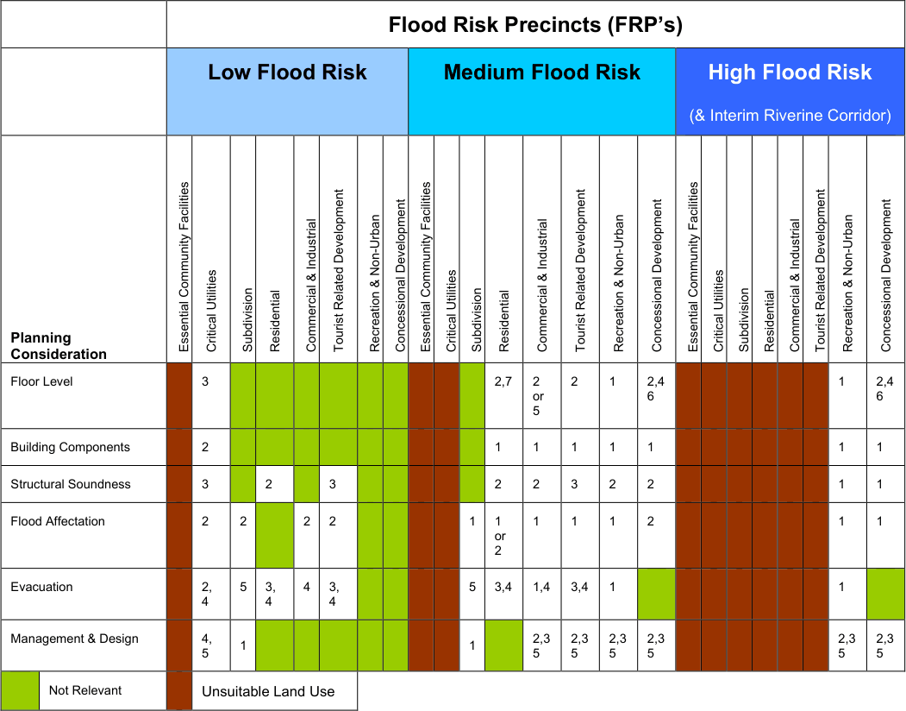

> [Picture on page 33: a map, saved as a picture (images/chapter-e13-floodplain-management-page-33-2.gif, 150 dpi); the street names and other small labels are on the picture.]
> Words printed on the picture (title and legend, copied from the PDF):
> (& Interim Riverine Corridor)
> Essential Community Facilities Critical Utilities Subdivision Residential Commercial & Industrial Tourist Related Development Recreation & Non-Urban Concessional Development Essential Community Facilities Critical Utilities Subdivision Residential Commercial & Industrial Tourist Related Development Recreation & Non-Urban Concessional Development Essential Community Facilities Critical Utilities Subdivision Residential Commercial & Industrial Tourist Related Development Recreation & Non-Urban Concessional Development
> 2 1 2,4
> Building Components 2
> 1 1 1 1 1
> Structural Soundness 3 2 3
> 2 2 3 2 2
> 1 1 1 2
> 2 2 2 2
> 5 3,4 1,4 3,4 1
> Management & Design 4,
> Not Relevant Unsuitable Land Use

#### Flood Risk Precincts (FRP’s)

#### Low Flood Risk Medium Flood Risk High Flood Risk

#### Note:

a. Filling of the site, where acceptable to Council, may change the FRP considered to determine the controls applied in the circumstances of individual applications.

b. Terms in italics are defined in the glossary of this plan and Schedule 2 specifies development types included in each land use category. These development types are generally as defined within Environmental Planning Instruments applying to the local government area.

c. Freeboard equals an additional height of 500mm.

Wollongong City Wide Development Control Plan 2009 – in force 25/3/20

#### Floor Level

1 All Floor Levels to be equal to or greater than the 5% AEP flood level plus freeboard unless justified by site specific assessment.

2 Habitable floor levels to be equal to or greater than the 1% AEP flood level plus freeboard.

3 All Floor Levels to be equal to or greater than the PMF flood level plus freeboard.

4 Floor levels to be as close to the flood planning level as practical & no lower than the existing floor level when undertaking alterations or additions.

5 Floor levels of shops to be as close to the flood planning level as practical. Where below the flood planning level, more than 30% of the floor area to be above the flood planning level or premises to be flood proofed below the flood planning level.

6 Garage floor level to be no lower than 300mm above finished adjacent ground.

7 Garage and all other non-habitable internal floor levels to be no lower than the 1% AEP flood level minus 300mm or 300mm above finished adjacent ground (whichever is the greater).

#### Building Components & Method

1 All structures to have flood compatible building components below or at the 100 year flood level plus freeboard.

2 All structures to have flood compatible building components below or at the PMF level plus freeboard.

#### Structural Soundness

1 Engineers report to certify that any structure can withstand the forces of floodwater, debris & buoyancy up to & including a 1% AEP flood level plus freeboard.

2 Applicant to demonstrate that any structure can withstand the forces of floodwater, debris & buoyancy up to & including a 1% AEP flood level plus freeboard , PMF plus freeboard if required to satisfy evacuation criteria (see below).

3 Applicant to demonstrate that any structure can withstand the forces of floodwater, debris & buoyancy up to & including a PMF flood plus freeboard.

#### Flood Affectation

1 Engineers report required to certify that the development will not increase flood affectation elsewhere, includes medium & high density residential proposals.

2 The impact of the development on flooding elsewhere to be considered, includes low density residential.

Note: When assessing flood affectation the following must be considered:

1\. Loss of storage in the floodplain.

2\. Changes in flood levels & velocities caused by alteration of conveyance of flood waters.

#### Evacuation

1 Reliable access or refuge required during a 100 year flood.

2 Reliable access for pedestrians and vehicles required during a PMF flood.

3 Reliable access for pedestrians or vehicles is required from the building, commencing at a minimum level equal to the lowest habitable floor level to an area of refuge above the PMF level, or a minimum of 20 m2 of the dwelling to be above the PMF level.

4 The development is to be consistent with any relevant flood evacuation strategy or similar plan.

5 Applicant to demonstrate that evacuation of potential development as a consequence of a subdivision proposal can be undertaken in accord with this Plan.

#### Management and Design

1 Applicant to demonstrate that potential development as a consequence of a subdivision proposal can be undertaken in accord with this Plan.

2 Site Emergency Response Flood plan required (except for single dwelling-houses) where floor levels are below the flood planning level.

3 Applicant to demonstrate that area is available to store goods above the 1% AEP flood level plus freeboard.

4 Applicant to demonstrate that area is available to store goods above the PMF level plus freeboard.

5 No external storage of materials below the flood planning level which may cause pollution or be potentially hazardous during any flood.

#### SCHEDULE 2: PRESCRIPTIVE CONTROLS – HEWITTS CREEK FLOODPLAIN

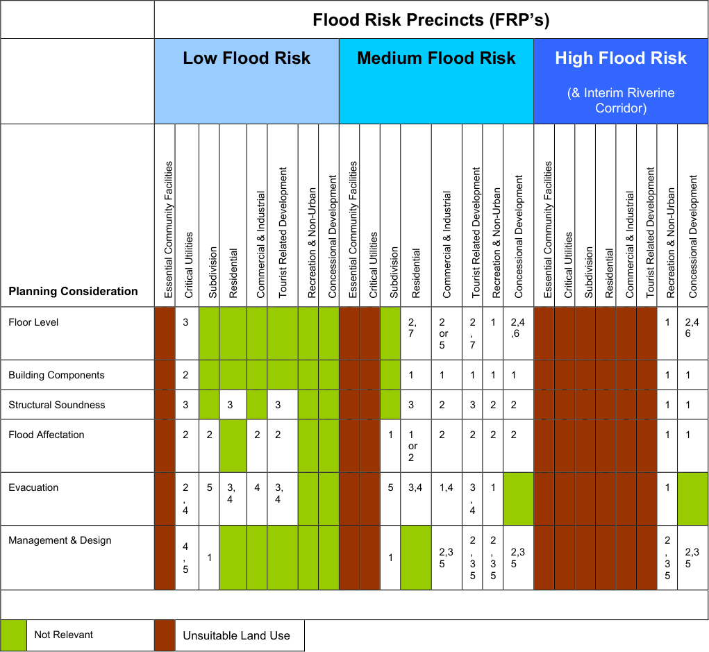

> [Picture on page 36: a map, saved as a picture (images/chapter-e13-floodplain-management-page-36-2.gif, 150 dpi); the street names and other small labels are on the picture.]
> Words printed on the picture (title and legend, copied from the PDF):
> (& Interim Riverine
> Planning Consideration Essential Community Facilities Critical Utilities Subdivision Residential Commercial & Industrial Tourist Related Development Recreation & Non-Urban Concessional Development Essential Community Facilities Critical Utilities Subdivision Residential Commercial & Industrial Tourist Related Development Recreation & Non-Urban Concessional Development Essential Community Facilities Critical Utilities Subdivision Residential Commercial & Industrial Tourist Related Development Recreation & Non-Urban Concessional Development
> 1 1 1 1 1
> 3 3 3
> 3 2 3 2 2
> 2 2 2 2
> 2 2 2 2
> 5 3,4 1,4 3
> Management & Design
> Unsuitable Land Use

#### Flood Risk Precincts (FRP’s)

#### Low Flood Risk Medium Flood Risk High Flood Risk

#### Note:

a. Filling of the site, where acceptable to Council, may change the FRP considered to determine the controls applied in the circumstances of individual applications.

b. For the Hewitts Catchments it is recommended that filling in floodplain areas east of the South Coast Railway Line embankment be permitted, if the applicant can demonstrate there are no local hydraulic impacts on adjoining property as a result of this filling. Filling in floodplain areas west of the Main South Coast Railway is not to be permitted unless an Engineer’s report is provided that certifies that the development will not increase flood affectation elsewhere.

c. Terms in italics are defined in the glossary of this plan and Schedule 2 specifies development types included in each land use category. These development types are generally as defined within Environmental Planning Instruments applying to the local government area.

d. Freeboard equals an additional height of 500 mm.

#### Floor Level

1 All Floor Levels to be equal to or greater than the 5% AEP flood level plus freeboard unless justified by site specific assessment.

2 Habitable floor levels to be equal to or greater than the 100 year flood level plus freeboard.

3 All Floor Levels to be equal to or greater than the PMF flood level plus freeboard.

4 Floor levels to be as close to the flood planning level as practical & no lower than the existing floor level when undertaking alterations or additions.

5 Floor levels of shops to be as close to the flood planning level as practical. Where below the flood planning level, more than 30% of the floor area to be above the flood planning level or premises to be flood proofed below the flood planning level.

6 Garage floor level to be no lower than 300mm above finished adjacent ground.

7 Garage and all other non-habitable internal floor levels to be no lower than the 1% AEP flood level minus 300mm or 300mm above finished adjacent ground (whichever is the greater).

#### Building Components & Method

1 All structures to have flood compatible building components below or at the 1% AEP flood level plus freeboard.

2 All structures to have flood compatible building components below or at the PMF level plus freeboard.

#### Structural Soundness

1 Engnieer’s report to certify that any structure can withstand the forces of floodwater, debris & buoyancy up to & including a 1% AEP flood plus freeboard.

2 Applicant to demonstrate that any structure can withstand the forces of floodwater, debris & buoyancy up to & including a 1% AEP flood plus freeboard.

3 Applicant to demonstrate that any structure can withstand the forces of floodwater, debris & buoyancy up to & including a PMF flood plus freeboard.

#### Flood Affectation

1 Engineer’s report required to certify that the development will not increase flood affectation elsewhere, includes medium & high-density residential proposals.

2 The impact of the development on flooding elsewhere to be considered, includes low density residential.

Note: When assessing flood affectation the following must be considered:

1\. Loss of storage in the floodplain.

2\. Changes in flood levels & velocities caused by alteration of conveyance of flood waters.

#### Evacuation

1 Reliable access or refuge required during a 1% AEP flood.

2 Reliable access for pedestrians and vehicles required during a PMF flood.

3 Reliable access for pedestrians or vehicles is required from the building, commencing at a minimum level equal to the lowest habitable floor level to an area of refuge above the PMF level, or a minimum of 20sqm of the dwelling to be above the PMF level.

4 The development is to be consistent with any relevant flood evacuation strategy or similar plan.

5 Applicant to demonstrate that evacuation of potential development as a consequence of a subdivision proposal can be undertaken in accord with this Plan.

#### Management and Design

1 Applicant to demonstrate that potential development as a consequence of a subdivision proposal can be undertaken in accord with this Plan.

2 Site Emergency Response Flood plan required (except for single dwelling-houses) where floor levels are below the flood planning level.

3 Applicant to demonstrate that area is available to store goods above the 1% AEP flood level plus freeboard.

4 Applicant to demonstrate that area is available to store goods above the PMF level plus freeboard.

5 No external storage of materials below the flood planning level which may cause pollution or be potentially hazardous during any flood.

#### SCHEDULE 3: PRESCRIPTIVE CONTROLS – MINNEGANG CREEK FLOODPLAIN

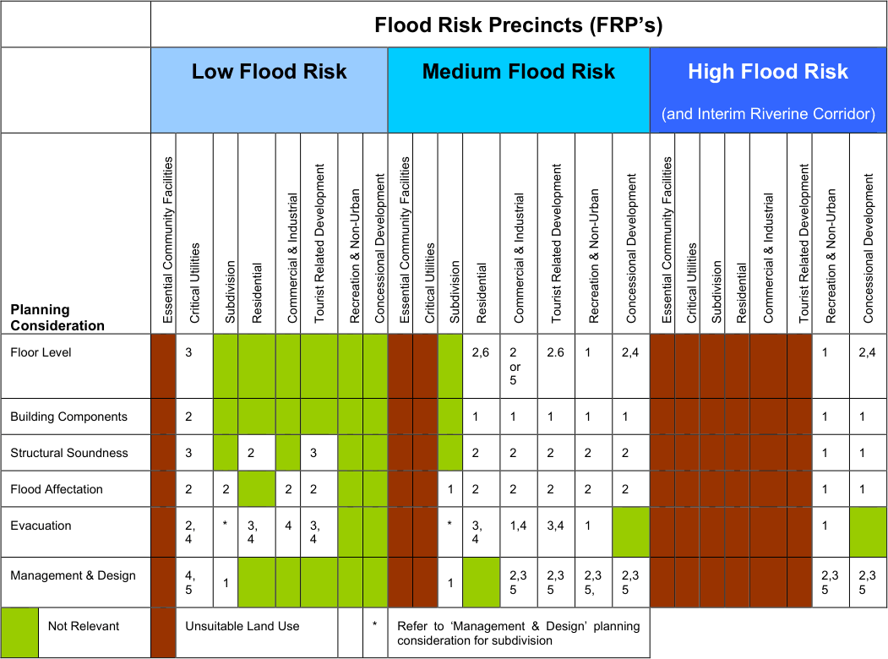

> [Picture on page 39: a map, saved as a picture (images/chapter-e13-floodplain-management-page-39-2.gif, 150 dpi); the street names and other small labels are on the picture.]
> Words printed on the picture (title and legend, copied from the PDF):
> (and Interim Riverine Corridor)
> Essential Community Facilities Critical Utilities Subdivision Residential Commercial & Industrial Tourist Related Development Recreation & Non-Urban Concessional Development Essential Community Facilities Critical Utilities Subdivision Residential Commercial & Industrial Tourist Related Development Recreation & Non-Urban Concessional Development Essential Community Facilities Critical Utilities Subdivision Residential Commercial & Industrial Tourist Related Development Recreation & Non-Urban Concessional Development
> 2.6 1 2,4
> Building Components 2
> 1 1 1 1 1
> Structural Soundness 3 2 3
> 2 2 2 2 2
> Flood Affectation 2 2 2 2
> 1 2 2 2 2 2
> 1,4 3,4 1
> Management & Design 4,
> Not Relevant Unsuitable Land Use * Refer to ‘Management & Design’ planning
> consideration for subdivision

#### Flood Risk Precincts (FRP’s)

#### Low Flood Risk Medium Flood Risk High Flood Risk

#### Notes:

1\. Filling of the site, where acceptable to Council, may change the FRP considered to determine the controls applied in the circumstances of individual applications.

2\. Terms in italics are defined in the glossary of this Plan and Schedule 2 specifies development types included in each land use category. These development types are generally as defined within Environmental Planning Instruments applying to the local government area.

#### Floor Level

1 All floor levels to be equal to or greater than the 5% AEP flood level plus freeboard unless justified by site specific assessment.

2 Habitable floor levels to be equal to or greater than the 1% AEP flood level plus freeboard.

3 All floor levels to be equal to or greater than the PMF flood level plus freeboard.

4 Floor levels to be as close to the flood planning level as practical and no lower than the existing floor level when undertaking alterations or additions.

5 Floor levels of shops to be as close to the flood planning level as practical. Where below the flood planning level, more than 30% of the floor area is to be above the flood planning level or premises to be flood-proofed below the flood planning level.

6 Garage and all other non-habitable internal floor levels to be no lower than the 1% AEP flood level minus 300mm or 300mm above finished adjacent ground (whichever is the greater).

#### Building Components and Method

1 All structures to have flood compatible building components below or at the 1% AEP flood level plus freeboard.

2 All structures to have flood compatible building components below or at the PMF flood level plus freeboard.

#### Structural Soundness

1 Engineer’s report to certify that any structure can withstand the forces of floodwater, debris and buoyancy up to and including a 1% AEP flood plus freeboard.

2 Applicant to demonstrate that any structure can withstand the forces of floodwater, debris and buoyancy up to and including a 1% AEP flood plus freeboard.

3 Applicant to demonstrate that any structure can withstand the forces of floodwater, debris and buoyancy up to and including a PMF flood plus freeboard.

#### Flood Affectation

1 Engineer’s report required to certify that the development would not increase flood affectation elsewhere.

2 The impact of the development on flooding elsewhere to be considered.

Note: When assessing flood affectation the following must be considered:

1\. Loss of storage in the floodplain.

2\. Changes in flood levels and velocities caused by alteration of conveyance of flood waters.

#### Evacuation

1 Reliable access or refuge required during a 1% AEP flood.

2 Reliable access for pedestrians and vehicles required during a PMF flood.

3 Reliable access for pedestrians or vehicles is required from the building, commencing at a minimum level equal to the lowest habitable floor level to an area of refuge above the PMF flood level, or a minimum of 40% of the gross floor area of the dwelling to be above the PMF flood level.

4 The development is to be consistent with any relevant flood evacuation strategy or similar plan.

#### Management and Design

1 Applicant to demonstrate that potential development as a consequence of a subdivision proposal can be undertaken in accordance with this Plan.

2 Site Emergency Response Flood plan required (except for single- dwelling houses) where floor levels are below the flood planning level.

3 Applicant to demonstrate that area is available to store goods above the 1% AEP flood level plus freeboard.

4 Applicant to demonstrate that area is available to store goods above the PMF flood level plus freeboard.

5 No external storage of materials below the flood planning level which may cause pollution or be potentially hazardous during any flood.

#### SCHEDULE 4: PRESCRIPTIVE CONTROLS – ALLANS CREEK FLOODPLAIN

|  | Flood Risk Precincts (FRP’s) |  |  |  |  |  |  |  |  |  |  |  |  |  |  |  |  |  |  |  |  |  |  |  |
|---|---|---|---|---|---|---|---|---|---|---|---|---|---|---|---|---|---|---|---|---|---|---|---|---|
|  | Low Flood Risk |  |  |  |  |  |  |  | Medium Flood Risk |  |  |  |  |  |  |  | High Flood Risk (& Interim Riverine Corridor) |  |  |  |  |  |  |  |
| Planning Consideration | Facilities Community Essential | Utilities Critical | Subdivision | Residential | Industrial & Commercial | Development Related Tourist | Non-Urban & Recreation | Development Concessional | Facilities Community Essential | Utilities Critical | Subdivision | Residential | Industrial & Commercial | Development Related Tourist | Non-Urban & Recreation | Development Concessional | Facilities Community Essential | Utilities Critical | Subdivision | Residential | Industrial & Commercial | Development Related Tourist | Non-Urban & Recreation | Development Concessional |
| Floor Level |  | 3 |  |  |  |  |  |  |  |  |  | 2, 6 | 1, 2 or 5 | 2,6 | 1 | 2,4 |  |  |  |  | 1 |  | 1 | 2,4 6 |
| Building Components |  | 2 |  |  |  |  |  |  |  |  |  | 1 | 1 | 1 | 1 | 1 |  |  |  |  | 1 |  | 1 | 1 |
| Structural Soundness |  | 3 |  | 3 |  | 3 |  |  |  |  |  | 3 | 2 | 3 | 2 | 2 |  |  |  |  | 1 |  | 1 | 1 |
| Flood Affectation |  | 2 | 2 |  | 2 | 2 |  |  |  |  | 1 | 1 | 1 | 1 | 1 | 2 |  |  |  |  | 1 |  | 1 | 1 |
| Evacuation |  | 2, 4 | * | 3, 4 | 4 | 3, 4 |  |  |  |  | * | 3, 4 | 1,4 | 3,4 | 1 |  |  |  |  |  | * |  | 1 |  |
| Management & Design |  | 4, 5 | 1 |  |  |  |  |  |  |  | 1 |  | 2,3 5 | 2,3 5 | 2,3 5,6 | 2,3 5 |  |  |  |  | 2,3 5 |  | 2,3 5 | 2,3 5 |

Industrial Only, Commercial Not Permitted

Not Relevant Unsuitable Land Use * Refer to ‘Management & Design’

planning consideration for subdivision

#### Floor Level

1 For industrial land use only – All Floor Levels to be equal to or greater than the 1% AEP flood unless justified by site specific assessment.

2 Habitable floor levels to be equal to or greater than the 1% AEP flood level plus 0.5m (freeboard).

3 All Floor Levels to be equal to or greater than the PMF flood level plus 0.5m (freeboard).

4 Floor levels to be as close to the flood planning level as practical & no lower than the existing floor level when undertaking alterations or additions.

5 Floor levels of shops to be as close to the flood planning level as practical. Where below the flood planning level, more than 30% of the floor area to be above the flood planning level or premises to be flood proofed below the flood planning level.

6 Garage and all other non-habitable internal floor levels to be no lower than the 1% AEP flood level minus 300mm or 300mm above finished adjacent ground (whichever is the greater).

#### Building Components & Method

1 All structures to have flood compatible building components below or at the 1% AEP flood level plus 0.5m (freeboard).

2 All structures to have flood compatible building components below or at the PMF level plus 0.5m (freeboard).

#### Structural Soundness

1 Engineer’s report to certify that any structure can withstand the forces of floodwater, debris and buoyancy up to and including a 1% AEP flood plus freeboard.

2 Applicant to demonstrate that any structure can withstand the forces of floodwater, debris and buoyancy up to and including a 1% AEP flood plus freeboard, or a PMF plus freeboard if required to satisfy evacuation criteria (see below).

3 Applicant to demonstrate that any structure can withstand the forces of floodwater, debris and buoyancy up to and including a PMF flood plus freeboard.

#### Flood Affectation

1 Engineers report required to certify that the development will not increase flood affectation elsewhere, includes medium and high density residential proposals.

2 The impact of the development on flooding elsewhere to be considered, includes low density residential.

#### Evacuation

1 Reliable access or refuge required during a 1% AEP flood.

2 Reliable access for pedestrians and vehicles required during a PMF flood.

3 Reliable access for pedestrians or vehicles is required from the building, commencing at a minimum level equal to the lowest habitable floor level to an area of refuge above the PMF level, or a minimum of 20sqm of the dwelling/premises to be above the PMF level.

4 The development is to be consistent with any relevant flood evacuation strategy or similar plan.

5 Applicant to demonstrate that evacuation of potential development as a consequence of a subdivision proposal can be undertaken in accord with this Plan.

#### Management and Design

1 Applicant to demonstrate that potential development as a consequence of a subdivision proposal can be undertaken in accordance with this chapter.

2 Site Emergency Response Flood plan required (except for single dwelling-houses) where floor levels are below the PMF.

3 Applicant to demonstrate that area is available to store goods above the 1% AEP flood level plus 0.5m (freeboard).

4 Applicant to demonstrate that area is available to store goods above the PMF plus 0.5m (freeboard).

5 No external storage of materials below the flood planning level which may cause pollution or be potentially hazardous during any flood.

\* adapted from this chapter for Towradgi Creek and modified for the Allans Creek Floodplain.

^ Flood Risk Precinct Definitions for Allans Creek – see Section 3.

Any proposed development will also need to be consistent with other Council requirements.

#### SCHEDULE 5: PRESCRIPTIVE CONTROLS – FAIRY CABBAGE TREE CREEK FLOODPLAIN

> [Picture on page 45: a map, saved as a picture (images/chapter-e13-floodplain-management-page-45-3.gif, 150 dpi); the street names and other small labels are on the picture.]
> Words printed on the picture (title and legend, copied from the PDF):
> (& Interim Riverine Corridor)
> Essential Community Facilities Critical Utilities Subdivision Residential Commercial & Industrial Tourist Related Development Recreation & Non-Urban Concessional Development Essential Community Facilities Critical Utilities Subdivision Residential Commercial & Industrial Tourist Related Development Recreation & Non-Urban Concessional Development Essential Community Facilities Critical Utilities Subdivision Residential Commercial & Industrial Tourist Related Development Recreation & Non-Urban Concessional Development
> 2 1 2,4
> Building Components 2
> 1 1 1 1 1
> Structural Soundness 3 2 3
> 2 2 3 2 2
> 1 1 1 2
> 2 2 2 2
> 5 3,4 1,4 3,4 1
> Management & Design 4,
> Not Relevant Unsuitable Land Use

#### Flood Risk Precincts (FRP’s)

#### Low Flood Risk Medium Flood Risk High Flood Risk

#### Note:

a. Filling of the site, where acceptable to Council, may change the FRP considered to determine the controls applied in the circumstances of individual applications.

b. Terms in italics are defined in the glossary of this plan and Schedule 2 specifies development types included in each land use category. These development types are generally as defined within Environmental Planning Instruments applying to the local government area.

c. Freeboard equals an additional height of 500mm.

Wollongong City Wide Development Control Plan 2009 – in force 25/3/20

#### Floor Level

1 All Floor Levels to be equal to or greater than the 5% AEP flood level plus freeboard unless justified by site specific assessment.

2 Habitable floor levels to be equal to or greater than the 1% AEP flood level plus freeboard.

3 All Floor Levels to be equal to or greater than the PMF flood level plus freeboard.

4 Floor levels to be as close to the flood planning level as practical & no lower than the existing floor level when undertaking alterations or additions.

5 Floor levels of shops to be as close to the flood planning level as practical. Where below the flood planning level, more than 30% of the floor area to be above the flood planning level or premises to be flood proofed below the flood planning level.

6 Garage and all other non-habitable internal floor levels to be no lower than the 1% AEP flood level minus 300 mm or 300 mm above finished adjacent ground (whichever is the greater).

#### Building Components & Method

1 All structures to have flood compatible building components below or at the 1% AEP flood level plus freeboard.

2 All structures to have flood compatible building components below or at the PMF level plus freeboard.

#### Structural Soundness

1 Engineer’s report to certify that any structure can withstand the forces of floodwater, debris & buoyancy up to & including a 1% AEP flood plus freeboard.

2 Applicant to demonstrate that any structure can withstand the forces of floodwater, debris & buoyancy up to & including a 1% AEP flood plus freeboard, PMF plus freeboard if required to satisfy evacuation criteria (see below).

3 Applicant to demonstrate that any structure can withstand the forces of floodwater, debris & buoyancy up to & including a PMF flood plus freeboard.

#### Flood Affectation

1 Engineer’s report required to certify that the development will not increase flood affectation elsewhere, includes medium & high-density residential proposals.

2 The impact of the development on flooding elsewhere to be considered, includes low density residential.

Note: When assessing flood affectation the following must be considered:

1\. Loss of net storage of flood waters in the floodplain. Compensatory cut to fill earthworks in the floodplain may be a means to ensure no net loss of flood water storage.

2\. Changes in flood levels and velocities caused by alteration of conveyance of flood waters.

#### Evacuation

1 Reliable access or refuge required during a 1% AEP flood.

2 Reliable access for pedestrians and vehicles required during an PMF flood.

3 Reliable access for pedestrians or vehicles is required from the building, commencing at a minimum level equal to the lowest habitable floor level to an area of refuge above the PMF level, or a minimum of 20 m2 of the dwelling to be above the PMF level.

4 The development is to be consistent with any relevant flood evacuation strategy or similar plan.

5 Applicant to demonstrate that evacuation of potential development as a consequence of a subdivision proposal can be undertaken in accord with this Plan.

#### Management and Design

1 Applicant to demonstrate that potential development as a consequence of a subdivision proposal can be undertaken in accord with this Plan.

2 Site Emergency Response Flood plan required (except for single dwelling houses) where floor levels are below the flood planning level.

3 Applicant to demonstrate that area is available to store goods above the 1% AEP flood level plus freeboard.

4 Applicant to demonstrate that area is available to store goods above the PMF level plus freeboard.

5 No external storage of materials below the flood planning level which may cause pollution or be potentially hazardous during any flood.

#### SCHEDULE 6: PRESCRIPTIVE CONTROLS – MULLET AND BROOKS CREEK FLOODPLAIN

|  | Flood Risk Precincts (FRP’s) |  |  |  |  |  |  |  |  |  |  |  |  |  |  |  |  |  |  |  |  |  |  |  |
|---|---|---|---|---|---|---|---|---|---|---|---|---|---|---|---|---|---|---|---|---|---|---|---|---|
|  | Low Flood Risk |  |  |  |  |  |  |  | Medium Flood Risk |  |  |  |  |  |  |  | High Flood Risk (& Interim Riverine Corridor) |  |  |  |  |  |  |  |
| Planning Consideration | Facilities Community Essential | Utilities Critical | Subdivision | Residential | Industrial & Commercial | Development Related Tourist | Non-Urban & Recreation | Development Concessional | Facilities Community Essential | Utilities Critical | Subdivision | Residential | Industrial & Commercial | Development Related Tourist | Non-Urban & Recreation | Development Concessional | Facilities Community Essential | Utilities Critical | Subdivision | Residential | Industrial & Commercial | Development Related Tourist | Non-Urban & Recreation | Development Concessional |
| Floor Level |  | 3 |  |  |  |  |  |  |  |  |  | 2,7 | 2 or 5 | 2 | 1 | 2,4 6 |  |  |  |  |  |  | 1 | 2,4 6 |
| Building Components |  | 2 |  |  |  |  |  |  |  |  |  | 1 | 1 | 1 | 1 | 1 |  |  |  |  |  |  | 1 | 1 |
| Structural Soundness |  | 3 |  | 2 |  | 3 |  |  |  |  |  | 2 | 2 | 3 | 2 | 2 |  |  |  |  |  |  | 1 | 1 |
| Flood Affectation |  | 2 | 2 |  | 2 | 2 |  |  |  |  | 1 | 1 or 2 | 1 | 1 | 1 | 2 |  |  |  |  |  |  | 1 | 1 |
| Evacuation |  | 2, 4 | 5 | 3, 4 | 4 | 3, 4 |  |  |  |  | 5 | 3,4 | 1,4 | 3,4 | 1 |  |  |  |  |  |  |  | 1 |  |
| Management & Design |  | 4, 5 | 1 |  |  |  |  |  |  |  | 1 |  | 2,3 5 | 2,3 5 | 2,3 5 | 2,3 5 |  |  |  |  |  |  | 2,3 5 | 2,3 5 |
| Not Relevant |  | Unsuitable Land Use |  |  |  |  |  |  |  |  |  |  |  |  |  |  |  |  |  |  |  |  |  |  |

#### Note:

a. Filling of the site, where acceptable to Council, may change the FRP considered to determine the controls applied in the circumstances of individual applications.

b. Terms in italics are defined in the glossary of this plan and Schedule 2 specifies development types included in each land use category. These development types are generally as defined within Environmental Planning Instruments applying to the local government area.

c. Freeboard equals an additional height of 500mm.

#### Floor Level

1 All Floor Levels to be equal to or greater than the 5% AEP flood level plus freeboard unless justified by site specific assessment.

2 Habitable floor levels to be equal to or greater than the 1% AEP flood level plus freeboard.

3 All Floor Levels to be equal to or greater than the PMF flood level plus freeboard.

4 Floor levels to be as close to the flood planning level as practical & no lower than the existing floor level when undertaking alterations or additions.

5 Floor levels of shops to be as close to the flood planning level as practical. Where below the flood planning level, more than 30% of the floor area to be above the flood planning level or premises to be flood proofed below the flood planning level.

7 Garage and all other non-habitable internal floor levels to be no lower than the 1% AEP flood level minus 300mm or 300mm above finished adjacent ground (whichever is the greater).

#### Building Components & Method

1 All structures to have flood compatible building components below or at the 1% AEP flood level plus freeboard.

2 All structures to have flood compatible building components below or at the PMF level plus freeboard.

#### Structural Soundness

1 Engineer’s report to certify that any structure can withstand the forces of floodwater, debris & buoyancy up to & including a 1% AEP flood plus freeboard.

2 Applicant to demonstrate that any structure can withstand the forces of floodwater, debris & buoyancy up to & including a 1% AEP flood plus freeboard, PMF plus freeboard if required to satisfy evacuation criteria (see below).

3 Applicant to demonstrate that any structure can withstand the forces of floodwater, debris & buoyancy up to & including a PMF flood plus freeboard.

#### Flood Affectation

1 Engineer’s report required to certify that the development will not increase flood affectation elsewhere, includes medium & high-density residential proposals.

2 The impact of the development on flooding elsewhere to be considered, includes low density residential.

Note: When assessing flood affectation the following must be considered:

1\. Loss of storage in the floodplain.

2\. Changes in flood levels & velocities caused by alteration of conveyance of flood waters.

#### Evacuation

1 Reliable access or refuge required during a 1% AEP flood.

2 Reliable access for pedestrians and vehicles required during a PMF flood.

3 Reliable access for pedestrians or vehicles is required from the building, commencing at a minimum level equal to the lowest habitable floor level to an area of refuge above the PMF level, or a minimum of 20sqm of the dwelling to be above the PMF level.

4 The development is to be consistent with any relevant flood evacuation strategy or similar plan.

5 Applicant to demonstrate that evacuation of potential development as a consequence of a subdivision proposal can be undertaken in accord with this Plan.

#### Management and Design

1 Applicant to demonstrate that potential development as a consequence of a subdivision proposal can be undertaken in accord with this Plan.

2 Site Emergency Response Flood plan required (except for single dwelling-houses) where floor levels are below the flood planning level.

3 Applicant to demonstrate that area is available to store goods above the 1% AEP flood level plus freeboard.

4 Applicant to demonstrate that area is available to store goods above the PMF level plus freeboard.

5 No external storage of materials below the flood planning level which may cause pollution or be potentially hazardous during any flood.

#### SCHEDULE 7: PRESCRIPTIVE CONTROLS – WOLLONGONG CITY FLOODPLAIN

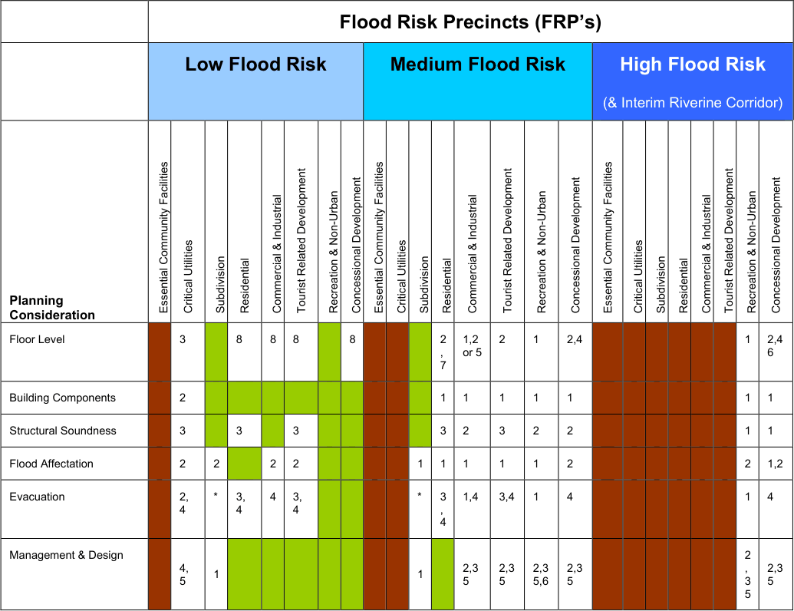

> [Picture on page 51: a map, saved as a picture (images/chapter-e13-floodplain-management-page-51-2.gif, 150 dpi); the street names and other small labels are on the picture.]
> Words printed on the picture (title and legend, copied from the PDF):
> (& Interim Riverine Corridor)
> Essential Community Facilities Critical Utilities Subdivision Residential Commercial & Industrial Tourist Related Development Recreation & Non-Urban Concessional Development Essential Community Facilities Critical Utilities Subdivision Residential Commercial & Industrial Tourist Related Development Recreation & Non-Urban Concessional Development Essential Community Facilities Critical Utilities Subdivision Residential Commercial & Industrial Tourist Related Development Recreation & Non-Urban Concessional Development
> 2 1 2,4
> 3 8 8 8 8
> Building Components 2
> 1 1 1 1 1
> Structural Soundness 3 3 3
> 3 2 3 2 2
> 2 2 2 2
> 1 1 1 1 1 2
> 1,4 3,4 1 4
> Management & Design

#### Flood Risk Precincts (FRP’s)

#### Low Flood Risk Medium Flood Risk High Flood Risk

Not Relevant Unsuitable Land Use * Refer to ‘Management & Design’ planning

consideration for subdivision

#### Note:

a. Filling of the site, where acceptable to Council, may change the FRP considered to determine the controls applied in the circumstances of individual applications.

b. Terms in italics are defined in the glossary of this plan and Schedule 2 specifies development types included in each land use category. These development types are generally as defined within Environmental Planning Instruments applying to the local government area.

c. Freeboard equals an additional height of 500mm

Wollongong City Wide Development Control Plan 2009 – in force 25/3/20

#### Floor Level

1 All Floor Levels to be equal to or greater than the 5% AEP flood level plus freeboard unless justified by site specific assessment.

2 Habitable floor levels to be equal to or greater than the 1% AEP flood level plus freeboard.

3 All Floor Levels to be equal to or greater than the PMF flood level plus freeboard.

4 Floor levels to be as close to the flood planning level as practical & no lower than the existing floor level when undertaking alterations or additions.

5 Floor levels of shops to be as close to the flood planning level as practical. Where below the flood planning level, more than 30% of the floor area to be above the flood planning level or premises to be flood proofed below the flood planning level.

7 Garage and all other non-habitable internal floor levels to be no lower than the 1% AEP flood level minus 300mm or 300mm above finished adjacent ground (whichever is the greater).

8 Habitable flood level to be a minimum of 300mm above finished adjacent ground level.

#### Building Components & Method

1 All structures to have flood compatible building components below or at the 1% AEP flood level plus freeboard.

2 All structures to have flood compatible building components below or at the PMF level plus freeboard.

#### Structural Soundness

1 Engineers report to certify that any structure can withstand the forces of floodwater, debris & buoyancy up to & including a 1% AEP flood plus freeboard.

2 Applicant to demonstrate that any structure can withstand the forces of floodwater, debris & buoyancy up to & including a 1% AEP flood plus freeboard, PMF plus freeboard if required to satisfy evacuation criteria (see below).

3 Applicant to demonstrate that any structure can withstand the forces of floodwater, debris & buoyancy up to & including a PMF flood plus freeboard.

#### Flood Affectation

1 Engineers report required to certify that the development will not increase flood affectation elsewhere, includes medium & high density residential proposals.

2 The impact of the development on flooding elsewhere to be considered, includes low density residential.

Note: When assessing flood affectation the following must be considered:

1\. Loss of storage in the floodplain.

2\. Changes in flood levels & velocities caused by alteration of conveyance of flood waters.

#### Evacuation

1 Reliable access or refuge required during a 1% AEP flood.

2 Reliable access for pedestrians and vehicles required during a PMF flood.

3 Reliable access for pedestrians or vehicles is required from the building, commencing at a minimum level equal to the lowest habitable floor level to an area of refuge above the PMF level, or a minimum of 20sqm of the dwelling to be above the PMF level.

4 The development is to be consistent with any relevant flood evacuation strategy or similar plan.

#### Management and Design

1 Applicant to demonstrate that potential development as a consequence of a subdivision proposal can be undertaken in accord with this Plan.

2 Site Emergency Response Flood plan required (except for single dwelling-houses) where floor levels are below the flood planning level.

3 Applicant to demonstrate that area is available to store goods above the 1% AEP flood level plus freeboard.

4 Applicant to demonstrate that area is available to store goods above the PMF level plus freeboard.

5 No external storage of materials below the flood planning level which may cause pollution or be potentially hazardous during any flood.

SCHEDULE 8: PRESCRIPTIVE CONTROLS – COMBINED CATCHMENTS OF WHARTONS, COLLINS AND FARRAHARS CREEKS, BELLAMBI GULLY AND

#### BELLAMBI LAKE FLOODPLAINS

|  | Flood Risk Precincts (FRP’s) |  |  |  |  |  |  |  |  |  |  |  |  |  |  |  |  |  |  |  |  |  |  |  |
|---|---|---|---|---|---|---|---|---|---|---|---|---|---|---|---|---|---|---|---|---|---|---|---|---|
|  | Low Flood Risk |  |  |  |  |  |  |  | Medium Flood Risk |  |  |  |  |  |  |  | High Flood Risk (& Interim Riverine Corridor) |  |  |  |  |  |  |  |
| Planning Consideration | Facilities Community Essential | Utilities Critical | Subdivision | Residential | Industrial & Commercial | Development Related Tourist | Non-Urban & Recreation | Development Concessional | Facilities Community Essential | Utilities Critical | Subdivision | Residential | Industrial & Commercial | Development Related Tourist | Non-Urban & Recreation | Development Concessional | Facilities Community Essential | Utilities Critical | Subdivision | Residential | Industrial & Commercial | Development Related Tourist | Non-Urban & Recreation | Development Concessional |
| Floor Level |  | 3 |  |  |  |  |  |  |  |  |  | 2, 7 | 2 or 5 | 2 | 1 | 2,4 6 |  |  |  |  |  |  | 1 | 2,4 6 |
| Building Components |  | 2 |  |  |  |  |  |  |  |  |  | 1 | 1 | 1 | 1 | 1 |  |  |  |  |  |  | 1 | 1 |
| Structural Soundness |  | 3 |  | 3 |  | 3 |  |  |  |  |  | 2 | 2 | 3 | 2 | 2 |  |  |  |  |  |  | 1 | 1 |
| Flood Affectation |  | 2 | 2 |  | 2 | 2 |  |  |  |  | 1 | 1 or 2 | 1 | 1 | 1 | 2 |  |  |  |  |  |  | 1 | 1 |
| Evacuation |  | 2, 4 | * | 3, 4 | 4 | 3, 4 |  |  |  |  | * | 3,4 | 1,4 | 3,4 | 1 |  |  |  |  |  |  |  | 1 |  |
| Management & Design |  | 4, 5 | 1 |  |  |  |  |  |  |  | 1 |  | 2,3 5 | 2,3 5 | 2,3 5 | 2,3 5 |  |  |  |  |  |  | 2 , 3 5 | 2,3 5 |

Not Relevant

Unsuitable Land Use * Refer to ‘Management & Design’ planning

consideration for subdivision

#### Notes:

#### *

a. Filling of the site, where acceptable to Council, may change the FRP considered to determine the controls applied in the circumstances of individual applications..

b. Terms in italics are defined in the glossary of this plan and Schedule 2 specifies development types included in each land use category. These development types are generally as defined within Environmental Planning Instruments applying to the local government area.

c. Freeboard equals an additional height of 500mm.

#### Floor Level

1 All Floor Levels to be equal to or greater than the 5% AEP flood level plus freeboard unless justified by site specific assessment.

2 Habitable floor levels to be equal to or greater than the 1% AEP flood level plus freeboard.

3 All Floor Levels to be equal to or greater than the PMF flood level plus freeboard.

4 Floor levels to be as close to the flood planning level as practical & no lower than the existing floor level when undertaking alterations or additions.

5 Floor levels of shops to be as close to the flood planning level as practical. Where below the flood planning level, more than 30% of the floor area to be above the flood planning level or premises to be flood proofed below the flood planning level.

7 Garage and all other non-habitable internal floor levels to be no lower than the 1% AEP flood level minus 300mm or 300mm above finished adjacent ground (whichever is the greater).

#### Building Components & Method

1 All structures to have flood compatible building components below or at the 1% AEP flood level plus freeboard.

2 All structures to have flood compatible building components below or at the PMF level plus freeboard.

#### Structural Soundness

1 Engineers report to certify that any structure can withstand the forces of floodwater, debris & buoyancy up to & including a 1% AEP flood plus freeboard.

2 Applicant to demonstrate that any structure can withstand the forces of floodwater, debris & buoyancy up to & including a 1% AEP flood plus freeboard, PMF plus freeboard if required to satisfy evacuation criteria (see below).

3 Applicant to demonstrate that any structure can withstand the forces of floodwater, debris & buoyancy up to & including a PMF flood plus freeboard.

#### Flood Affectation

1 Engineers report required to certify that the development will not increase flood affectation elsewhere, includes medium & high density residential proposals.

2 The impact of the development on flooding elsewhere to be considered, includes low density residential.

Note: When assessing flood affectation the following must be considered:

1\. Loss of storage in the floodplain.

2\. Changes in flood levels & velocities caused by alteration of conveyance of flood waters.

#### Evacuation

1 Reliable access or refuge required during a 1% AEP flood.

2 Reliable access for pedestrians and vehicles required during a PMF flood.

3 Reliable access for pedestrians or vehicles is required from the building, commencing at a minimum level equal to the lowest habitable floor level to an area of refuge above the PMF level, or a minimum of 20sqm of the dwelling to be above the PMF level.

4 The development is to be consistent with any relevant flood evacuation strategy or similar plan.

#### Management and Design

1 Applicant to demonstrate that potential development as a consequence of a subdivision proposal can be undertaken in accord with this Plan.

2 Site Emergency Response Flood plan required (except for single dwelling-houses) where floor levels are below the flood planning level.

3 Applicant to demonstrate that area is available to store goods above the 1% AEP flood level plus freeboard.

4 Applicant to demonstrate that area is available to store goods above the PMF level plus freeboard.

5 No external storage of materials below the flood planning level which may cause pollution or be potentially hazardous during any flood.

#### SCHEDULE 9: PRESCRIPTIVE CONTROLS – LAKE ILLAWARRA FLOODPLAIN

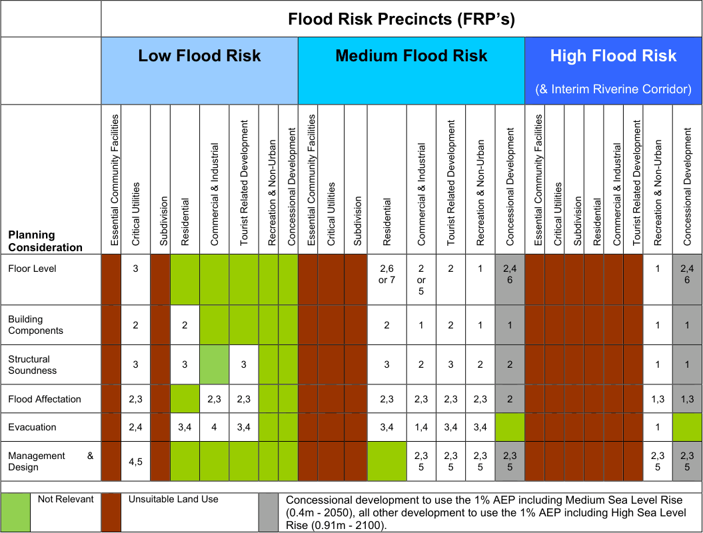

> [Picture on page 57: a map, saved as a picture (images/chapter-e13-floodplain-management-page-57-2.gif, 150 dpi); the street names and other small labels are on the picture.]
> Words printed on the picture (title and legend, copied from the PDF):
> (& Interim Riverine Corridor)
> Essential Community Facilities Critical Utilities Subdivision Residential Commercial & Industrial Tourist Related Development Recreation & Non-Urban Concessional Development Essential Community Facilities Critical Utilities Subdivision Residential Commercial & Industrial Tourist Related Development Recreation & Non-Urban Concessional Development Essential Community Facilities Critical Utilities Subdivision Residential Commercial & Industrial Tourist Related Development Recreation & Non-Urban Concessional Development
> 2 1 2,4
> 2 1 2 1 1
> 3 3 3
> 3 2 3 2 2
> Flood Affectation 2,3
> 2,3 2,3 2,3 2,3 2
> 2,4 3,4 4 3,4
> 3,4 1,4 3,4 3,4
> Not Relevant Unsuitable Land Use
> Concessional development to use the 1% AEP including Medium Sea Level Rise
> (0.4m - 2050), all other development to use the 1% AEP including High Sea Level
> Rise (0.91m - 2100).

#### Flood Risk Precincts (FRP’s)

#### Low Flood Risk

#### Medium Flood Risk High Flood Risk

#### Floor Level

1 All floor levels to be equal to or greater than the 5% AEP flood level plus freeboard unless justified by site specific assessment.

2 Habitable floor levels to be equal to or greater than the 1% AEP flood level plus 0.5m freeboard.

3 All floor levels to be equal to or greater than the PMF.

4 Floor levels to be as close to the flood planning level as practical and no lower than the existing floor level when undertaking alterations or additions.

5 Floor levels of shops to be as close to the flood planning level as practical. Where below the flood planning level, more than 30% of the floor area to be above the flood planning level or premises to be flood proofed below the flood planning level.

6 Garage floor level to be no lower than 300mm above finished adjacent ground.

7 Garage and all other non-habitable internal floor levels to be no lower than the 1% AEP flood level minus 300mm or 300mm above finished adjacent ground (whichever is the greater).

Wollongong City Wide Development Control Plan 2009 – in force 25/3/20

#### Building Components and Method

1 All structures to have flood compatible building components below or at the 1% AEP flood level plus freeboard.

2 All structures to have flood compatible building components below or at the PMF.

#### Structural Soundness

1 Engineers report to certify that any structure can withstand the forces of floodwater, debris and buoyancy up to and including a 1% AEP flood plus 0.5m freeboard.

2 Applicant to demonstrate that any structure can withstand the forces of floodwater, debris and buoyancy up to and including a 1% AEP flood plus 0.5m freeboard.

3 Engineers report to demonstrate that any structure can withstand the forces of floodwater, debris and buoyancy up to and including a PMF event.

#### Flood Affectation

1 Engineers report required to certify that the development will not increase flood affectation elsewhere.

2 The impact of the development on flooding elsewhere to be considered.

3 No wholesale filling of sites around the foreshore of the lake is permitted, unless supported by a sensitivity analysis indicting that there is no significant impact on flood levels. Also, filling that impacts on active flow areas in the stream networks feeding Lake Illawarra will not be supported. However, filling within existing building areas is permitted. Filling of depressions outside of the existing building areas may be permitted subject to it being demonstrated that there is no loss of flood storage across the site in all events up to the PMF.

#### Evacuation

1 Reliable access or refuge required during a 1% AEP flood.

2 Reliable access for pedestrians and vehicles required during a PMF event.

3 Reliable access for pedestrians or vehicles is required from the building, commencing at a minimum level equal to the lowest habitable floor level to an area of refuge above the PMF, or a minimum of 20m² of the dwelling to be above the PMF level.

4 The development is to be consistent with any relevant flood evacuation strategy or similar plan.

5 Applicant to demonstrate that evacuation of potential development as a consequence of a subdivision proposal can be undertaken in accord with this Plan.

#### Management and Design

1 Applicant to demonstrate that potential development as a consequence of a subdivision proposal can be undertaken in accord with this Plan.

2 Site Emergency Response Flood plan required (except for single dwelling-houses) where floor levels are below the flood planning level.

3 Applicant to demonstrate that area is available to store goods above the 1% AEP flood level plus 0.5m freeboard.

4 Applicant to demonstrate that area is available to store goods above the PMF.

5 No external storage of materials below the flood planning level which may cause pollution or be potentially hazardous during any flood.

#### SCHEDULE 9a: PRESCRIPTIVE CONTROLS – LAKE ILLAWARRA – WINDANG PENINSULA

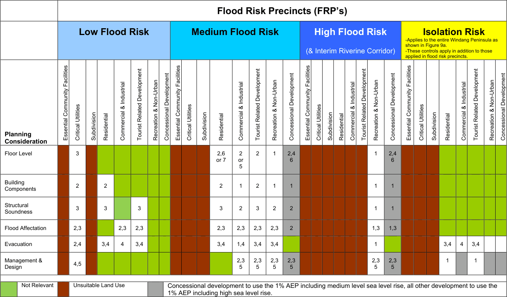

> [Picture on page 60: a map, saved as a picture (images/chapter-e13-floodplain-management-page-60-2.gif, 150 dpi); the street names and other small labels are on the picture.]
> Words printed on the picture (title and legend, copied from the PDF):
> (& Interim Riverine Corridor)
> -Applies to the entire Windang Peninsula as
> shown in Figure 9a.
> -These controls apply in addition to those
> applied in flood risk precincts.
> Essential Community Facilities Critical Utilities Subdivision Residential Commercial & Industrial Tourist Related Development Recreation & Non-Urban Concessional Development Essential Community Facilities Critical Utilities Subdivision Residential Commercial & Industrial Tourist Related Development Recreation & Non-Urban Concessional Development Essential Community Facilities Critical Utilities Subdivision Residential Commercial & Industrial Tourist Related Development Recreation & Non-Urban Concessional Development Essential Community Facilities Critical Utilities Subdivision Residential Commercial & Industrial Tourist Related Development Recreation & Non-Urban Concessional Development
> 2 1 2,4
> 2 1 2 1 1
> 3 3 3
> 3 2 3 2 2
> Flood Affectation 2,3
> 2,3 2,3 2,3 2,3 2
> 2,4 3,4 4 3,4
> 3,4 1,4 3,4 3,4
> 3,4 4 3,4
> Not Relevant Unsuitable Land Use
> Concessional development to use the 1% AEP including medium level sea level rise, all other development to use the
> 1% AEP including high sea level rise.

#### Flood Risk Precincts (FRP’s)

#### Low Flood Risk

#### Medium Flood Risk High Flood Risk

#### Isolation Risk

Wollongong City Wide Development Control Plan 2009 – in force 25/3/20

#### Floor Level

1 All floor levels to be equal to or greater than the 5% AEP flood level plus freeboard unless justified by site specific assessment.

2 Habitable floor levels to be equal to or greater than the 1% AEP flood level plus 0.5m freeboard.

3 All floor levels to be equal to or greater than the PMF.

4 Floor levels to be as close to the flood planning level as practical and no lower than the existing floor level when undertaking alterations or additions.

5 Floor levels of shops to be as close to the flood planning level as practical. Where below the flood planning level, more than 30% of the floor area to be above the flood planning level or premises to be flood proofed below the flood planning level.

6 Garage floor level to be no lower than 300mm above finished adjacent ground.

7 Garage and all other non-habitable internal floor levels to be no lower than the 1% AEP flood level minus 300mm or 300mm above finished adjacent ground (whichever is the greater).

#### Building Components and Method

1 All structures to have flood compatible building components below or at the 1% AEP flood level plus freeboard.

2 All structures to have flood compatible building components below or at the PMF.

#### Structural Soundness

1 Engineers report to certify that any structure can withstand the forces of floodwater, debris and buoyancy up to and including a 1% AEP flood plus 0.5m freeboard.

2 Applicant to demonstrate that any structure can withstand the forces of floodwater, debris and buoyancy up to and including a 1% AEP flood plus 0.5m freeboard.

3 Engineers report to demonstrate that any structure can withstand the forces of floodwater, debris and buoyancy up to and including a PMF event.

#### Flood Affectation

1 Engineers report required to certify that the development will not increase flood affectation elsewhere.

2 The impact of the development on flooding elsewhere to be considered.

3 No wholesale filling of sites around the foreshore of the lake is permitted, unless supported by a sensitivity analysis indicting that there is no significant impact on flood levels. Also, filling that impacts on active flow areas in the stream networks feeding Lake Illawarra will not be supported. However, filling within existing building areas is permitted. Filling of depressions outside of the existing building areas may be permitted subject to it being demonstrated that there is no loss of flood storage across the site in all events up to the PMF.

#### Evacuation

1 Reliable access or refuge required during a 1% AEP flood.

2 Reliable access for pedestrians and vehicles required during a PMF event.

3 Reliable access for pedestrians or vehicles is required from the building, commencing at a minimum level equal to the lowest habitable floor level to an area of refuge above the PMF, or a minimum of 20m² of the dwelling to be above the PMF level.

4 The development is to be consistent with any relevant flood evacuation strategy or similar plan.

5 Applicant to demonstrate that evacuation of potential development as a consequence of a subdivision proposal can be undertaken in accord with this Plan.

#### Management and Design

1 Applicant to demonstrate that potential development as a consequence of a subdivision proposal can be undertaken in accord with this Plan.

2 Site Emergency Response Flood plan required (except for single dwelling-houses) where floor levels are below the flood planning level.

3 Applicant to demonstrate that area is available to store goods above the 1% AEP flood level plus 0.5m freeboard.

4 Applicant to demonstrate that area is available to store goods above the PMF.

5 No external storage of materials below the flood planning level which may cause pollution or be potentially hazardous during any flood.

#### SCHEDULE 10: PRESCRIPTIVE CONTROLS – OTHER FLOOPLAINS

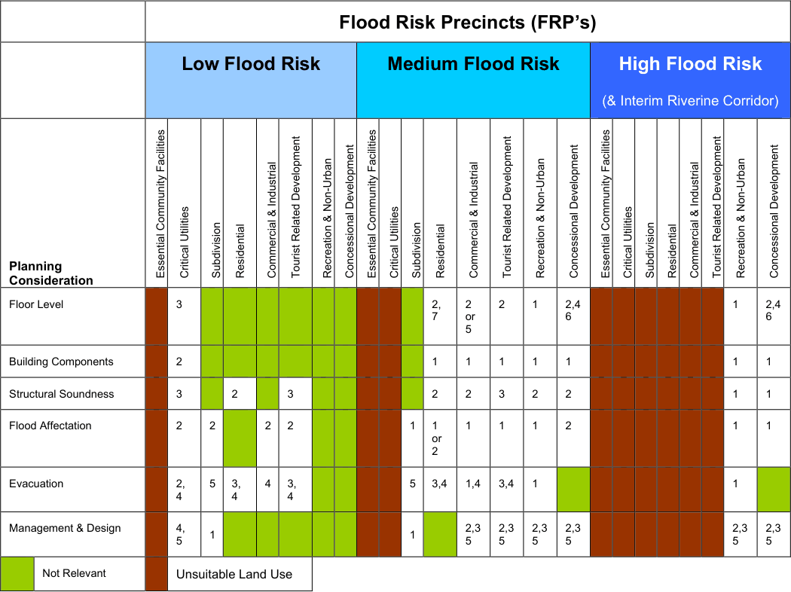

> [Picture on page 63: a map, saved as a picture (images/chapter-e13-floodplain-management-page-63-2.gif, 150 dpi); the street names and other small labels are on the picture.]
> Words printed on the picture (title and legend, copied from the PDF):
> (& Interim Riverine Corridor)
> Essential Community Facilities Critical Utilities Subdivision Residential Commercial & Industrial Tourist Related Development Recreation & Non-Urban Concessional Development Essential Community Facilities Critical Utilities Subdivision Residential Commercial & Industrial Tourist Related Development Recreation & Non-Urban Concessional Development Essential Community Facilities Critical Utilities Subdivision Residential Commercial & Industrial Tourist Related Development Recreation & Non-Urban Concessional Development
> 2 1 2,4
> Building Components 2
> 1 1 1 1 1
> Structural Soundness 3 2 3
> 2 2 3 2 2
> 1 1 1 2
> 2 2 2 2
> 5 3,4 1,4 3,4 1
> Management & Design 4,
> Not Relevant Unsuitable Land Use

#### Flood Risk Precincts (FRP’s)

#### Low Flood Risk Medium Flood Risk High Flood Risk

#### Note:

a. Filling of the site, where acceptable to Council, may change the FRP considered to determine the controls applied in the circumstances of individual applications.

b. Terms in italics are defined in the glossary of this plan and Schedule 2 specifies development types included in each land use category. These development types are generally as defined within Environmental Planning Instruments applying to the local government area.

c. Freeboard equals an additional height of 500mm.

#### Floor Level

1 All floor levels to be equal to or greater than the 5% AEP flood level plus freeboard unless justified by site specific assessment.

2 Habitable floor levels to be equal to or greater than the 100 year flood level plus freeboard.

3 All floor levels to be equal to or greater than the PMF flood level plus freeboard.

4 Floor levels to be as close to the flood planning level as practical and no lower than the existing floor level when undertaking alterations or additions.

5 Floor levels of shops to be as close to the flood planning level as practical. Where below the flood planning level, more than 30% of the floor area to be above the flood planning level or premises to be flood proofed below the flood planning level.

6 Garage floor level to be no lower than 300mm above finished adjacent ground.

7 Garage and all other non-habitable internal floor levels to be no lower than the 1% AEP flood level minus 300mm or 300mm above finished adjacent ground (whichever is the greater).

#### Building Components and Method

1 All structures to have flood compatible building components below or at the 1% AEP flood level plus freeboard.

2 All structures to have flood compatible building components below or at the PMF level plus freeboard.

#### Structural Soundness

1 Engineers report to certify that any structure can withstand the forces of floodwater, debris and buoyancy up to and including a 100 year flood plus freeboard.

2 Applicant to demonstrate that any structure can withstand the forces of floodwater, debris and buoyancy up to and including a 100 year flood plus freeboard, or a PMF plus freeboard if required to satisfy evacuation criteria (see below).

3 Applicant to demonstrate that any structure can withstand the forces of floodwater, debris and buoyancy up to and including a PMF flood plus freeboard.

#### Flood Affectation

1 Engineers report required to certify that the development will not increase flood affectation elsewhere, includes medium and high density residential proposals.

2 The impact of the development on flooding elsewhere to be considered, includes low density residential.

Note: When assessing flood affectation the following must be considered:

1\. Loss of storage in the floodplain.

2\. Changes in flood levels and velocities caused by alteration of conveyance of flood waters.

#### Evacuation

1 Reliable access for pedestrians required during a 100 year flood.

2 Reliable access for pedestrians and vehicles required during a PMF flood.

3 Reliable access for pedestrians or vehicles is required from the building, commencing at a minimum level equal to the lowest habitable floor level to an area of refuge above the PMF level, or a minimum of 20m² of the dwelling to be above the PMF level.

4 The development is to be consistent with any relevant flood evacuation strategy or similar plan.

5 Applicant to demonstrate that evacuation of potential development as a consequence of a subdivision proposal can be undertaken in accord with this Plan.

#### Management and Design

1 Applicant to demonstrate that potential development as a consequence of a subdivision proposal can be undertaken in accord with this plan.

2 Site Emergency Response Flood plan required (except for single dwelling-houses) where floor levels are below the flood planning level.

3 Applicant to demonstrate that area is available to store goods above the 100 year flood level plus freeboard.

4 Applicant to demonstrate that area is available to store goods above the PMF level plus freeboard.

5 No external storage of materials below the flood planning level which may cause pollution or be potentially hazardous during any flood.

### Appendix: D McLuckie et al (2019) Improving Guidance for Councils

### and Committees on Floodplain Management in NSW – NSW Office of Environment and Heritage

Improving Guidance for Councils and Committees on Floodplain Management in NSW – NSW Office of Environment and Heritage## Session Duncan McLuckie1, Angela Toniato2 Elise  Armstrong1

1 NSW Office of Environment and Heritage##   (Newcastle) 2 NSW Office of Environment and Heritage## (Wollongong) Note: ## The NSW Office of Environment and Heritage is transitioning into the Department of Planning Industry and Environment on 1 July 2019.

#### Abstract

The New South Wales Flood Prone Land Policy aims  to reduce the impact of flooding  and flood liability on individual owners and occupiers of flood prone land and reduce  public and private losses from floods utilising ecologically positive methods wherever possible.

The NSW Office of Environment and Heritage is updating the NSW Floodplain Development Manual in consultation with other agencies and industry. As part of this  work OEH is developing and updating a range of technical guidance that supports  councils and committees in understanding and managing flood behaviour in NSW.

This session discusses progress on the Manual and guidance update in consideration of consultation to date, user needs, improving outcomes from the process, improving understanding of flooding, the need for improved access to flood information,  and  national best practice.

This paper provides the basis for this session which will:

• Outline the scope of the overall project

• Provide an overview of the review of the manual

• Provide an overview of the review of associated guidance and tools

• Discuss draft guidance in different areas of practice and their interaction. These include guides on the local flood risk management framework, flood emergency response classification of communities, information to support emergency management, flood hazard categorisation and flood function including floodways and flood storage.

#### Introduction

The NSW Office of Environment and Heritage (OEH) is the lead agency in flood risk management in New South Wales. It manages the NSW Floodplain Management  Program (the Program) which provides local councils in NSW with both technical and policy support (through a range of professionals with expertise in flood risk management and associated disciplines) and financial support through the associated grants program OEH administers. OEH works closely with a range of other relevant agencies (in NSW  and beyond) and with local government councils and the floodplain risk management (FRM) industry in NSW to support the management of flood risk and the delivery of the NSW Flood Prone Land Policy (the Policy). OEH is currently reviewing the Floodplain Development Manual (2005) (the Manual) and associated guidance to improve flood risk management outcomes in NSW. This paper outlines the direction of these projects and provides an update on their progress.

#### Background on Development of FRM Guidance in NSW

The Policy was first adopted in 1984 and was supported by the NSW Floodplain Development Manual (1986). The Policy and Manual were last fully updated in 2005. Although Planning Circular 07/003, New Guideline and changes to section 117 direction and EP&A Regulation on flood prone land amended the Manual.  The Joint Department   of Natural Resources (DNR, now OEH) and Department of Planning (DoP, now Department of Planning and Environment, DPE) guideline required councils to get DNR and DoP agreement to place development controls on standard residential development  in low flood risk areas, i.e. areas outside the flood planning area).

The primary objective of the Policy is to reduce the impact of flooding and flood liability   on individual owners and occupiers of flood prone property, and to reduce private and public losses resulting from floods, utilising ecologically positive methods,  where  possible. The Policy recognises that flood prone land is a valuable resource that should not be sterilised by unnecessarily precluding its development and that the application of rigid and presciptive controls to address flooding can lead to inappropriate development  or unreasonably restricted development.

The delivery of the Policy is supported by the Manual and FRM guidelines and the technical and financial support provided by OEH through the Program. The Manual provides an informed basis for local councils to meet their obligations for managing flood risks to their community under Section 733 of the Local Government Act (1993) and the NSW Flood Prone Land Policy. Managing flood risk consistent with the Manual provides councils, staff and councillors with limited protection from liability for decisions made and flood information provided.

The Manual (which includes the Policy) is available on OEH’s website at http://www.environment.nsw.gov.au/topics/water/floodplains/floodplain-manual and is supported by a range of technical guidelines available on OEH’s website at http://www.environment.nsw.gov.au/topics/water/floodplains/floodplain-guidelines. The existing guidelines provide advice on the following:

• Understanding flood behaviour o Modelling reports and supporting information for review o Modelling the interaction of catchment flooding and oceanic inundation in coastal waterways, which includes examples and templates o Floodway definition o Practical consideration of climate change o Considering Australian Rainfall and Runoff 2016 in Studies, which includes guidelines, examples and background documents

• Assessing residential flood damage

• Supporting emergency management including: Flood emergency response planning classification of communities and NSW State Emergency Service (NSW SES) requirements from the FRM process

• Other FRM concerns such as temporary or relocatable flood barriers,  rainwater tanks: limitations as FRM devices and drainage behind and through levees

• Data handover through the NSW Flood Data Portal

The Manual and Policy are also supported by tools such as:

• The   brief  development  tool. This tool enables the development of technical specifications that can be tailored for the project. This supports flexibility in scoping

#### Consultation on Improving FRM delivery in NSW

McLuckie and Toniato (2018) provided a synopsis of consultation to improve FRM in  NSW undertaken in early 2018. Consultation outcomes were considered in the structure and scope of the review project and included:

• Website: Need a single website as the go to place for NSW Government FRM advice.

• Policy: Keep the Policy in the Manual but improve its prominence and clarity.

• Manual and Guidelines o Maintain the FRM process as it supports comprehensive assessment and informed decisions. o Consider how to address State Government administrative changes o Clearly separate the FRM process for strategic FRM by local government from flood impacts assessments for developments. o Consider national best practice and link to as appropriate.  National  flood  planning constraint categories were seen as providing a good starting point for  risk based land use planning as they were not limited to a single scale of event. o Support approaches that are practical for different circumstances but enable consistency of outcomes and outputs. o Update or consider guidance in areas including freeboard, climate change, defining flood function, flood damages, flood warning, land  use  planning, mapping, emergency management considerations, committees, cumulative impacts, local overland flooding, consultation and community  engagement,  shelter in place, model use and filtering, business cases for mitigation actions, flood compatible building material, future timeframe scenarios, model planning controls and mapping. o Promote the importance of reports as a communication avenue to communities. o Improving accessibility of reports and final expertly interpreted spatial layers. o Identify minimum requirements for studies and plans and measures of success including evaluation process to understand the level of success. o Continue to link guidance into project specifications.

• Community flood resilience should incorporate FRM concepts of avoidance, mininisation and mitigation and go beyond the concepts of building it back better    after an event and being prepared to recover from disasters. Focus could be on identifying key factors that support a community being more resilient to flooding.

• Other relevant issues raised include: o Planning circular PS07/003 was seen by local councils as limiting consideration   of flood risk to residential properties in land use planning to within the FPA based upon the FPL of 1% AEP plus a typical freeboard of 0.5m. The circular and the associated guide and direction are being reviewed in parallel with the Manual. o The need for training for council staff and councillors on flood risk management.

#### Update of the Manual, Guides and Tools

Given the timeframe since the last update of the Manual, the changes to agency responsibilities, lessons learnt from floods and reviews in NSW and other jurisdisctions, the update of national best practice as outlined in the ADR Handbook 7 (ADR 2017a)   and it supporting sreries of guides, the OEH recognised the importance of updating the Manual.

OEH is leading this review with support from an inter-agency working group and with reference to both local government and consultant groups.   The review is not intending   to make significant changes to the intent of the Policy, nor the fundamental roles and responsibilities of councils in understanding and managing flood risk for the benefit of  their communities nor the support provided by the NSW  Government.  Rather,  the  review is focussed on updating the guidance and advice available to assist councils in undertaking this role.

The Manual and Program will continue to provide the foundation of delivery of the Policy and to outline the separation between State and Local Government responsibilities. However, there will likely be more advice included in technical guidelines which can be more responsive to change than the gazetted Manual.

Work on the Manual and associated guidance is progressing and is being undertaken in parallel with work being undertaken in relation to the update of PS07/003 and the related joint OEH/DPE guide. OEH is working closely in supporting DPE with this work.  This  work is outside the scope of this paper.

Floodplain Development Manual Work on the Manual is currently underway. The intent is to restructure the Manual into  four

(4) sections, rather than separating information between the main manual chapters and the appendices (as in the 2005 version). The four draft sections are: A. NSW Flood Prone Land Policy B. Preliminaries, Foreword, Introduction and Roles and Responsibility C. Strategic Management of Flood Risk including FRM principles D. FRM Framework and associated FRM process

The Manual is being written with roles and responsibilities for different  government  levels, i.e. local, State and Commonwealth.  The breakdown of roles is being addressed  in a separate administrative guide.

FRM Guidelines A range of additional or updated FRM guides are likely to be needed to support the updated Manual. The draft list below provides an indication of the FRM guides expected  to be needed to facilitate the update. The list below is expected to evolve as work continues.

• Administrative Guide – Outlines agency roles, current guides and tools.

• Local flood risk management framework

• Flood function - updates the previous floodway definition guide and replaces part of Appendix L of the Manual

• Flood hazard - replaces part of Appendix L of the Manual

• Emergency management planning for floods – replace Appendix N of the Manual

• Flood information from studies to support emergency management (update existing guide)

• Flood emergency management classification (update existing guide)

• Flood information to support land use planning activities

• Considering flood risk in land use planning

• Flood impact assessment for developments

• Rural floodplain management planning – supplement Manual

• Management options including assessment and business cases – replace Appendix J of the Manual and several existing guides

• Estimating Flood Damage – guide and tools – replace Manual guidance

• Guidance on reporting for studies

The update of the Manual and FRM Guides also mean that the Brief Development Tool and Handover Requirements will be updated. The most up to date Brief Development Tool and handover requirements will continue to be made available to registered users through the NSW Flood Data Portal. This tool should always be used in partnership with OEH FRM staff and in consideration of the aims and scope of the project being undertaken.

Other documents identified by industry for development or update but not critical to the immediate update of the 2005 Manual include:

• Climate  change adaptation

• FRM Committee Handbook

• Shelter in Place

• Data to be provided for review of model calibration and validation reports

• Levee investigation, design, operation and maintenance guidance and will expand and replace guidance on drainage through levees

• Local flood warning system and gauge owner’s manual

• Local overland flooding

• Post event data collection

• Brief Development Tool for investigations and designs

• Guidance for voluntary purchase and voluntary house raising projects

• Consultation and community engagement

• Flood compatible building materials

Following completion of the Manual update project consideration will be given to future priorities for additional or updated guidance.

#### Discussion of Specific Draft Guides

Guidance on the local FRM framework, flood emergency response classification of communities, flood hazard and flood function (floodways and flood storage), and how   they influence decision making are discussed below.

Local Flood Risk Management Framework The local FRM framework has been developed from ADR Handbook 7 (ADR 2017a) to link LGA scale activities that manage or influence flood risk with the FRM process which may be undertaken at difference scales within the LGA or may span multiple LGAs. This difference in scale means that effective management at LGA scale will generally involve the range of activities shown in Figure 1. The local FRM framework guide will provide guidance to council in relation to LGA scale activities and the development of  consolidated knowledge to inform these activities.

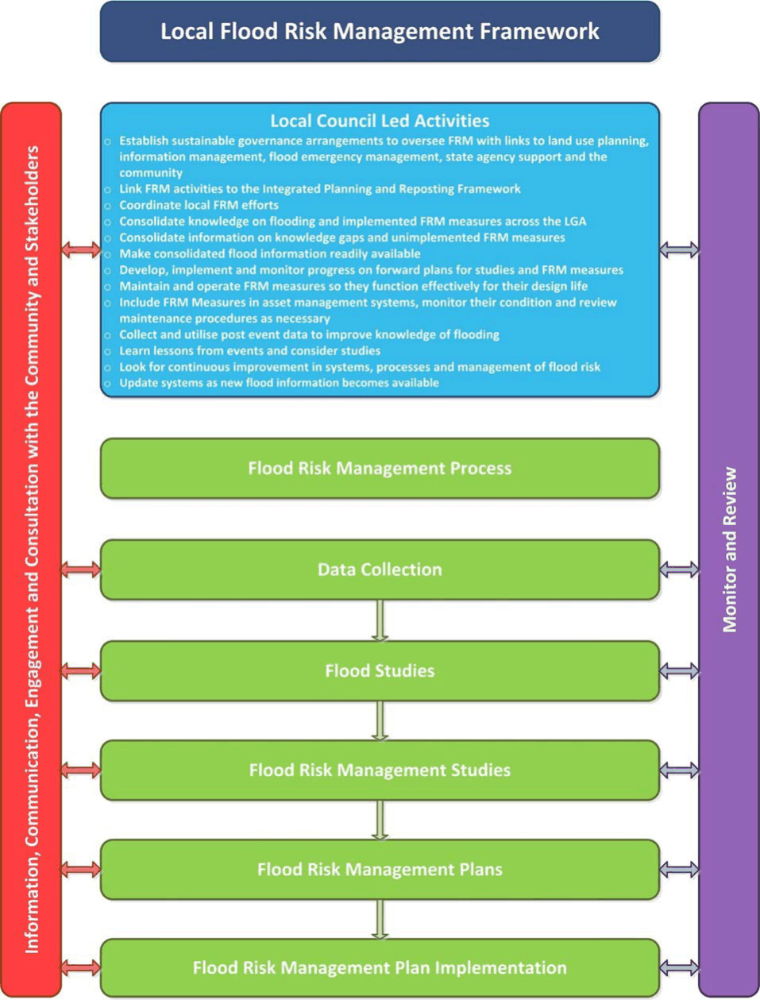

> [Picture on page 72: a picture, saved as a picture (images/chapter-e13-floodplain-management-page-72-1.gif, 150 dpi).]

Flood Emergency Response Classification of Communities and Flood Information to Support Emergency Management The Flood Emergency Response Classification of Communities (FERCCs) Guide will update the existing NSW FRM Guide Flood Emergency Response Classification of Communities (OEH 2007) in consideration of the changing use of this guide and ADR FRM Guide 7.2 Flood Emergency Response Classification of the Floodplain (ADR  2017b). It outlines how FERCCs are to be undertaken in future studies under  the Program.

The original NSW guide focused purely on informing flood emergency management planning.  The later ADR guide (ADR 2017b) took the opportunity to embed evolving  NSW practice by identifying emergency management constraints earlier in the FRM process.  This enables this information to be made available earlier (from flood studies)   in a format suitable to inform broader decision making. For example, in land  use  planning, this information can inform decisions either used directly or through the development of flood planning constraint categories (FPCCs) as outlined in ADR FRM Guide 7.5 Flood Information to Support Land Use Planning (ADR 2017c). An equivalent NSW guide is currently being developed.

The updated NSW FERCC guide supports the availability of knowledge of emergency management constraints from flood studies. This information can be refined in the FRM study where better information becomes available or where additional  breakdown into   the cause for isolation (due to flooding or a combination of flooding and impassable terrain) is required to inform emergency management planning. Flow charts for determining FERCCs in flood studies (Figure 2) and where more detail is  required  (Figure 3) provide the basis for assessing the flood emergency management constraints  of land. These flow charts consider both the original 2007 NSW guide and the 2017 equivalent national guide (ADR 2017b).

The guide also recognises the importance of understanding tipping points (Table 1) that would influence emergency response. For example, the height at which external access may be cut isolating an area.

|  | High | Low Flood | High | Low | Area with | Area with | Indirectly |
|---|---|---|---|---|---|---|---|
| Key Tipping Points | Flood Island | Island | Trapped Perimeter | Trapped Perimeter | Overland Escape | Rising Road | Affected Area |
| External access cut, area | ✓ | ✓ | ✓ | ✓ | ✓ |  |  |
| becomes isolated |  |  |  |  |  |  |  |
| Key internal roads cut |  | ✓ |  | ✓ | ✓ | ✓ |  |
| Overground flooding of land |  | ✓ |  | ✓ |  |  |  |
| Overground flooding of houses |  | ✓ |  | ✓ |  |  |  |
| Over floor flooding of facilities |  | ✓ |  | ✓ |  |  |  |
| with special evacuation needs |  |  |  |  |  |  |  |
| e.g. Aged care, schools |  |  |  |  |  |  |  |
| Transport infrastructure | ✓ | ✓ | ✓ | ✓ | ✓ | ✓ | ✓ |
| shutdown e.g. railways, |  |  |  |  |  |  |  |
| airports |  |  |  |  |  |  |  |
| Flooding of key response |  | ✓ |  | ✓ | ✓ | ✓ |  |
| infrastructure e.g. hospitals / |  |  |  |  |  |  |  |
| evac centres |  |  |  |  |  |  |  |
| Risk of flooding of key public | ✓ | ✓ | ✓ | ✓ | ✓ | ✓ | ✓ |
| utilities e.g. sewage / gas / |  |  |  |  |  |  |  |
| power |  |  |  |  |  |  |  |
| Whole area flooded |  | ✓ | ✓ | ✓ | ✓ | ✓ |  |

Table 1 Key considerations/tipping points for areas with different flood emergency response classifications

Wollongong City Wide Development Control Plan 2009 – in force 25/3/20

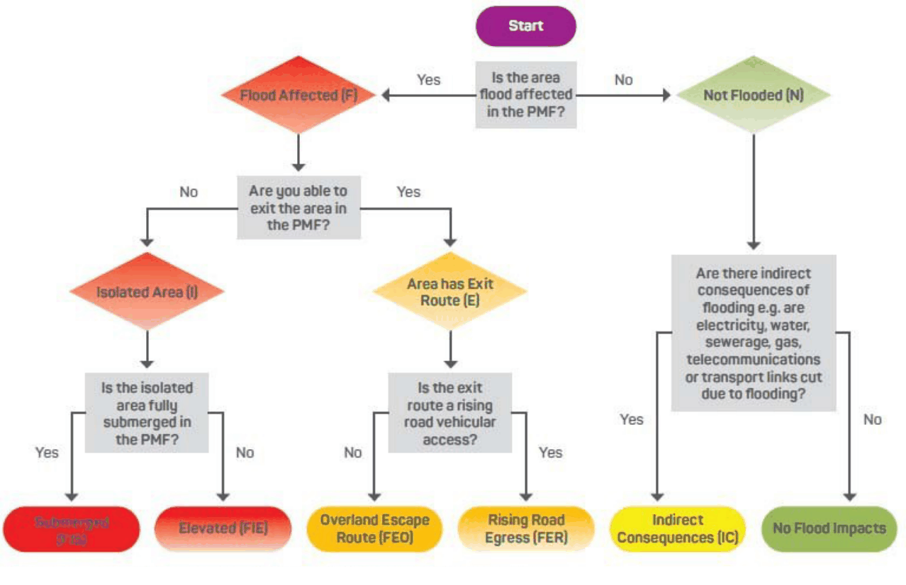

> [Picture on page 74: a picture, saved as a picture (images/chapter-e13-floodplain-management-page-74-1.gif, 150 dpi).]

Wollongong City Wide Development Control Plan 2009 – in force 25/3/20

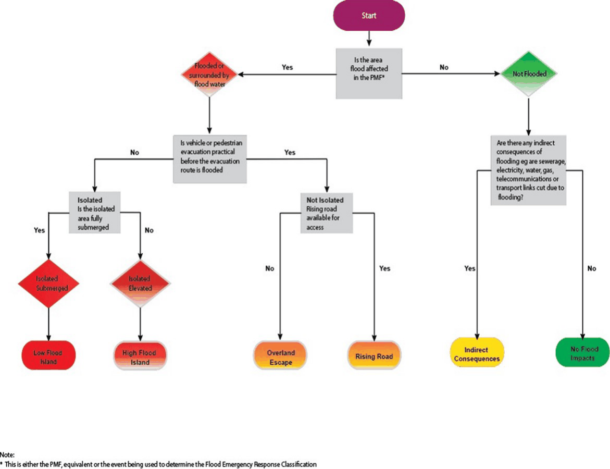

> [Picture on page 75: a picture, saved as a picture (images/chapter-e13-floodplain-management-page-75-1.gif, 150 dpi).]

Figure 3 Flow Chart for Determining more detailed Flood Emergency Response Classifications where required

The FERCCs guide will also inform the flood information needed to inform emergency management from flood studies and FRM studies under the FRM process. These information needs vary depending on the FERCC classification (see Table 1).

This information will assist flood emergency response planning and the development of local flood plans by the NSW SES plan. It will also assist in preparing communities for potential flooding, guide response operations and assist communities to begin their recovery following flood events.

The updated guide on flood information to support emergency management considers   the significant changes to the capabilities of modelling software and the delivery of flood information that has occurred since the 2007 NSW guide. It also considers the:

• The transition from 1D to 2D and 1D/2D combinations in modelling

• Improvements in post processers for modelling results including AVIs.

• requirement to hand all information from studies under the Program over through the NSW Flood Data Portal. This provides a direct conduit for flood information flow to OEH and the NSW SES.

• improved clarity of specification of outputs from studies resulting from the implementation of the OEH Brief Development Tool

• changing information needs of the NSW SES.

Flood Hazard Categorisation This new NSW Flood Hazard Categorisation guide provides a basis for understanding how variations in velocity and depth influence flood hazard and how this is to be categorised in future studies under the Program.

It considers ADR FRM Guide 7.3 Flood Hazard (ADR 2017d) and similarly enables the floodplain to be categorised into areas of different flood hazard based on categories H1 to H6 (see Figure 4), for different scales of flood events. An example of mapping of this information is given in Figure 5. The guide also provides a link back to low and high hazard, terms often used in decision making in current NSW practice.

Changing practice, as outlined in the ADR Handbook 7 series of documents, reduces the reliance on hazard mapping alone. It is now more regularly accompanied with FERCCs, flood function mapping, across a range of events. These are now also informing other spatial products, such as FPCC mapping (ADR 2017c), which combines hazard information with other flood related constraints on land so that these can be managed.

This means that the need to develop provisional hazard mapping and then translate this to true hazard is no longer needed. The issues of rate of rise, flood readiness, effective warning time, duration of flooding and type of development still need to be considered in understanding flood risk, so it can inform decision making.  However, this is occurring in  a different way and will be dealt with separately in the Manual and supporting guides.

The guide provides advice on how flood hazard can influence decisions including:

• Flood risk management. Flood hazard categorisation provides information on the varying scale of flood hazard to people, vehicles and buildings. It can influence flood risk, decisions on managing flood risk, and the types of mitigation measures suitable for managing risk in different areas of the floodplain.

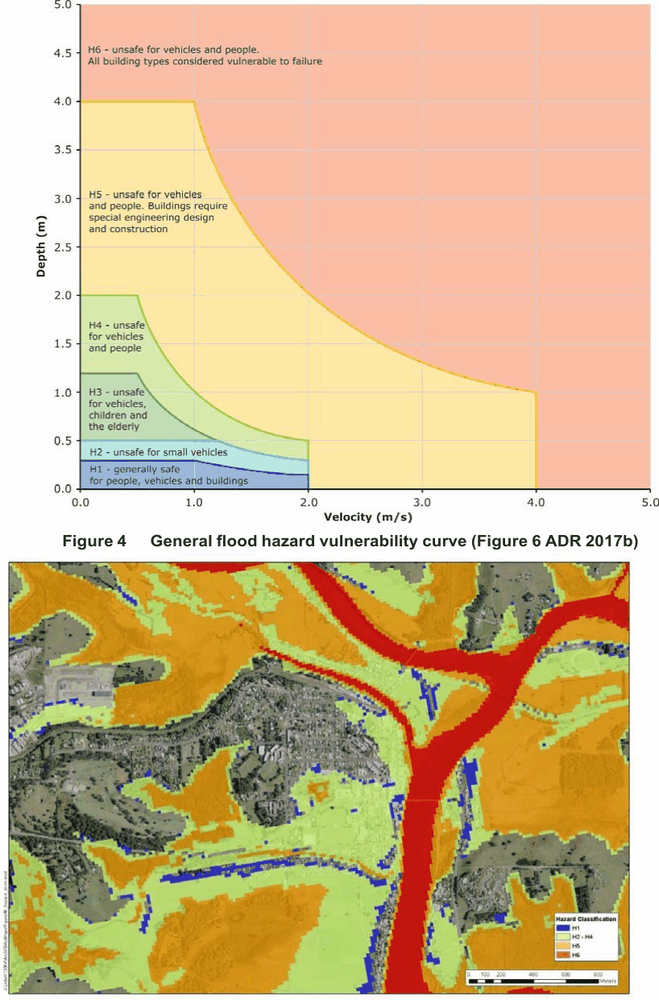

> [Picture on page 77: a picture, saved as a picture (images/chapter-e13-floodplain-management-page-77-1.gif, 150 dpi).]

#### Figure 4 General flood hazard vulnerability curve (Figure 6 ADR 2017b)

Figure 5 Flood Hazard for Categories H1 combined H2-4 and H5 and H6 for a localised area

of a floodplain (Figure A6 ADR 2017b)

• Management of flood hazard. In certain circumstances it is possible to modify flood hazard, generally by modifying flood depth by filling of the floodplain.   However, filling the floodplain can affect the key flood functions (see updated FRM Guide: Flood Function of flow conveyance in floodways and flood storage), as well as impacting on local flowpaths. Therefore, modifying flood hazard cannot be looked at in isolation of other factors in decision making.

• Land-use planning. Flood hazard is an important constraint in considering the development of land. Information on where the varying degree of flood hazard to people, vehicles and buildings occurs on land across the floodplain can inform the setting of strategic land-use directions for a community. It is a key consideration used to determine flood planning constraint categories.

• Development controls relating to people safely  traversing  floodwaters.  The threshold values for safety to people presented in this guide are not fit for purpose to use as maximum wading depths in determining the safe conditions for people to traverse floodwaters to safety to support the location of new or infill development in flood affected areas.   The guide provides a threshold for limiting depths relating to the stability of capable adults in good conditions, such as in controlled conditions in a laboratory.  Any decision relating to flood depths for wading need to consider a wide range of issues including: the varying capability and age of users, the varying conditions that people may need to traverse to safety such as opaque flood waters obscuring the ground surface, uneven ground, trip hazards including debris moved by flood waters and flowing water from local catchments in areas where water may appear relatively still.   All these factors reduce the safe wading depths well below the thresholds provided in this guide.

• Building controls. Flood hazard categorisation can identify areas that may warrant additional structural building controls.

• Flood emergency response planning. Flood hazard categorisation can provide an indication of hazardous conditions to people, vehicles and buildings which can assist in emergency management planning and inform the development of Local Flood Plans.

Flood Function (Hydraulic Categorisation) Understanding and maintaining the flood function of the floodplain is important to enable effective flood risk management. The key hydraulic functions of the floodplain are flow conveyance and flood storage in floodways and flood storage areas respectively. Techniques to identify these areas have been evolving, particularly with the increased   use of 2D models or models with 2D components (1D-2D Models) which are now the  norm in FRM in NSW.

To inform decision making as early as possible in the FRM process, flood function areas need to be identified in flood studies. They may be refined in FRM studies were new information becomes available.

The Flood Function guide provides advice on identifying flood function areas using characteristics of flooding, such as flood depths, levels, and velocities, and  on setting  and testing acceptable limits for changes and impacts.  It aims to improve the derivation  of floodway and flood storage areas in studies so that this information is more fit for purpose to inform decision making.

Floodways and flood storage areas should be identified in studies  undertaken  by  councils so that decisions can consider the cumulative impacts of change on flood behaviour. The guide provides advice to councils which should be considered when setting limits for the cumulative impacts of change on flood function. It also provides advice on techniques that can be used to identify flood function areas and the requirements of a good technique. Good techniques need to:

• use calibrated and validated models wherever possible

• be reproducible and objective

• define the limits of the flood function areas based on the landform and hydraulic behaviour during floods and not existing or preferred land use

• define flood function areas across the full range of potential floods because flood function areas will vary with the magnitude of the flood

• include a review of results to ensure that the defined flood function areas are not overly constrained If a defined floodway is too narrow it will not be able to convey sufficient flood flows. This can lead to new floodways developing in other locations, and flood levels, distribution, and/or inundation times changing beyond acceptable limits. If flood storage areas are overly constrained, flood levels, distribution, and/or inundation times can be changed beyond acceptable limits. The results application of a good technique should:

• produce floodways that: o are smooth and continuous to and from waterbodies and transition into and out of waterbodies o include all the in-bank sections of a waterway (where the majority of flow is conveyed) including as it enters and leaves a waterbody and some of the floodplain o include the full width of hydraulic structures (bridges and culverts) in the floodway, except for very wide bridges

• determine the extent of flood storage areas based on their flood function and should not relate purely to the depth of flooding. This requires practitioners to consider the floodplain in question and determine what constitutes “important” storage and what level of impact from filling would adversely affect flood function.

When flood function is mapped in an accurate and reproducible manner it can inform, for example:

• Flood risk management. Flood function categorisation identifies area which have the functions of conveying or storing floodwaters. These are areas that will be sensitive to change. Understanding the location of  these areas can influence  the management of flooding including the location of works to mitigate flood risk to the existing community.

• Emergency risk management. Understanding flood function can also give an indication of the variation in flood behaviour. Floodways are generally areas with significant water and often debris movement which can impede evacuation and therefore influence decisions on the suitability of evacuation routes. Floodways, and in some cases flood storage areas, are also areas where the use of temporary mitigation works may alter flood behaviour with adverse impacts on the community.

This needs to be considered in decisions to undertake any such works in response to a flood threat.

• Land-use planning. Flood function is an important constraint to consider in the use and development of land. Information on the location of floodways and flood storage areas can inform the setting of strategic land-use directions for a community. It is a key consideration used to determine FPCCs (ADR 2017c).

• Flood dependent ecosystem management. Understanding flood function can inform decisions that may impact on ecological health of flood dependent ecosystems, particularly on the larger floodplains of the Murray Darling Basin where minor changes in hydraulic connectivity to flood dependent ecosystems can cause adverse ecological impacts.

#### Conclusions

NSW OEH, as the lead agency in FRM in NSW, continues to work with other agencies and with NSW local councils to improve the management of flood risk for NSW communities. The update of the Manual and associated guidance is progressing in  parallel with other work being undertaken to support local councils and other agencies to improve FRM and consideration of flood information in decisions by both the government and the community.

This project will continue to progress with input in consultation with industry through reference groups, through discussions at Floodplain Management  Australia  meetings and workshops.

During the review of the Manual and guidelines councils should continue to proceed with their program of current and proposed FRM projects, including those funded under the Program, so that their communities can be better informed and more resilient to  flood  risk. They should continue to liaise with their regional OEH flood contacts in scoping   and delivering projects.

#### References

ADR 2017a Australian Disaster Resilience Handbook 7: Managing the floodplain:  A  guide to best practice in flood risk management in Australia (2017). ADR 2017b Australian Disaster Resilience Guideline 7-2: Flood emergency response classification of the floodplain (2017) ADR 2017c Australian Disaster Resilience Guideline 7-5: Flood information to support land-use planning ADR 2017d Australian Disaster Resilience Guideline 7-3: Flood hazard McLuckie, D., (2017). National Best Practice Guidance in Flood Risk Management – Fitting the Pieces Together, Floodplain Management Australia Conference, Newcastle, May 2017. McLuckie, D., Toniato A, (2018). Improving Delivery under the NSW Flood Prone Land Policy, Floodplain Management Australia Conference, Gold Coast, May 2018. McLuckie D, Babister, M, Askew, E, Gear, A, Grech, P (2017). Using Flood Planning Constraint Category Mapping in Planning Activities – an example considering NSW Practice, Floodplain Management Australia Conference, Newcastle, May 2017. Note this was presented by Mark Babister at the conference.

McLuckie, D., Toniato, A. Askew, E. Babister, M. Retallick, M. (2016). Supporting Land use planning by providing improved information from the floodplain  management  process, Nowra, Floodplain Management Australia Conference, Nowra, May 2016. NSW Government (2005). Floodplain Development Manual. Department of Infrastructure Planning and Natural Resources. DIPNR 05_020. NSW Office of Environment and Heritage (OEH 2019a) draft Flood Risk Management Guide: Flood Emergency Response Classification of Communities, OEH, (unpublished) NSW Office of Environment and Heritage (OEH 2019b) draft Flood Risk Management Guide: Flood Function, OEH, (unpublished) NSW Office of Environment and Heritage (OEH 2019c) draft Flood Risk Management Guide: Flood Information to Support Land Use Planning, OEH, (unpublished) NSW Office of Environment and Heritage (OEH 2019d) draft Flood Risk Management Guide: Information to Support Emergency Management, OEH, (unpublished)
