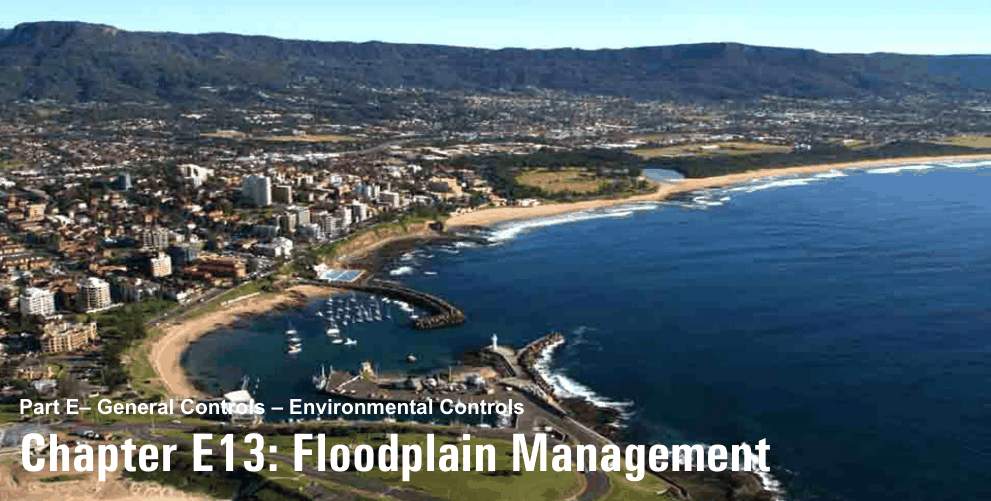

# Wollongong Development Control Plan 2009 - Chapter E13 Floodplain Management

> This chapter is split into 13 section file(s), one per numbered heading, in the order they appear in the PDF.

Source PDF: [Wollongong-DCP-2009-Chapter-E13-Floodplain-Management.pdf](https://planfortomorrow.sharepoint.com/sites/Planfortomorrow/Shared%20Documents/00%20NSW-Planning-Resources/dcp/wollongong-development-control-plan-2009/chapter-e13-floodplain-management/Wollongong-DCP-2009-Chapter-E13-Floodplain-Management.pdf)

> [Picture on page 1: a picture, saved as a picture (images/chapter-e13-floodplain-management-page-1-1.gif, 150 dpi).]

#### Part E– General Controls – Environmental Controls

### Chapter E13: Floodplain Management

### Contents

<!-- sections -->
## Sections

1. [4 KEY STEPS IN THE PROCESS](01-4-key-steps-in-the-process.md)
2. [5 FLOOD STUDIES](02-5-flood-studies.md)
3. [6 WHAT ARE THE KEY CRITERIA FOR](03-6-what-are-the-key-criteria-for.md)
4. [9 WHAT INFORMATION IS REQUIRED WITH AN](04-9-what-information-is-required-with-an.md)
5. [1 INTRODUCTION](05-1-introduction.md)
6. [2 LAND TO WHICH THE PLAN APPLIES](06-2-land-to-which-the-plan-applies.md)
7. [3 OBJECTIVES](07-3-objectives.md)
8. [4 KEY STEPS IN THE PROCESS](08-4-key-steps-in-the-process.md)
9. [5 FLOOD STUDIES](09-5-flood-studies.md)
10. [6 WHAT ARE THE KEY CRITERIA FOR DETERMINING](10-6-what-are-the-key-criteria-for.md)
11. [7 FILLING OF THE FLOODPLAIN](11-7-filling-of-the-floodplain.md)
12. [8 OTHER CONSIDERATIONS](12-8-other-considerations.md)
13. [9 WHAT INFORMATION IS REQUIRED WITH AN APPLICATION TO](13-9-what-information-is-required-with-an.md)
