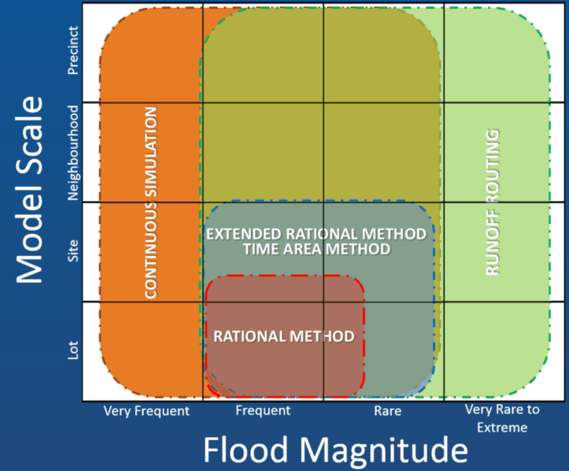
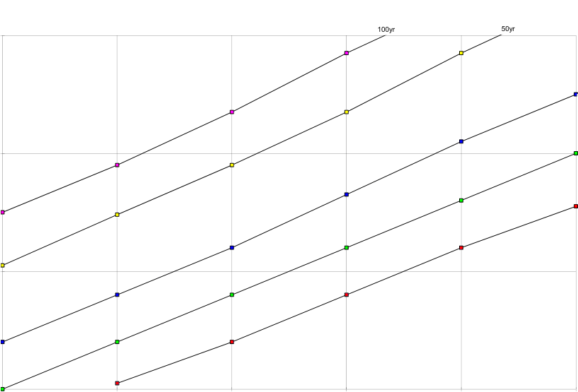

#### 5 HYDROLOGY

a) All parameters used in hydrologic models must be selected in accordance with those values adopted as part of Council’s catchment wide flood studies or FRMS.

b) For unstudied catchments, ARR1987 IFDs and hydrologic procedures will be used until Council has investigated the implications of ARR2019 for the Wollongong LGA through catchment wide FRMS.

### 5.1 Hydrologic Models

a) Figure 1 indicates the likely range of effectiveness for different hydrologic models against flood magnitude and model scale. The applicant must justify the appropriateness of any selected hydrologic model selected for the estimation of minor and major system flows.

> [Picture on page 9: a picture, saved as a picture (images/chapter-e14-stormwater-management-page-9-18.gif, 150 dpi).]

Figure 1 Types of Urban Hydrologic Models and their Application Range (ARR2019, Book 9, Chapter 6)

### 5.2 Conveyance

a) Overland flow times must be determined using the Kinematic Wave Equation or an appropriate computer model.

b) Table 1 shows the retardance coefficient “n*” to be used in the calculation of overland flow time times when using the Kinematic Wave Equation. Note the retardance coefficient “n*” is not to be confused with Manning’s “n”.

#### Table 1: Surface Retardance Coefficients

| Land Use | Retardance Coefficients (n*) |
|---|---|
| Road/Paved Areas | 0.01 |
| Parkland – Grassed | 0.17 |
| Open Space (Natural Bushland) | 0.30 |

### 5.3 Runoff Coefficient

a) The runoff coefficient to be adopted for design must be determined from Figure 2.

b) The runoff coefficient must be estimated separately for each land use. Table 2 estimates the percentage impervious area for various types of land uses. Actual percentages of impervious area may be used as long as they take into account the ultimate development of the site.

> [Picture on page 10: a picture, saved as a picture (images/chapter-e14-stormwater-management-page-10-14.gif, 150 dpi).]
> Words printed on the picture (title and legend, copied from the PDF):
> 100yr
> 50yr

1

20yr

0.9

10yr

5yr

Co-Efficient

0.8

0.7 0

20

40

60

80

100

% Impervious Area

#### Figure 2: Determination of Runoff Coefficient

#### Table 2: Percentage Impervious Area for Land use type

| Land Use | Percentage Impervious Area |
|---|---|
| Normal Residential Lots | 60% |
| Half Width Road Reserve | 95% |
| Medium Density Residential Lots | 80% |
| Commercial Areas | 100% |
| Industrial Areas | 100% |
| Public Recreation Areas | 25% |
