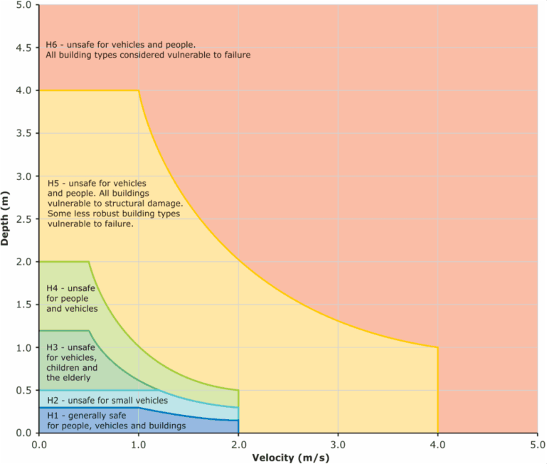

#### 8 SAFETY IN DESIGN

1\. The design of minor and major system flow paths and structures must consider how public safety and risk will be managed. The following will be considered in assessment of proposals. This list is not exhaustive and requirements will vary from site to site:

a) Overland flow paths must be designed with consideration to with the flood hazard categories shown in Figure 3. The anticipated public use of the flow path (e.g. roadway, public reserve, no public access etc.) must consider the food hazard curves shown in Figure 3. The design of the flow path shall ensure that flow characteristics within the flow path are within the safe range for the anticipated potential users of the flow path (e.g. vehicles, people, children, elderly, etc.). Where flow characteristics are proposed that are unsafe for potential end users, details shall be provided of how access to those users will be prevented (e.g. fencing, signage, etc.).

> [Picture on page 17: a picture, saved as a picture (images/chapter-e14-stormwater-management-page-17-1.gif, 150 dpi).]

#### Figure 3: Combined Flood Hazard Curves (Smith et al., 2014)

b) Access to underground pipe and pit systems which are large enough for children to enter must be prevented through design. The design must be informed by the risk-based procedures detailed in the Queensland Urban Drainage Manual (QUDM).

c) Safer by Design and Crime Prevention through Environmental Design principles and Protocols must also be considered. System elements and vegetation which may provide opportunities for concealment adjoining pedestrian areas must be avoided.
