#### 12 REFERENCES

Australian Rainfall and Runoff.  A Guide to Flood Estimation (1998) Institution of Engineers, Australia.

Ball J, Babister M, Nathan R, Weeks W, Weinmann E, Retallick M, Testoni I, (Editors) Australian Rainfall and Runoff: A Guide to Flood Estimation, © Commonwealth of Australia (Geoscience Australia), 2019.

Coombes, P., and Roso, S. (Editors), 2019 Runoff in Urban Areas, Book 9 in Australian Rainfall and Runoff

- A Guide to Flood Estimation, Commonwealth of Australia, © Commonwealth of Australia (Geoscience Australia), 2019.

Floodplain Development Manual. (2005) New South Wales Government.

AS/NZS 3500.3:2003. Plumbing and Drainage – Stormwater Drainage.

Smith, G.P., Davey, E.K. and Cox, R.J. (2014), Flood Hazard UNSW Australia Water Research Laboratory Technical Report 2014/07 30 September 2014.

Sydney Water (2015). Building Over or Adjacent to Sydney Water Stormwater Assets.

### APPENDIX 1 - OSD DESIGN

#### CONTAINING:

(i) Appendix A1. Concessional OSD Zones

(ii) Appendix A2. Wollongong Rainfall Isohyets

(iii) Appendix A3. F1 –v- %imp

(iv) Appendix A4. F2 –v- Area

(v) Appendix A5. F3 –v- %imp

(vi) Appendix A6. F4 –v- Area

(vii) Appendix A7. OSD Basin Sizing Examples

#### APPENDIX 1A: Concessional OSD Zones

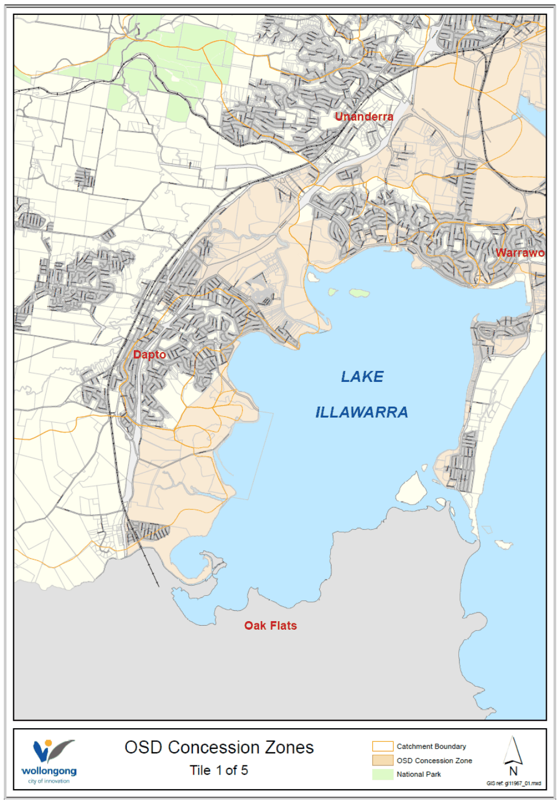

> [Picture on page 48: a picture, saved as a picture (images/chapter-e14-stormwater-management-page-48-1.gif, 150 dpi).]

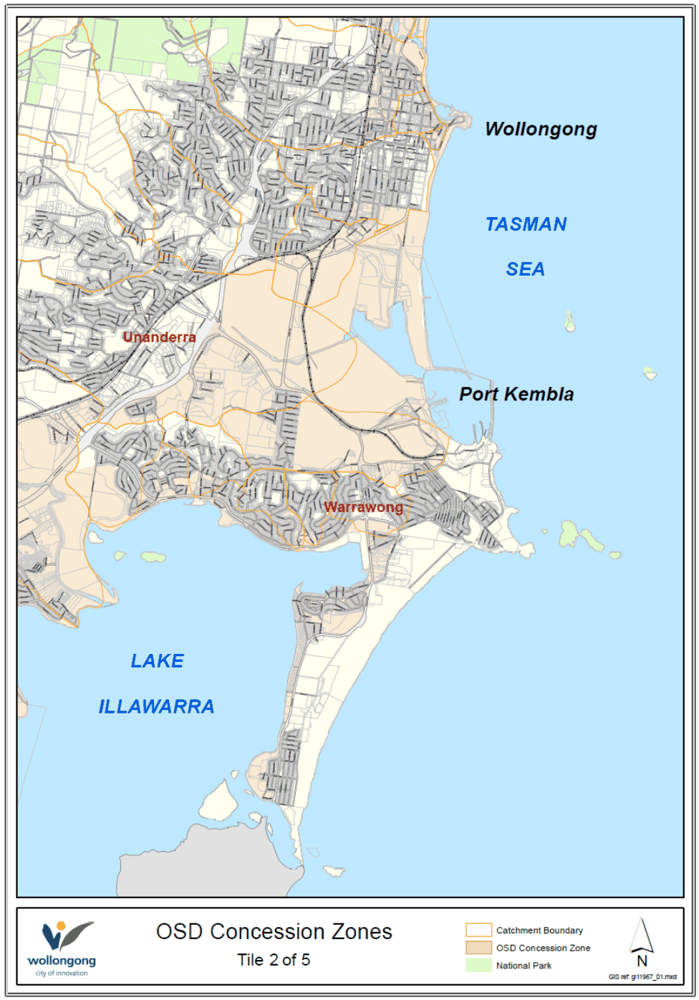

> [Picture on page 49: a picture, saved as a picture (images/chapter-e14-stormwater-management-page-49-1.gif, 150 dpi).]

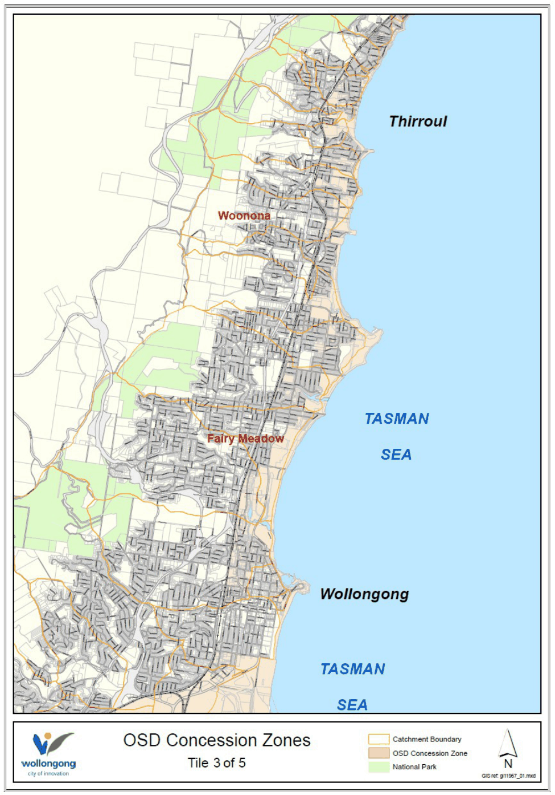

> [Picture on page 50: a picture, saved as a picture (images/chapter-e14-stormwater-management-page-50-1.gif, 150 dpi).]

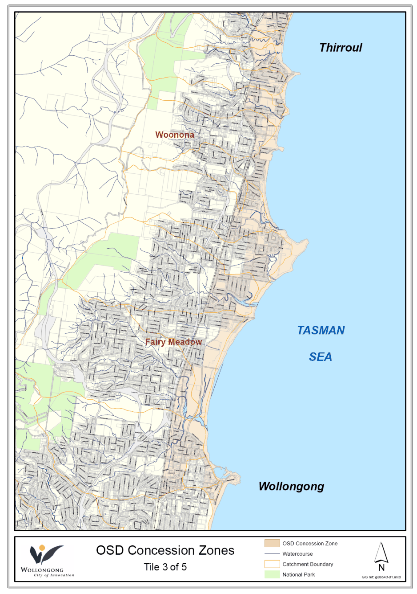

> [Picture on page 51: a picture, saved as a picture (images/chapter-e14-stormwater-management-page-51-1.gif, 150 dpi).]

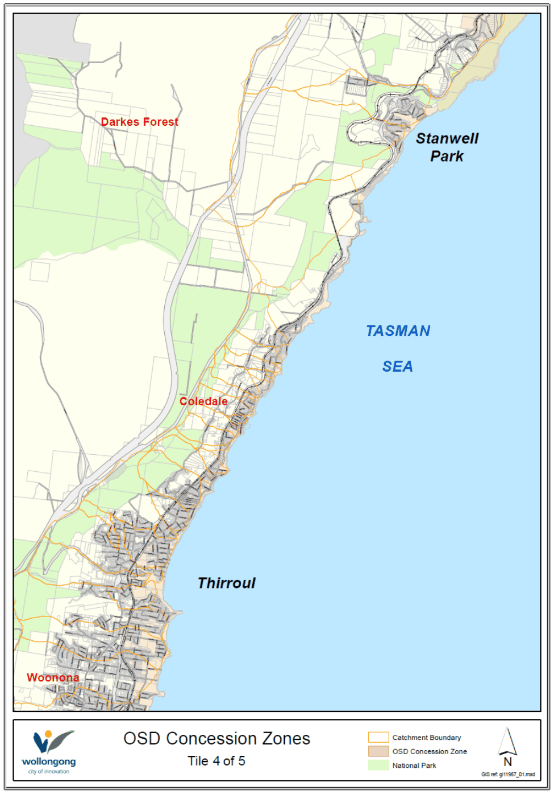

> [Picture on page 52: a picture, saved as a picture (images/chapter-e14-stormwater-management-page-52-1.gif, 150 dpi).]

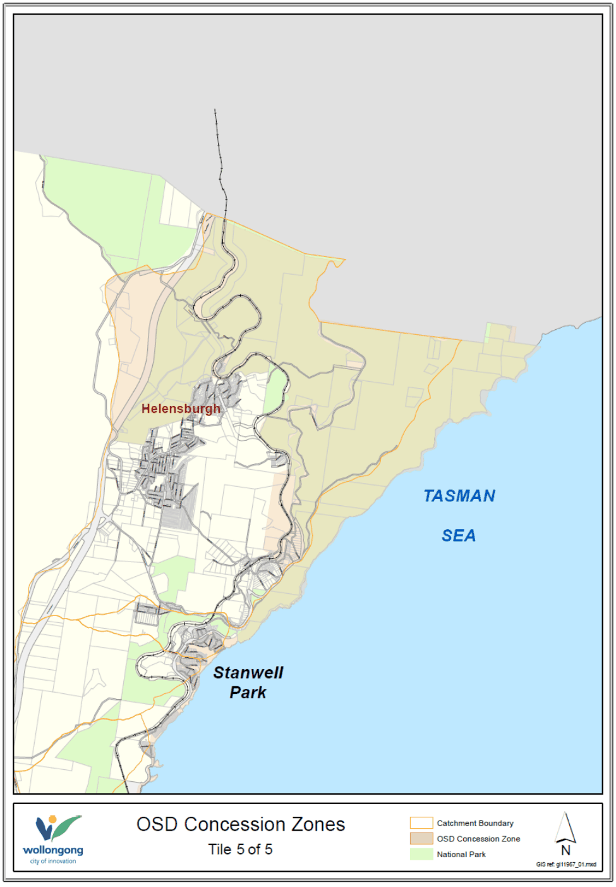

> [Picture on page 53: a picture, saved as a picture (images/chapter-e14-stormwater-management-page-53-1.gif, 150 dpi).]

#### APPENDIX A2: Wollongong Rainfall Isohyets

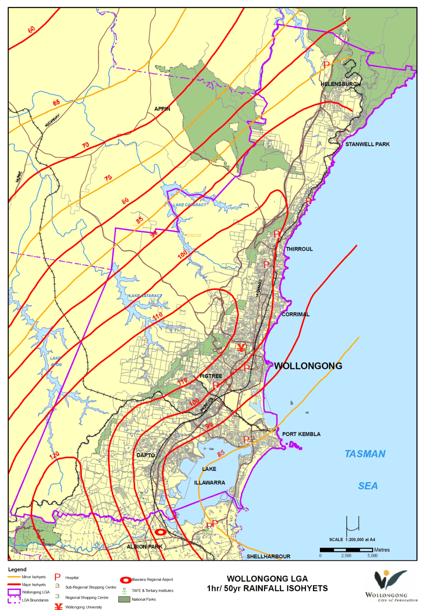

> [Picture on page 54: a picture, saved as a picture (images/chapter-e14-stormwater-management-page-54-2.gif, 150 dpi).]

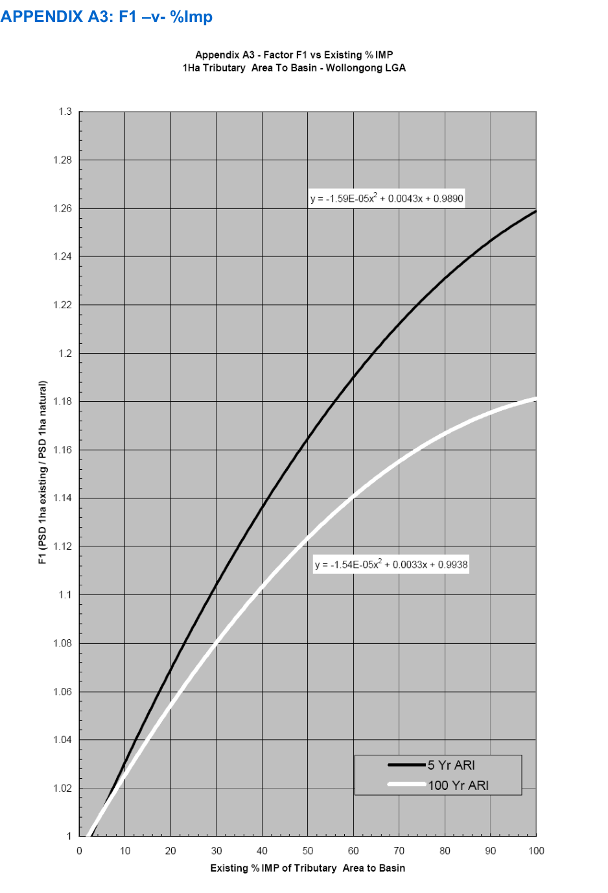

> [Picture on page 55: a picture, saved as a picture (images/chapter-e14-stormwater-management-page-55-1.gif, 150 dpi).]

#### APPENDIX A3: F1 –v- %Imp

#### APPENDIX A4 F2 –v- Area

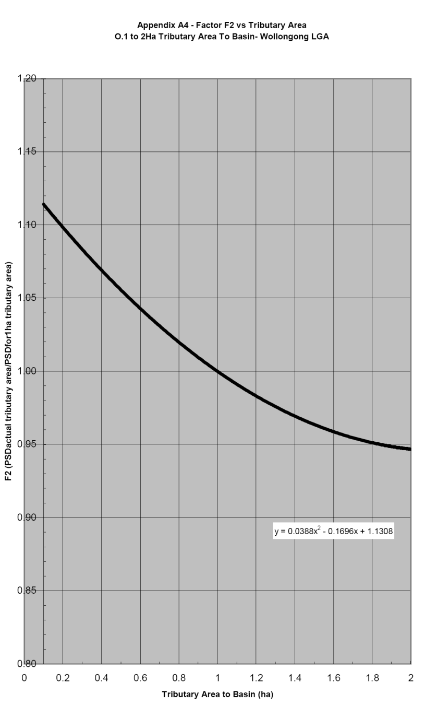

> [Picture on page 56: a picture, saved as a picture (images/chapter-e14-stormwater-management-page-56-2.gif, 150 dpi).]

#### APPENDIX A5: F3 –v- %Imp

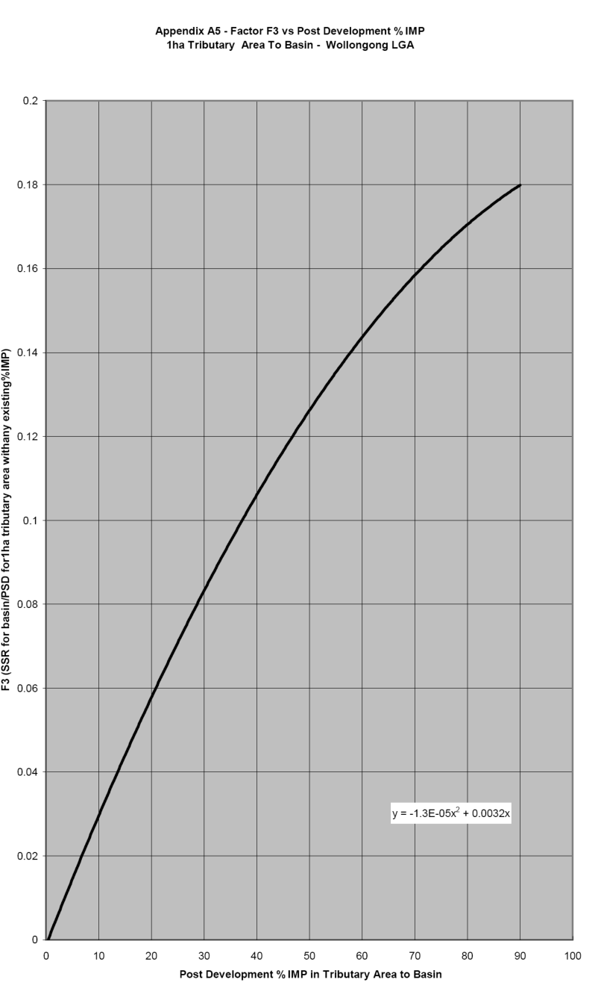

> [Picture on page 57: a picture, saved as a picture (images/chapter-e14-stormwater-management-page-57-2.gif, 150 dpi).]

#### APPENDIX A6: F4 –v- Area

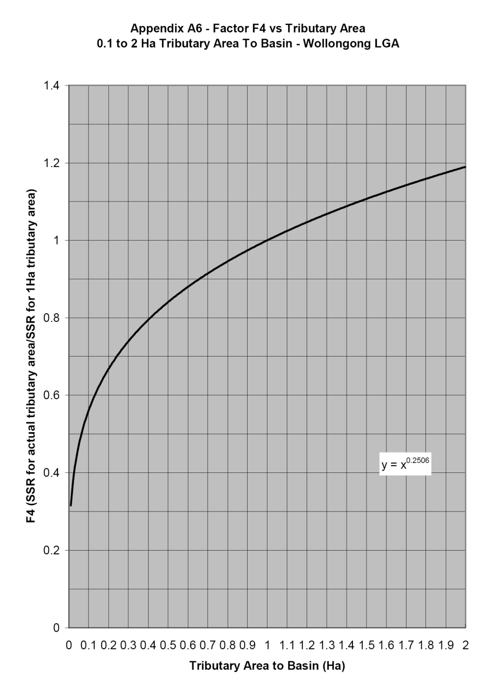

> [Picture on page 58: a picture, saved as a picture (images/chapter-e14-stormwater-management-page-58-2.gif, 150 dpi).]

#### APPENDIX A7: Examples

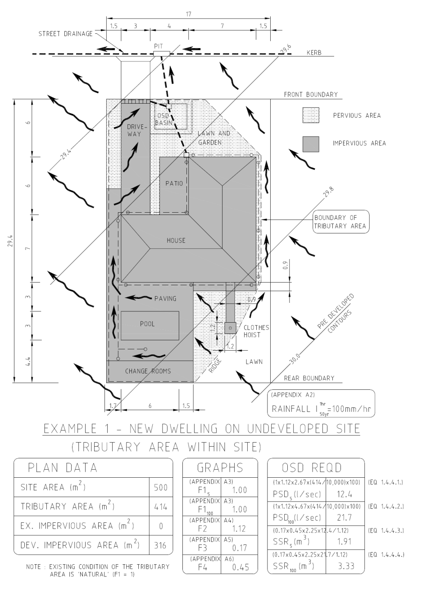

> [Picture on page 59: a picture, saved as a picture (images/chapter-e14-stormwater-management-page-59-2.gif, 150 dpi).]

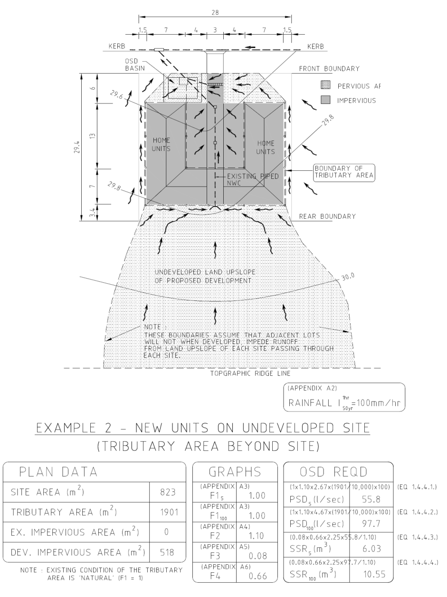

> [Picture on page 60: a picture, saved as a picture (images/chapter-e14-stormwater-management-page-60-1.gif, 150 dpi).]

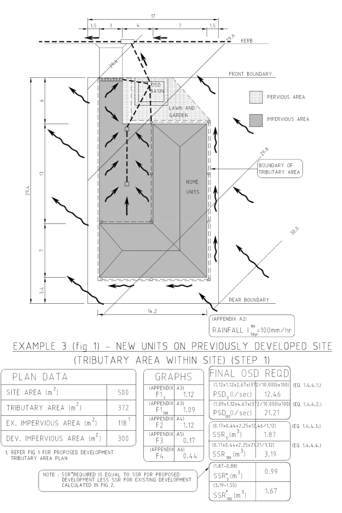

> [Picture on page 61: a picture, saved as a picture (images/chapter-e14-stormwater-management-page-61-1.gif, 150 dpi).]

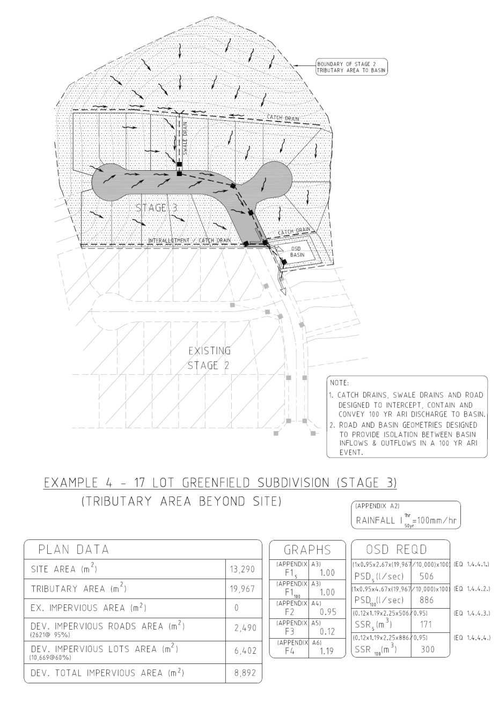

> [Picture on page 62: a picture, saved as a picture (images/chapter-e14-stormwater-management-page-62-1.gif, 150 dpi).]

### DETAILED DESIGN CHECKLIST

#### OSD DETAILED DESIGN CHECKLIST

NOTE This checklist is specific to the OSD requirements of a proposed development

It should be read in conjunction with Council’s current Drainage Design Code

and included with the detail drainage design submission documents

| ITEM | DESIGNER |  | COUNCIL REVIEW |  |
|---|---|---|---|---|
|  | YES | NO | YES | NO |
| 1. A Stormwater Concept Plan (SCP) has been approved |  |  |  |  |
| 2. The site is within the OSD ‘Concession’ zone and flows can be conveyed to a ‘registered’ watercourse without adversely impacting others If YES - refer supporting calculations (OSD not required) If NO - OSD is required – (remainder of list to be completed) |  |  |  |  |
| 3. The site is (whole or partly) inundated in a 5 year ARI event If YES - see Plan No ................ for 5Yr flood extents |  |  |  |  |
| 4. The tributary area to the basin is shown on Plan No …………… |  |  |  |  |
| 5. The tributary area to the basin is currently in a natural condition If NO – see Plan No ……………. For details of existing development |  |  |  |  |
| 6. Surface floodways/flowpaths of sufficient capacity to contain and convey the 100Yr discharge to the basin are shown on Plan No .................. |  |  |  |  |
| 7. Buildings are not inundated and have the required freeboard |  |  |  |  |
| 8. Flows are not increased or concentrated on an adjoining property |  |  |  |  |
| 9. Ground levels/contours extending into adjoining properties sufficiently to quantify bypass flow hydraulics are shown on Plan No. ............... |  |  |  |  |
| 10. The invert level of the storage is not less than ground level (or top of kerb) at the point of connection to external stormwater system If YES, see Plan No. .................... If NO, refer attached hydraulic analysis confirming potential impact of downstream control |  |  |  |  |
| 11. The discharge outlet pit design is consistent with the policy principles |  |  |  |  |
| 12. The discharge outlet pit design is consistent with the policy. If YES, see Plan No ……….. for details of: Orifice plate geometry, matl and fixing screen type, matl fixing, area and orientation, confirmation that all inflows to the discharge control pit are on the upstream side of the screen protecting the orifice If NO refer separate explanatory attachment. |  |  |  |  |
| 13. If an above ground/landscaped storage is specified, answer Q13(a) to Q13(g), otherwise move to Q14. |  |  |  |  |

| ITEM | DESIGNER |  | COUNCIL REVIEW |  |
|---|---|---|---|---|
|  | YES | NO | YES | NO |
| 13(a) Where the depth of ponding exceeds 600 mm, consideration has been given to whether there are steep drops, and/or a need for steps or ‘walk-in’ ‘walk-out’ batters, etc. when deciding if fencing and/or warning signs are required |  |  |  |  |
| 13(b) The landscaping treatment within the storage area is such that it does not limit storage volumes or provide a significant source of debris loading. |  |  |  |  |
| 13(c) The minimum surface slope is consistent with the policy |  |  |  |  |
| 13(d) Subsoil drainage is provided in areas subject to frequent ponding and around the outlet |  |  |  |  |
| 13(e) If the design includes a retaining wall, has it been structurally checked? |  |  |  |  |
| 13(f) Does the system have the correct storage? If YES, see stage-storage calculations attached If NO, refer separate explanatory attachment. |  |  |  |  |
| 14. If a driveway/car-park storage is specified, answer Q14(a) to Q14(b), otherwise move to Q15 |  |  |  |  |
| 14(a) The maximum depth is less than or equal to 200mm |  |  |  |  |
| 14(b) The minimum transverse slope is 1.5% |  |  |  |  |
| 15. If a structural/underground storage is specified, answer Q 15(a) to Q 15(f), otherwise move to Q16 |  |  |  |  |
| 15(a) The dimensions of openings are consistent with the policy |  |  |  |  |
| 15(b) The storage floor has a minimum slope of 0.7% |  |  |  |  |
| 15(c) There are sufficient access points for flushing purposes |  |  |  |  |
| 15(d) There are sufficient grated openings for ventilation purposes |  |  |  |  |
| 15(e) All access points have light weight covers |  |  |  |  |
| 16. The distribution of storage minimises inconvenience |  |  |  |  |
| 17. The OSD plans have been checked for consistency against the architectural and landscaping plans |  |  |  |  |
| 18 The OSD Design Summary details are consistent with the engineering plans |  |  |  |  |
| 19. The OSD Design Summary & Plans are consistent with the approved SCP |  |  |  |  |
| 20 The OSD Design Summary is attached |  |  |  |  |
| 21. A maintenance schedule has been prepared |  |  |  |  |

| Name of Designers Organisation | ………………..................................................... |  |
|---|---|---|
| Signature of Authorised Designer | ………………………….. | …../…../…… |
| Signature of Reviewing Officer …………………………… |  | …./…../….. |

### TECHNICAL DATA – MESH SCREENS

#### Technical Data – Mesh Screens

Discharge outlet pits must be fitted with an internal screen.  The screen needs to:

(a) Protect the orifice from blockage

(b) Create static conditions around the orifice which helps to achieve predictable discharge coefficients

(c) Retain litter and debris which would degrade downstream waterways.

#### i.Screen type

A small aperture-expanded steel mesh, such as Maximesh Rh3030, is recommended for orifices less than 150 mm in diameter.  This type of screen retains relatively fine material

(e.g. cigarette butts and grass clippings) while maintaining the performance of the orifice under heavy debris loading.  For orifices larger than 150 mm, the screen area necessary for a fine mesh screen can make it difficult to fit in a discharge outlet pits.  A grid mesh, such as Weldlok F40/203, may be used for these larger orifices.  Where the grid mesh is used, a fine mesh screen should be installed upstream of the discharge outlet pits, for areas likely to collect litter or debris.

#### ii.Screen area

The minimum recommended area (including blocked area) for an internal screen in a discharge outlet pits is:

(a) 50 times the orifice area where a fine mesh screen is used (egg.  Maximesh Rh3030)

(b) 20 times the orifice area where a grid mesh is used (e.g. Weldlok F40/203).

#### iii.Screen orientation

The inlet pipe to a discharge outlet pits should direct inflows parallel (or at a small angle) to the screen. Perpendicular inflows drive debris into a mesh screen making it difficult to dislodge.

When inflows are directed parallel to the screen, the debris is layered on the screen but is blown off when the inflow exceeds approximately 2-3 times the PSD.  The performance of the orifice and screen is influenced by the orientation of the screen.  To assist in shedding debris, the screen should be positioned as close to vertical as possible.  This allows debris to fall off once the water level in the discharge outlet pits drops.  However, the screen must fit securely to the pit to avoid debris floating over or around the screen and blocking the orifice.  The screen should be placed no less than 60 degrees to the horizontal.

#### iv.General

To prevent blockages, Maximesh screens must be positioned so that the long axis of the oval shaped holes is horizontal, the protruding lip is uppermost and above the hole and the screen is tilted downstream (See Figure 5).  Blockages can occur if the screen is accidentally placed upside down.  Fitting a handle to the screen not only reduces the chance of incorrect placement but also makes removal for cleaning easier. Fixings need to be selected to suit the screen and to promote easy removal for maintenance.  Reducing the screen size also facilitates cleaning by reducing the weight.  Proprietary screens may be considered to achieve this end.  After being cut to size, Maximesh screens need to be 'hot dipped' galvanised to prevent corrosion.  All mesh screens deflect under high inflows and heavy debris loading and should be braced to stop debris being carried around the screen.

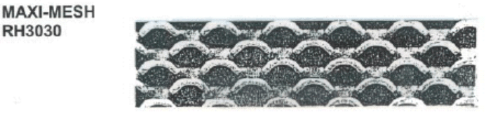

> [Picture on page 67: a picture, saved as a picture (images/chapter-e14-stormwater-management-page-67-1.gif, 150 dpi).]

#### Figure 5: Maximesh Screen

(Source: UPRCT OSD Design Handbook)

### SAMPLE MAINTENANCE SCHEDULE

| DRAFT MAINTENANCE SCHEDULE |  |  |  |
|---|---|---|---|
| (for guidance only) |  |  |  |
| MAINTENANCE | FREQUENCY | PERFORMED BY | PROCEDURE |
| ACTION |  |  |  |
| Inspect & remove any | Six monthly | Owner | Remove grate & screen to inspect orifice. See plan |
| blockage of orifice |  |  | for location of discharge outlet pit. |
| Inspect screen and | Six monthly | Owner | Remove grate and screen if required to clean it. |
| clean |  |  |  |
| Inspect flap valve & | Six monthly | Owner | Remove grate. Ensure flap valve moves freely and |
| remove any blockage |  |  | remove any blockages or debris. |
| Inspect pit sump & | Six monthly | Owner | Remove grate and screen. Remove sediment/sludge build-up and check orifice and flap valve clear. |
| remove any |  |  |  |
| sediment/sludge |  |  |  |
| Inspect grate for | Six monthly | Owner | Check both sides of grate for corrosion, (especially |
| damage or blockage |  |  | corners and welds) damage or blockage. |
| Inspect & remove any | Six monthly | Owner | Remove blockages from grate and check if pit blocked. |
| debris/litter/mulch etc |  |  |  |
| blocking grates of return |  |  |  |
| pit |  |  |  |
| Inspect storage areas & | Six monthly | Owner | Remove debris and floatable material likely to be carried to grates. |
| remove |  |  |  |
| debris/mulch/litter etc |  |  |  |
| likely to block |  |  |  |
| screens/grates |  |  |  |
| Check attachment of | Annually | Maintenance | Remove grate and screen. Ensure plate mounted |
| orifice plate to wall of pit |  |  | securely, tighten fixings if required. Seal gaps as |
|  |  | Contractor |  |
| (gaps less than 5 mm) |  |  | required. |
| Check orifice diameter | Five yearly | Maintenance | Compare diameter to design (see Work-as-Executed) and ensure edge is not pitted or damaged. |
| correct and retains |  |  |  |
|  |  | Contractor |  |
| sharp edge |  |  |  |
| Check attachment of screen to wall of pit | Annually | Maintenance Contractor | Remove grate and screen. Ensure screen fixings secure. Repair as required. |
| Check screen for corrosion | Annually | Maintenance Contractor | Remove grate and examine screen for rust or corrosion, especially at corners or welds. |

| Inspect overflow weir & | Six monthly | Maintenance Contractor | Remove grate and open cover to ventilate underground storage if present. Ensure weir clear of blockages. |
|---|---|---|---|
| remove |  |  |  |
| any blockage |  |  |  |
| Empty basket at | Six monthly | Maintenance Contractor | Remove grate and ventilate underground storage chamber if present. Empty basket, check fixings secure and not corroded. |
| overflow weir (if |  |  |  |
| present) |  |  |  |
| Inspect pit walls | Annually | Maintenance Contractor | Remove grate to inspect internal walls. Repair as required. Clear vegetation from external walls if necessary and repair as required. |
| (internal and external, if |  |  |  |
| appropriate) for cracks |  |  |  |
| or spalling |  |  |  |
| Inspect outlet pipe & remove any blockage | Six monthly | Maintenance Contractor | Remove grate and screen. Ventilate underground storage if present. Check orifice and remove any blockages in outlet pipe. Flush outlet pipe to confirm it drains freely. Check for sludge/debris on upstream side of return line (if relevant). |
| Check step irons for corrosion | Annually | Maintenance Contractor | Remove grate. Examine step irons and repair any corrosion or damage. |
| Check fixing of step irons is secure | Six monthly | Maintenance Contractor | Remove grate and ensure fixings secure prior to placing weight on step iron. |
| Inspect internal walls of | Annually | Maintenance Contractor | Remove grate to inspect internal walls. Repair as required. Clear vegetation from external walls if necessary and repair as required. |
| return |  |  |  |
| pit (and external, if |  |  |  |
| appropriate) |  |  |  |
| for cracks or spalling |  |  |  |
| Compare storage | Annually | Maintenance Contractor | Compare actual storage available with Work-as |
| volume to volume |  |  | Executed plans. If volume loss is greater than 5%, |
| approved. (Rectify if |  |  | arrange for reconstruction to replace the volume lost. |
| loss > 5%) |  |  | Council to be notified of the proposal. |
| Inspect storages for | Annually | Maintenance Contractor | Check along drainage lines and at pits for subsidence likely to indicate leakages. |
| subsidence |  |  |  |
| near pits |  |  |  |

### CERTIFICATE OF HYDRAULIC COMPLIANCE &

#### OUTSTANDING WORKS FORM

#### FORM X.XX

#### WOLLONGONG CITY COUNCIL

#### ON-SITE STORMWATER DETENTION SYSTEM

#### CERTIFICATE OF HYDRAULIC COMPLIANCE

#### JOB NO: ________________ DA NO: ________________ PROJECT:

#### _____________________________________________________________________________

#### LOCATION:

#### _____________________________________________________________________________

#### CONSTRUCTION

#### DESIGNED BY: _________________________ CERTIFIED BY:______________________

#### QUALIFICATIONS: ______________________ TELEPHONE: ________________________

1.0 WORKS CONSTRUCTED IN ACCORDANCE WITH DESIGN.  (Delete if not applicable)

I _____________________ of ______________________ (accredited professional being competent to practice in the field of stormwater drainage design) have inspected the above on-site stormwater detention system and certify that the works have been constructed in accordance with the approved design details for the above mentioned project.

Signature: ____________________ Date: _________

2.0 CONSTRUCTION VARIATIONS NOT AFFECTING DESIGN PERFORMANCE.  (Delete if not applicable)

I _____________________ of ______________________ (accredited professional being competent to practice in the field of stormwater drainage design) have inspected the above on-site stormwater detention system and certify that the works have been constructed in accordance with the approved design details for the above mentioned project, except for the variations listed below which do not affect the performance of the system, subject to satisfactory maintenance.

#### Variations:

_______________________________________________________________________________

_______________________________________________________________________________

_______________________________________________________________________________

Signature: ____________________ Date: __________

### 3.0 AUTHORITY TO RELEASE PLANS TO FUTURE OWNERS OF THE PROPERTY

As the copyright owner of the drainage plans, I hereby authorise release of the approved plans/attached sketch plan to future owners of the property to assist in the maintenance of the On-site Stormwater Detention system.

Signature: ____________________ Date: __________

Name: _______________________________(Print)

#### FORM X.XX

#### WOLLONGONG CITY COUNCIL

#### ON-SITE STORMWATER DETENTION SYSTEM

#### LIST OF OUTSTANDING WORKS

#### JOB NO: ________________ DA NO: ________________

#### PROJECT:

#### _______________________________________________________________________________

#### LOCATION:

#### _______________________________________________________________________________

#### CONSTRUCTION

#### DESIGNED BY: _________________________ CERTIFIED BY: ________________________

#### QUALIFICATIONS: ______________________ TELEPHONE: ________________________

1.0 CONSTRUCTION VARIATIONS AFFECTING DESIGN PERFORMANCE.

I _____________________ of ______________________ (accredited professional being competent to practice in the field of stormwater drainage design) have inspected the above on-site stormwater detention system and the following variations to the approved design.  The listed remedial works will be necessary to make the system function according to the approved design.

> [Picture on page 73: a picture, saved as a picture (images/chapter-e14-stormwater-management-page-73-1.gif, 150 dpi).]
> Words printed on the picture (title and legend, copied from the PDF):
> Variation
> Remedial Work Necessary

Signature: ____________________ Date: __________

### LEGAL PROTECTION OF OSD SYSTEMS

F.1  Explanatory notes on the preparation and registration of Restrictions on Use of

#### Land and Positive Covenants

Private developers within the area administered by Wollongong City Council are required to construct On-site Stormwater Detention (OSD) facilities as part of their development consent in accordance with Section 10 of this DCP.

OSD systems consist of a storage area, an outlet and a collection network.  The collection network directs stormwater flow to the storage.  The collection network includes those surfaces which are sloped so as to direct flow to the storage, as well as the more obvious devices such as roof gutters, downpipes, drainage lines and pits.  In effect, the whole lot is part of the OSD system.

All the components of an OSD system need to be kept intact and maintained so that the overall system continues to function as it was intended for the life of the development.  To ensure that the OSD system is not altered during the life of the development, a Restriction on Use of the land is created.  This prevents owners making changes to any of the site drainage components which would alter the way the facility works, without the permission of their local council.  To ensure that the OSD system is adequately maintained, a Positive Covenant is registered on the title of the property, placing the responsibility for this maintenance on the owner of the land.  By registering the covenant and restriction on the property title, the obligations can be transferred to future owners.  The Positive Covenant will be established to benefit the local Council.

A sketch plan showing the location of the different components of the OSD system and a copy of the Maintenance Schedule must be included as attachments to the Positive Covenant.  This will ensure future owners are aware of their maintenance obligation.

If no new lot is being created, the cheapest and quickest way to register the Positive Covenant and Restriction on Use on the title of Torrens Title land is through:

Form 13PC for a Positive Covenant, and

Form 13RPA for a Restriction on Use.

For Old System land the covenant and restriction should be imposed with a suitable deed.

A copy of forms 13PC and 13RPA is included in Appendix F.2.

The covenant and restriction on use may also be imposed under Section 88B of the Conveyancing Act, 1919 in conjunction with the creation of a new lot or lots.  The Positive Covenant will be in favour of the local council but, because the land is privately owned, the covenant and restriction will be imposed through Section 88E of the Act.

A copy of Information Bulletin No 14, prepared by the Land Titles Office (LTO), A Guide to the Preparation of a Section 88B Instrument to:

· Create Easements, Profits à Prendre, Restrictions on the Use of Land or Positive Covenants

· Release Easements or Profits à Prendre

is included below.

The terms and conditions of the covenant and restriction must be shown in part 2 of the Section 88B Instrument or be attached to the forms 13PC and 13RPA.  A copy of suitable wording for the terms and conditions is below.  The local Council has the right to release, vary or modify the terms and conditions of the covenant and restriction.

#### F.2  Blank Copy of Forms 13RPA AND 13PC

These forms for a Restriction on Use of Land and Positive Covenant are required by the Lands Titles Office where there is no subdivision of land, and the covenant and restriction are being imposed on an existing parcel of land.

A plan should be attached showing the location and various components of the On-site Stormwater Detention system.  This should be accompanied by the Maintenance Schedule.  (See Appendix D)

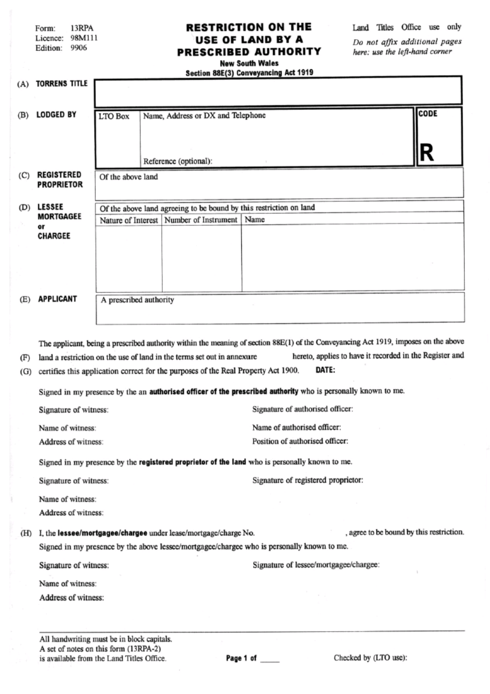

> [Picture on page 76: a picture, saved as a picture (images/chapter-e14-stormwater-management-page-76-1.gif, 150 dpi).]

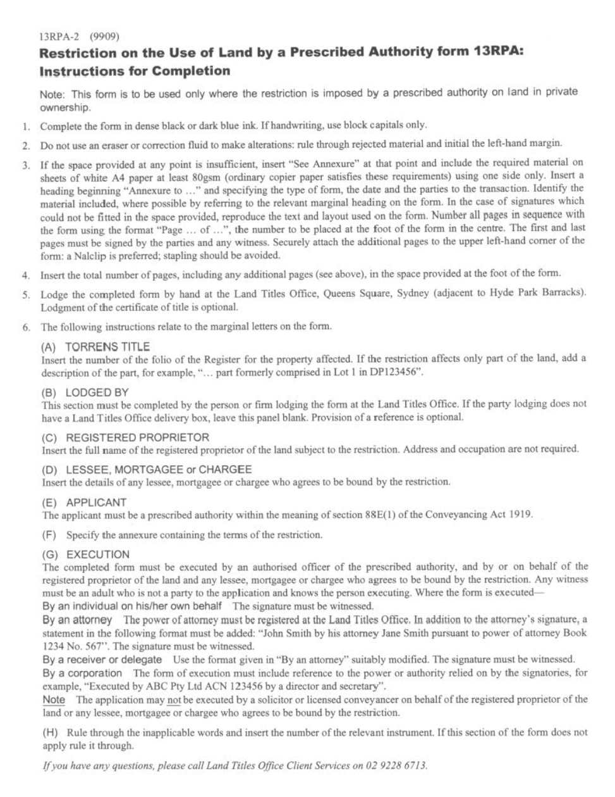

> [Picture on page 77: a picture, saved as a picture (images/chapter-e14-stormwater-management-page-77-1.gif, 150 dpi).]

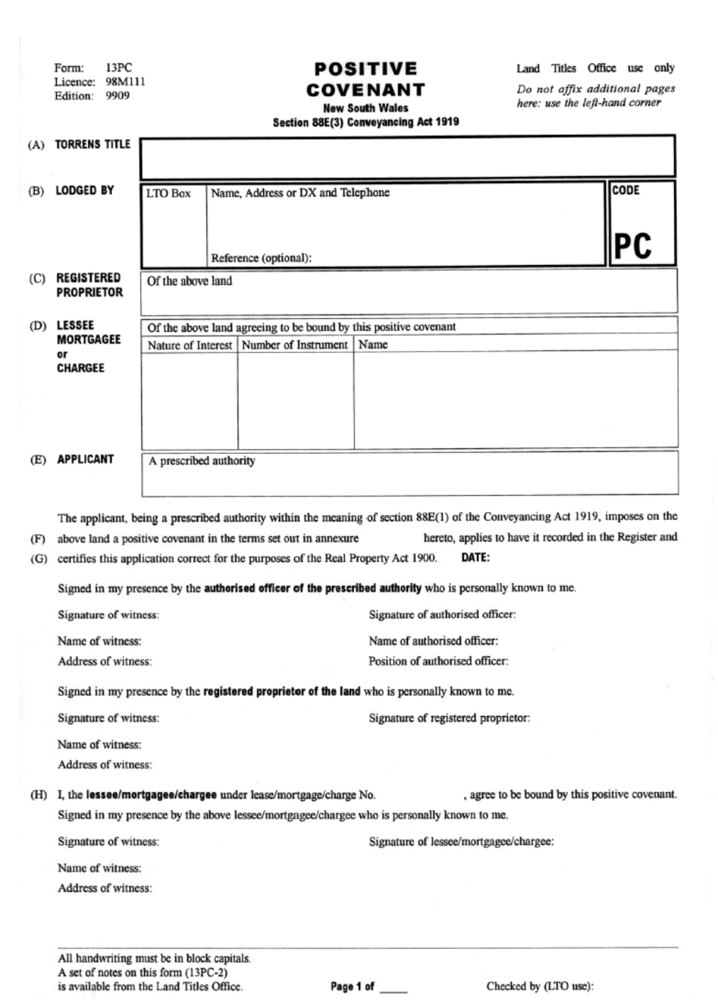

> [Picture on page 78: a picture, saved as a picture (images/chapter-e14-stormwater-management-page-78-1.gif, 150 dpi).]

B.4-2

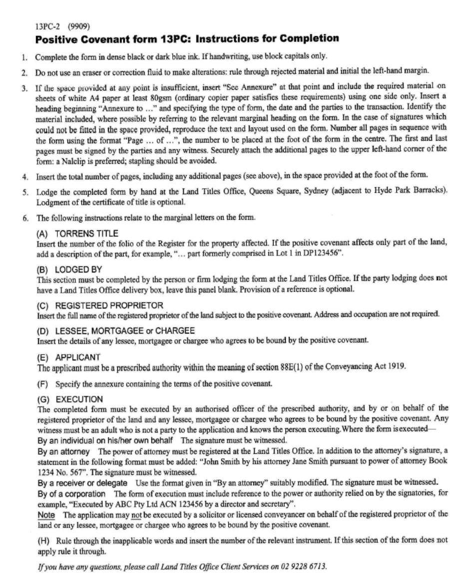

> [Picture on page 79: a picture, saved as a picture (images/chapter-e14-stormwater-management-page-79-2.gif, 150 dpi).]

#### F.3  Terms and Conditions for Restriction on Use of Land and Positive Covenant

This appendix contains standard clauses for the Terms and Conditions to be applied in Restrictions on Use of Land and or Positive Covenants in relation to OSD systems.  Appendix F.4 contains a sample instrument which shows how these terms and conditions are applied.

Both the Restriction on Use and the Positive Covenant will normally be required, however in cases where only the Positive Covenant is used, the definition of the OSD system (given in clause 1 of the Restriction on Use) should be included in the Positive Covenant.

#### Restrictions on Use of Land for OSD Systems

1\. The registered proprietor of the lot burdened must not make or permit or suffer the making of any alterations to any on-site stormwater detention system on the lot(s) burdened without the prior consent in writing of the authority benefited. .  The expression “on-site stormwater detention system” shall include all ancillary gutters, pipes, drains, walls, kerbs, pits, grates, tanks, chambers, basins and surfaces designed to temporarily detain stormwater as well as all surfaces graded to direct stormwater to those structures. Name of authority having the power to release, vary or modify the restriction referred to is Wollongong City Council.

2\. The registered proprietor of the lot burdened must not erect or permit the erection of or permit to remain any dwelling house or other structure on the lot burdened unless the registered proprietor has constructed an on site stormwater detention system on the said lot burdened, in accordance with the requirements of Wollongong City Council. The expression “on-site stormwater detention system” shall include all ancillary gutters, pipes, drains, walls, kerbs, pits, grates, tanks, chambers, basins and surfaces designed to temporarily detain stormwater as well as all surfaces graded to direct stormwater to those structures. Note: Clause 2 is only necessary when construction of the OSD system is being deferred, which will only be permitted by Council in exceptional circumstances.

#### Positive Covenants

1\. The registered proprietor of the lot  burdened must in respect of the on site stormwater detention system on the lot burdened:

(a) keep the system clean and free from silt, rubbish and debris

(b) maintain and repair the system so that it functions in a safe and efficient manner

(c) permit the prescribed authority or its authorised agents from time to time and upon giving reasonable notice (but at any time and without notice in the case of an emergency) to enter and inspect the land for the compliance with the requirements of this covenant; and

(d) comply with the terms of any written notice issued by the prescribed authority in respect of the requirements of this covenant.

2\. Under Section 88F(3) of the Conveyancing Act 1919 the Prescribed authority has the following additional powers:

(a) If the registered proprietor fails to comply with the terms of any written notice issued by prescribed authority under part 1(d) above the prescribed authority may enter the land with all necessary materials and equipment and carry out any work which the prescribed authority in its discretion considers necessary to comply with that notice .

(b) the prescribed authority may recover from the registered proprietor of the burdened lot  in any court of competent jurisdiction:

(i) any expense reasonably incurred by it in exercising its powers under part 2(a) above including reasonable wages for the prescribed authorities employees engaged in carrying out and supervising and administering the work and the costs of materials, machinery, tools and equipment used to carry out the work.

(ii) legal costs on an indemnity basis for issue of the notices for recovery of the costs and expenses for  registration of a covenant charge under section 88F of the Act for providing any certificate required under section 88G of the Act and for obtaining any injunction under section 88H of the Act.

Name of authority having the power to release vary or modify the positive covenant

referred to is Wollongong City Council. F.4  Sample Restriction on Use of Land and Covenant where a Deposited Plan is being registered together with a Section 88B instrument.

In this case the On-Site Detention system is provided with Development Approval involving subdivision of land.

A Plan of the OSD system and a copy of the Maintenance Schedule should be attached to the Instrument.

#### INSTRUMENT SETTING OUT TERMS OF RESTRICTION ON THE USE OF LAND AND POSITIVE

COVENANT INTENDED TO BE CREATED PURSUANT TO SECTION 88E OF THE CONVEYANCING ACT 1919.

|  |  | (Sheet .. of … sheets) |
|---|---|---|
| Plan: |  | Subdivision of Lot …….D.P……………. Covered by Council Clerk’s Certificate No. ……………….. |
| Full name and address |  | Of ……………………………… |
| ……………………………………………… |  |  |
| Of proprietor of the land |  |  |
| ……………………………………………… | … | …………………………………………… |

## PART 1

| ( ) | Identity of restriction…………….. referred to in abovementioned plan | Restriction on use under Section 88E of the Conveyancing Act 1919 |
|---|---|---|

#### SCHEDULE OF LOT(S), ETC. AFFECTED

| Lot(s) Burdened | Authority Benefited |
|---|---|
| ……………………………………… | Insert name of Council |
| ( ) Identity of Positive Covenant | Positive Covenant under |
| referred to in above-mentioned plan | Section 88E of the Conveyancing Act 1919 |

#### SCHEDULE OF LOT(S), ETC. AFFECTED

Lot(s) Burdened

Authority Benefited

………………………………………

Insert name of Council

## PART 2

TERMS OF RESTRICTION ON USE …………………………………………….. REFERRED TO IN THE ABOVE-MENTIONED PLAN

The registered proprietor shall not make or permit or suffer the making of any alterations to the on-site stormwater detention system which is constructed on the lot(s) burdened without the prior consent in writing of ………………………………………(Insert name of Council).  The expression “on-site stormwater detention system” shall include all ancillary gutters, pipes, drains, walls, kerbs, pits, grates, tanks, chambers, basins and surfaces designed to temporarily detain stormwater as well as all surfaces graded to direct stormwater to the temporary storage.  Any on-site stormwater detention system constructed on the lot(s) burdened is hereafter referred to as “the system”.

Name of Authority having the power to release, vary or modify the Restriction ……………… referred to is ………………………………………(Insert name of Council).

TERMS OF POSITIVE COVENANT …………………………………..…………..REFERRED TO IN THE ABOVE-MENTIONED PLAN

1\. The registered proprietor of the lot(s) hereby burdened will in respect of the system:

(a) keep the system clean and free from silt, rubbish and debris

(b) maintain and repair at the sole expense of the registered proprietors the whole of the system so that if functions in a safe and efficient manner

(c) permit the Council or its authorised agents from time to time and upon giving reasonable notice (but at any time and without notice in the case of an emergency) to enter and inspect the land for the compliance with the requirements of this covenant

(d) comply with the terms of any written notice issued by the Council in respect of the requirements of this covenant within the time stated in the notice.

2\. Pursuant to Section 88F(3) of the Conveyancing Act 1919 the Council shall have the following additional powers:

(i) in the event that the registered proprietor fails to comply with the terms of any written notice issued by the Council as set out above the Council or its authorised agents may enter the land with all necessary materials and equipment and carry out any work which the Council in its discretion considers reasonable to comply with the said notice referred to in part 1(d) above

(ii) The Council may recover from the registered proprietor in a Court of competent jurisdiction:

(a) any expense reasonably incurred by it in exercising its powers under subparagraph (i) hereof.  Such expense shall include reasonable wages for the Council’s employees engaged in effecting the work referred to in (i) above, supervising and administering the said work together with costs, reasonably estimated by the Council, for the use of materials, machinery, tools and equipment in conjunction with the said work.

(b) legal costs on an indemnity basis for issue of the said notices and recovery of the said costs and expenses together with the costs and expenses of registration of a covenant charge pursuant to section 88F of the Act or providing any certificate required pursuant to section 88G of the Act or obtaining any injunction pursuant to section 88H of the Act.

Name of Authority having the power to release vary or modify the Positive Covenant

………………………………….. referred to is …………………………………(Insert name of Council).

#### F.5  Land Titles Office Information Bulletin September 1998 Number: 14

#### A Guide to the preparation of a Section 88B Instrument to:

· Create Easements, Profits à Prendre, Restrictions on the Use of Land or Positive Covenants

#### · Release Easements or Profits à Prendre

Note: This bulletin should be read in conjunction with the following:

· Information Bulletin No. 43 - ‘Creating an Easement over a Track in Use’

· Information Bulletin No. 56 - ‘Property Legislation (Easements) Amendment Act 1995.’
