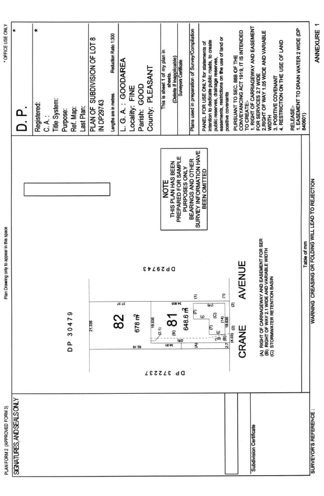

#### 7. Signatures and Consents

Where an easement, profit à prendre, restriction or positive covenant is being created the plan and Section 88B instrument must be signed by:

(a) The registered proprietor

(b) Mortgagee

(c) Chargee or

(d) Covenant chargee and

Written consents must be furnished by any

(a) Caveator,

(b) Lessee, or

(c) Judgement creditor under any writ

in accordance with Section 195D Conveyancing Act 1919.

Note: Written consents may be dispensed with if the caveator, lessee or judgement creditor signs the plan and instrument.

#### Where an Easement or Profit à Prendre is being released:

The signatures and consents of all the parties relating to the dominant tenement

should be furnished.

Inquiries on all matters related to plans and associated dealings should initially be made in person at Customer Services Branch, second level, Land Titles Office, Queens Square, Sydney or by contacting the Telephone Inquiry Service on (02) 9228 6713.

David Mulcahy

#### Director of Land Titles and Registrar General

First issued July 1987

#### Annexure 1

> [Picture on page 90: a picture, saved as a picture (images/chapter-e14-stormwater-management-page-90-1.gif, 150 dpi).]

#### Annexure 2

Instrument setting out Terms of Easements/Profits à Prendre intended to be created or released and of Restrictions on the Use of Land and Positive Covenants intended to be created pursuant to

## Section 88B of the Conveyancing Act 1919.

| Plan: |  | Subdivision of Lot 8 D.P.29743 covered by Subdivision Certificate No. 98/200 of 9/7/1998 |
|---|---|---|
| Full name and address of the |  | Grace Mary Brothers |
| owner of the land |  | 4 Crane Avenue Fine NSW 2775 |
| 1. Identity of easement, profit à prendre, | Part 1 | Right of Carriage Way and |
| restriction or positive covenant to be |  | Easement for Services 2.7 wide |
| created and firstly referred to in the plan |  |  |

#### Schedule of Lots etc. Affected

#### Lots Burdened

#### Lots Benefited

82

81
