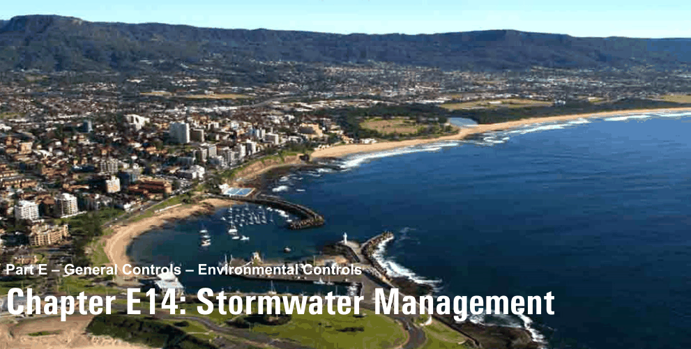

# Wollongong Development Control Plan 2009 - Chapter E14 Stormwater Management

> This chapter is split into 27 section file(s), one per numbered heading, in the order they appear in the PDF.

Source PDF: [Wollongong-DCP-2009-Chapter-E14-Stormwater-Management.pdf](https://planfortomorrow.sharepoint.com/sites/Planfortomorrow/Shared%20Documents/00%20NSW-Planning-Resources/dcp/wollongong-development-control-plan-2009/chapter-e14-stormwater-management/Wollongong-DCP-2009-Chapter-E14-Stormwater-Management.pdf)

> [Picture on page 1: a picture, saved as a picture (images/chapter-e14-stormwater-management-page-1-1.gif, 150 dpi).]

#### Part E – General Controls – Environmental Controls

### Chapter E14: Stormwater Management

> The PDF's contents list (page numbers of the printed document) is not repeated here - see Sections below.

i

LEGAL PROTECTION OF OSD SYSTEMS 72

### Figures

#### Figure 1 Types of Urban Hydrologic Models and their Application

Range (ARR2019, Book 9, Chapter 6) .............................. 7 Figure 2: Determination of Runoff Coefficient .................... 8 Figure 3: Combined Flood Hazard Curves (Smith et al., 2014) 15 Figure 4: OSD Approval Process ................................... 30 Figure 5: Maximesh Screen ......................................... 65

ii

<!-- sections -->
## Sections

1. [1 INTRODUCTION](01-introduction.md)
2. [2 DEFINITIONS / TECHNICAL TERMS](02-definitions-technical-terms.md)
3. [3 AVERAGE RECURRANCE INTERVAL](03-average-recurrance-interval.md)
4. [4 PRELIMINARY LAYOUT OF PROPOSED STORMWATER](04-preliminary-layout-of-proposed.md)
5. [5 HYDROLOGY](05-hydrology.md)
6. [6 MINOR SYSTEM](06-minor-system.md)
7. [7 MAJOR SYSTEM](07-major-system.md)
8. [8 SAFETY IN DESIGN](08-safety-in-design.md)
9. [9 MANAGEMENT OF STORMWATER FROM DEVELOPMENT](09-management-of-stormwater-from.md)
10. [10 ON-SITE STORMWATER DETENTION](10-on-site-stormwater-detention.md)
11. [11 INFORMATION REQUIREMENTS (TO BE SUBMITTED BY APPLICANT)](11-information-requirements-to-be-submitted.md)
12. [12 REFERENCES](12-references.md)
13. [1 Introduction:](13-1-introduction.md)
14. [2 Preparation of a Section 88B Instrument:](14-2-preparation-of-a-section-88b-instrument.md)
15. [3 Creating easements:](15-3-creating-easements.md)
16. [4 Creating Profits à Prendre, Restrictions on Use of Land.](16-4-creating-profits-prendre-restrictions-on.md)
17. [5 Creating Positive Covenants](17-5-creating-positive-covenants.md)
18. [6 Releasing Easements or Profits à Prendre](18-6-releasing-easements-or-profits-prendre.md)
19. [7 Signatures and Consents](19-7-signatures-and-consents.md)
20. [2 Identity of easement to be created and](20-2-identity-of-easement-to-be-created-and.md)
21. [3 Identity of positive covenant thirdly](21-3-identity-of-positive-covenant-thirdly.md)
22. [4 Identity of restriction fourthly referred](22-4-identity-of-restriction-fourthly.md)
23. [1 Identity of easement to be released and](23-1-identity-of-easement-to-be-released-and.md)
24. [1 Terms of Right of Way 2.1 wide and variable secondly referred to in the plan.](24-1-terms-of-right-of-way-2-1-wide-and.md)
25. [2 Terms of Positive Covenant thirdly referred to in the plan](25-2-terms-of-positive-covenant-thirdly.md)
26. [3 Terms of Restriction on the Use of Land fourthly referred to in the plan](26-3-terms-of-restriction-on-the-use-of-land.md)
27. [1 Identity of easement, profit à](27-1-identity-of-easement-profit.md)
