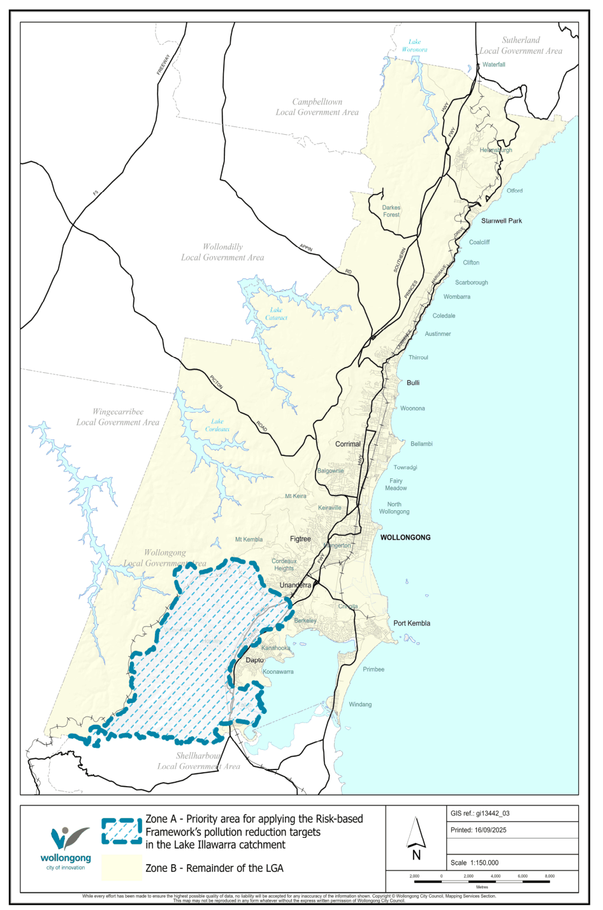
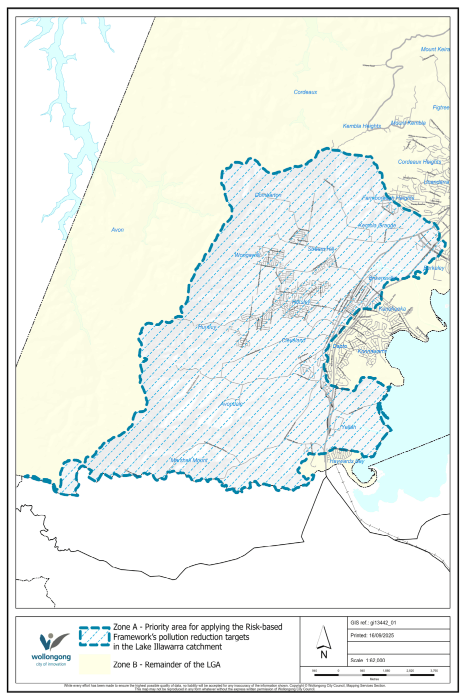

### 4.2 Stormwater quality

A key initial step in preparing a compliant WSUD Strategy is to confirm the appropriate objectives and pollution reduction targets that apply to the development site. Where required, developments must achieve the minimum percentage (%) reduction of the pre-development pollutants in accordance with Table 2.

#### Table 2 - Minimum post-development pollution reduction targets (%)

| Pollutant | Zone A | Zone B |
|---|---|---|
| Gross Pollutants (GP) | 90% | 90% |
| Total Suspended Solids (TSS) | 82% | 85% |
| Total Phosphorus (TP) | 78% | 60% |
| Total Nitrogen (TN) | 67% | 45% |

#### Notes:

Zone A includes areas subject to the water quality targets identified by the NSW Government. Zone B covers all other parts of the LGA (see Figures 1 and 2). The percentages listed in Table 2 represent the minimum reduction in pollutant loads that must be achieved through WSUD treatment measures and demonstrated through MUSIC modelling. The stormwater quality performance targets set out in Table 2 may be adjusted by Council at its discretion. This is particularly applicable to developments located in sensitive catchments, such as the Lake Illawarra catchment. Furthermore, Council may require proponents to include additional analysis and related performance criteria in a WSUD Strategy for specific developments, such as those on land affected by soil or groundwater contamination. Detailed maps of Zone A (the priority area for applying the NSW Government’s risk-based framework for improving water quality targets in Lake Illawarra catchment area) are available through Council's interactive online map service, IntraMaps. This platform allows users to explore comprehensive and key information related to the City’s infrastructure, zoning, land use, and other relevant data. All development within the Sydney Drinking Water Catchment must comply with the Neutral or Beneficial Effect (NorBE) water quality controls.

> [Picture on page 10: a picture, saved as a picture (images/chapter-e15-water-sensitive-urban-design-wsud-page-10-1.gif, 150 dpi).]

Figure 1 - Map showing the water quality target areas including Zone A (the NSW Government’s Risk-based framework for improving water quality target area) and Zone B for the Wollongong LGA only.

> [Picture on page 11: a picture, saved as a picture (images/chapter-e15-water-sensitive-urban-design-wsud-page-11-1.gif, 150 dpi).]

Figure 2 - Zone A – Priority area for applying the Risk-based framework’s pollution reduction targets for improving water quality in the Wollongong LGA only (NSW Government 2024).
