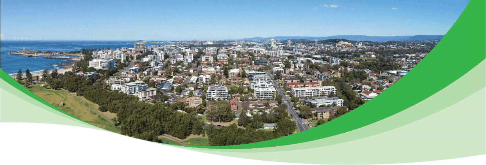

# Wollongong Development Control Plan 2009 - Chapter E15 Water Sensitive Urban Design (WSUD)

> This chapter is split into 15 section file(s), one per numbered heading, in the order they appear in the PDF.

Source PDF: [Wollongong-DCP-2009-Chapter-E15-Water-Sensitive-Urban-Design.pdf](https://planfortomorrow.sharepoint.com/sites/Planfortomorrow/Shared%20Documents/00%20NSW-Planning-Resources/dcp/wollongong-development-control-plan-2009/chapter-e15-water-sensitive-urban-design-wsud/Wollongong-DCP-2009-Chapter-E15-Water-Sensitive-Urban-Design.pdf)

> [Picture on page 1: a picture, saved as a picture (images/chapter-e15-water-sensitive-urban-design-wsud-page-1-1.gif, 150 dpi).]

### Part E General Controls – Environmental Controls Chapter E15: Water Sensitive Urban Design (WSUD)

> The PDF's contents list (page numbers of the printed document) is not repeated here - see Sections below.

Figure 1 - Map showing the water quality target areas including Zone A (the NSW Government’s Risk-based framework for improving water quality target area) and Zone B for

the Wollongong LGA only. ....................................................................................................... 10 Figure 2 - Zone A – Priority area for applying the Risk-based framework’s reduction targets for

water quality in the Wollongong LGA only (NSW Government, 2024). .................................... 11

#### Document Control

| Rev No. | Adoption Date 15 December 2009 | In Force Date 1 March 2010 | Revision Details Commenced |
|---|---|---|---|
| 1 | 17 November 2025 | 28 November 2025 | Updates to development controls, compliance pathways, accepted WSUD measures and pollution reduction targets. |

<!-- sections -->
## Sections

1. [1 INTRODUCTION](01-introduction.md)
2. [1.1 Purpose of this Chapter](02-1-1-purpose-of-this-chapter.md)
3. [1.2 Development to which this Chapter applies](03-1-2-development-to-which-this-chapter.md)
4. [1.3 Aims of this Chapter](04-1-3-aims-of-this-chapter.md)
5. [2 RELEVANT LEGISLATION, STANDARDS AND GUIDELINES](05-2-relevant-legislation-standards-and.md)
6. [3 WSUD COMPLIANCE PATHWAYS](06-3-wsud-compliance-pathways.md)
7. [3.1 Accepted WSUD measures for assets being transferred to Council](07-3-1-accepted-wsud-measures-for-assets-being.md)
8. [3.2 MUSIC-link](08-3-2-music-link.md)
9. [4.1 General](09-4-1-general.md)
10. [4.2 Stormwater quality](10-4-2-stormwater-quality.md)
11. [4.3 Stormwater harvesting, reuse and efficiency](11-4-3-stormwater-harvesting-reuse-and.md)
12. [4.4 Stormwater retention](12-4-4-stormwater-retention.md)
13. [4.5 Groundwater](13-4-5-groundwater.md)
14. [4.6 Erosion and sedimentation](14-4-6-erosion-and-sedimentation.md)
15. [5 APPENDIX 1 – WSUD HANDOVER CHECKLIST](15-5-appendix-1-wsud-handover-checklist.md)
