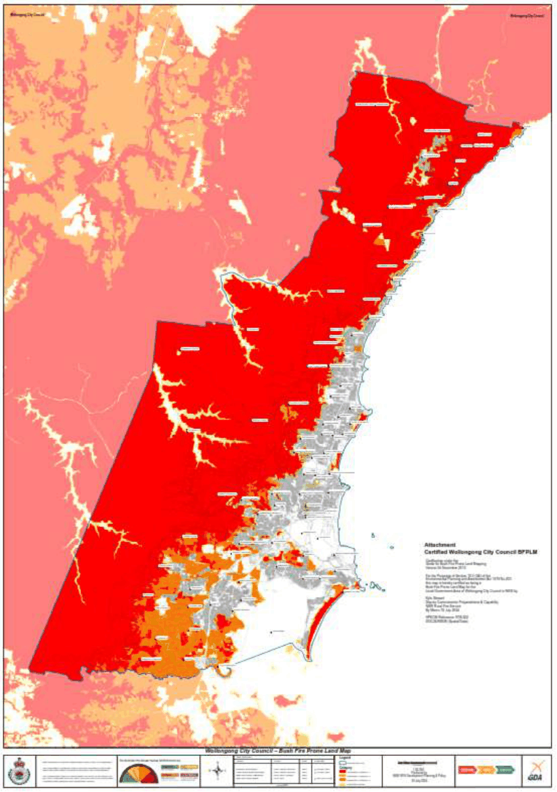
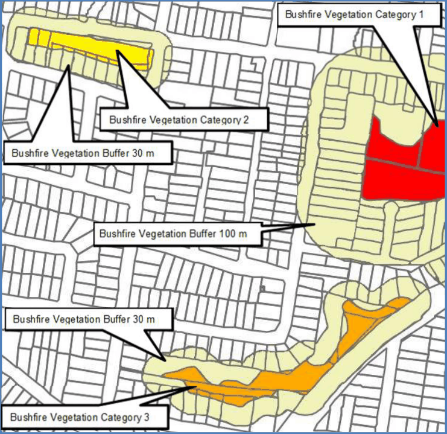

## 2. WHAT IS BUSH FIRE PRONE LAND?

### 2.1 General

Figure 1 illustrates the Bush Fire Prone Land map applying to the whole of the City of Wollongong LGA. This map can be viewed on Council’s website.

Bush fire prone land is described as Category 1, Category 2 or Category 3 vegetation. Figure 2 depicts bush fire vegetation (Category 1, Category 2 and Category 3) and the associated buffer distances.

If either the mapped vegetation or the buffer intersects a property, then the property is considered to be bush fire prone land.

### 2.2 Category 1 Vegetation

Category 1 vegetation appears as red on the map and represents forests, woodlands, heathlands, pine plantations and forested wetlands. Land within 100 metres of this category (indicated by the light yellow buffer on the map) is also captured by the Bush Fire Prone Land Map due to the likelihood of bushfire attack.

### 2.3 Category 2 Vegetation

Category 2 vegetation appears as yellow on the map and represents rainforests, and lower risk vegetation parcels. Lower risk vegetation parcels consist of:

• Remnant vegetation;

• Land within ongoing land management practices that reduce bush fire risk. These areas must be subject to a plan of management or similar that demonstrates that the risk of bush fire is offset by strategies that reduce bush fire risk and include:

o Discreet urban reserve/s;

o Parcels that are isolated from larger uninterrupted tracts of vegetation and known firepaths;

o Shapes and topographies which do not permit significant upslope fire runs towards development;

o Suitable access and adequate infrastructure to support suppression by fire fighters;

o Vegetation that supports a lower likelihood of ignition because the vegetation is surrounded by development such that ignition in any part of vegetation has a high likelihood of detection.

Land within 30 metres of this category (ie as indicated by the light yellow buffer on the map) is also

captured by the Bush Fire Prone Land Map due to the likelihood of bushfire attack.

### 2.4 Category 3 Vegetation

Category 3 vegetation appears as dark orange on the map and represents grasslands, freshwater wetlands, semi-arid woodlands, alpine complex and arid shrublands

Land within 30 metres of this category (ie as indicated by the light yellow buffer on the map) is also captured by the Bush Fire Prone Land Map due to the likelihood of bushfire attack.

> [Picture on page 3: a picture, saved as a picture (images/chapter-e16-bushfire-management-page-3-7.gif, 150 dpi).]

Figure 1 – Bush Fire Prone Land Map

> [Picture on page 4: a picture, saved as a picture (images/chapter-e16-bushfire-management-page-4-1.gif, 150 dpi).]

Figure 2 – Vegetation Categories and Buffer Distances
