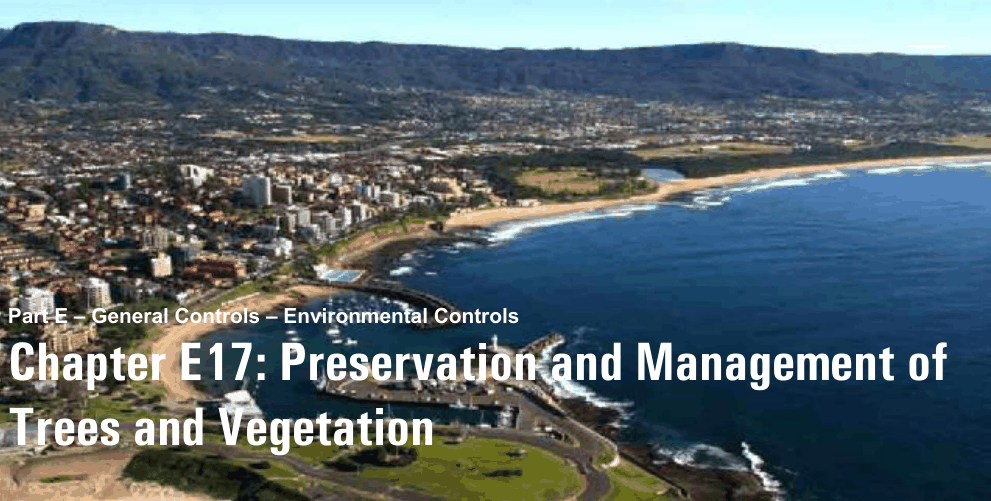

# Wollongong Development Control Plan 2009 - Chapter E17 Preservation and Management of Trees and Vegetation

> This chapter is split into 13 section file(s), one per numbered heading, in the order they appear in the PDF.

Source PDF: [Wollongong-DCP-2009-Chapter-E17-Tree-and-Vegetation-Management-In-force-1-July-2023.pdf](https://planfortomorrow.sharepoint.com/sites/Planfortomorrow/Shared%20Documents/00%20NSW-Planning-Resources/dcp/wollongong-development-control-plan-2009/chapter-e17-preservation-and-management-of-trees-and-vegetatio/Wollongong-DCP-2009-Chapter-E17-Tree-and-Vegetation-Management-In-force-1-July-2023.pdf)

> [Picture on page 1: a picture, saved as a picture (images/chapter-e17-preservation-and-management-of-trees-and-vegetat-page-1-1.gif, 150 dpi).]

#### Part E – General Controls – Environmental Controls

Chapter E17: Preservation and Management of

### Trees and Vegetation

> The PDF's contents list (page numbers of the printed document) is not repeated here - see Sections below.

Wollongong Development Control Plan 2009

| Document Control Document ID: Wollongong DCP 2009 – E17 Preservation and Management of Trees and Vegetation |  |  |  |
|---|---|---|---|
| Rev No | Adoption Date | In force date | Revision Details |
| 1 | 15/12/2009 | 01/03/2010 | Adopted |
| 2 |  | 07/09/2013 | Amended |
| 3 | 03/04/2023 | 01/07/2023 | Amended (ECM Ref 24261849) |

Wollongong Development Control Plan 2009

<!-- sections -->
## Sections

1. [1 INTRODUCTION](01-introduction.md)
2. [2 PURPOSE](02-purpose.md)
3. [3 LAND TO WHICH THIS CHAPTER APPLIES](03-land-to-which-this-chapter-applies.md)
4. [4 DEVELOPMENT TO WHICH THIS CHAPTER APPLIES](04-development-to-which-this-chapter.md)
5. [5 OBJECTIVES](05-objectives.md)
6. [6 RELATED LEGISLATION](06-related-legislation.md)
7. [7 RELATIONSHIP TO OTHER DCP CHAPTERS](07-relationship-to-other-dcp-chapters.md)
8. [8 APPROVAL PATHWAYS](08-approval-pathways.md)
9. [9 COMPENSATORY PLANTING / OFFSETTING](09-compensatory-planting-offsetting.md)
10. [10 EXEMPTIONS FROM APPROVALS](10-exemptions-from-approvals.md)
11. [11 FURTHER INFORMATION: PERMIT APPLICATION AND DEVELOPMENT APPLICATION](11-further-information-permit-application.md)
12. [12 DEVELOPMENT APPLICATION – LODGEMENT REQUIREMENTS](12-development-application-lodgement.md)
13. [13 TREE AND VEGETATION MANAGEMENT AS PART OF A DEVELOPMENT PROPOSAL](13-tree-and-vegetation-management-as-part.md)
