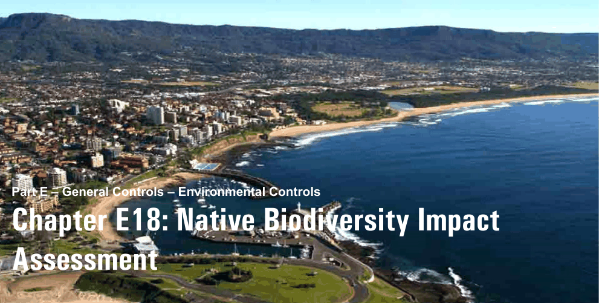

# Wollongong Development Control Plan 2009 - Chapter E18 Native Biodiversity Impact Assessment

> This chapter is split into 16 section file(s), one per numbered heading, in the order they appear in the PDF.

Source PDF: [Wollongong-DCP-2009-Chapter-E18-Native-Biodiversity-Impact-Assessment-endorsed-3-April-2023.pdf](https://planfortomorrow.sharepoint.com/sites/Planfortomorrow/Shared%20Documents/00%20NSW-Planning-Resources/dcp/wollongong-development-control-plan-2009/chapter-e18-native-biodiversity-impact-assessment/Wollongong-DCP-2009-Chapter-E18-Native-Biodiversity-Impact-Assessment-endorsed-3-April-2023.pdf)

> [Picture on page 1: a picture, saved as a picture (images/chapter-e18-native-biodiversity-impact-assessment-page-1-1.gif, 150 dpi).]

#### Part E – General Controls – Environmental Controls

### Chapter E18: Native Biodiversity Impact Assessment

### Table of Contents

### 9.12 Biodiversity Certification

6

#### DEFINITIONS AND ACRONYMS

7

Chapter E18: Native Biodiversity Impact Assessment i

<!-- sections -->
## Sections

1. [1 INTRODUCTION](01-introduction.md)
2. [2 PURPOSE](02-purpose.md)
3. [3 LAND TO WHICH THIS CHAPTER APPLIES](03-land-to-which-this-chapter-applies.md)
4. [5 OBJECTIVES](04-5-objectives.md)
5. [6 RELATED LEGISLATION](05-6-related-legislation.md)
6. [8 APPROVAL PATHWAYS](06-8-approval-pathways.md)
7. [9 CONTROLS](07-9-controls.md)
8. [1 INTRODUCTION –](08-1-introduction.md)
9. [2 PURPOSE](09-2-purpose.md)
10. [3 LAND TO WHICH THIS CHAPTER APPLIES](10-3-land-to-which-this-chapter-applies.md)
11. [4 DEVELOPMENT TO WHICH THIS CHAPTER APPLIES](11-4-development-to-which-this-chapter.md)
12. [5 OBJECTIVES](12-5-objectives.md)
13. [6 RELATED LEGISLATION](13-6-related-legislation.md)
14. [7 RELATIONSHIP TO OTHER DCP CHAPTERS](14-7-relationship-to-other-dcp-chapters.md)
15. [8 APPROVAL PATHWAYS](15-8-approval-pathways.md)
16. [9 CONTROLS](16-9-controls.md)
