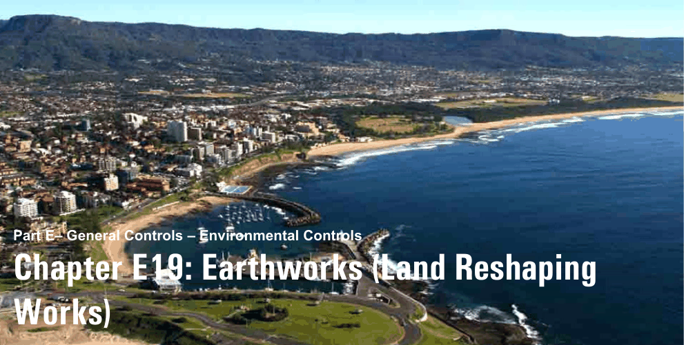

# Wollongong Development Control Plan 2009 - Chapter E19 Earthworks (Land Reshaping Works)

> This chapter is split into 4 section file(s), one per numbered heading, in the order they appear in the PDF.

Source PDF: [Wollongong-DCP-2009-Chapter-E19-Earthworks-Land-Reshaping-Works.pdf](https://planfortomorrow.sharepoint.com/sites/Planfortomorrow/Shared%20Documents/00%20NSW-Planning-Resources/dcp/wollongong-development-control-plan-2009/chapter-e19-earthworks-land-reshaping-works/Wollongong-DCP-2009-Chapter-E19-Earthworks-Land-Reshaping-Works.pdf)

> [Picture on page 1: a picture, saved as a picture (images/chapter-e19-earthworks-land-reshaping-works-page-1-1.gif, 150 dpi).]

#### Part E– General Controls – Environmental Controls

### Chapter E19: Earthworks (Land Reshaping Works)

> The PDF's contents list (page numbers of the printed document) is not repeated here - see Sections below.

#### Document Control

|  |  |  | Document ID: Wollongong DCP 2009 – E19 Earthworks |
|---|---|---|---|
| Rev No | Adoption Date | In force date | Revision Details |
| 0 | 15/12/09 | 1/3/10 | Adopted |
| 1 | 27/7/11 | 3/8/11 | Revised |
| 2 | 11/12/17 | 12/1/18 | Contaminated Lands Review update |

Wollongong Development Control Plan 2009 - In force as at 12 January 2018

i

<!-- sections -->
## Sections

1. [1 INTRODUCTION](01-introduction.md)
2. [2 OBJECTIVES](02-objectives.md)
3. [3 INFORMATION REQUIREMENTS FOR LODGEMENT WITH THE DEVELOPMENT APPLICATION](03-information-requirements-for-lodgement.md)
4. [4 DEVELOPMENT STANDARDS](04-development-standards.md)
