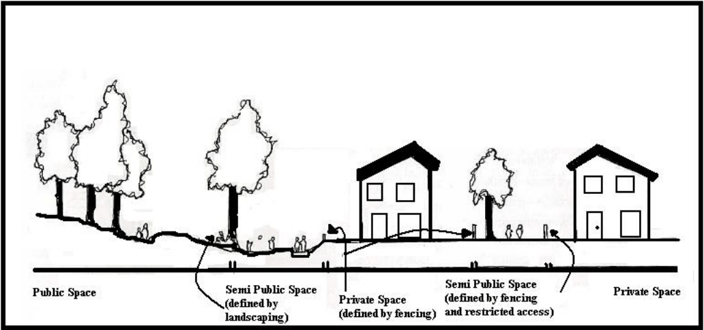
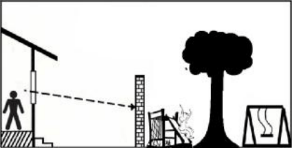
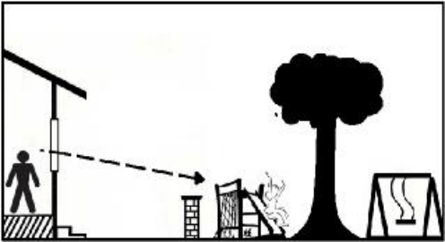

## 3 GENERAL ISSUES

### 3.1 Lighting

#### 3.1.1 Objectives

(a) To promote legitimate activity in public spaces after dark thereby providing a safe and secure environment.

(b) To encourage the use of lighting to create safer places after dark.

(c) To ensure that plans for new or redeveloped public spaces consider areas that will be utilized at night.

#### 3.1.2 Development Controls

1\. Areas intended to be used at night must provide appropriate lighting.

2\. Lighting must be provided to heavily used spaces such as car parks, major pedestrian routes, entries to buildings and entries to public toilets.

3\. Security lighting is to be consistent with AS4282 (1997) The Control of the Obtrusive Effect of Outdoor Lighting.

4\. In areas used by pedestrians, ensure that lighting shines on pedestrian pathways and possible entrapment spaces.

5\. Select and light ‘safe routes’ so that these become the focus of legitimate pedestrian activity after dark.

6\. Provide adequate illumination for directional signage and maps in locations used at night.

7\. Avoid glare by not placing any unshielded lighting at eye level (that is 1.5m to 3m above ground level).

8\. Lighting must be designed to be vandal resistant, through measures such as high mounting.

### 3.2 Natural surveillance and sightlines

#### 3.2.1 Objectives

(a) To encourage buildings and the public realm to be designed to maximise the potential for public surveillance.

(b) To encourage active street environments as they enhance public safety.

(c) To provide unimpeded sight lines, particularly along pedestrian pathways.

(d) To improve natural surveillance through increased legitimate use of spaces.

#### 3.2.2 Development Controls

1\. Avoid blind, sharp corners on pathways, stairs or corridors

2\. Avoid or ameliorate sudden changes of grade on pathways which may reduce sightlines.

3\. Ensure that pedestrians can easily see what is at the end of tunnels/overpasses

4\. Seating should be located in areas of active use

5\. Avoid medium height vegetation with concentrated top to bottom foliage.  Plants such as low hedges and shrubs (1 - 1.2m high), creepers, ground covers or high canopied vegetation are good for natural surveillance.

6\. Where sightlines are impeded, determine whether they can be improved through the use of hardware such as flat vandal-resistant security mirrors.

7\. Avoid convex mirrors as they distort images.

8\. Ensure where barriers are provide along paths that they are semi transparent.

9\. Ensure that windows of activity rooms (e.g. kitchen windows not bathroom windows) rather than blank facades overlook pedestrian areas, car parks, parks and public spaces.

10\. Colocate pedestrian, cycle and vehicular movement systems to encourage maximum surveillance of public areas.

11\. Ensure that bus shelter location and design do not impede natural surveillance.

12\. In designing subdivisions ensure that back yards do not orientate towards public open spaces and cycle ways.

### 3.3 Signage

#### 3.3.1 Objectives

(a) To provide clear direction for people undertaking day to day activities.

(b) To create a sense of safety through greater knowledge of location and direction.

#### 3.3.2 Development Controls

1\. A signage plan focusing on the safe routes and indicating destinations, facilities and amenities en route may be required for large developments.

2\. Ensure that signage is clearly legible through the use strong colors, clear contrasts, standard symbols and simple graphics.

3\. Provide clear signage at bus shelters, taxi ranks and public facilities.

4\. Clearly identify streets, courtyards and common areas and encourage use of street numbers and businesses identification signs.

5\. Illuminate signs that are essential for night use.

6\. Locate signs so that they are not likely to be obscured by vegetation growth.

7\. Ensure that the size and/or location of signs do not create entrapment opportunities.

8\. Maps should be provided in large public open spaces such as parks, and orientated towards main routes if pedestrian travel.

### 3.4 Building design

#### 3.4.1 Objectives

(a) To integrate public buildings into the wider public realm enhancing the potential for passive surveillance.

(b) To construct, sturdy, attractive, environmentally sensitive buildings to reduce temptations for vandalism and graffiti.

(c) To reduce the risk of public buildings contributing to crime or safety problems.

#### 3.4.2 Development Controls

1\. Ensure that entrances to buildings are clearly defined, secure, well lit and face the street.

2\. Blank walls should be avoided onto public streets, public open spaces and pedestrian traffic areas.

3\. Design the front entrances of public buildings so that they do not create entrapment spots or places where intruders may loiter.

4\. Clearly indicate closing hours at entrances to public areas which are closed off to access at night.

5\. Design lobbies to be highly visible.

6\. Avoid the location of ramps and elevator entrances in isolated areas.

7\. Secure non-pedestrian entrances against illicit activities/entry.

8\. If staff entrances are to be separated from the main entrance, ensure that they are well lit and maximize opportunities for natural surveillance and sight lines.

9\. Use transparent, unbreakable materials in door and walls at major entry points to provide sightlines through the door or wall.

10\. Locate delivery hatches and bins so that they do not assist an intruder to gain access to a building.

11\. Ensure that loading and storage areas are either well lit or can be locked after hours.

12\. Areas are to be illuminated so that occupants can see out some distance from the entry before leaving the building.

13\. Illuminate all external edges and access points to car parks.

14\. Where large expanses of car parks are proposed, consideration should be given to the provision of surveillance e.g. the installation of security cameras.

15\. Avoid hidden recesses.

16\. Car spaces should be reserved near the building entry for employees working after hours.

17\. Ensure that enclosed or underground car parking can only be accessed from inside the building not by pedestrians passing.

### 3.5 Landscaping

#### 3.5.1 Objectives

(a) To create a friendly and pleasant environment that attracts users and creates safe places.

(b) To support ease of maintenance by not creating fragile landscaped areas in public use areas.

(c) To support and reinforce security principles such as natural surveillance by the careful selection and placement of appropriate landscaping.

#### 3.5.2 Development Controls

1\. Shrubbery and low-level planting must be selected for footpaths that does not exceed 1m in height where abutting pavements.

2\. Avoid planting taller growing plants and trees in areas that screen doorways, entrances and windows.

3\. Select trees that do not have branches below 1.5m (for the trees protection it is recommended that they do not have branches below 2.4m above ground level)

4\. Use hard landscaping details such as low fencing and walls to deter pedestrian or vehicle movement.

5\. If surfaces are constructed using cobbles or large pebbles, make sure that they are embedded for two thirds of their depth.

6\. Avoid using gravel paths as these may cause difficulties for people that are mobility impaired.

7\. Landscaping within front yards should not obscure the entry points and windows of the dwelling.

### 3.6 Public open space and parks.

> [Picture on page 7: a picture, saved as a picture (images/chapter-e2-crime-prevention-through-environmental-design-page-7-2.gif, 150 dpi).]

#### Figure 1: Delineation between public open space and private spaces

#### 3.6.1 Objectives

(a) To encourage legitimate use public open space by a wide range of users that is visible from surrounding buildings and other active places.

(b) To ensure that the design of public open space does not create unsafe environments such as entrapment spaces.

(c) To ensure appropriate lighting and landscaping of public open spaces to reduce opportunities for crime.

#### 3.6.2 Development Controls

1\. The design of the public open space should foster legibility so that people can easily identify entrances and exits, find their way around and locate public amenities.

2\. Avoid creating unused or unusable spaces or isolated pockets.

3\. The design should cater for easy maintenance of well used areas.

4\. Open space should be located where it can easily be surrounded by a mix of land uses that generate activity both during and after hours.

5\. Locate children’s play areas so that they are visible from adjoining properties.

6\. Provide adequate and appropriate equipment for all ages and both sexes so that one group does not dominate or damage recreation equipment intended for others.

7\. Provide shaded seating areas with good sightlines to children’s play equipment for adults supervising children’s play.

8\. Ensure that paths and areas of high pedestrian activity intended for night use are lit to the same level as the street to indicate that they are 'safe routes'.

9\. Avoid below grade pathways.

10\. Where possible ensure that parks or play areas are visible from the street and that housing or commercial buildings with active frontages overlook parks or edges of larger parks.

11\. Locate activity generators along the edge of parks or along pedestrian routes e.g. coffee vendors,

> [Picture on page 8: a picture, saved as a picture (images/chapter-e2-crime-prevention-through-environmental-design-page-8-7.gif, 150 dpi).]

chess boards, tables etc

Figure 2: Natural surveillance of public open space - No natural surveillance of playground

> [Picture on page 8: a picture, saved as a picture (images/chapter-e2-crime-prevention-through-environmental-design-page-8-10.gif, 150 dpi).]

Figure 3: Natural surveillance of public open space - Good natural surveillance of playground

### 3.7 Community Facilities and Public Amenities

#### 3.7.1 Objectives

(a) To encourage the safe use of community facilities during the day and night.

(b) To support security measures by the use of planning and design principles.

(c) To create a pleasing environment while ensuring the safety of staff and users of the facility.

(d) To locate facilities to take advantage of natural surveillance to discourage non-legitimate users.

#### 3.7.2 Development Controls

1\. Locate community facilities near other activities to increase the level of legitimate use of the area.

2\. Provide secure fencing around play equipment.

3\. The location and material of fencing should delineate the boundary of the community facility but not provide areas of concealment for intruders.

4\. If back fences are over 1800mm high, then the type of fencing selected shall have a 'see-through' quality.

5\. Locate public amenity buildings adjacent to high traffic areas rather than in isolated locations.

6\. Ensure that external doors can only be opened by a legitimate key holder to prevent unauthorised entry.

7\. Approaches and entrances should be highly visible so that people cannot loiter or enter without being seen.

### 3.8 Bus stops and taxi ranks

#### 3.8.1 Objectives

(a) To maximise the use of public transport by a wide range of people, especially after hours.

(b) To encourage users to feel safe in bus stops and taxi ranks by increasing safety provisions.

(c) To promote natural surveillance of bus stops.

#### 3.8.2 Development Controls

1\. Ensure that the areas adjacent to major bus stops and taxi ranks are well lit and protected from the weather.

2\. Ensure that lighting within or around bus shelters is adequate.

3\. Ensure that people waiting at bus stops and taxi ranks are clearly visible from the street and adjacent buildings where possible.

4\. Ensure sightline are not blocked by walls, landscaping, fences or other structures to the bust stop or taxi rank.

5\. Avoid locating bus stops and taxi ranks adjacent to vacant land, alleys, car parks and buildings set back from the street or possible entrapment spots.

6\. Provide short, safe routes to bus stops and taxi ranks from night time venues such as cinemas.

7\. Taxi and bus interchanges should be located to activity areas where possible.

8\. Bus shelters should be designed to reduce the possibility of entrapment and to improve sightlines.

9\. Provide adequate signage that is vandal proof and easily updated with current information. Signage is to include the provision of a number to call to report maintenance issues.
