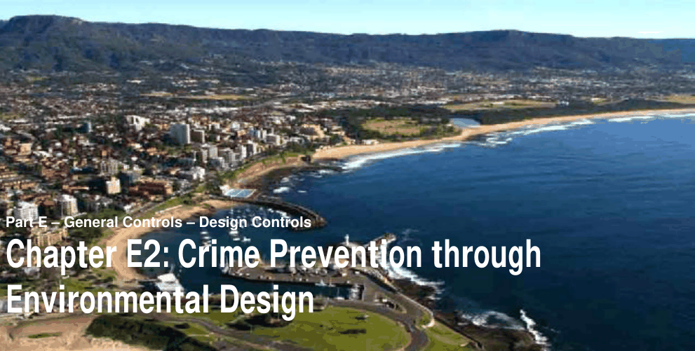

# Wollongong Development Control Plan 2009 - Chapter E2 Crime Prevention through Environmental Design

> This chapter is split into 5 section file(s), one per numbered heading, in the order they appear in the PDF.

Source PDF: [Wollongong-DCP-2009-Chapter-E02-Crime-Prevention-through-Environmental-Design.pdf](https://planfortomorrow.sharepoint.com/sites/Planfortomorrow/Shared%20Documents/00%20NSW-Planning-Resources/dcp/wollongong-development-control-plan-2009/chapter-e2-crime-prevention-through-environmental-design/Wollongong-DCP-2009-Chapter-E02-Crime-Prevention-through-Environmental-Design.pdf)

> [Picture on page 1: a picture, saved as a picture (images/chapter-e2-crime-prevention-through-environmental-design-page-1-1.gif, 150 dpi).]

#### Part E – General Controls – Design Controls

### Chapter E2: Crime Prevention through Environmental Design

> The PDF's contents list (page numbers of the printed document) is not repeated here - see Sections below.

<!-- sections -->
## Sections

1. [2 EXEMPT DEVELOPMENT](01-2-exempt-development.md)
2. [3 GENERAL ISSUES](02-3-general-issues.md)
3. [1 INTRODUCTION](03-1-introduction.md)
4. [2 EXEMPT DEVELOPMENT](04-2-exempt-development.md)
5. [3 GENERAL ISSUES](05-3-general-issues.md)
