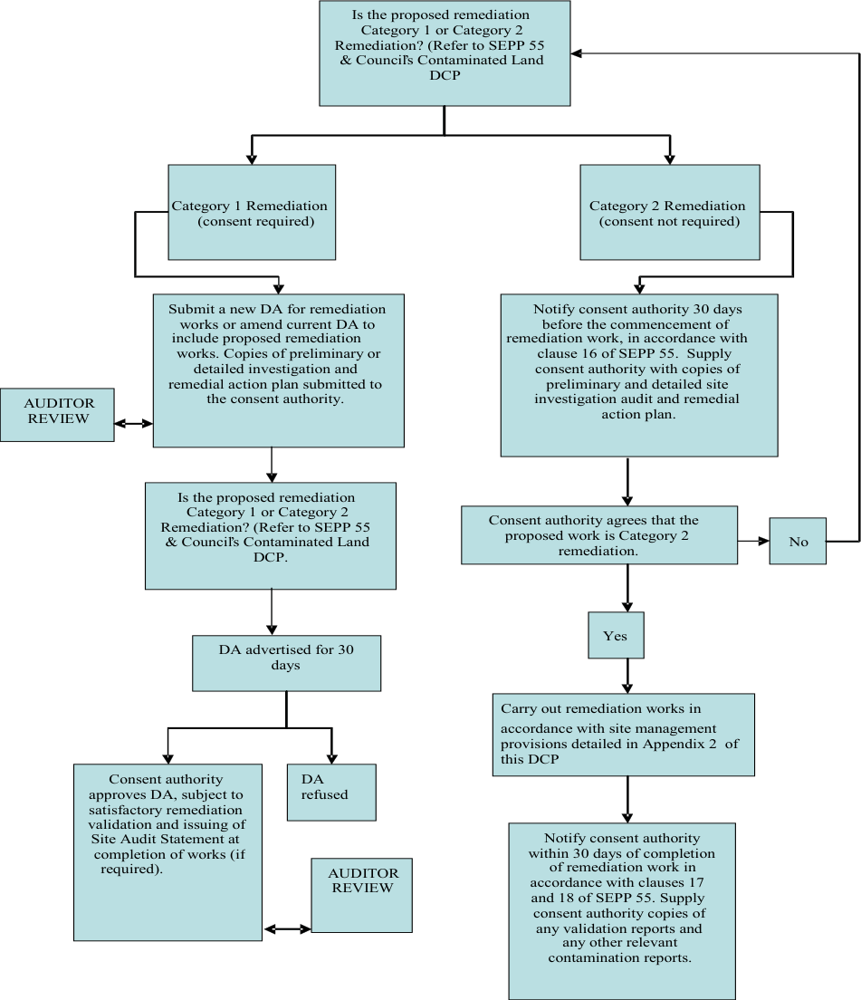

### 4 STATE ENVIRONMENTAL PLANNING POLICY NO. 55 REMEDIATION OF LAND (SEPP 55)

1\. The aim of SEPP 55 is to provide for a state-wide planning approach to the assessment, remediation and validation of contaminated land.

2\. Under SEPP 55, Council is required in determining a Development Application to consider whether land is contaminated and whether the proposed remediation of any identified contamination site will satisfactorily render the land suitable for the intended land use upon the site.

3\. SEPP 55 states that a person must not carry out a category 1 remediation work except with the consent of the consent authority. Under the SEPP, a person may however carry out category 2 remediation work, without the consent of the consent authority (however the local consent authority must be informed of the intended remediation works 30 days prior to commencement).

5\. For more information relating to the categories of work and the requirements refer to the SEPP.

> [Picture on page 4: a picture, saved as a picture (images/chapter-e20-contaminated-land-management-page-4-1.gif, 150 dpi).]
> Words printed on the picture (title and legend, copied from the PDF):
> Is the proposed remediation
> Category 1 or Category 2
> Remediation? (Refer to SEPP 55
> & Council ’ s Contaminated Land
> DCP
> Category 1 Remediation
> Category 2 Remediation
> (consent required)
> (consent not required)
> Submit a new DA for remediation
> Notify consent authority 30 days
> works or amend current DA to
> include proposed remediation
> before the commencement of
> remediation work, in accordance with
> works. Copies of preliminary or
> clause 16 of SEPP 55.  Supply
> consent authority with copies of
> detailed investigation and
> remedial action plan submitted to
> the consent authority.
> preliminary and detailed site
> investigation audit and remedial
> AUDITOR
> action plan.
> REVIEW
> Is the proposed remediation
> Consent authority agrees that the
> Category 1 or Category 2
> Remediation? (Refer to SEPP 55
> proposed work is Category 2
> & Council ’ s Contaminated Land
> No
> remediation.
> DCP.
> Yes
> DA advertised for 30
> days
> Carry out remediation works in
> accordance with site management
> provisions detailed in Appendix 2  of
> this DCP
> DA
> refused
> Consent authority
> approves DA, subject to
> satisfactory remediation
> validation and issuing of
> Site Audit Statement at
> Notify consent authority
> within 30 days of completion
> completion of works (if
> required).
> AUDITOR
> of remediation work in
> accordance with clauses 17
> REVIEW
> and 18 of SEPP 55. Supply
> consent authority copies of
> any validation reports and
> any other relevant
> contamination reports.

\** NOTE:   Development consent may be required if works such as demolition or shoring are involved.

#### Figure 1: Procedure for category 1 and category 2 remediation work

### 4.1 Reporting  Requirements

### 4.2 General

The key principle in considering contaminated land and the likelihood of land contamination is to determine any issues as early as possible in the planning and development process. This section provides an overview of the requirements in the SEPP 55. For full detail of requirements refer to the SEPP.

### 4.3 Stages for investigation

1\. There are 4 main stages associated with the investigation of a site for potential contamination and its subsequent remediation and validation, namely:- Stage 1 – Preliminary Investigation; Stage 2 – Detailed Investigation; Stage 3 – Remediation Action Plan; and Stage 4 – Validation Report.

All reporting must be completed in accordance with relevant regulations, legislation and guidance documentation. Reports must also be completed by appropriately experienced and qualified consultants with a demonstrated history of working on CLM projects. At any stage throughout the investigation, remediation and validation process Council may request a Site Audit Statement (SAS) be prepared by an appropriately accredited NSW EPA Auditor. The costs associated with the preparation of the SAS are to be covered by the applicant. Council may request a SAS when:

- Council has reasonable grounds to believe the information provided to Council is incomplete or incorrect.

- Council wishes to confirms the information provided conforms to relevant legislations, guidelines (etc.).

- Council does not have the capability to undertake appropriate technical reviews (i.e. a site with complex contamination issues and significant risks to human health and the environment).

#### 4.3.1 Stage 1 – Preliminary Investigation

2\. The main requirements of a preliminary investigation are to:-

i) Identify any past or present potentially contaminating activities;

ii) Review available historic records (i.e. including Council & NSW Government Department Records);

iii) Conduct a preliminary visual inspection;

iv) Provide a preliminary assessment of any site contamination; and

v) Provide the basis for a more detailed investigation if required.

For an indicative list of industries and potential contaminants please refer to SEPP No. 55 Remediation of Land and the Planning Guidelines “Managing Contaminated Land”

#### 4.3.2 Stage 2 – Detailed Investigation

1\. A detailed investigation is only necessary where a preliminary investigation indicates that the land is contaminated or the site history confirms that the site is or was exposed to potentially contaminating industry or activities.

2\. The requirements of the detailed investigation are:-

i) To define the nature, extent and degree of all contamination (i.e. soil, water and soil vapour);

ii) To assess potential risk posed by contaminants to health and environment; and

iii) To obtain sufficient information for the development of a viable Remedial Action Plan (RAP), if required.

As part of the detailed investigation and assessment of site contamination issues, proponents are required to take into account any relevant technical standards or guideline requirements.

#### 4.3.3 Stage 3 – Remedial Action Plan

1\. The Remedial Action Plan (RAP) is based on information from the previous Preliminary Site History and Detailed Investigation stages and shall demonstrate what remediation measures are required to deal with any identified contamination in order to render the site suitable for the proposed development or land use activity. The objectives of the remediation strategy and the recommended site contamination remediation clean-up criteria must be clearly stated in the RAP.

2\. If development consent is required, then a RAP must be considered by Council, prior to the determination of the Development Application.

#### 4.3.4 Stage 4 – Completion of Remediation Work - Validation Reporting, Site

#### Auditing & Monitoring

1\. SEPP 55 requires the submission of a formal Notice of Completion of Remediation Work to Council within 30 days from the date of completion of the remediation works.

2\. Upon satisfactory completion of remediation and validation works any ongoing site management requirements (such as Environmental Management Plans) must be registered on the property title (in accordance with the Conveyancing Act 1919).

3\. Refer to the SEPP for more information.
