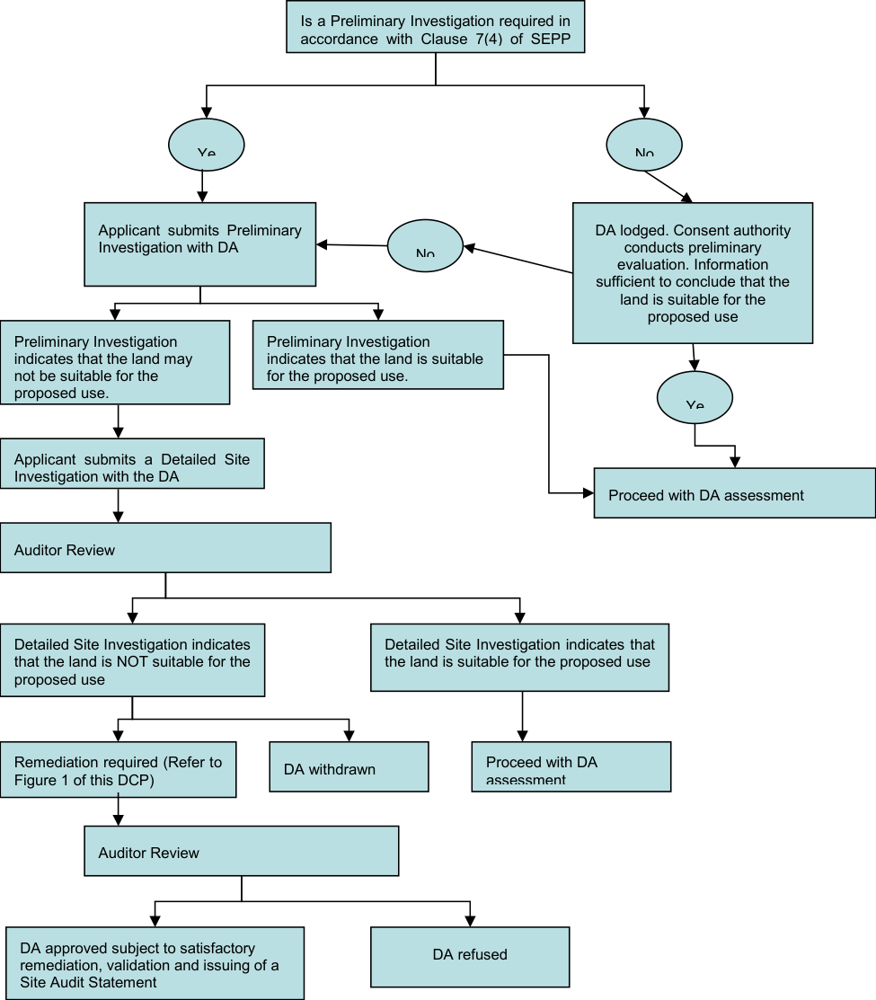

## 5 PROCEDURES FOR DEVELOPMENT APPLICATIONS &

### COMPLYING DEVELOPMENT CERTIFICATE APPLICATIONS

1\. Were land is contaminated or has the potential for contamination Council requires the following:

a) A preliminary investigation report in accordance with the requirements of this policy and relevant legislation;

b) a Detailed Site Contamination Investigation Report is required where the preliminary investigation report reveals that the site is or was previously used by a potentially contaminating land use or soil and / or groundwater analysis reveals elevated contaminants above threshold levels;

c) Council may, as a matter of due diligence, request a Site Audit Statement to be provided from an accredited Site Auditor, in order to certify that the site is suitable for its intended use even if the Preliminary Investigation confirms that the site has no issues and the visual assessment of the site reveals no evidence of any contamination;

d) Where the Detailed Site Contamination Investigation Report indicates that the site is subject to soil strata, soil vapour and / or groundwater table contamination above threshold limits, a Remedial Action Plan will be required;

e) Contaminated land consultants who prepare preliminary investigation, detailed investigation, RAP’s and validation reports must be accredited via one of the following: the Site Contamination Practitioners Australia (SCPA) scheme; the Environment Institute of Australia and New Zealand’s (EIANZ) Contaminated Land Assessment Specialist Certified Environmental Practitioner (CLA Specialist CEnvP) scheme; or the Soil Science Australia (SSA) Certified Professional Soil Scientist Contaminated Site Assessment and Management (CPSS CSAM) certification.

f) Council will not continue the assessment until satisfied with the information in the detailed report or RAP. Council may grant a conditional Development Consent with conditions of consent relating to the preparation of a Remedial Action Plan (prior to the issuing of the Construction Certificate), completion of the remediation works (during the construction phase) and the completion of a

validation report and ‘signing’ off’ of the remediation work by the Site Auditor through a Site Audit Statement at prior to the occupation of the building or commencement of the land use stage. Alternatively, Council may grant a “Deferred Commencement” Consent pursuant to Section 80(3) of the Environmental Planning and Assessment Act 1979, particularly where the level of contamination is in the opinion of Council significant and / or the proposed land use is a sensitive land use with respect to potential contamination impacts. The “Deferred Commencement” Consent will require the completion of a range of “pre-conditions” prior to the consent becoming operative.

> [Picture on page 8: a picture, saved as a picture (images/chapter-e20-contaminated-land-management-page-8-1.gif, 150 dpi).]
> Words printed on the picture (title and legend, copied from the PDF):
> Is a Preliminary Investigation required in
> accordance with Clause 7(4) of SEPP
> 55
> Ye
> No
> s
> DA lodged. Consent authority
> Applicant submits Preliminary
> Investigation with DA
> No
> conducts preliminary
> evaluation. Information
> sufficient to conclude that the
> land is suitable for the
> proposed use
> Preliminary Investigation
> indicates that the land is suitable
> for the proposed use.
> Preliminary Investigation
> indicates that the land may
> not be suitable for the
> proposed use.
> Ye
> s
> Applicant submits a Detailed Site
> Investigation with the DA
> Proceed with DA assessment
> Auditor Review
> (at the discretion of the consent authority)
> Detailed Site Investigation indicates that
> the land is suitable for the proposed use
> Detailed Site Investigation indicates
> that the land is NOT suitable for the
> proposed use
> Remediation required (Refer to
> DA withdrawn
> Proceed with DA
> assessment
> To Figure 3 of this DCP)
> Auditor Review
> (at the discretion of the consent authority)
> DA refused
> DA approved subject to satisfactory
> remediation, validation and issuing of a
> Site Audit Statement

Figure 1 of this DCP)

Figure 2: Council procedure for considering land contamination issues for Development Applications
