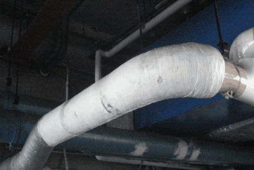
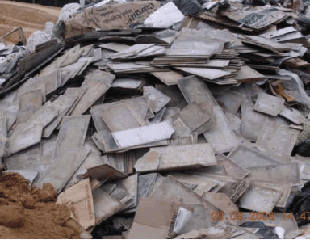
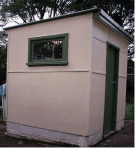

## 6 HAZAROUS BUILDING MATERIALS MANAGEMENT

### 6.1 Types of asbestos and health impacts

1\. According to relevant Australian Government publications (Safe Work Australia, NSW WorkCover) the main types of asbestos are:

− Chrysotile (white asbestos); − Amosite (brown asbestos); and − Crocidolite (blue asbestos).

2\. These types of asbestos are considered to range from hazardous to highly hazardous, especially where they are in a poor or deteriorated condition or disturbed during activities that produce dust containing asbestos fibres.

3\. Chrysotile (white asbestos) is the only form of asbestos that was commercially used from the serpentine group of silicates. Chrysotile was previously used in the manufacture of:

− Asbestos cloth, tapes, ropes and gaskets for packing and in thermal and chemical insulation; − Asbestos cement sheets and pipes for construction, casing for water and electrical / telecommunication services; − Fire rated doors, equipment and structural beams of buildings; − Rubber, plastics, thermosetting resins, adhesives, paints, coatings, caulking compounds and sealants for thermal, electrical and insulation applications; − Filters; and − Packing and friction material such as gaskets, brake and clutch linings.

4\. Amosite (brown asbestos) and crocidolite (blue asbestos) were used in a range of products until the mid 1980’s. These products were mainly:

Asbestos cement sheets and pipes for construction, casing for water and electrical / telecommunication services; and

Thermal and chemical insulation i.e. fire rated doors, limpet spray, lagging and gaskets.

5\. Non-friable asbestos means material containing asbestos that is not friable asbestos, including material containing asbestos fibres reinforced with a bonding compound (Safe Work Australia: How to Safely Remove Asbestos 2011).

6\. Friable asbestos means material that is in a powder form or that can be crumbled, pulverised or reduced to a powder by hand pressure when dry, and contains asbestos (Safe Work Australia: How to Safely Remove Asbestos 2011).

> [Picture on page 7: a picture, saved as a picture (images/chapter-e21-demolition-and-hazardous-building-materials-mana-page-7-1.gif, 150 dpi).]

#### Figure 3: Friable Asbestos – Pipe Lagging

> [Picture on page 7: a picture, saved as a picture (images/chapter-e21-demolition-and-hazardous-building-materials-mana-page-7-3.gif, 150 dpi).]

#### Figure 2: Bonded Asbestos Tiles

> [Picture on page 7: a picture, saved as a picture (images/chapter-e21-demolition-and-hazardous-building-materials-mana-page-7-5.gif, 150 dpi).]

#### Figure 1: Bonded Asbestos (Fibro)

Source: NSW WorkCover Authority (2008) Working with Asbestos Guide 2008

7\. Asbestos fibres are made up of many very fine fibres so that as asbestos is further processed or disturbed, the airborne fibres become progressively finer and more hazardous. The most dangerous fibres are the smallest ones which are invisible to the naked eye, but which penetrate the deepest part of the lungs.

8\. Breathing in the fibres of asbestos can bring the risk of asbestosis, lung cancer and mesothelioma. However, asbestos related diseases have a long delay or lag period in the order of 20 – 40 years between first exposure and the onset of symptoms and / or detection of the disease.

9\. Asbestosis is the scarring of lung tissue that can result from the inhalation over a period of years of substantial amounts of asbestos. This results in breathlessness which may lead to disability and in some cases early death.

10\. Lung cancer is related to the amount of fibre that is breathed in and the risk of lung cancer is greatly increased in those who also smoke tobacco.

11\. Mesothelioma is a cancer of the pleura (outer lung lining) or of the peritoneum (the lining of the abdominal cavity). The risk of mesothelioma is less with chrysotile (white asbestos) than with other types of asbestos. Both pleural and peritoneal mesothelioma can result from exposure to amosite (brown asbestos) and crocidolite (blue asbestos).

### 6.2 Procedures for handling asbestos material

1\. Handling, management and disposal of asbestos shall comply with NSW WorkCover and NSW EPA requirements. The NSW WorkCover Authority’s (prepared by Safe Work Australia): How to Safely Remove Asbestos, Code of Practice (2011) recommends a range of work procedures for dealing with bonded asbestos material including asbestos cement. Further advice can be obtained from the enHealth Publication: Asbestos, A guide for householders and the general public (2013)

2\. As at 1 January 2008, individuals are limited to handling a maximum area of 10 square metres of bonded asbestos material. Otherwise an appropriately licensed person must carry out the removal and disposal of the bonded asbestos material.

### 6.3 Lead Work

1\. All lead removal works must comply with the relevant Workplace Health and safety regulations. In the event that works are not carried out by an appropriately licensed and insured contractor council recommends that DIY renovators review available resources regarding safe and acceptable removal processes.
