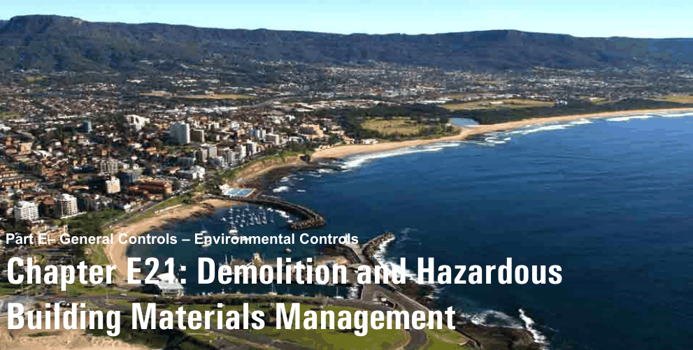

# Wollongong Development Control Plan 2009 - Chapter E21 Demolition and Hazardous Building Materials Management

> This chapter is split into 7 section file(s), one per numbered heading, in the order they appear in the PDF.

Source PDF: [Wollongong-DCP-2009-Chapter-E21-Demolition.pdf](https://planfortomorrow.sharepoint.com/sites/Planfortomorrow/Shared%20Documents/00%20NSW-Planning-Resources/dcp/wollongong-development-control-plan-2009/chapter-e21-demolition-and-hazardous-building-materials-manage/Wollongong-DCP-2009-Chapter-E21-Demolition.pdf)

> [Picture on page 1: a picture, saved as a picture (images/chapter-e21-demolition-and-hazardous-building-materials-mana-page-1-1.gif, 150 dpi).]

#### Part E– General Controls – Environmental Controls

### Chapter E21: Demolition and Hazardous Building Materials Management

> The PDF's contents list (page numbers of the printed document) is not repeated here - see Sections below.

#### Document Control

Document ID:  Wollongong DCP 2009 – E21 Demolition and Hazardous Building Material Management

| Rev No | Adoption Date | In force date | Revision Details |
|---|---|---|---|
| 0 | 15/12/09 | 1/3/10 | Adopted |
| 1 | 11/12/17 | 12/1/18 | Contaminated Lands Review update |

i

<!-- sections -->
## Sections

1. [1 INTRODUCTION](01-introduction.md)
2. [2 OBJECTIVES](02-objectives.md)
3. [3 DEFINITIONS](03-definitions.md)
4. [4 RELEVANT LEGISLATION](04-relevant-legislation.md)
5. [5 DEMOLITION OF BUILDINGS](05-demolition-of-buildings.md)
6. [6 HAZAROUS BUILDING MATERIALS MANAGEMENT](06-hazarous-building-materials-management.md)
7. [7 REFERENCES](07-references.md)
