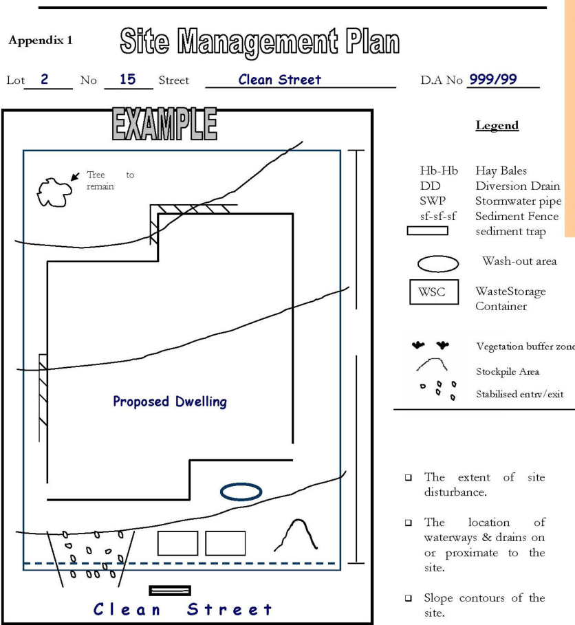
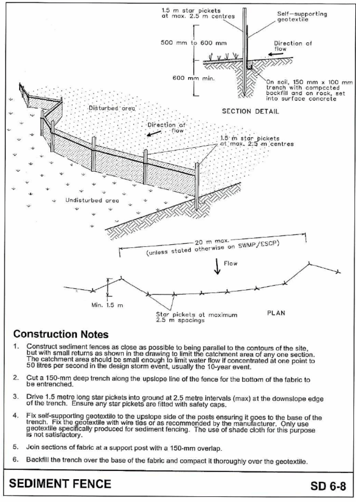
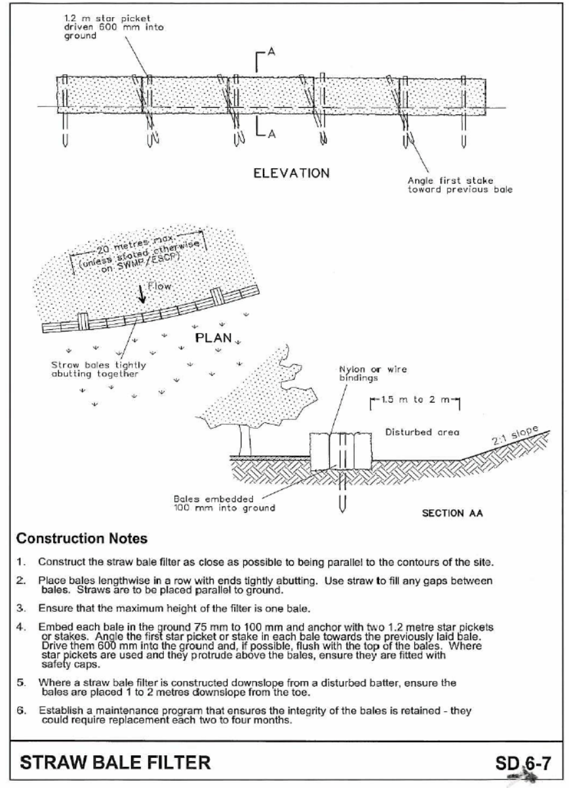
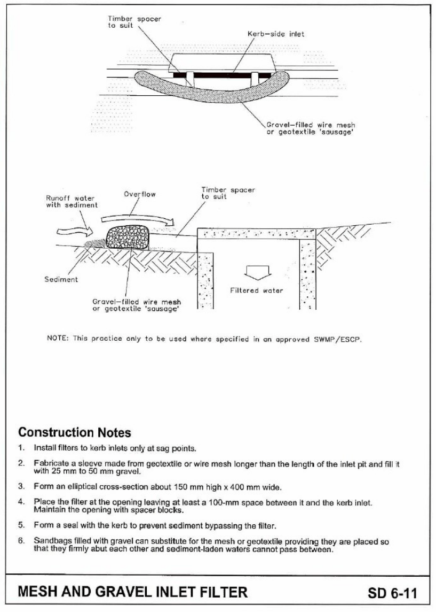
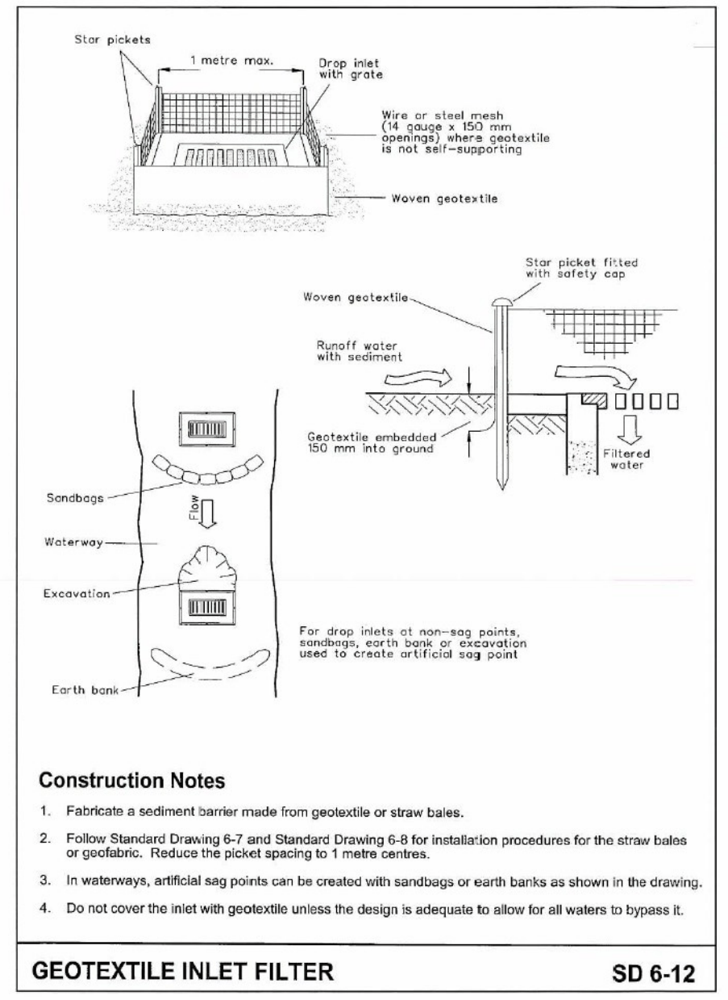

## 5 INSPECTION AND MAINTENANCE

Erosion and sediment control measures must be inspected:

1\. By Council as spot inspections prior to commencement of any construction works;

2\. Daily (i.e. when work is occurring on the site) or weekly (i.e. when work is not occurring on the site); and

3\. Immediately after a rainfall event, in order to ensure such measures are maintained in a functional condition and any sediment is removed from the structure.

All erosion and sediment control measures shall be maintained in a satisfactory condition throughout the entire construction period up until such time as a final occupation certificate for a development project or a subdivision certificate for a subdivision has been issued. Failure to control and appropriately maintain ESC infrastructure in a working order may result in sediment or contaminated surface water leaving a site. In accordance with relevant state legislation these actions are considered a pollution offence and are punishable under relevant environmental legislation.

> [Picture on page 7: a picture, saved as a picture (images/chapter-e22-soil-erosion-and-sediment-control-page-7-1.gif, 150 dpi).]

Additional Details: Split level design to minimise cut and fill. Vegetation retained at rear of site to hold soil in place, and at front of site to trap sediment.

#### Appendix: 2

> [Picture on page 8: a picture, saved as a picture (images/chapter-e22-soil-erosion-and-sediment-control-page-8-2.gif, 150 dpi).]

#### Figure 1: Sediment fencing

SOURCE: NSW Landcom. Managing Urban Stormwater: Soils and Construction Volume 1 March 2004.

> [Picture on page 9: a picture, saved as a picture (images/chapter-e22-soil-erosion-and-sediment-control-page-9-1.gif, 150 dpi).]

#### Figure 2: Straw bale filter

SOURCE: NSW Landcom. Managing Urban Stormwater: Soils and Construction Volume 1 March 2004.

> [Picture on page 10: a picture, saved as a picture (images/chapter-e22-soil-erosion-and-sediment-control-page-10-1.gif, 150 dpi).]

#### Figure 3: Mesh and gravel inlet filter

SOURCE: NSW Landcom. Managing Urban Stormwater: Soils and Construction Volume 1 March 2004.

> [Picture on page 11: a picture, saved as a picture (images/chapter-e22-soil-erosion-and-sediment-control-page-11-1.gif, 150 dpi).]

#### Figure 4: Geotextile inlet filter

SOURCE: NSW Landcom. Managing Urban Stormwater: Soils and Construction Volume 1 March 2004.
