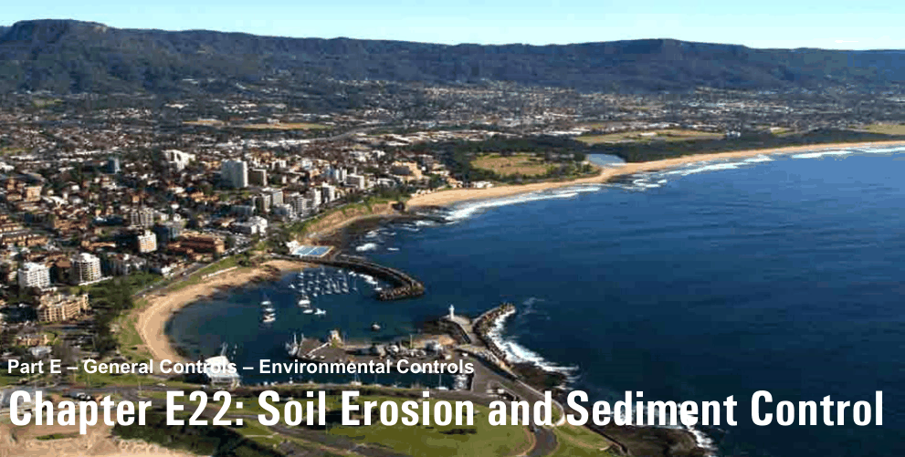

# Wollongong Development Control Plan 2009 - Chapter E22 Soil Erosion and Sediment Control

> This chapter is split into 7 section file(s), one per numbered heading, in the order they appear in the PDF.

Source PDF: [Wollongong-DCP-2009-Chapter-E22-Soil-Erosion-and-Sedimentation.pdf](https://planfortomorrow.sharepoint.com/sites/Planfortomorrow/Shared%20Documents/00%20NSW-Planning-Resources/dcp/wollongong-development-control-plan-2009/chapter-e22-soil-erosion-and-sediment-control/Wollongong-DCP-2009-Chapter-E22-Soil-Erosion-and-Sedimentation.pdf)

> [Picture on page 1: a picture, saved as a picture (images/chapter-e22-soil-erosion-and-sediment-control-page-1-1.gif, 150 dpi).]

#### Part E – General Controls – Environmental Controls

### Chapter E22: Soil Erosion and Sediment Control

### Contents

<!-- sections -->
## Sections

1. [4 CONTROL MEASURES](01-4-control-measures.md)
2. [5 INSPECTION AND MAINTENANCE](02-5-inspection-and-maintenance.md)
3. [1 INTRODUCTION](03-1-introduction.md)
4. [2 OBJECTIVES](04-2-objectives.md)
5. [3 INFORMATION REQUIREMENTS](05-3-information-requirements.md)
6. [4 CONTROL MEASURES](06-4-control-measures.md)
7. [5 INSPECTION AND MAINTENANCE](07-5-inspection-and-maintenance.md)
