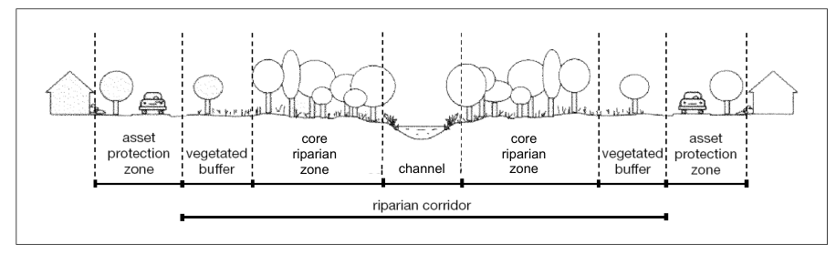
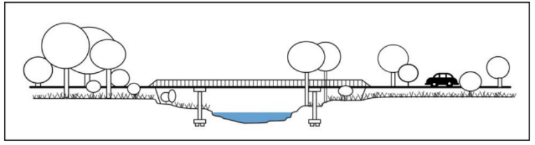

## 10 DEVELOPMENT CONTROLS

### 10.1 Watercourse Categorisation

10.1.1 The category of each watercourse within the Wollongong LGA is provided in Council’s Riparian Corridors map within the Constraints and Planning DCPs layer of Council’s public mapping system. The watercourses have been categorised into one or more of the following, depending upon the nature and function of each watercourse: Category 1 – Environmental Corridor Category 2 – Terrestrial and Aquatic Habitat Category 3 – Bank Stability and Water Quality Predominantly piped or heavily engineered.

10.1.2 Watercourses that flow west from the escarpment have not been included in the Riparian Corridors map but are to be considered as Category 1 watercourses.

10.1.3 This Chapter does not have any particular controls for development within, over or adjacent to watercourses mapped as predominantly piped or heavily engineered.  Chapter E14: Stormwater Management of this DCP needs to be considered for these types of developments.

### 10.2 Riparian Corridor Width Requirements

#### 10.2.1 The riparian corridor consists of:

the channel which comprises the bed and banks of the watercourse (to the highest bank), and the core riparian zone measured from the top of the highest bank on either side of the watercourse; and the vegetated buffer (where applicable) adjoining the core riparian zone (see Figure 1 below).

> [Picture on page 6: a picture, saved as a picture (images/chapter-e23-riparian-land-management-page-6-9.gif, 150 dpi).]
> Words printed on the picture (title and legend, copied from the PDF):
> core
> riparian
> core
> riparian
> zone
> channel
> zone

Figure 1.  Diagram of a typical riparian corridor for a Category 1 or Category 2 watercourse (not to scale).

10.2.2 Any development to which this Chapter applies must be designed to achieve the minimum total riparian corridor width requirement for the specific watercourse category as set out in Table 1 below.  The core riparian zone width is measured from the top of the highest watercourse bank away from the watercourse.

#### Table 1  Minimum Width Requirements for Riparian Corridors

| Watercourse Category | Minimum Core Riparian Zone Width (each side of watercourse) | Minimum Vegetated Buffer Width (each side of watercourse) | Minimum Total Riparian Corridor Width |
|---|---|---|---|
| Category 1 | 40 metres | 10 metres | 100 metres + channel width |
| Category 2 | 20 metres | 10 metres | 60 metres + channel width |
| Category 3 | 10 metres | – | 20 metres + channel width |

10.2.3 The minimum width requirements set out in Table 1 may exceed those stipulated in General Terms of Approval from the Department of Planning and Environment, a Controlled Activity Approval or within guidelines published by the Department of Planning and Environment.

10.2.4 The minimum width requirements set out in Table 1 may result in riparian corridor widths extending beyond land that has been zoned C3 Environmental Management.

10.2.5 Except as provided by clause 9.6 of this Chapter, no development other than environmental management works is to take place within the applicable minimum total riparian corridor width specified in Table 1.

10.2.6 Any variation to the minimum widths set out in Table 1 are to be addressed as a variation to a control in the DCP as outlined at Part 8 of Chapter A1: Introduction of this DCP and if approved environmental/biodiversity compensation will be required within the development site. a When considering a variation request, the following matters will, at a minimum be considered:

4                                           Wollongong Development Control Plan 2009 (Adopted 18 July 2022)

i Whether the variation will result in any adverse impact on the functions of the riparian corridor (including as a result of edge effects over time) or flood hazard risk or increased risk from any other hazard; and

ii Whether reasonable alternative design options exist which would enable the minimum width requirements set out in Table 1 to be achieved.

### 10.3 Riparian Corridor Design and Management

10.3.1 Any development to which this Chapter applies shall be designed, sited and managed to meet the specific riparian corridor objectives for the relevant watercourse category as set out in Table 2.

10.3.2 The land within the riparian corridor is to be restored/revegetated as part of a proposed development in accordance with the approved Vegetation Management Plan (VMP) (refer to clause 9.9 for VMP requirements).

#### Table 2  Objectives and Design Guidance for Watercourse Categories

| Watercourse Category | Watercourse Objectives | Design, Siting and Management Measures |
|---|---|---|
| Category 1 – Environmental Corridor | Maximise the protection of terrestrial and aquatic habitat to: provide a continuous corridor width for the movement of flora and fauna; provide extensive habitat (and connectivity between habitat nodes) for terrestrial and aquatic fauna; maintain the viability of native riparian vegetation; manage edge effects at the riparian/urban interface; provide bank stability; and protect water quality. | Provide a continuous riparian corridor that also provides linkages to stands of remnant vegetation where applicable. Restore/rehabilitate the vegetation, geomorphic structure, hydrology and water quality of the riparian corridor to its original (pre-European) condition as far as practicable. Locate infrastructure and utility services (ie power, water, sewerage and water quality treatment ponds etc) outside of the core riparian zone and vegetated buffer. Encroachment into the vegetated buffer may be possible if unavoidable and the impact on riparian functions is minimised. Any infrastructure and utility services within the vegetated buffer are to be sited to retain existing trees and the location and construction methods are to be determined by a consulting arborist. Tree locations are to be survey accurate. Provide a suitable interface between the riparian area and urban development (roads, cycleways, playing fields, open space) to minimise edge effects. Minimise the number of road crossings Maintain riparian connectivity by the use of piered crossings in preference to pipes or culverts. Any watercourse crossings within mapped Key Fish Habitat must have regard to the Fish Passage Guidelines developed by NSW Fisheries. Minimise the impact of cycleways/shared paths, walking tracks and general access points by using ecologically informed design principles. Locate flood compatible uses (eg playing fields) outside of the riparian corridor. Manage and treat stormwater run-off outside the riparian corridor before discharge into the watercourse. |

#### Table 2  Objectives and Design Guidance for Watercourse Categories (continued)

| Watercourse Category | Watercourse Objectives | Design, Siting and Management Measures |
|---|---|---|
| Category 2 – Terrestrial and Aquatic Habitat | Maintain/restore the natural functions of a watercourse to: maintain the viability of native riparian vegetation; provide suitable habitat for terrestrial and aquatic fauna; provide bank stability, and protect water quality. | Restore/rehabilitate the vegetation, geomorphic structure, hydrology and water quality of the riparian corridor to its original (pre-European) condition as far as practicable. Locate infrastructure or utility services (ie power, water, sewerage and water quality treatment ponds etc) outside of the core riparian zone and vegetated buffer. Encroachment into the vegetated buffer may be possible if unavoidable and the impact on riparian functions is minimised. Any infrastructure and utility services within the vegetated buffer are to be sited to retain existing trees and the location and construction methods are to be determined by a consulting arborist. Tree locations are to be survey accurate. Provide a suitable interface between the riparian area and urban development (roads, cycleways, playing fields, open space) to minimise edge effects. Minimise the number of road crossings. Maintain riparian connectivity by the use of piered crossings in preference to pipes or culverts. Any watercourse crossings within mapped Key Fish Habitat must have regard to the Fish Passage Guidelines developed by NSW Fisheries. Minimise the impact of cycleways/shared paths, walking tracks and general access points by using ecologically informed design principles. Locate flood compatible uses (eg playing fields) outside of the riparian corridor. Manage and treat stormwater run-off outside the riparian corridor before discharge into the watercourse. |

#### Table 2  Objectives and Design Guidance for Watercourse Categories (continued)

| Watercourse Category | Watercourse Objectives | Design, Siting and Management Measures |
|---|---|---|
| Category 3 – Bank Stability and Water Quality | Minimise sedimentation and nutrient transfer to: provide bank stability; protect water quality, and protect native vegetation. | Emulate a naturally functioning watercourse with a suitable riparian corridor width. Provide suitable vegetated habitat refuges for terrestrial and aquatic fauna, wherever possible. Treat stormwater run-off outside the riparian corridor before discharge into the riparian zone, wherever possible. Implement weed management and restore areas with appropriate native vegetation and densities. |

Note: Category 3 often applies to open channels with very little remnant vegetation.

### 10.4 Bush Fire Asset Protection Zones

10.4.1 Any bush fire Asset Protection Zone (APZ) is required to be located and managed within the defined limits of the development site and outside of the minimum total riparian corridor width (see Figure 1).

### 10.5 Fencing

10.5.1 Fencing is to be restricted to the outer edge of the total riparian corridor width.

10.5.2 The design of fencing shall comply with the requirements stated in the Floodplain Management Chapter contained in Part E of this DCP.

10.5.3 Any proposed fence adjoining the riparian corridor is to be designed to avoid steep batters and should be of an open, permeable style to maintain views to and from the riparian area.

### 10.6 Watercourse Crossings

The objective of this clause is to minimise the total number of watercourse crossings in the LGA and require all watercourse crossings to achieve specified environmental outcomes.

#### 10.6.1 Minimum Riparian Corridor Width Requirements

All proposed watercourse crossings for roads, cycleways/shared paths and utility infrastructure must comply with the minimum riparian corridor width requirements in Table 1 of clause 9.2 by spanning the applicable minimum riparian corridor width (see Figure 2 below).

> [Picture on page 10: a picture, saved as a picture (images/chapter-e23-riparian-land-management-page-10-21.gif, 150 dpi).]

Figure 2.  Diagram of a bridge crossing spanning a watercourse and riparian corridor (not to scale) (source: Office of Water 2012).

#### 10.6.2 Encroachments for Essential Public Road Infrastructure

A.  Despite clause 9.6.1, watercourse crossings of Category 1 or 2 watercourses and which fulfill the definition of ‘essential watercourse crossing for public road infrastructure’ in this Chapter, may encroach within the minimum riparian corridor width providing that: a The crossing of a Category 1 or 2 watercourse uses a single span or piered bridge design; and

b Bridge piers or foundations are located outside the existing low flow channel of the watercourse; and

c The crossing is as close to perpendicular as practical to the natural watercourse; and d Any works required within the riparian corridor incorporate soft engineering solutions and natural channel design techniques, particularly to preserve natural ecological stream functions (aquatic and terrestrial) including fish passage; and

e The design incorporates sufficient unobstructed width on both sides of the watercourse (ie from top of bank) and vertical clearance between the underside of the bridge and the top of bank to facilitate dry passage for the greatest range of ground dwelling fauna as possible (from reptiles to small macropods), during a 2% AEP (or 1 in 50 AEP) flood event.

f The design provides access for maintenance, and where applicable, pedestrian connectivity. For any shared path, a minimum 2.5 metre width is required and the overall design must meet the requirements of the relevant Australian Standards and AUSTROADS Guides.

g Where the watercourse crossing is new (ie is not replacing and upgrading an existing crossing), appropriate compensatory riparian restoration will be provided at a suitable location as part of the development within the same catchment.

B.  Despite clause 9.6.1, watercourse crossings over Category 3 watercourses and which fulfill the definition of ‘essential watercourse crossing for public road infrastructure’ in this Chapter, may use a: single span, piered bridge, or box culvert design

and encroach within the minimum riparian corridor width providing that: a Bridge piers or foundations are located outside the existing low flow channel of the watercourse; and

b The shape and sizes of precast elements are designed to optimise dry passage for a range of ground dwelling fauna (from reptiles to small macropods) during a 5% AEP (1 in 20 AEP) flood event.

c The base of box culverts of watercourses in mapped Key Fish Habitat are to be set so that it does not block the passage of fish.

d The design provides access for maintenance, and where applicable, pedestrian connectivity. e Where the watercourse crossing is new (ie is not replacing and upgrading an existing crossing), and/or results in an impact to existing riparian vegetation, appropriate compensatory riparian restoration will be provided at a suitable location as part of the development within the same catchment.

#### 10.6.3 Co-location of Roads, Cycleways/Shared Paths and Utility Infrastructure

Roads, cycleways/shared paths and utility infrastructure should be co-located within single crossings unless doing so in a particular circumstance will lead to greater impacts to the ecological functioning of the riparian corridor than not co-locating the infrastructure.

### 10.7 Stormwater/Water Quality Treatment

a Water quantity and quality treatment systems such as stormwater detention basins are to be constructed and located outside the riparian corridor.

b Sediment and litter capture and management must be undertaken outside the riparian corridor.

### 10.8 Restoration Works

a Works to stabilise the watercourse bed or bank are to be carried out with soft engineering methods.  Designs must aim to maintain or mimic existing or natural hydraulic, hydrologic, geomorphic and ecological functions of the watercourse, including regeneration and/or rehabilitation of appropriate local native riparian vegetation and ecological amenity.

b Stream bank stability is to be promoted by retaining and establishing well vegetated riparian zones.  Restoration works within the riparian corridor must be coordinated through Council or in some cases, the NSW Natural Resources Access Regulator directly.

c All works involving soil disturbance are to be carried out in accordance with the NSW Landcom publication titled Managing Urban Stormwater: Soils and Construction, 4th edition (March 2004).

### 10.9 Vegetation Management Plan

a A Vegetation Management Plan (VMP) must be submitted with any Integrated Development Application or Development Application lodged for any proposed development this Chapter applies to.

b The VMP must be prepared in accordance with Council’s published Vegetation Management Plan Guidelines for Development Applications and Unauthorised Works (available via www.wollongong.nsw.gov.au); and in the case of Integrated Development, the VMP must also be prepared in accordance with the Natural Resources Access Regulator’s Guidelines for Vegetation Management Plans on Waterfront Land.

c The VMP must identify maintenance access points and trails. d The VMP must be in accordance with the relevant Council adopted Floodplain Risk Management Study and Plan with respect to the restoration of vegetated (riparian) corridors and associated flood behaviour. Otherwise, the VMP must consider a flood study for the specific development to ensure the proposed vegetation densities do not adversely increase the flood affectation upon surrounding properties in the locality.

e Where the riparian corridor width is in adjoining lots with different ownership and separate development applications for each lot are proposed, the preparation and implementation of a VMP submitted with a development application is to be coordinated with the adjoining lot landowner(s).

f For any land proposed to be transferred to Council, all necessary revegetation or other works are to be completed in accordance with the approved VMP to the satisfaction of Council, prior to Council accepting the transfer of the land.

### 10.10 General

a Subdivisions and new development should front onto the riparian corridor and not back onto it, perimeter roads are encouraged for this purpose.

b For subdivisions, where relevant, the bush fire assessment report must assess whether the creation of riparian corridors and the implementation of the VMP will result in the creation of potential future and unmapped Bush Fire Prone Land and assess the bush fire risk for future development.

c Services should be located outside of the riparian corridor. d Access to the watercourse for maintenance and passive recreation should be planned in strategic locations where the existing vegetation will not be impacted and the stream bed and bank stability will not be compromised.  The integration of infrastructure to accommodate self-directed recreational activities such as walking, running and cycling will create activity and opportunities for passive surveillance and encourage social interaction in a natural setting.

10 Wollongong Development Control Plan 2009 (Adopted 18 July 2022)
