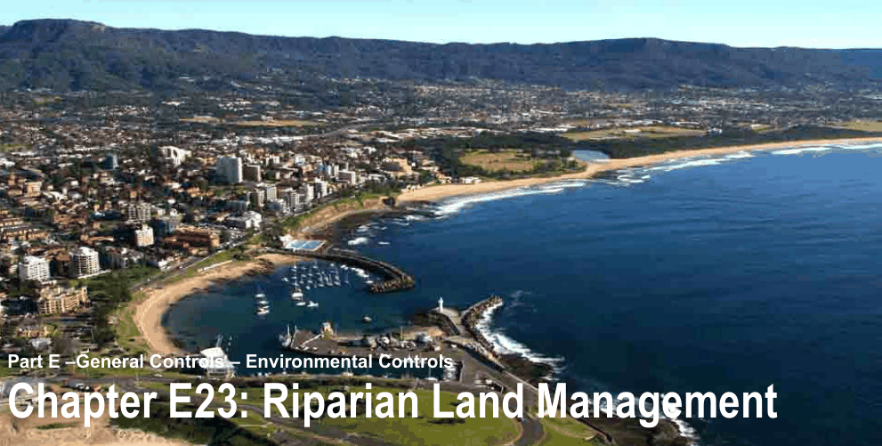

# Wollongong Development Control Plan 2009 - Chapter E23 Riparian Land Management

> This chapter is split into 11 section file(s), one per numbered heading, in the order they appear in the PDF.

Source PDF: [Wollongong-DCP-2009-Chapter-E23-Riparian-Land-Management.pdf](https://planfortomorrow.sharepoint.com/sites/Planfortomorrow/Shared%20Documents/00%20NSW-Planning-Resources/dcp/wollongong-development-control-plan-2009/chapter-e23-riparian-land-management/Wollongong-DCP-2009-Chapter-E23-Riparian-Land-Management.pdf)

> [Picture on page 1: a picture, saved as a picture (images/chapter-e23-riparian-land-management-page-1-1.gif, 150 dpi).]

#### Part E –General Controls – Environmental Controls

### Chapter E23: Riparian Land Management

> The PDF's contents list (page numbers of the printed document) is not repeated here - see Sections below.

#### Document Control

|  | Document ID: Wollongong DCP 2009 – Chapter E23: Riparian Land Management |  |  |
|---|---|---|---|
| Rev No | Adoption Date | In Force Date | Revision Details |
| 0 | 15/12/2009 | 1/3/2010 | Adopted |
| 1 | 18/07/2022 | 22/8/2022 | Revised and updated |

<!-- sections -->
## Sections

1. [1 INTRODUCTION](01-introduction.md)
2. [2 BACKGROUND](02-background.md)
3. [3 PURPOSE](03-purpose.md)
4. [4 LAND TO WHICH THIS CHAPTER APPLIES](04-land-to-which-this-chapter-applies.md)
5. [5 DEVELOPMENT TO WHICH THIS CHAPTER APPLIES](05-development-to-which-this-chapter.md)
6. [6 OBJECTIVES](06-objectives.md)
7. [7 RELATED LEGISLATION](07-related-legislation.md)
8. [8 RELATIONSHIP TO CLAUSE 7.4 OF WOLLONGONG LOCAL ENVIRONMENTAL PLAN 2009](08-relationship-to-clause-7-4-of-wollongong.md)
9. [9 RELATIONSHIP TO OTHER DCP CHAPTERS AND COUNCIL MANUALS](09-relationship-to-other-dcp-chapters-and.md)
10. [10 DEVELOPMENT CONTROLS](10-development-controls.md)
11. [11 DEVELOPMENT APPLICATION INFORMATION](11-development-application-information.md)
