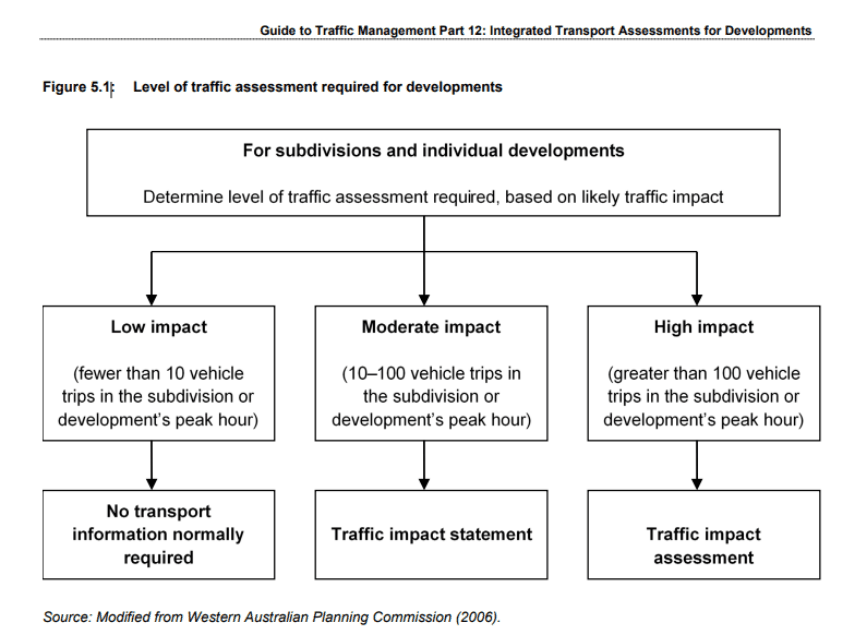

## 8. DEVELOPMENT APPLICATION INFORMATION REQUIREMENTS

The following information may be required to be submitted by the applicant in support of a development application – these studies/plans must be prepared by a suitably qualified and experienced consultants.  The need for this information will be determined by Council at the pre-lodgement phase and the level of Traffic Assessment is to be determined by Austroads Guide to Traffic Management Part 12: Figure 5.1:

• Car Parking and Traffic Impact Assessment Study

• Intersection and/or network modelling of potential traffic impacts of the proposed development (including submission of electronic modelling files to Council)

• Preliminary/Final Construction Traffic Management Plan

• Public Transport Study

• Travel Plan

• Noise Impact Assessment

• Geotechnical Report

• Hydro-geological Report

• Landscape Concept Plan

Note: Guide to Transport Impact Assessment (TfNSW 2024) contains methodology guidance.

> [Picture on page 25: a picture, saved as a picture (images/chapter-e3-car-parking-access-servicing-loading-facilities-a-page-25-1.gif, 150 dpi).]

Figure 1 – Austroads Guide to Traffic Management Part 12 - Figure 5.1
