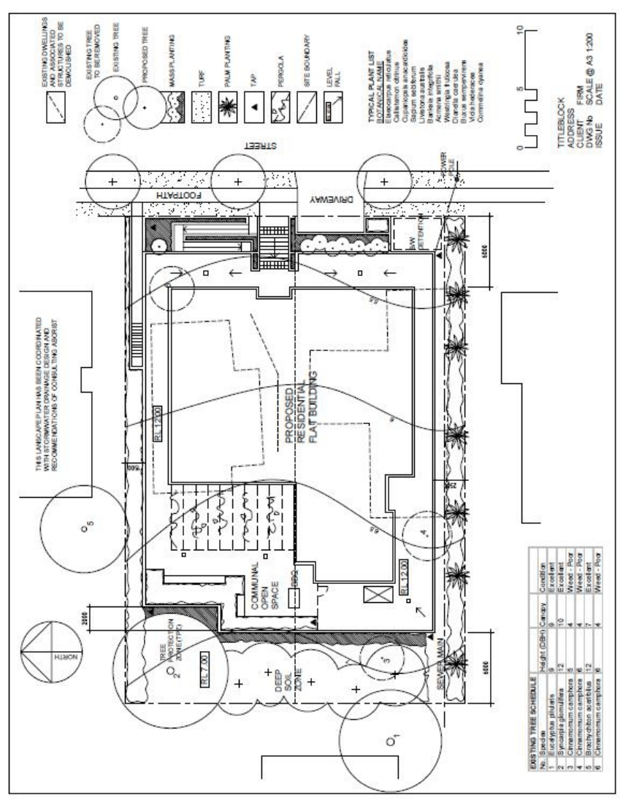

## 4 MINIMUM INFORMATION REQUIREMENTS TO ACCOMPANY A DEVELOPMENT APPLICATION

1\. Table 1 outlines the requirements to accompany a Development Application for different types of development:

Table 1: Landscape Requirements at Development Application Stage

| Development Type | Required | Category |  |  |
|---|---|---|---|---|
|  |  | 1 | 2 | 3 |
| Residential Subdivision (Two (2) Lots) | Site and Context Analysis | x |  |  |
| Residential Subdivision (Up to 10 Lots inclusive) | Landscape Concept Plan |  | x |  |
| Residential Subdivision (> 10 Lots) | Landscape Concept Plan |  |  | x |
| Dual Occupancy (Attached or Detached) | Landscape Concept Plan and Site and Context Analysis |  | x |  |
| Multi-dwelling Development (Up to 10 dwellings inclusive) | Landscape Concept Plan |  | x |  |
| Multi-dwelling Development (> 10 dwellings) | Landscape Concept Plan |  |  | x |
| Residential Flat Building | Landscape Concept Plan |  |  | x |
| Mixed Use Developments | Landscape Concept Plan |  |  | x |
| Business or Retail Development (< $1 million) | Landscape Concept Plan |  | x |  |
| Business or Retail Development (> $1 million) | Landscape Concept Plan |  |  | x |
| Community, educational, health, aged care/housing, tourism, Child Care facilities, Place of Public Worship | Landscape Concept Plan |  |  | x |
| Industrial Development (excluding minor alterations and additions to existing building) | Landscape Concept Plan |  |  | x |
| Industrial Development (minor alterations and additions to existing building) | Landscape Concept Plan |  | x |  |
| Telecommunications and Radiocommunications Facilities | Landscape Concept Plan |  |  | x |
| Development in the Illawarra Escarpment | Landscape Concept Plan |  |  | x |
| Rural Development | Landscape Concept Plan |  | x |  |

| Category | Qualifications required by Landscape Designer |
|---|---|
| 1 | No formal qualifications required. |
| 2 | Landscape Architect or Landscape Designer with Landscape Associate Diploma or similar and at least 3 years postgraduate experience in landscape design. |
| 3 | Registered Landscape Architect or eligible for registration with the Australian Institute of Landscape Architects. |

### 4.1 Site and Context Analysis Plan

1\. Site and Context Analysis Plan is critical in providing the foundation of landscape design for smaller development types outlined in Table 1.

2\. Information to be included in the Site and Context Analysis is contained in the following Site and Context Analysis Checklist:

#### Site and Context Analysis Plan – Landscaping Checklist

Information in the Site and Context Analysis must be prepared accordance with Chapter A1 Clause 9 Site and Context Analysis as well as:

Trees and vegetation

• Tree survey including existing trees on the site and trees on adjacent properties that will be affected by the development,

• All trees must be accurately located by a registered surveyor,

• Show the trunk location and level to AHD,

• Show an accurate portrayal of the canopy spread,

• Inner and outer bushfire protection zone areas and any trees requiring removal as a result,

• Should the land be bushfire prone the landscape plan must be coordinated with the Arborist Report and in accordance with the Planning for Bushfire Protection Guidelines.

Developers are to involve an arborist in the initial stages of planning a development to determine which trees are suitable to be retained. Suitability of a tree should be based on the following:

• Tree's health,

• Amenity value,

• Ability of the tree to cope with changes to the site conditions,

• Significance of the tree,

• The location of the tree on the site, and

• Extent of the protection zone that would be required (an area in which no building, excavation, service lines or level changes must occur)

### 4.2 Landscape Concept Plan

1\. The lodgement of a Landscape Concept Plan is required for certain development types as outlined in Table 1.

2\. The Landscape Concept Plan should outline the overall landscape objectives and the context of the surrounding urban and landscape setting.

3\. The minimum information requirements for a Landscape Concept Plan are listed below:

#### Landscape Concept Plan – Checklist

1\. Drawn to scale,

2\. Landscape Consultant declaration in relation to the compatibility of the landscape plan with the stormwater and bushfire documentation.

3\. Existing site information and proposed development as per Chapter A1 Clause 9 Site and Context Analysis

4\. Drainage/Bushfire/Arborist report must be coordinated where appropriate.

5\. Proposed Landscape Design:

• Suggested plant species list suitable with site conditions e.g. acid sulphate soils, overshadowing throughout the day etc;

• Location of various planting layers including groundcovers, shrubs, trees and palms showing canopy at maturity;

• Location of proposed drainage including subsurface and surface drainage, stormwater detention basins, and water quality control devices – in concept form only;

• Landscape areas outside the building envelope, balcony planting, roof gardens and internal courtyards etc, and their proposed treatment (e.g. mass planting beds, paving, lawn, water etc);

• Design details for special situations in concept form e.g. raised planting bed sections, creeks and watercourse treatment and weed eradication; and

• Proposed surface treatment of landscaped areas (e.g. paving, driveways, mulched planted areas, edging, turfed)

• All retaining walls including levels top and bottoms of walls.

\* Landscaping maintenance is required to be undertaken for a minimum of 6 months after completion of the development unless otherwise specified by Council.

\* For large sites with extensive planting that may or will require regular pruning or maintenance, or for sites including a green roof or wall, a “Maintenance Schedule” should be prepared detailing the types of works that will be required to maintain the Landscape Plan once approved.

> [Picture on page 8: a picture, saved as a picture (images/chapter-e6-landscaping-page-8-1.gif, 150 dpi).]

Figure 1: Example Only - Landscape Concept Plan
