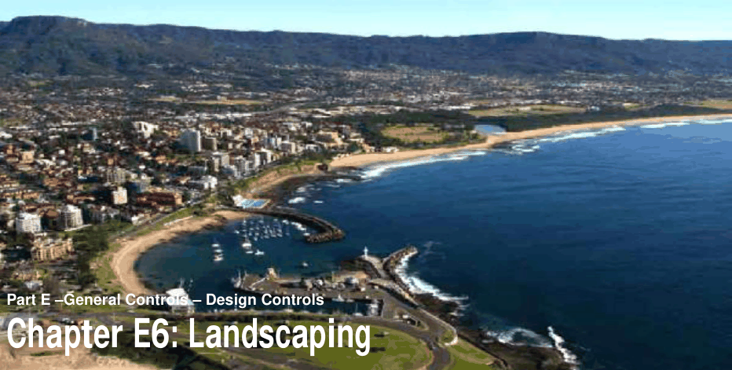

# Wollongong Development Control Plan 2009 - Chapter E6 Landscaping

> This chapter is split into 15 section file(s), one per numbered heading, in the order they appear in the PDF.

Source PDF: [Wollongong-DCP-2009-Chapter-E06-Landscaping.pdf](https://planfortomorrow.sharepoint.com/sites/Planfortomorrow/Shared%20Documents/00%20NSW-Planning-Resources/dcp/wollongong-development-control-plan-2009/chapter-e6-landscaping/Wollongong-DCP-2009-Chapter-E06-Landscaping.pdf)

> [Picture on page 1: a picture, saved as a picture (images/chapter-e6-landscaping-page-1-1.gif, 150 dpi).]

#### Part E –General Controls – Design Controls

### Chapter E6: Landscaping

#### Contents

### 6.3 Retaining walls

9

<!-- sections -->
## Sections

1. [1 INTRODUCTION](01-introduction.md)
2. [2 OBJECTIVES](02-objectives.md)
3. [3 DEFINITIONS](03-definitions.md)
4. [4 MINIMUM INFORMATION REQUIREMENTS TO](04-minimum-information-requirements-to.md)
5. [8 POST DEVELOPMENT CONSENT](05-8-post-development-consent.md)
6. [5 NEIGHBOURHOOD AMENITY AND CHARACTER 7 8.2 Maintenance](06-5-neighbourhood-amenity-and-character-7-8.md)
7. [6 GENERAL LANDSCAPING REQUIREMENTS 8](07-6-general-landscaping-requirements-8.md)
8. [1 INTRODUCTION](08-1-introduction.md)
9. [2 OBJECTIVES](09-2-objectives.md)
10. [3 DEFINITIONS](10-3-definitions.md)
11. [4 MINIMUM INFORMATION REQUIREMENTS TO ACCOMPANY A DEVELOPMENT APPLICATION](11-4-minimum-information-requirements-to.md)
12. [5 NEIGHBOURHOOD AMENITY AND CHARACTER](12-5-neighbourhood-amenity-and-character.md)
13. [6 GENERAL LANDSCAPING REQUIREMENTS](13-6-general-landscaping-requirements.md)
14. [7 CAR PARKING AREAS](14-7-car-parking-areas.md)
15. [8 POST DEVELOPMENT CONSENT](15-8-post-development-consent.md)
